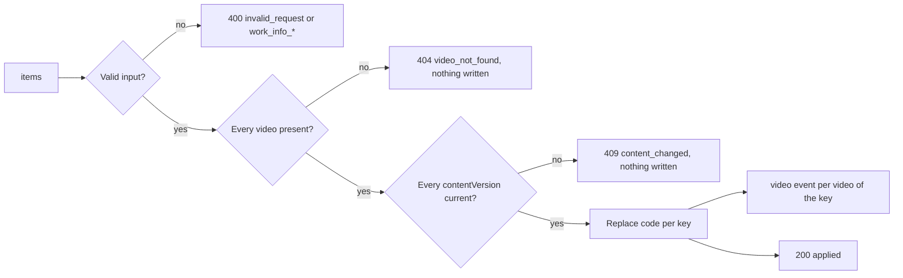

# Contract: video code edits

Source of truth: [api/openapi.yaml](../../../api/openapi.yaml), operations
`summarizeVideoCodeEdits` and `applyVideoCodeEdits`. Both are owner-only,
answer `Cache-Control: no-store`, and take the selection as `videoIds` plus
`smartFolderIds`, resolved as `summarizeVideoEdits` resolves them.

## `POST /api/video-code-edits/summary`

Resolves the selection into one row per user key, so the editor can show each
video's code or its file name as a suggestion.

| Field | In | Type | Required | Meaning |
| --- | --- | --- | --- | --- |
| `videoIds` | body | `integer[]` | yes, may be empty when `smartFolderIds` is not | Selected videos, including each selected group's members |
| `smartFolderIds` | body | `integer[]` | no | Smart folders resolved to their current members at request time |

**Response**: `200` with `VideoCodeEditSummary`: `rows`, in the order the
resolved videos were first listed, each `{ video, code? }` where `video` is the
owner list-item `Video` shape of the key's shown video (the bundle's
representative) and `code` the key's current code, absent when there is none.
A row of a virtual video has `video.virtual` true and no `video.fileTitle`.

| Status | `code` | When |
| --- | --- | --- |
| `400` | `too_many_videos` | Fewer than 1 or more than 1,000 distinct videos after smart folders are resolved; `limit` is 1000 |
| `403` | `forbidden` | The viewer is not the owner |

## `POST /api/video-code-edits`

Writes one code per row in one transaction, keeping every other work-information
field of each key.

The diagram shows the outcomes the editor handles.

| Field | In | Type | Required | Meaning |
| --- | --- | --- | --- | --- |
| `items` | body | `array`, 1–1,000 | yes | One per row to write; a video ID listed twice returns `400 invalid_request` |
| `items[i].videoId` | body | `integer` | yes | The row's shown video; a bundle member maps to its bundle's key |
| `items[i].contentVersion` | body | `string` | yes | The row's `video.contentVersion` from the summary; it checks that the ID still names the video the row showed, since SQLite can reuse a deleted video's ID |
| `items[i].code` | body | `string` | yes | The new code: trimmed, 1–100 code points, no control characters, as `WorkInfo.code` |

**Response**: `200` with `VideoCodeEditResponse`: `applied`, the number of
keys whose code changed; a key whose code already equals the item's counts as
unchanged.

| Status | `code` | When |
| --- | --- | --- |
| `400` | `invalid_request` | No items, over 1,000 items, a repeated `videoId` or two items on one key; `field` names the item |
| `400` | `work_info_empty`, `work_info_too_long`, `work_info_control_characters` | A code empty after trimming, over 100 code points or with a control character; `field` is `items[i].code` |
| `403` | `forbidden` | The viewer is not the owner |
| `404` | `video_not_found` | A video is missing, hidden or merged away; `field` is `items[i].videoId`, and nothing is written |
| `409` | `content_changed` | A video's `contentVersion` differs from the item's, as when its ID now names another video; `field` is `items[i].contentVersion`, and nothing is written |

## Client use

The bar sends the summary before opening the editor and shows a `400` as a
toast. The editor sends only the rows whose value is non-empty and differs
from the row's `code`, each with its `video.contentVersion`, keeps its values
on any error and names the row the error's `field` points at. After `200` it closes and clears the list
snapshot; the cards read their `cardCredits` again on the `video` events.
