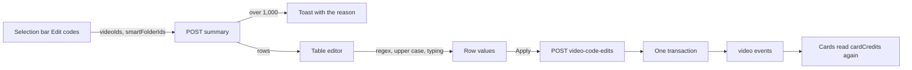
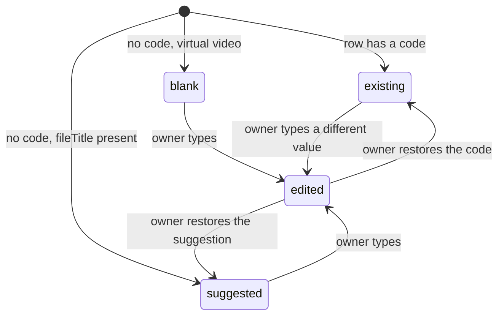

# Implementation Plan: Edit the codes of selected videos in a table

**Branch**: `feature/059-bulk-code-edit` | **Parent Issue**: #1634

**Input**: The parent Issue. It is this feature's specification.

## Summary

`Edit codes` on the list selection bar opens a full-screen table, one row per
selected video, that shows each video's code or, when it has none, its file
name without the extension as a suggestion; a regular expression, an
upper-case option and hand edits shape the suggestions, and one request writes
every changed row's code in a single transaction. Two owner-only endpoints
carry it: `POST /api/video-code-edits/summary` resolves the selection into
rows, and `POST /api/video-code-edits` writes the codes
([contracts/video-code-edits.md](contracts/video-code-edits.md)). The
regular expression runs in the browser, so the table follows the input as it
is typed.

## Technical Context

**Canonical definitions**: [ARCHITECTURE.md](../../ARCHITECTURE.md) for
layers, store roles and viewer classification;
[api/openapi.yaml](../../api/openapi.yaml) for the screen API;
[bulk-editing.md](../../docs/design-docs/bulk-editing.md) for the existing
editor over a selection and its target resolution;
[library-ui.md, Selection bar](../../docs/design-docs/library-ui.md#selection-bar)
for the bar's items; [catalog-organization.md](../../docs/design-docs/catalog-organization.md)
for user keys, bundles and virtual videos;
[`work_info.go`](../../internal/domain/work_info.go) for the code rule
(trimmed, no control characters, at most 100 code points);
[design-system.md](../../docs/design-docs/design-system.md) and
[patterns.md](../../web/registry/rules/patterns.md) for the screen's parts;
[testing.md](../../docs/design-docs/testing.md) and
[web-testing.md](../../docs/design-docs/web-testing.md) for test levels.

**Feature-specific context**:

| Item | Delta |
| --- | --- |
| Limit | 1,000 distinct videos per editor, below the 20,000 of the other bulk actions; the Issue sets it because every row is an input field |
| Regular expression dialect | JavaScript `RegExp` (`u` flag), not Go RE2, because the expression runs in the browser |
| Code list items carry | `fileTitle` and `virtual` are already in owner list items; the current code is read through the summary, since `workInfo` is absent from lists |

## Constitution Check

*GATE: Must pass before Phase 0 research. Re-check after Phase 1 design.*

| Rule | Source | Verdict |
| --- | --- | --- |
| Domain decides, store enforces | ARCHITECTURE.md, Cross-cutting invariants | The code rule stays `domain.NormalizeWorkInfo`'s text rule, exported for one field; the store only re-reads the targets in its transaction |
| One role per operation | ARCHITECTURE.md, Store roles | Both operations join `VideoEditStore`, which owns edits over a selection ([Rows are resolved on the server](#rows-are-resolved-on-the-server)) |
| Every read knows its viewer | ARCHITECTURE.md | Both paths are owner-only in `router.go`'s path list and `security` in `api/openapi.yaml`; the existing Go test checks they agree |
| User data survives a rebuild | ARCHITECTURE.md | The code is written to the user key's work-information row, as the single write does; no new table |
| Pages never call `fetch` | ARCHITECTURE.md, Web layer | A new `web/src/api/videoCodeEdits.ts` module is the only caller |
| Design system | design-system.md | The screen composes `FormPageDialog` and `DataTable`; `ui-design.md` adds a missing part to the registry first |
| Complexity 25 and no copies | AGENTS.md | Target resolution reuses `resolveVideoTargets` with the limit as a parameter instead of a second copy |

No gate is at stake after Phase 1; `## Complexity Tracking` is left out.

## Rows are resolved on the server

The summary endpoint turns the selection (video IDs plus smart-folder IDs) into
rows, one per user key, each carrying the shown video and the current code;
the client never expands a smart folder or a bundle.

The diagram shows one edit from the bar to the refreshed cards.



| Decision | Rejected | Why |
| --- | --- | --- |
| New endpoints `POST /api/video-code-edits/summary` and `POST /api/video-code-edits` | A `codes` part in `POST /api/video-edits` | That request sets one value on every target and counts values; this one carries a value per video and lists rows, and has its own limit |
| One row per user key, shown as the bundle's representative, sent back as that video's ID | One row per video | The code is user data of the key, so two rows for one bundle would write the same row twice ([video-versions.md](../../docs/design-docs/video-versions.md)) |
| The limit counts the distinct resolved videos before bundling, on the server, as `too_many_videos` with `limit` 1000 | Counting rows after bundling | The Issue counts videos, and the client's pre-check can only count the videos it knows; the same rule on both sides keeps the pre-check honest |
| The bar fetches the summary before it opens the editor, and shows a `400` as a toast | Opening the editor in a loading state as `Edit` does | The Issue requires that an over-limit selection does not open the editor |
| Both operations in `VideoEditStore` | A new `VideoCodeStore` role | They are edits over a selection with the same target resolution; a new role would hold two methods and its own fixtures |
| The write replaces only `code` of each key's work information and keeps the rest | `WorkInfoStore.SetMany` | `SetMany` replaces the whole record, so the client would have to send people, dates and links it never read |
| A missing or merged video answers `404 video_not_found` with `field` `items[i].videoId` and writes nothing | Skipping missing videos as `POST /api/video-edits` does | The owner edited that row by hand; dropping it silently loses the value, and the Issue asks for a reason instead |
| Each item carries the row's `video.contentVersion`; the store compares it with the video's in the transaction and answers `409 content_changed` with `field` `items[i].contentVersion`, writing nothing | Sending only `videoId` | `videos.id` is a rowid SQLite can reuse after a delete, so a deleted video's ID can name a new video; the check the virtual-video save uses ([catalog-organization.md](../../docs/design-docs/catalog-organization.md)) makes that row fail instead of writing into the new video |
| The code itself is not versioned: the last write wins | Sending the code the row read and rejecting a changed one | The Issue chooses last-write-wins for a code changed elsewhere; the `contentVersion` check guards the video's identity, not its code |
| No activity entry | A `done` entry per video | The single `PUT /api/videos/{id}/work-info` writes none ([activity.md](../../docs/design-docs/activity.md#owner-operations-write-a-done-entry-per-video)); the two writes stay equivalent |

## Suggestions and the regular expression are computed in the browser

A pure module (`web/src/library/codeEdit/rows.ts`) derives each row's value
from the summary, the pattern, the replacement, the upper-case option and the
owner's typed values; the table shows the result as the inputs change.

The diagram shows the states a row moves through.



| Row | Value | Pattern, replacement and upper case | Written on Apply |
| --- | --- | --- | --- |
| `existing` | The current code | Not applied | No |
| `suggested` | `fileTitle` through the pattern, then upper case | Applied | Yes, when not empty |
| `blank` | Empty | Not applied | No |
| `edited` | What the owner typed, trimmed | Not applied | Yes, when not empty and different from the current code |

A row that is empty after trimming is left out of the request, so this screen
never clears a code. Two rows with the same final value both carry a
duplicate warning and stay writable. A value over 100 code points is cut to
100 and the row says so.

| Decision | Rejected | Why |
| --- | --- | --- |
| The regular expression runs in the browser with JavaScript semantics: an empty replacement extracts group 1, else the whole match; a replacement uses `$1` references through `String.prototype.replace` | Evaluating on the server | A preview per keystroke would be a request per keystroke, and Go's RE2 lacks look-around the owner may type; the written value is validated on the server either way |
| A row the owner typed in leaves the pattern's reach until the suggestion is restored | The pattern overwrites typed rows | The owner fixes single rows after shaping the rest; a later pattern change must not undo that |
| A pattern that does not match leaves the file-name suggestion | Emptying the row | The Issue keeps the suggestion, and an empty row would silently drop the video from the write |
| An invalid pattern shows the error at the field and freezes the suggestions at their last valid values | Clearing the suggestions | Typing a pattern passes through invalid states on every keystroke |
| Trimming follows the details editor; control characters are rejected by the server, which names the row (`field` `items[i].code`) | Stripping control characters in the browser | The single editor does not strip them either, so one rule stays in `internal/domain` |
| Upper case uses locale-independent `toUpperCase()` | `toLocaleUpperCase` | A product code must not change with the browser locale (dotted I in Turkish) |

## The editor is a modal table over the list

The editor is a `FormPageDialog` over the list page whose body is a
`DataTable` of the rows, with the pattern, the replacement and the upper-case
switch above it and `Apply to N videos` in the header band. The design stage
writes the screen in `ui-design.md`; the decisions below fix the skeleton it
composes.

| Decision | Rejected | Why |
| --- | --- | --- |
| A `FormPageDialog` over the list, as `Edit` is | A route of its own | Leaving the list drops its selection and loaded pages ([bulk-editing.md](../../docs/design-docs/bulk-editing.md#the-fields-fill-the-screen-and-the-targets-sit-in-a-narrow-column)) |
| A `DataTable` with one input per row | One `FormRow` per video | A thousand labelled fieldsets do not line up the file name and the value for comparison; a table does |
| Rows render without virtualization; thumbnails load lazily | `@tanstack/react-virtual` | The cap is 1,000 fixed-height rows; a virtualizer breaks Tab order between inputs and the browser's find |
| The aside holds the pattern, the replacement, the upper-case switch and the counts; it does not list targets to leave out | The target rows with `leave out`, as `Edit` has | Emptying a row already leaves the video out of the write |

## Project Structure

### Documentation (this feature)

```text
specs/059-bulk-code-edit/
├── plan.md                        # This file
└── contracts/
    └── video-code-edits.md        # The two endpoints this feature adds
```

`research.md` is not created: the decisions above name their alternatives and
need no investigation record. `data-model.md` is not created: no entity or
field changes, the code stays in the work-information row of the user key.
`quickstart.md` is not created: the checks in `## Implementation Work` and the
visual review owed by the screen unit cover the acceptance criteria.
`ui-design.md` is written by the design stage, since the parent carries `ui`.

### Source Code

**Affected boundaries**:

| Boundary | Change |
| --- | --- |
| `api/openapi.yaml` | Two operations, their schemas and error codes; `task generate` |
| `internal/domain` | An exported code normalization for one field and the `VideoCodeEdit` input type with its validation (distinct video IDs, 1–1,000 items) |
| `internal/store` | `VideoEditStore.CodeSummary` and `VideoEditStore.ApplyCodes` in a new `video_code_edits.go` |
| `internal/httpapi` | `video_code_edits.go` handlers; `resolveVideoTargets` takes the limit; the owner-only path list in `router.go` |
| `web/src/api` | `videoCodeEdits.ts`, the only caller of the two endpoints |
| `web/src/library/codeEdit/` | `rows.ts` (pure derivation), the editor and its table rows, the bar action |
| `web/src/library/SelectionBar.tsx`, `web/src/i18n/en.ts` | The `Edit codes` item and its text |
| `docs/design-docs/bulk-editing.md`, `library-ui.md` | The code editor section, the replaced rejection and the bar item |

**New paths**: `internal/store/video_code_edits.go`,
`internal/httpapi/video_code_edits.go`, `web/src/api/videoCodeEdits.ts`,
`web/src/library/codeEdit/`.

**Structure decision**: the code editor sits beside `bulkEdit/` as its own
directory, because it shares the bar and the target shape with `Edit` but no
field or draft code; the design document grows a section instead of a new
file, because requirement 14 replaces a rejection recorded there.

## Implementation Work

### Read and write the codes of a selection through the API

**Scope**: The two operations in
[contracts/video-code-edits.md](contracts/video-code-edits.md): the schema,
generated code, the domain input type and code normalization, the two
`VideoEditStore` methods and the handlers, including the owner-only
classification and the 1,000 limit through `resolveVideoTargets`
([Rows are resolved on the server](#rows-are-resolved-on-the-server)).

**Dependencies**: None

**Acceptance**:

- `task generate` leaves no diff; `task check SCOPE=go` passes for
  `./internal/domain/... ./internal/store/... ./internal/httpapi/...`.
- Store tests (SQLite, the boundary under test): a bundle gives one row with
  the representative's `fileTitle` and the key's code; a virtual video's row
  has no `fileTitle`; the write changes only `code` and keeps the key's people,
  dates and links; an item whose video is missing writes nothing and returns
  the index; an item whose `contentVersion` differs from its video's, as
  after a deleted virtual video's ID is reused, writes nothing and returns
  `ErrContentChanged` with the index; two items on one key return
  `invalid_request`; events are the
  single write's `VideoWorkInfoChanged` per video of the key.
- Domain tests: 0 and 1,001 items, a repeated video ID, a code of 100 and 101
  code points, a control character, each accepted or rejected as the contract
  says.
- HTTP tests with a fake store: 1,001 resolved videos answer
  `400 too_many_videos` with `limit` 1000 and no store call; a missing video
  maps to `404 video_not_found` with `items[i].videoId` and a changed one to
  `409 content_changed` with `items[i].contentVersion`; the owner-only
  classification test covers both paths.

### Derive the code table rows from the selection and the pattern

**Scope**: `web/src/library/codeEdit/rows.ts`: row states, the pattern and
replacement rule, upper case, trimming, truncation to 100 code points,
duplicate detection, the invalid-pattern state and the list of items Apply
sends ([Suggestions and the regular expression are computed in the browser](#suggestions-and-the-regular-expression-are-computed-in-the-browser)).
Uses the generated request and response types.

**Dependencies**: Read and write the codes of a selection through the API

**Acceptance**: Logic tests (`task check SCOPE=web` on the directory) for each
rule with the Issue's values: `[A-Z]+-\d+` with an empty replacement turns
`[xxx] ABC-123 1080p` into `ABC-123` and leaves an existing code and a
non-matching row as they were; `$1` substitutes the capture; upper case turns
`abc-123` into `ABC-123` on suggested rows only; two equal values mark both
rows; a 101-code-point value is cut to 100 and flagged; an invalid pattern
reports the error and keeps the last values; the items list holds suggested
and edited non-empty rows only, with no row whose value equals its code.

### Show the code editor table with suggestions and the pattern controls

**Scope**: The editor component under `web/src/library/codeEdit/`: the
`FormPageDialog`, the `DataTable` rows (thumbnail, title, file name, input,
state marks), the pattern, replacement and upper-case controls, the counts and
the `Apply to N videos` button, following `ui-design.md`
([The editor is a modal table over the list](#the-editor-is-a-modal-table-over-the-list)).
Takes the summary rows as props and emits the items to apply; it sends no
request.

**Dependencies**: Derive the code table rows from the selection and the
pattern

**Acceptance**: Component tests: existing rows show the code and suggested
rows the file name, distinguishable by their marks; typing a pattern changes
the suggested rows while the test observes the inputs; an invalid pattern
shows its error; two equal rows show the warning and Apply stays enabled; a
virtual-only selection shows `Apply to 0 videos` disabled; a cleared row
leaves the count. This unit changes a screen: the implementation reviews the
visuals and the interaction at the widths `ui-design.md` names.

### Add Edit codes to the selection bar and apply the table

**Scope**: The `Edit codes` item on the bar with its pre-check and reason, the
summary request before opening, the apply request, the failure notice that
keeps the inputs, the success toast, closing and the list refresh
(`clearListSnapshot`, smart-folder cards re-read); `web/src/api/videoCodeEdits.ts`;
`en.ts`; the section in `bulk-editing.md` replacing the rejection of codes in
bulk editing, and the bar item in `library-ui.md`.

**Dependencies**: Show the code editor table with suggestions and the pattern
controls

**Acceptance**: Page tests with the fake server
(`web/src/library/*.test.tsx`): the bar's item opens the editor with the
summary rows; a `400 too_many_videos` summary shows the reason and no dialog;
Apply sends only the changed and suggested rows and, on `200`, closes, toasts
the count and refreshes the cards whose `video` event arrives through the fake
event source; a `404` or `409` keeps the dialog and its values and shows the
reason.
`task check-docs` passes; `bulk-editing.md` no longer lists codes as rejected.
This unit changes a screen: the implementation reviews the bar at the width
where its items wrap.
