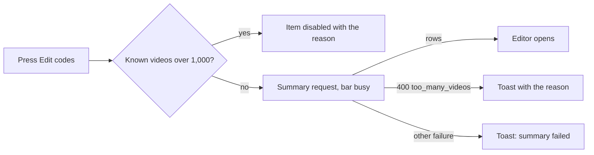
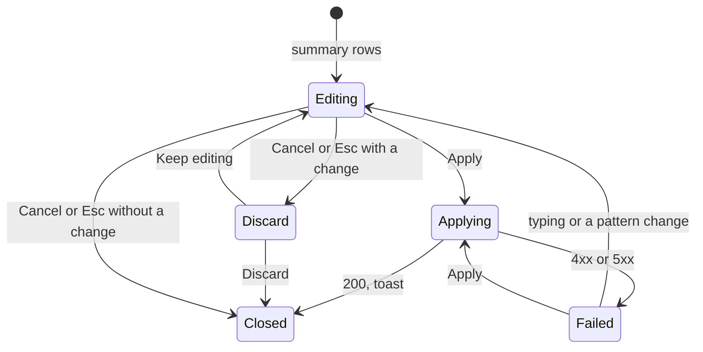

# UI design: Edit the codes of selected videos in a table

**Feature**: [parent Issue #1634](https://github.com/syudead/vv/issues/1634) ·
[plan.md](plan.md) ·
[contracts/video-code-edits.md](contracts/video-code-edits.md)

Sources that already decide things, linked rather than repeated here:

| Topic | Source |
| --- | --- |
| Tokens, closed scales, library density | [design-system.md, Foundations](../../docs/design-docs/design-system.md#foundations); the values in `@theme` of [`web/src/ui/tokens.css`](../../web/src/ui/tokens.css), named here and never copied |
| `FormPageDialog`: the band, the `notice`, the `aside`, the panels, Esc and `Cancel` | [patterns.md, Form page](../../web/registry/rules/patterns.md#form-page), and `Edit` as its one use ([bulk-editing.md](../../docs/design-docs/bulk-editing.md#the-fields-fill-the-screen-and-the-targets-sit-in-a-narrow-column)) |
| `DataTable`, `SelectionBar`; the state blocks | [patterns.md, Sections](../../web/registry/rules/patterns.md#sections), [States](../../web/registry/rules/patterns.md#states) |
| `Table`, `Input`, `Field`, `Checkbox`, `Badge`, `Alert`, `Tooltip`, `Sonner`, `VideoThumbnail`; disabled is `opacity-50` everywhere | [components.md](../../web/registry/rules/components.md) |
| The bar's items, their order, the disabled reason and the 20,000 limit of the other actions | [library-ui.md, Selection bar](../../docs/design-docs/library-ui.md#selection-bar) |
| The list view's row: the thumbnail cell `w-list-thumb-cell`, the title `text-sm font-medium` clamped to two lines | `VideoRow` in [`web/src/videoList/VideoCard.tsx`](../../web/src/videoList/VideoCard.tsx) |
| The row states, the pattern rule, trimming and truncation | [plan.md, Suggestions and the regular expression are computed in the browser](plan.md#suggestions-and-the-regular-expression-are-computed-in-the-browser) |
| Discarding a draft (`Discard these changes?`) | `Edit`'s `ConfirmDialog` in [`BulkEditor.tsx`](../../web/src/library/bulkEdit/BulkEditor.tsx) |
| Screen text | [`web/src/i18n/en.ts`](../../web/src/i18n/en.ts) (`library.bulkEdit`, `library.selection`, `errors.reason`); this feature adds the words below under `library.codeEdit` |

This feature adds one item to the selection bar, `Edit codes`, and the
full-screen table it opens (requirement 1). The table's rows, their values
and the pattern rule are decided in the plan; this document decides how the
screen shows them: what a row looks like, how its state is marked, where the
pattern controls and the counts sit, and what the screen does at each width
and in each state.

## Why this shape

The table is the body of a `FormPageDialog` whose single panel spans the
width beside the aside, and the pattern controls sit in the aside, not above
the table. The owner's work is one pass: type a pattern, watch a thousand
rows change, fix a few by hand, apply. With the controls in the aside they
stay in view from `lg` while the table scrolls, and the aside's counts sit
under the controls that change them (`UI品質`, the regular expression's result
visible while typing). Controls above the table were rejected: at 1,000 rows
they scroll away with the header row, so changing the pattern after reading
row 400 means scrolling back up. Holding inputs, this aside departs from
the `form-page` slot rule, which keeps the aside read only; the rule changes
for `FormPageDialog` as [Changes to the design system](#changes-to-the-design-system)
records.

A row is four readable things in one line, in the order the eye needs them:
the thumbnail and the title say which video, the file name is the source,
the input is the result, and the state mark says what Apply will do with it
(`UI品質`, the first point). The file name has its own column rather than a
line under the title, so the source and the result sit side by side at the
same height and a wrong extraction is seen without reading the title at all.
A card grid of inputs was rejected because it cannot line up the source
and the result across rows; one `FormRow` per video was rejected in the plan.

A state mark means "Apply writes this row", and a row carries one exactly
when it is in the request plan.md defines: `Suggested` on a suggested row
with a non-empty value, `Changed` on an edited row whose value is not empty
and differs from the current code. Every other row carries no mark: a row
with the current code and nothing typed, a virtual video's empty row, and an
edited row that is empty or was typed back to its current code. The number
of marked rows is therefore the number on the `Apply` button, and the owner
can check one against the other by looking. A mark on every row (`Existing`, `Blank`) was rejected: in the
common case, a selection of videos without codes, every row would carry
`Suggested`, and a column of 1,000 identical badges says nothing. The
suggested value is further set apart from a typed or existing value by
its text colour: the input of a `Suggested` row shows its value in
`text-muted-foreground`, as a value the owner has not confirmed, and turns
`text-foreground` the moment it is typed in. That is the distinction
requirement 5 asks for, visible on the input itself without the mark.

The warnings (`Duplicate`, `Cut to 100`) are `warning` badges with an icon
beside the row's state mark, not a line under the row: they do not stop
Apply (requirements 9 and 10), so they must not break the rows' rhythm, and
a badge in a fixed column is scanned down a long table in one glance. The
aside repeats the duplicate count as one `warning` line so the owner learns
about a duplicate on row 800 without scrolling to it.

The upper-case option is a `Checkbox`, not a `Switch`: it is a choice inside
a form that is saved with `Apply` ([components.md, Checkbox and Switch](../../web/registry/rules/components.md#checkbox-and-switch)),
even though the table shows its effect at once.

An edited row has `Restore`, a `ghost` `icon-sm` button, so a hand edit can
be undone after the pattern changed and the suggestion is no longer known.
Returning a row to `Suggested` by retyping the suggestion would be guesswork,
and clearing the row leaves the video out of the write, which is a different
thing (requirement 11).

The bar does not open the editor until the summary has answered, so an
over-limit selection shows a toast and no empty dialog (requirement 3).
While it waits the bar's actions are disabled, as the other bulk actions do
while in flight, and `Edit codes` shows its busy state; opening a loading
dialog, as `Edit` does, was rejected in the plan.

## Words

| Place | Text | Notes |
| --- | --- | --- |
| Selection bar item | Edit codes | `library.codeEdit.action`; a lucide `Hash` and the word, after `Edit` |
| Bar item disabled reason, over the limit | Select between 1 and 1,000 videos. | `errors.reason.too_many_videos` with `limit` 1000, as the tooltip and the `DisabledReason` text; the same text is the toast when the summary answers `400 too_many_videos` |
| Bar item disabled reason, no video | Select a video | Only smart folders can be selected with no video; the rows are resolved on the server, so the item stays enabled while a smart folder is selected |
| Summary failed | Couldn't read the selected videos: {reason} | Toast, `library.codeEdit.summaryFailed`, as `bulkEdit.summaryFailed` |
| Dialog title | Edit codes | The band's `h1` |
| Band detail | {N} videos | `bulkEdit.detail`, the number of rows |
| Band actions | Cancel · Apply to {N} videos | `player.detailsEditor.cancel`; `bulkEdit.apply` with the number of rows Apply writes; `Applying…` while in flight |
| Aside label and heading | Suggestions | `library.codeEdit.suggestions`; the aside's `aria-label` and its `h2` |
| Aside hint | Rows without a code show their file name. The pattern and the option change those rows only. | One `
`, `text-xs text-muted-foreground` |
| Pattern field label | Pattern | `library.codeEdit.pattern`; `FieldDescription`: Regular expression, JavaScript. The first group, or the whole match, becomes the code. |
| Replacement field label | Replacement | `library.codeEdit.replacement`; `FieldDescription`: Optional. Use $1 for a group. |
| Invalid pattern | Not a valid pattern: {message} | `FieldError` under the pattern, with the `RegExp` constructor's message; `aria-invalid` on the input |
| Upper-case option | Upper case | `Checkbox` with its `Label`, `library.codeEdit.upperCase` |
| Count line | Apply writes {N} of {M} videos | `library.codeEdit.willWrite`, `text-sm`; `N` is the number of marked rows |
| Duplicate line | {N} rows share a code | `library.codeEdit.duplicates`, `text-sm text-warning` with `TriangleAlert`; shown only while `N` is at least 2 |
| Panel legend | Codes | `library.codeEdit.codes`; the `FieldLegend` of the one panel |
| Column headers | Video · File name · Code · State | `library.codeEdit.columns.*`; the thumbnail column has an empty head, as the list view |
| Code input name | Code of {title} | The input's `aria-label`, since the column header is its only visible name |
| Virtual video's file cell | No file | `library.codeEdit.noFile`, `text-muted-foreground` |
| State mark, suggested | Suggested | `Badge` `secondary` |
| State mark, changed | Changed | `Badge` `soft` |
| Warning mark, duplicate | Duplicate | `Badge` `warning` with `TriangleAlert` |
| Warning mark, cut | Cut to 100 | `Badge` `warning` with `Scissors`; the value is 100 code points, as `WorkInfo.code` |
| Restore button | Restore | `Tooltip` and `aria-label` of the `RotateCcw` button on an edited row, marked `Changed` or not |
| Apply failed | Couldn't apply the codes: {reason} | The `notice` line, `library.codeEdit.failed`; the row the error's `field` names shows the reason again as `FieldError` under its input |
| Applied | Set the code of {N} videos | Toast, `library.codeEdit.applied`, with the response's `applied` |
| Discard | Discard these changes? · The codes in the editor aren't applied yet. | `bulkEdit.discardTitle` and `library.codeEdit.discardText`, with `Discard` and `Keep editing` |

## Changes to the design system

The `form-page` pattern changes in two rules, in its registry item,
[patterns.md, Form page](../../web/registry/rules/patterns.md#form-page) and
its example block, by the "Show the code editor table" unit before the
editor uses them.

| Change | What it is |
| --- | --- |
| A sole panel spans both panel columns | From `lg`, when `panels` holds one panel it takes both columns of `grid-cols-form-page` whether or not an `aside` is passed; today it spans them only without an aside, which would leave the table at five elevenths of the body with an empty column beside it |
| `FormPageDialog`'s aside may hold controls that shape the panel | The `aside` slot of `FormPage` stays read only. `FormPageDialog`'s aside may also hold inputs that are not saved themselves but derive the values of the panel's fields, followed by the counts of their result, as this editor's pattern, replacement and upper-case option; the slot table and the `FormPageDialog` paragraph say so, and the example block shows one such input. Without the change, the aside's `Inputs` prohibition and this design cannot both be followed |

No colour token is added and nothing is added to `pairs` in
`web/src/theme/tokens.test.ts`: the marks use the `Badge` variants, the
muted value uses `muted-foreground` on `input`, and the warning line uses
`warning` on `background`, pairs the test already holds. The icons are
lucide `Hash`, `TriangleAlert`, `Scissors` and `RotateCcw`.

## Selection bar item

`Edit codes` follows `Edit` in the bar: the same `ghost` `sm`
`SelectionAction` with `Hash` and its name at every width. Its disabled
reasons follow the bar's rule (a `Tooltip` and a `DisabledReason`), and it
is disabled while any bulk action is in flight, as the other items.

The diagram shows what pressing it does before the editor opens.

The client counts only the videos it knows (selected videos and group
members), so a selection over 1,000 known videos never sends the request,
and a selection whose smart folders push it over the limit learns so from
the response. While the request is in flight the item shows `aria-busy` with
a `Spinner` in place of its icon and the bar's actions and
`Clear selection` are disabled.

## Editor

A `FormPageDialog` with the title, the detail, `Cancel` and
`Apply to N videos` in the band, the aside at the left and one panel,
`Codes`, holding the `DataTable`. The list and its selection stay under it.

| Part | Content |
| --- | --- |
| Band | Title `Edit codes`, detail `N videos`; `Cancel` (`ghost` `sm`), then `Apply to N videos` (`default` `sm`), `aria-disabled` while `N` is 0 or a request is in flight |
| Notice | The failed-apply line, `role="alert"`, `text-sm text-destructive`, only after a failed Apply |
| Aside | The `Suggestions` heading, the hint, the `Pattern` field, the `Replacement` field, the `Upper case` checkbox, then the count line and the duplicate line; `gap-3` between the parts as the aside gives |
| Panel | The `DataTable` named `Codes`, one row per summary row in the summary's order; its column header sticks at the top of the panel from `lg` and under the band below `lg` |

### Aside

The two inputs are `sm` `Input`s in `Field`s with a visible `FieldLabel`
and a `FieldDescription`, filling the aside's width; the checkbox is a
`Field orientation="horizontal"`. The pattern is `font-mono`, the only
monospace text on the screen, so a bracket or a backslash is read as typed.
The count line and the duplicate line come last, after a `Separator`, so
the inputs read as "shape", the lines as "result".

The pattern applies as it is typed; nothing is pressed to run it. While the
pattern is invalid the `FieldError` shows under it, the input is
`aria-invalid`, and the table keeps the values of the last valid pattern
([plan.md](plan.md#suggestions-and-the-regular-expression-are-computed-in-the-browser)).
`Upper case` applies to the rows the pattern applies to and to no other.

### Table

| Column | Head | Cell |
| --- | --- | --- |
| Thumbnail | Empty | `VideoThumbnail` `w-list-thumb rounded-sm` in a `w-list-thumb-cell` cell, the image loading lazily; a virtual video shows `VirtualMark` in it, as the list view |
| Video | Video | The title, `text-sm font-medium text-foreground`, `line-clamp-2 break-all`; a bundle's row shows the representative's title and its `VersionsMark` after it |
| File name | File name | `fileTitle` in `text-xs text-muted-foreground`, `line-clamp-2 break-all`, so the whole name is readable for composing the pattern; `No file` for a virtual video |
| Code | Code | An `sm` `Input`, the column's full width, with the row's value; `text-muted-foreground` while the row is `Suggested`, `text-foreground` otherwise; `maxLength` is not set, so a long value is seen cut by the mark rather than refused at the keyboard |
| State | State | The state mark, the warning marks and the `Restore` button in one line, `gap-1`, `whitespace-nowrap`; no state mark on a row Apply does not write, and empty for an untouched existing row and an untouched virtual row |

The column widths are the table's own: the thumbnail and state columns fit
their content, and the title, file name and code columns share the rest in
the ratio 2:3:3, so the file name and the code, the two things compared,
are the widest. Cells are `p-2` as `Table` gives them; a row's height is the
thumbnail's, and a two-line title or file name does not raise it.

The tab order is the document order with no key handler: Tab moves from a
row's input to its `Restore` button when the row has one, then to the next
row's input, and Shift+Tab walks the same stops back. Only edited rows have
`Restore`, so walking a thousand rows stops on few of them. Enter in an
input does nothing (the form is applied by the button only), so the rows can
be walked without an accidental Apply.

### States

The diagram shows the editor's states and what moves it between them; a
row's own states are in [plan.md](plan.md#suggestions-and-the-regular-expression-are-computed-in-the-browser).

| State | What the screen shows |
| --- | --- |
| Editing, nothing changed | Suggested rows marked and muted, existing rows unmarked with their code, virtual rows unmarked and empty; `Apply to N videos` with `N` the marked rows; the count line |
| Editing, a pattern typed | Each `Suggested` row's input shows the pattern's result or, when the pattern does not match, the file name again; existing and `Changed` rows unchanged |
| Invalid pattern | The `FieldError` under the pattern; the inputs keep the last valid values; `Apply` stays enabled |
| A row typed in | The row's mark is `Changed`, its text `text-foreground`, `Restore` after the mark; the count line and the `Apply` number follow |
| A row emptied, or typed back to its current code | The row is not written, so it carries no state mark; `Restore` stays; the count line and the `Apply` number drop by one if the row was marked |
| Two rows with one value | Both rows carry `Duplicate`; the duplicate line in the aside counts them; `Apply` stays enabled |
| A value over 100 code points | The input shows the cut value and the row carries `Cut to 100` |
| Only virtual rows, nothing typed | Every row unmarked and empty; `Apply to 0 videos` disabled; the count line reads `Apply writes 0 of M videos` |
| Applying | Every input, the pattern controls and `Cancel` `aria-disabled`; the button reads `Applying…` with `aria-busy` |
| Failed | The notice line under the band; the row the `field` names gets a `FieldError` under its input, `aria-invalid`, and is scrolled into view with its input focused; every value kept |
| Discard | The `ConfirmDialog` over the editor |
| Closed after 200 | The list with the toast; the cards of the written videos show the new code in their credits layer once their `video` event arrives, and the selection is kept |

A `404 video_not_found` or `409 content_changed` names a row the owner
cannot fix in place: the notice says so, and the owner closes and opens the
editor again for the remaining videos (the Issue's edge case). The editor
does not re-read the summary itself, because the owner's typed values would
have nowhere to go.

## Responsive behaviour

Breakpoints are Tailwind's defaults only, applied in CSS
([library-ui.md, Width breakpoints](../../docs/design-docs/library-ui.md#width-breakpoints-in-css-and-the-sidebar-exception));
`md` is 768px and `lg` is 1024px. The widths judged are 360px, 768px and
1280px.

| Width | Layout |
| --- | --- |
| 1280px | The aside `form-page-aside` wide at the left with the controls and counts in view; the table in the panel beside it with all five columns; the panel scrolls inside itself with the column header stuck at its top, and the band and the aside do not move |
| 768px | The aside above the table, then the table with all five columns, the page scrolling as one under the band; the column header sticks under the band; the aside's two inputs sit side by side (`md:grid-cols-2`) with the checkbox and the lines under them, so the controls take three lines, not six |
| 360px | The aside stacked above the table as at 768px with one input per line; the table drops the thumbnail and file name columns and shows the file name under the title in the Video cell, so a row is the title with the file name, the input, and the state below the input (`md:hidden` on the dropped columns, the file name and the marks drawn in the two remaining cells); the band's detail is hidden, as the pattern hides it below `sm` |

Below `md` the thumbnail is left out rather than shrunk: at 360px a
`w-list-thumb` thumbnail plus the two text columns leaves the input under
10rem wide. The title and the file name together still say which video a
row is, and the owner shaping a pattern on a phone reads names, not images.

## Review criteria

Judged by looking at the real screen
([library-ui.md, Layout verified by people, not machines](../../docs/design-docs/library-ui.md#layout-verified-by-people-not-machines))
at the widths above, with a selection of videos without codes, a selection
mixing coded, uncoded and virtual videos, and a bundle. "It exists" alone
does not satisfy a criterion (Q-4).

1. **Visual hierarchy**: on opening at 1280px, the eye goes band title →
   the `Pattern` field → the code column; the state marks and the file
   names are read second, the thumbnails last. Nothing in the aside is
   larger or bolder than the `Apply` button, and no badge is louder than
   the `warning` ones (`UI品質`, the first and second points).
2. **Which video**: on any row, the thumbnail and the title say which video
   it is without reading the file name, and a bundle's row is told apart
   from a single video's by its `VersionsMark` (`UI品質`, the first point).
3. **Source beside result**: at 768px and 1280px, a row's file name and its
   input sit at the same height, and a pattern that extracts the wrong
   part is seen by comparing the two without moving the eye to another
   row; at 360px the same two sit one line apart in the row.
4. **States on the row**: a `Suggested` row, an untouched existing row, a
   `Changed` row, a `Duplicate` row and a `Cut to 100` row are told apart at
   a glance by the mark column and by the input's text colour, with the
   screen's words, not by hovering; an emptied row and a row typed back to
   its current code carry no state mark; the suggested value reads as not yet
   confirmed and the typed value as confirmed (`UI品質`, the second point;
   requirement 5).
5. **The pattern is live**: typing `[A-Z]+-\d+` in `Pattern` changes the
   suggested rows' inputs keystroke by keystroke with no press, an existing
   row and a non-matching row stay as they were, a half-typed invalid
   pattern shows its error under the field and changes no row, and
   `Upper case` changes suggested rows only (`UI品質`, the third point;
   acceptance criteria 4 to 6).
6. **Counts**: the number on `Apply to N videos` equals the number of marked
   rows, drops by one with its mark when a row is emptied, and reads 0 and
   is disabled when only virtual rows are shown and nothing is typed; the
   count line in the aside says the same number (`UI品質`, the last point;
   acceptance criteria 7 and 9).
7. **Information density**: at 1280px with 1,000 rows, the panel scrolls
   while the band, the aside and the column header stay; rows are one
   thumbnail high with `p-2` cells and a two-line title does not raise them; the
   duplicate line tells the owner about a duplicate on an unseen row.
8. **Spacing rhythm**: the aside's parts are `gap-3` apart as the pattern
   gives, the table's cells share `Table`'s padding, and the marks in the
   state column line up down the table because every row's mark cell is
   one line.
9. **Typography**: the pattern is the only monospace text; titles are
   `text-sm font-medium`, file names `text-xs` muted, inputs `text-sm`;
   nothing in the table is larger than the band title.
10. **Priority of actions**: `Apply` is the one filled button on the screen
    and `Cancel` sits before it; `Restore` is found on an edited row only
    and never on a `Suggested` row, and Tab reaches it after its row's input; the bar's `Edit codes` reads as `Edit`'s
    sibling and is not mistaken for `Edit`.
11. **Failure keeps the work**: after a `404`, `409` or `400` Apply, the
    notice names the reason, the named row is scrolled into view with its
    reason under the input, and every typed value and the pattern are
    still there (acceptance criterion 11).
12. **Over the limit**: with 1,001 known videos selected, `Edit codes` is
    disabled with its reason; with a smart folder whose members push the
    total over 1,000, pressing it shows the toast and no dialog
    (acceptance criterion 3).
13. **Examples that do not meet the requirement** (`UI品質`): the pattern
    controls sit above the table and scroll away; a suggested value looks
    like a typed value; every row carries a badge; a warning is a line that
    breaks the rows' rhythm; the file name is hidden at 768px; the `Apply`
    number counts rows that are empty; a marked row that Apply does not write; the editor opens empty while the
    summary loads; the state column wraps to two lines.

## Accessibility

The parent Issue does not ask for screen-reader or contrast design, so only
names are decided, as the earlier designs did.

- The dialog's title is the band's `h1`; the aside is named `Suggestions`;
  the table is named `Codes`; each input is named `Code of {title}`.
- The marks are text in a `Badge`, so they are read with the row; the
  `Restore` button has its name as `aria-label`.
- An invalid pattern and a failed row set `aria-invalid` with a `FieldError`
  the field describes; the failed-apply notice is `role="alert"`.
