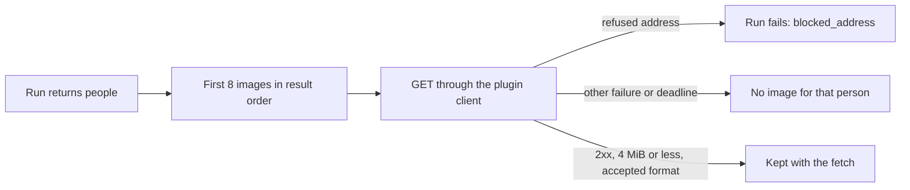

# Contract: faces and profiles in work-info plugin results

Source of truth: [the plugin contract, version 1](../../../docs/how-to/work-info-plugins.md)
and [`api/openapi.yaml`](../../../api/openapi.yaml) (`WorkInfoFetchedPerson`).
The contract number stays 1: both fields are optional and older hosts ignore
unknown fields ([R-9](../research.md#r-9-plugins-return-a-face-url-and-a-profile-per-person-fetched-like-the-cover)).

## `people[]` in a fetch response

| Field | Type | Required | Meaning |
| --- | --- | --- | --- |
| `image` | string | no | `http` or `https` URL of the person's face, at most 2,048 characters |
| `profile` | object | no | The `PersonProfile` properties of [people-api.md](people-api.md#person-and-personprofile), same names and formats |

A malformed `image` or a malformed `profile` property is dropped alone; the
rest of the entry stays. Organizations take neither field.

## Image fetch after the run

The diagram shows what happens to the `image` URLs of one run.

The images share the cover's per-request timeout, size limit, format check and
the run's deadline, and count toward the fetch result budget with the cover.

## `WorkInfoFetchedPerson`

Gains optional `hasImage` (true when an image was kept) and `profile` (the
fetched values), so the comparison can tell the owner what applying adds. The
comparison layout is the design stage's.

## `GET /api/videos/{id}/work-info-fetches/{fetchId}/people/{index}/image`

Owner-only. Serves the kept image of the fetched person at `index` in the
result's `people`, with `Cache-Control: no-store`, as the cover endpoint does.

| Status | `code` | When |
| --- | --- | --- |
| 404 | the cover endpoint's codes | The fetch has expired or does not exist |
| 404 | `person_image_not_found` | No image was kept for that person |

## Apply

Applying `people` fills each linked person's empty profile fields in the apply
transaction, and stores a kept image after the commit when the person still has
no face ([R-10](../research.md#r-10-plugin-data-only-fills-what-is-empty-after-the-apply-commits)).
A fetched value that fails validation is reported as skipped with its field;
an image that fails to decode is dropped without an error.
