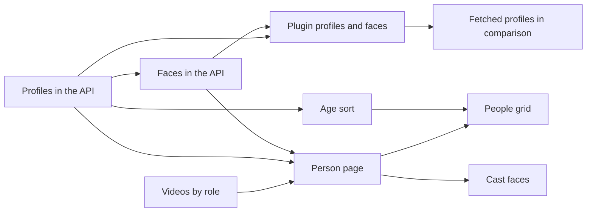

# Implementation Plan: faces and profiles for people

**Branch**: `feature/person-profiles` | **Parent Issue**: #1398

**Input**: The parent Issue. It is this feature's specification.

## Summary

A person gains one face image and a fixed set of profile fields, both
editable by the owner and filled by work-info plugins where empty. `/people`
becomes a card grid, a new person page at `/people/:id` holds the person's
details, videos by role and every edit, and the video page's cast shows faces
that open it. Profiles are columns on `people`, the face is a fitted JPEG blob
in SQLite, and the browser computes ages from the dates
([research.md](research.md)).

## Technical Context

**Canonical definitions**: [ARCHITECTURE.md](../../ARCHITECTURE.md),
[work-info-plugins.md](../../docs/design-docs/work-info-plugins.md),
[the plugin contract](../../docs/how-to/work-info-plugins.md),
[thumbnail-editing.md](../../docs/design-docs/thumbnail-editing.md#uploaded-images),
[library-ui.md](../../docs/design-docs/library-ui.md),
[design-system.md](../../docs/design-docs/design-system.md),
[the screen API schema](../../api/openapi.yaml),
[the external API schema](../../api/external-v1.yaml),
[validation commands](../../docs/how-to/development.md#validate-changes).

**Feature-specific context**:

- One migration: profile columns, `people_links`, `person_images`
  ([data-model.md](data-model.md#migration)).
- Screen and external API deltas: [contracts/people-api.md](contracts/people-api.md).
  Plugin contract deltas, still contract 1:
  [contracts/work-info-plugin.md](contracts/work-info-plugin.md).
- No new dependency: image fitting uses `golang.org/x/image/draw`, already a
  dependency ([R-5](research.md#r-5-a-face-is-one-jpeg-blob-in-sqlite-fitted-on-the-server-in-pure-go)).
- The parent Issue carries `ui`, so the `design` stage settles the card, the
  person page, the edit form, the cast faces and the comparison's display of
  fetched profiles. This plan fixes only the skeletons
  ([R-12](research.md#r-12-the-people-list-becomes-a-listpage-card-grid-organizations-keep-the-table)).
- No open question.

## Constitution Check

Checked against [ARCHITECTURE.md](../../ARCHITECTURE.md),
[core-beliefs.md](../../docs/design-docs/core-beliefs.md) and
[AGENTS.md](../../AGENTS.md), before and after Phase 1.

| Rule | Verdict |
| --- | --- |
| Dependency direction | Pass: profile validation is pure in `internal/domain`; image fitting is an `internal/app` use case on standard and `x/image` packages, with storage behind a port |
| The domain decides, the store enforces | Pass: `NormalizePersonProfile` decides; the store writes, and re-reads emptiness inside its transaction for merge and plugin fills |
| Store roles | Pass: profile and image writes belong to `CreditStore`; the plugin fill runs inside `ApplyFetchedWorkInfo` through package-private helpers |
| Events after commit | Pass: the post-commit face of a plugin apply mirrors the cover; no new event |
| User data survives a rebuild | Pass: profiles and faces live in SQLite keyed by person id, not under the rebuildable thumbnails directory (R-5) |
| Every read knows its viewer | Pass: the image endpoints and `personRole` are owner-only, matching their `security` in the schema |
| Generated code | Pass: both schemas change and `task generate` writes the generated code |
| Complexity 25 and no copying | Watch: `NormalizePersonProfile` has many fields; split it per field group. The upload reuses the thumbnail upload's limits, gate and multipart reader rather than copying them |
| Documentation with the change | Pass: each unit updates the design or how-to document it changes; the lasting rules go to a new `docs/design-docs/people.md`; nothing cites this directory |

## Project Structure

### Documentation (this feature)

```text
specs/060-person-profiles/
├── plan.md
├── research.md                # R-1..R-12
├── data-model.md              # migration, profile columns, links, faces
└── contracts/
    ├── people-api.md          # Person, profile, image endpoints, sorts, personRole
    └── work-info-plugin.md    # image and profile per fetched person
```

`ui-design.md` is added by the `design` stage. No `quickstart.md`: each unit's
checks and the visual reviews named below cover the feature, and nothing needs
a run beyond them.

### Source Code

**Affected boundaries**:

| Boundary | What changes |
| --- | --- |
| `internal/domain` | `PersonProfile`, its normalization, the age sorts, fetched-person image and profile |
| `internal/store` | Migration, profile columns and links in credit reads, writes, merge and list; `person_images`; plugin fills in `ApplyFetchedWorkInfo` |
| `internal/app` | Person face upload (decode, fit, encode) shared with the thumbnail upload's checks; post-commit plugin faces |
| `internal/wasmplugin` | Fetching person images after the run |
| `internal/httpapi`, both schemas | Profile, image endpoints, sorts, `personRole`, `WorkPerson.imageRevision`, MCP descriptions |
| `web/src/credits`, `web/src/app`, `web/src/api` | People grid, person page and routes; `/organizations` keeps `CreditsPage` |
| `web/src/player` | Cast faces, links to the person page, fetched-profile display in the comparison |

**New paths**: `docs/design-docs/people.md`, one migration,
`web/src/credits/person/` for the person page.

**Structure decision**: Follows the existing layout. The person page sits
under `credits/` beside the people grid, and reuses the details, merge and
delete dialogs there.

## Implementation Work

The graph shows which units must land first.



### Store people's profiles and expose them in the screen and external APIs

**Scope**: The migration's profile columns and `people_links`,
`PersonProfile` and its normalization, `profile` on `Person`, `CreditInput`
and `CreditPatch` in both schemas, the MCP descriptions, and the merge fill of
profile fields and links ([data-model.md](data-model.md),
[people-api.md](contracts/people-api.md#person-and-personprofile), R-1, R-2,
R-7, R-8). Start `docs/design-docs/people.md` and link it from the index;
update [external-api.md](../../docs/how-to/external-api.md).

**Dependencies**: None

**Acceptance**: Go domain tests cover each range and format, a death date
before a birth date at mixed precision, and the end year before the start
year. Store tests show a patch replacing and clearing single fields and a
merge filling only the target's empty fields from the first source that has
one. HTTP tests show `profile` round-tripping on the screen and external APIs,
and `400 invalid_request` for `profile` on an organization.

### Store people's faces and serve them with a revision

**Scope**: `person_images`, the upload use case sharing the thumbnail
upload's limits, decode gate and animated-WebP refusal, fitting to 800 px with
`x/image/draw`, `GET`, `PUT` and `DELETE /api/people/{id}/image`,
`imageRevision` on `Person` and `WorkPerson`, and the merge fill of the face
([people-api.md](contracts/people-api.md#get-apipeopleidimage), R-5, R-6,
R-8). Add the rule to `people.md` and cross-link
[thumbnail-editing.md](../../docs/design-docs/thumbnail-editing.md#uploaded-images).

**Dependencies**: Store people's profiles and expose them in the screen and external APIs

**Acceptance**: An app test fits a 2000×3000 PNG to 533×800 and refuses an
animated WebP. HTTP tests show `PUT` returning a new `imageRevision`, `GET`
answering `304` on the same ETag, `404 person_image_not_found` after
`DELETE`, a face uploaded after a `DELETE` getting a revision never used
before, `413` with the limit, and a guest refused. A store test shows the
face removed with its person and kept on a merge target that had none.

### Sort people by age

**Scope**: `ageAsc` and `ageDesc` on `CreditSort`, the `birth_key` column
written with the birth date, the keyset order with unknown dates last, and
`400 invalid_request` for organizations
([people-api.md](contracts/people-api.md#get-apipeople-and-get-apiv1people), R-4).

**Dependencies**: Store people's profiles and expose them in the screen and external APIs

**Acceptance**: A store test pages people with full, partial and unknown
birth dates across a cursor boundary in both directions and gets the unknown
ones last each time; an HTTP test shows the organizations refusal.

### Let work-info plugins return people's faces and profiles

**Scope**: `image` and `profile` on fetched people with lenient parsing, the
post-run fetch of up to 7 images within the run's deadline and budget,
`hasImage`, `profile` and the image endpoint on fetched people, the
in-transaction fill of empty profile fields, and the post-commit face for
people without one
([work-info-plugin.md](contracts/work-info-plugin.md), R-9, R-10). Update the
probe fixtures, the [plugin contract](../../docs/how-to/work-info-plugins.md)
and [work-info-plugins.md](../../docs/design-docs/work-info-plugins.md).

**Dependencies**: Store people's profiles and expose them in the screen and external APIs; Store people's faces and serve them with a revision

**Acceptance**: Domain tests drop a malformed `profile` property alone.
wasmplugin tests with the probe fixture keep 7 of 10 images, drop a failed
one, and fail the run with `blocked_address` on a refused one. An HTTP test
serves a kept image by index and answers `404 person_image_not_found` for a
person without one. A store test
applies a fetch to an existing person with a birth date and no height and gets
the height filled and the birth date unchanged; an app test stores the face
only for the person without one.

### Filter a person's videos by role

**Scope**: The owner-only `personRole` parameter on `listVideos`, requiring
`person` ([people-api.md](contracts/people-api.md#get-apivideos), R-11).
Update the person filter in [library-ui.md](../../docs/design-docs/library-ui.md).

**Dependencies**: None

**Acceptance**: A store test with one person as performer in one video and
director in another returns one video and `total` 1 per role; HTTP tests show
`400` for `personRole` without `person` and for a guest.

### Open a person page with their face, profile, videos and edits

**Scope**: The `/people/:id` route and its owner guard and navigation
highlight, the page with face, name, aliases, profile, external IDs and the
age range (R-3), the videos list with the role filter, the link to the
filtered library, rename, the details form extended with the profile, face
upload and removal, merge and delete reusing the credit dialogs, and the
loading, failed, gone and no-video states, as `ui-design.md` lays them out.

**Dependencies**: Store people's profiles and expose them in the screen and external APIs; Store people's faces and serve them with a revision; Filter a person's videos by role

**Acceptance**: Web unit tests show the age range for a year-only birth date
and the age at death, a profile edit sending only changed properties, a face
upload updating the shown image, the role filter's request, and the gone state
after a 404. Visual review of the page at desktop and mobile widths, with and
without a face.

### Replace the people list with a grid of face cards

**Scope**: `/people` as `ListPage` with `CardGrid` and infinite scroll over
the existing pages, cards with face or placeholder, name, age and video
count, search, the existing sorts plus the age sorts, creating a person, and cards opening
the person page; the row actions leave the list. `/organizations` keeps
`CreditsPage` (R-12). Update [library-ui.md](../../docs/design-docs/library-ui.md)
and `people.md`.

**Dependencies**: Open a person page with their face, profile, videos and edits; Sort people by age

**Acceptance**: Web unit tests show the grid paging on scroll, the age sort's
request, a card linking to `/people/:id`, and no rename, merge or delete on a
card; the organizations suite of `CreditsPage.test.tsx` still passes.
Visual review of the grid at desktop and mobile widths with mixed faces and
placeholders.

### Show faces in the video page's cast and open the person page

**Scope**: Faces from `WorkPerson.imageRevision` next to each person in the
video page's work information, a placeholder without one, and the link to
`/people/:id` in place of the library filter; organizations keep their links.

**Dependencies**: Open a person page with their face, profile, videos and edits

**Acceptance**: `WorkInfo.test.tsx` shows a face image URL with the revision,
a placeholder, the person link to `/people/:id` and the organization link
unchanged. Visual review of the work information with faces at desktop and
mobile widths.

### Show what a work-info fetch adds to people before applying

**Scope**: The comparison step shows each fetched person's kept image and
profile values from `hasImage` and `profile`, and marks that only empty
fields are filled, as `ui-design.md` lays it out
([work-info-plugin.md](contracts/work-info-plugin.md#workinfofetchedperson)).

**Dependencies**: Let work-info plugins return people's faces and profiles

**Acceptance**: A `detailRows` or comparison test shows a fetched person's
image and profile values; visual review of the comparison step with and
without fetched profiles.
