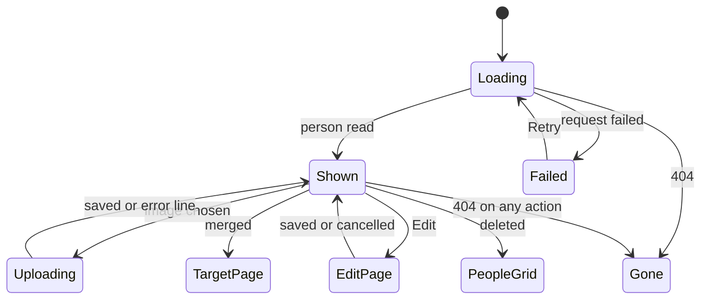

# UI design: faces and profiles for people

Sources: [design-system.md](../../docs/design-docs/design-system.md),
[page patterns](../../web/registry/rules/patterns.md),
[foundations](../../web/registry/rules/foundations.md),
[library-ui.md, List layout](../../docs/design-docs/library-ui.md#list-layout),
[library-ui.md, Cards](../../docs/design-docs/library-ui.md#cards),
[library-ui.md, Favorite mark](../../docs/design-docs/library-ui.md#favorite-mark),
[library-ui.md, Information rows](../../docs/design-docs/library-ui.md#information-rows),
[library-ui.md, Details editor](../../docs/design-docs/library-ui.md#details-editor),
the screens [`CreditsPage`](../../web/src/credits/CreditsPage.tsx),
[`PlaylistPage`](../../web/src/playlists/PlaylistPage.tsx),
[`VideoDetailsEditor`](../../web/src/player/detailsEditor/VideoDetailsEditor.tsx),
[`WorkInfo`](../../web/src/player/WorkInfo.tsx) and
[`CompareStep`](../../web/src/player/workInfoFetch/CompareStep.tsx), and the
plan's [R-3](research.md#r-3-age-is-computed-in-the-browser-as-a-range-at-partial-precision),
[R-12](research.md#r-12-the-people-list-becomes-a-listpage-card-grid-organizations-keep-the-table)
and [R-13](research.md#r-13-person-favorites-join-the-existing-favorites).

## Why this shape

People are found by face, so the list is a grid of round faces with the name
under each: the card is one link to the person page, with the favorite heart
as its only control. The maintainer picked the round face-only card over
portrait, square and horizontal cards on the mockup; it shows more people per
row than a portrait card and reads as a person rather than a video.

The person page keeps the person in a column at the left and their videos to
the right, so the videos start at the top of the page and the face and facts
stay in view while the videos scroll. No skeleton has that shape, so the
design system gains `ProfilePage`; `ListPage`'s `aside` is a right-hand
column for tools read after the body, and `DetailPage` is outside the shell
with media edge to edge. The page keeps a portrait face, since it is the one
place the whole image is seen.

Every text value of a person is edited on one `FormPage`, as the video
details editor is, because opening a dialog per group made the owner reopen
the editor for each change. Dialogs per group were rejected for that reason,
and one `FormDialog` for every field because more than a dozen fields break
its rule of a few fields for one action.

## Design-system additions

Each is added to the design system, with its rule and example, by the first
implementation unit that uses it.

| Addition | What it is | First used by |
| --- | --- | --- |
| `card-face` spacing step | Minimum width of a face card, chosen so a 360px screen holds three columns and 1280px eight or nine | People grid |
| `CardGrid size="face"` and `LoadingState` face cards | The grid at `card-face`, and its skeletons as circles with a line under them | People grid |
| `aspect-portrait` | The 2:3 portrait ratio of the person page's face | Person page |
| `PersonFace` (`ui/`) | A face image with the placeholder when there is none, in four shapes: `card` (full width, `aspect-square`, `rounded-full`), `profile` (full width, `aspect-portrait`, `rounded-md`), `chip` (`size-5`, `rounded-full`, the height of a `text-sm` line) and `compare` (`size-8`, `rounded-full`) | Person page |
| `ProfilePage` skeleton | Shell page, library density: a `profile` column at the left and the main column (`header`, `toolbar`, body); widths in [Responsive behaviour](#responsive-behaviour) | Person page |
| `profile-aside` spacing step | Width of the `ProfilePage` profile column from `lg` | Person page |

A round shape crops the stored image with `object-fit: cover` centred
horizontally and a third from the top, where a portrait photo usually holds
the face. The placeholder is lucide `UserRound` in `muted-foreground` centred
on `bg-muted`, in the same frame as a face, so a row mixing both keeps one
height. It is not a letter: the first character of a Japanese name tells the
viewer little.

## Words

| Place | Text | Notes |
| --- | --- | --- |
| People grid, card meta | `34 · 12 videos` | Age, then the existing video count; `34–35` at partial precision; the count alone without a birth date |
| People grid, sort | `Youngest first`, `Oldest first` | Added after the existing sorts |
| People grid, filter | `Favorites` | The library's favorites filter, same control |
| People grid, no favorites | `No favorite people yet` | Empty state while the filter is on |
| People grid, new person dialog | `New person`, `Name`, `Create` | Existing `newButton`; the dialog replaces the inline create row |
| Favorite heart | `Add to favorites`, `Remove from favorites` | The names the video and group hearts use |
| Person page, document title | `{name}` | |
| Person page, aliases | `Also known as {a} · {b}` | |
| Person page, actions | `Edit`, `Show in library` | `Show in library` reuses the meaning of today's `t.credits.row.open` |
| Person page, more menu | `Merge into another person…`, `Delete` | Both exist |
| Person page, groups | `Profile`, `Measurements`, `Career and bio` | Group headings; a group with no value is left out |
| Person page, no profile | `No profile yet.` | Muted line, with `Edit` beside it, when every group is empty |
| Person page, facts | `Born`, `Died`, `Gender`, `Birthplace`, `Height`, `Measurements`, `Cup`, `Blood type`, `Career` | Term column of the `FactList` |
| Person page, fact values | `1990-05-01 (age 34)`, `1990 (age 34–35)`, `2060-01-01 (aged 69)`, `160 cm`, `85–58–86 cm`, `2010–2018`, `Since 2010`, `Until 2018` | Dates as stored, like work dates; a missing bust, waist or hips shows `–` in its place |
| Person page, gender values | `Female`, `Male`, `Other` | |
| Person page, bio fold | `Show more`, `Show less` | |
| Person page, links | The link's host, such as `x.com` | Opens in a new tab with the external-link mark |
| Person page, face | `Add a face`, `Change face`, `Upload an image…`, `Remove face` | `Add a face` names the placeholder button |
| Person page, face errors | `This image can't be used. Choose a PNG, JPEG or still WebP.`, `This image is over {limit}.`, `Couldn't save the face: {reason}` | Under the face, `text-sm text-destructive` |
| Remove face confirm | `Remove the face of "{name}"?`, `The image is deleted. You can upload another one later.`, `Remove` | `ConfirmDialog` |
| Person page, videos | `Videos`, `All`, `Performer`, `Director`, `Photographer`, `Streamer` | Heading and the role filter |
| Person page, video states | `No videos yet`, `No videos as {role}`, `Couldn't load videos: {reason}` | |
| Person page, gone | `This person no longer exists`, `Back to people` | |
| Person page, after merge | `Merged into "{name}"` | Toast on the target's page |
| Person page, after delete | `Deleted "{name}"` | Toast on the people grid |
| Edit page, band | `Edit "{name}"`, `Cancel`, `Save` | `FormPage` title and actions |
| Edit page, aside | `Back to the person` | Under the face, name and counts |
| Edit page, panels | `Profile`, `Names and links` | Panel legends |
| Edit page, profile fields | `Gender`, `Not set`, `Birth date`, `Death date`, `Birthplace`, `Blood type`, `Height (cm)`, `Bust (cm)`, `Waist (cm)`, `Hips (cm)`, `Cup`, `Career from`, `Career until`, `Bio` | |
| Edit page, date hint | `YYYY-MM-DD, YYYY-MM or YYYY` | Under both date fields |
| Edit page, names fields | `Name`, `Aliases`, `External IDs`, `Links`, `Add alias`, `Add ID`, `Add link`, `URL` | Aliases and IDs as the details dialog has them today |
| Edit page, leaving | `Discard changes?`, `Your changes to "{name}" aren't saved.`, `Discard` | The video details editor's confirmation |
| Video page cast link | `Open {name}` | Replaces `showVideosWith` for people only |
| Comparison, people | `Fills only empty fields: {facts}` | One line per fetched person with a profile, `{facts}` as on the person page joined by ` · ` |

## People grid

`/people` is a `ListPage` with the toolbar in the top bar, like the library:
search, the `Favorites` filter and sort, the sort holding the existing modes
and the two age sorts. The header is the `PageHeader` with `People`, the count
and `New person` as its one `default` action, which opens a `FormDialog` with
the name and, on `Create`, opens the new person's page.

The body is `CardGrid size="face"` then `LoadMoreRow`. A card is
`PersonFace card`, then the name (`text-sm font-medium`, one line, centred,
truncated, the full name in `title`), then the meta line (`text-xs`, muted,
centred). The whole card is one link to `/people/:id` with the hover
`shadow-card-hover` of other cards. The favorite heart follows
[Favorite mark](../../docs/design-docs/library-ui.md#favorite-mark) at the top
right of the circle, outside the link; nothing else sits on a card.

### States

| State | What the screen shows |
| --- | --- |
| Loading | `LoadingState` with face cards |
| No people | `EmptyState`: `Users` icon, the existing `No people yet`, and `New person` |
| No matches | `EmptyState` with the existing `No people match "…"` |
| No favorites | `EmptyState`: `Heart` icon and `No favorite people yet`, with the filter still on |
| Failed | `ErrorState` with `Retry` |
| More pages | `LoadMoreRow`, loading and failed as the library |

## Person page

`/people/:id` is a `ProfilePage`. The profile column holds, top to bottom:

1. `PersonFace profile`, with the favorite heart at its top right as on a
   card. Without a face, the placeholder is a button named `Add a face` that
   opens the file picker. With one, a `Change face` button (`icon-sm`, on
   `overlay`, with `drop-shadow-mark`) sits at its bottom right and opens a
   menu: `Upload an image…`, `Remove face`. During an upload a `Spinner`
   covers the face; an error line sits under the face until the next attempt.
2. The name, the page's `h1` (`text-xl font-semibold`, wrapping, at most three
   lines).
3. `Also known as …` (`text-sm`, muted, wrapping), when there are aliases.
4. The actions row: `Edit` (`outline` `sm`, a link to `/people/:id/edit`),
   `Show in library` (`ghost` `sm`, a link to the filtered library) and the
   more menu (`ghost` `icon-sm` `Ellipsis`). There is no `default` button:
   nothing on the page outranks viewing.
5. The groups that have a value, each under a small heading (`h2`, `text-sm
   font-semibold`): `Profile` (born, died, gender, birthplace, blood type),
   `Measurements` (height, measurements, cup) and `Career and bio` (career,
   then the bio in `text-sm` with line breaks kept, folded to six lines with
   `Show more`). Each is a `FactList` of its filled rows. When every group is
   empty, one muted `No profile yet.` line stands in their place.
6. The links, one per line with the external-link mark, then the external
   IDs as `source: value` in `text-xs` muted, as the video page shows them.

The main column holds `Videos` with the count (`PageHeader`, `h2`), the role
filter as a single-choice `ToggleGroup` (`All` first and pressed by default,
then the four roles), and the body: the library's `VideoCard`s in `CardGrid`
at the smallest card size (`card-0`), so three columns fit beside the profile
column at 1280px, then `LoadMoreRow`. The order is the library's default;
`Show in library` is where the owner sorts and filters further.

Merging opens the existing merge dialog and then the target's page with the
`Merged into` toast; deleting confirms with the existing dialog and then opens
`/people` with the `Deleted` toast.

### States

| State | What the screen shows |
| --- | --- |
| Loading | `Skeleton`s in the profile column's shape; `LoadingState` grid in the main column |
| Failed | `ErrorState` with `Retry` in the main column; the profile column empty |
| Gone | `EmptyState` with `This person no longer exists` and `Back to people`, in place of both columns |
| No videos | `EmptyState` `No videos yet`, or `No videos as {role}` with a role pressed |
| Videos failed | `ErrorState` with `Retry` in the main column; the profile stays |
| Uploading a face | `Spinner` over the face; other actions stay usable |

## Edit page

`/people/:id/edit` is a `FormPage` outside the shell, built as the video
details editor is ([Details editor](../../docs/design-docs/library-ui.md#details-editor)):
the band holds `Edit "{name}"`, `Cancel` and `Save`; the aside names the
person (the face, the name, the age and the video count) and holds `Back to
the person`. The two panels are:

| Panel | Fields, in order |
| --- | --- |
| `Profile` | Gender and blood type (`Select`s with `Not set`) side by side; birth date and death date side by side, each with the date hint; birthplace; height and cup side by side; bust, waist and hips in one row; career from and until side by side; bio (`Textarea`) |
| `Names and links` | Name; aliases (rows of name and language, `Add alias`); external IDs (rows of source and value, `Add ID`); links (rows of a URL, `Add link`) |

`Save` sends one `PATCH` with only the changed properties and returns to the
person page with the response. A reason with a `field` stays under that
control with every other input kept; another failure is the band's failure
line. `Cancel`, `Back to the person` and the browser's Back ask `Discard
changes?` when the draft changed. Opened by its URL, the page reads the person
first; a missing person shows the person page's gone state.

## Video page cast

Each person in the work information row becomes `PersonFace chip` and the
name inside one link to `/people/:id` named `Open {name}`, the face centred on
the name's line. Organizations keep their text links to the filtered library,
and the fold after three names is unchanged.

## Comparison of a fetch

In the people row of the fetched column, a chip whose person has a kept image
shows `PersonFace compare` before the name. Under the chips, each fetched
person with a profile gets one `text-xs` muted line `Fills only empty fields:
…`, at most three lines, then the existing `+N more` fold.

## Responsive behaviour

| Width | People grid | Person page | Edit page |
| --- | --- | --- | --- |
| 360px | Three face cards per row | The profile column stacks above the videos: the face at half the width beside the name, aliases and actions; the facts, bio and links full width under them; the role filter scrolls sideways in one line | The aside, then the two panels, stacked; fields side by side stay two to a row, the three measurements one row |
| 768px | Five or more cards per row | As 360px, the face beside the name block | As 360px |
| 1024px | Six or more cards per row | Two columns: the profile column `profile-aside` wide at the left, sticky under the top bar and scrolling inside itself when taller; the videos at the right | The `FormPage` columns: aside, `Profile`, `Names and links` |
| 1280px | Eight or nine cards per row with the full sidebar | As 1024px, with more video columns | As 1024px |

## Review criteria

1. On the people grid at 360px, three round faces sit side by side, and a row
   mixing faces and placeholders keeps one height with the names on one line.
2. A card reads face first, name second, meta third; the heart is the only
   control and shows unfilled only on hover or focus, as on video cards.
3. On the person page at 1280px, the first row of videos is visible without
   scrolling, and the face and facts stay in view while the videos scroll.
4. On the person page, `Edit`, `Show in library` and the more menu are quieter
   than the name: no button on the page uses the `default` fill.
5. The groups show only filled rows, each a short term and its value on one
   line at 1280px, and an age at partial precision reads as a range.
6. On the edit page at 1280px, every profile field and the names and links are
   visible together without opening anything, and one `Save` keeps all of
   them.
7. At 360px the role filter stays one line, and the face beside the name block
   leaves the name readable at three lines.
8. On the video page, a cast face sits on the name's line without raising the
   row height beyond the other information rows, and organizations look as
   before.
9. On the comparison step, the fill line under the people chips reads as
   secondary to the chips and never wraps past three lines.
