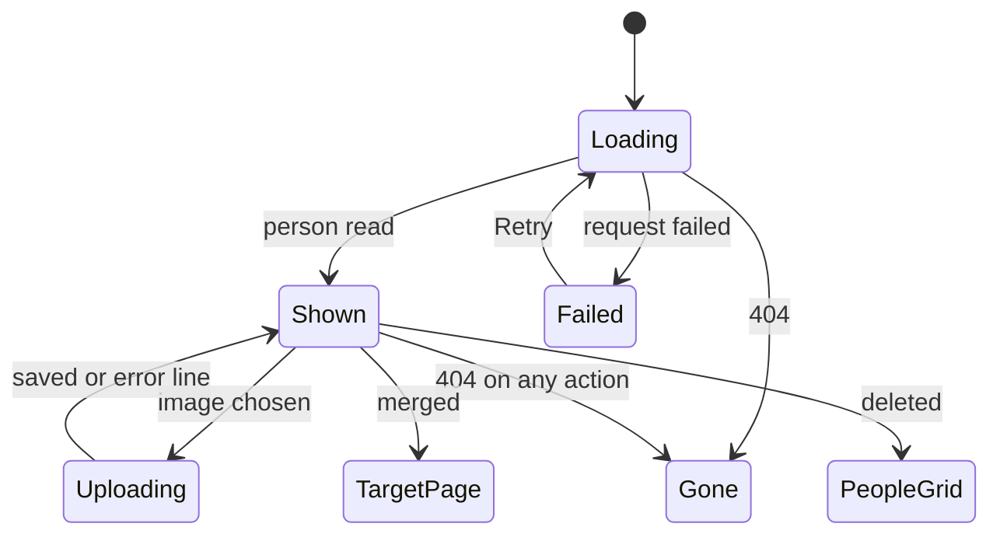

# UI design: faces and profiles for people

Sources: [design-system.md](../../docs/design-docs/design-system.md),
[page patterns](../../web/registry/rules/patterns.md),
[foundations](../../web/registry/rules/foundations.md),
[library-ui.md, List layout](../../docs/design-docs/library-ui.md#list-layout),
[library-ui.md, Cards](../../docs/design-docs/library-ui.md#cards),
[library-ui.md, Information rows](../../docs/design-docs/library-ui.md#information-rows),
the screens [`CreditsPage`](../../web/src/credits/CreditsPage.tsx),
[`PlaylistPage`](../../web/src/playlists/PlaylistPage.tsx),
[`WorkInfo`](../../web/src/player/WorkInfo.tsx) and
[`CompareStep`](../../web/src/player/workInfoFetch/CompareStep.tsx), and the
plan's [R-3](research.md#r-3-age-is-computed-in-the-browser-as-a-range-at-partial-precision)
and [R-12](research.md#r-12-the-people-list-becomes-a-listpage-card-grid-organizations-keep-the-table).

## Why this shape

People are found by face, so the list is portrait cards and nothing else: the
card is one link to the person page, and every edit lives on that page, which
is the form Stash, Jellyfin and Plex converge on. The person page keeps the
person in a column at the left and their videos to the right, so the videos
start at the top of the page instead of below a profile block, and the face
and facts stay in view while the videos scroll. No skeleton has that shape,
so the design system gains `ProfilePage`; `ListPage`'s `aside` is a right-hand
column for tools read after the body, and `DetailPage` is outside the shell
with media edge to edge.

Every edit opens in place, as the parent Issue's `UI品質` asks: the name is
renamed on the title, the profile is one `FormDialog`, and names, IDs and
links are the existing details dialog. The video details editor's `FormPage`
was rejected because it leaves the page; the profile's fields are all short
values, so they fit a wide dialog two to a row.

## Design-system additions

Each is added to the design system, with its rule and example, by the first
implementation unit that uses it.

| Addition | What it is | First used by |
| --- | --- | --- |
| `card-portrait` spacing step | Minimum width of a portrait card, chosen so a 360px screen holds two columns | People grid |
| `aspect-portrait` | The 2:3 portrait ratio of a face | People grid |
| `CardGrid size="portrait"` and `LoadingState` portrait cards | The grid at `card-portrait`, and its skeletons in the portrait ratio | People grid |
| `PersonFace` (`ui/`) | A face image with the placeholder when there is none, in four shapes: `card` and `profile` (full width, `aspect-portrait`, `rounded-md`), `chip` (`size-5`, `rounded-full`, the height of a `text-sm` line), `compare` (`size-8`, `rounded-full`) | Person page |
| `ProfilePage` skeleton | Shell page, library density: a `profile` column at the left and the main column (`header`, `toolbar`, body); widths in [Responsive behaviour](#responsive-behaviour) | Person page |
| `profile-aside` spacing step | Width of the `ProfilePage` profile column from `lg` | Person page |

The placeholder is lucide `UserRound` in `muted-foreground` centred on
`bg-muted`, in the same frame as a face, so a list mixing both keeps one row
height. It is not a letter: the first character of a Japanese name tells the
viewer little.

## Words

| Place | Text | Notes |
| --- | --- | --- |
| People grid, card meta | `34 · 12 videos` | Age, then the existing video count; `34–35` at partial precision; the count alone without a birth date |
| People grid, sort | `Youngest first`, `Oldest first` | Added after the existing sorts |
| People grid, new person dialog | `New person`, `Name`, `Create` | Existing `newButton`; the dialog replaces the inline create row |
| Person page, document title | `{name}` | |
| Person page, aliases | `Also known as {a} · {b}` | |
| Person page, actions | `Edit profile`, `Show in library` | `Show in library` reuses the meaning of today's `t.credits.row.open` |
| Person page, more menu | `Edit names and links…`, `Merge into another person…`, `Delete` | Second and third exist |
| Person page, rename | `Rename` | Pencil on the title, as on the video page |
| Person page, facts | `Born`, `Died`, `Gender`, `Birthplace`, `Height`, `Measurements`, `Cup`, `Blood type`, `Career` | Term column of the `FactList` |
| Person page, fact values | `1990-05-01 (age 34)`, `1990 (age 34–35)`, `2060-01-01 (aged 69)`, `160 cm`, `85–58–86 cm`, `2010–2018`, `Since 2010`, `Until 2018` | Dates as stored, like work dates; a missing bust, waist or hips shows `–` in its place |
| Person page, gender values | `Female`, `Male`, `Other` | |
| Person page, no profile | `No profile yet.` | Muted line in place of the facts |
| Person page, bio fold | `Show more`, `Show less` | |
| Person page, links | The link's host, such as `x.com` | Opens in a new tab with the external-link mark |
| Person page, face | `Add a face`, `Change face`, `Upload an image…`, `Remove face` | `Add a face` names the placeholder button |
| Person page, face errors | `This image can't be used. Choose a PNG, JPEG or still WebP.`, `This image is over {limit}.`, `Couldn't save the face: {reason}` | Under the face, `text-sm text-destructive` |
| Remove face confirm | `Remove the face of "{name}"?`, `The image is deleted. You can upload another one later.`, `Remove` | `ConfirmDialog` |
| Person page, videos | `Videos`, `All`, `Performer`, `Director`, `Photographer`, `Streamer` | Heading and the role filter |
| Person page, video states | `No videos yet`, `No videos as {role}`, `Couldn't load videos: {reason}` | |
| Person page, gone | `This person no longer exists`, `Back to people` | |
| Person page, after merge | `Merged into "{name}"` | Toast on the target's page |
| Person page, after delete | `Deleted "{name}"` | Toast on the people grid |
| Edit profile dialog | `Edit profile`, `Gender`, `Not set`, `Birth date`, `Death date`, `Birthplace`, `Height (cm)`, `Bust (cm)`, `Waist (cm)`, `Hips (cm)`, `Cup`, `Blood type`, `Career from`, `Career until`, `Bio`, `Save` | |
| Edit profile, date hint | `YYYY-MM-DD, YYYY-MM or YYYY` | Under both date fields |
| Edit names and links dialog | `Links`, `Add link`, `URL` | Added to the existing details dialog |
| Video page cast link | `Open {name}` | Replaces `showVideosWith` for people only |
| Comparison, people | `Fills only empty fields: {facts}` | One line per fetched person with a profile, `{facts}` as on the person page joined by ` · ` |

## People grid

`/people` is a `ListPage` with the toolbar in the top bar, like the library:
search and sort, the sort holding the existing modes and the two age sorts.
The header is the `PageHeader` with `People`, the count and `New person` as
its one `default` action, which opens a `FormDialog` with the name and, on
`Create`, opens the new person's page.

The body is `CardGrid size="portrait"` then `LoadMoreRow`. A card is
`PersonFace card`, then the name (`text-sm font-medium`, one line, truncated,
the full name in `title`), then the meta line (`text-xs`, muted). The whole
card is one link to `/people/:id` with the hover `shadow-card-hover` of other
cards. Nothing else sits on a card: no menu, no favourite, no count badge over
the face.

### States

| State | What the screen shows |
| --- | --- |
| Loading | `LoadingState` with portrait cards |
| No people | `EmptyState`: `Users` icon, the existing `No people yet`, and `New person` |
| No matches | `EmptyState` with the existing `No people match "…"` |
| Failed | `ErrorState` with `Retry` |
| More pages | `LoadMoreRow`, loading and failed as the library |

## Person page

`/people/:id` is a `ProfilePage`. The profile column holds, top to bottom:

1. `PersonFace profile`. Without a face, the placeholder is a button named
   `Add a face` that opens the file picker. With one, a `Change face` button
   (`icon-sm`, on `overlay`, with `drop-shadow-mark`) sits at its bottom
   right and opens a menu: `Upload an image…`, `Remove face`. During an upload
   a `Spinner` covers the face; an error line sits under the face until the
   next attempt.
2. The name, the page's `h1` (`text-xl font-semibold`, wrapping, at most three
   lines), with the `Rename` pencil after it; renaming edits the title in
   place as the video page's title does.
3. `Also known as …` (`text-sm`, muted, wrapping), when there are aliases.
4. The actions row: `Edit profile` (`outline` `sm`), `Show in library`
   (`ghost` `sm`, a link to the filtered library), and the more menu
   (`ghost` `icon-sm` `Ellipsis`). There is no `default` button: nothing on the
   page outranks viewing.
5. The facts as a `FactList`, only the rows with a value, or `No profile yet.`
6. The bio (`text-sm`, line breaks kept), folded to six lines with
   `Show more`.
7. The links, one per line with the external-link mark, then the external
   IDs as `source: value` in `text-xs` muted, as the video page shows them.

The main column holds `Videos` with the count (`PageHeader`, `h2`), the role
filter as a single-choice `ToggleGroup` (`All` first and pressed by default,
then the four roles), and the body: the library's `VideoCard`s in `CardGrid`
at the library's default card size, then `LoadMoreRow`. The order is the
library's default; `Show in library` is where the owner sorts and filters
further.

`Edit profile` opens a `FormDialog size="wide"` with two fields per row from
`sm` (one below): gender and blood type (`Select`s with `Not set`), birth and
death dates (text with the date hint), birthplace (full row), height and cup,
bust, waist and hips (three in one row), career from and until, and the bio
(`Textarea`, full row). `Save` sends only the changed properties; a field's
error stays under it. `Edit names and links…` opens the existing details
dialog with a `Links` list added after the external IDs. Merging opens the
existing merge dialog and then the target's page with the `Merged into` toast;
deleting confirms with the existing dialog and then opens `/people` with the
`Deleted` toast.

### States

| State | What the screen shows |
| --- | --- |
| Loading | `Skeleton`s in the profile column's shape; `LoadingState` grid in the main column |
| Failed | `ErrorState` with `Retry` in the main column; the profile column empty |
| Gone | `EmptyState` with `This person no longer exists` and `Back to people`, in place of both columns |
| No videos | `EmptyState` `No videos yet`, or `No videos as {role}` with a role pressed |
| Videos failed | `ErrorState` with `Retry` in the main column; the profile stays |
| Uploading a face | `Spinner` over the face; other actions stay usable |

## Video page cast

Each person in the work information row becomes `PersonFace chip` and the
name inside one link to `/people/:id` named `Open {name}`, the face centred on
the name's line. Organizations keep their text links to the filtered library,
and the fold after three names is unchanged.

## Comparison of a fetch

In the people row of the fetched column, a chip whose person has a kept image
shows `PersonFace compare` before the name. Under the chips, each fetched
person with a profile gets one `text-xs` muted line `Fills only empty fields:
…`, at most three lines, then the existing `+N more` fold.

## Responsive behaviour

| Width | People grid | Person page |
| --- | --- | --- |
| 360px | Two portrait cards per row | The profile column stacks above the videos: the face at half the width beside the name, aliases and actions; the facts, bio and links full width under them; the role filter scrolls sideways in one line |
| 768px | Four or more cards per row | As 360px, the face beside the name block at `card-portrait` width |
| 1024px | Five or more cards per row | Two columns: the profile column `profile-aside` wide at the left, sticky under the top bar and scrolling inside itself when taller; the videos at the right |
| 1280px | Six or more cards per row | As 1024px, with more video columns |

## Review criteria

1. On the people grid at 360px, two cards sit side by side, and a row mixing
   faces and placeholders keeps one card height with the names on one line.
2. A card reads face first, name second, meta third; nothing on the card
   competes with the face.
3. On the person page at 1280px, the first row of videos is visible without
   scrolling, and the face and facts stay in view while the videos scroll.
4. On the person page, `Edit profile`, `Show in library` and the more menu are
   quieter than the name: no button on the page uses the `default` fill.
5. The facts list shows only filled rows, each a short term and its value on
   one line at 1280px; an age at partial precision reads as a range.
6. Editing the profile, the names and links, the name and the face never
   leaves the person page, and the page behind each dialog is unchanged when
   it closes.
7. At 360px the role filter stays one line, and the face beside the name block
   leaves the name readable at three lines.
8. On the video page, a cast face sits on the name's line without raising the
   row height beyond the other information rows, and organizations look as
   before.
9. On the comparison step, the fill line under the people chips reads as
   secondary to the chips and never wraps past three lines.
