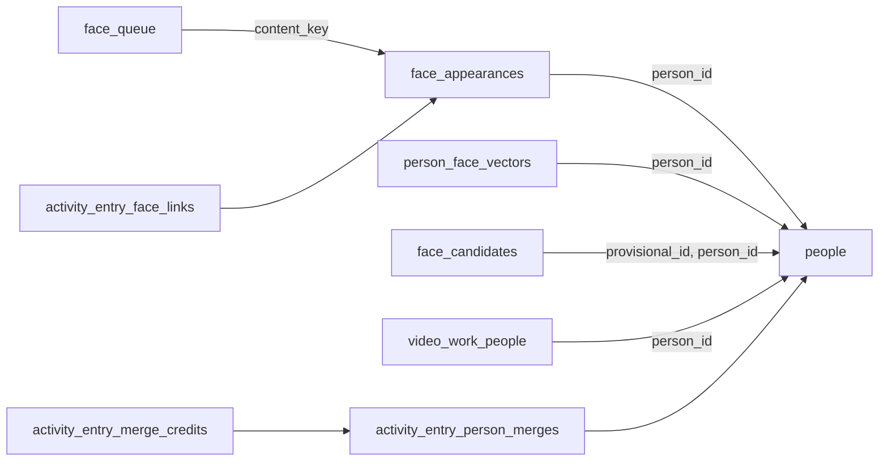
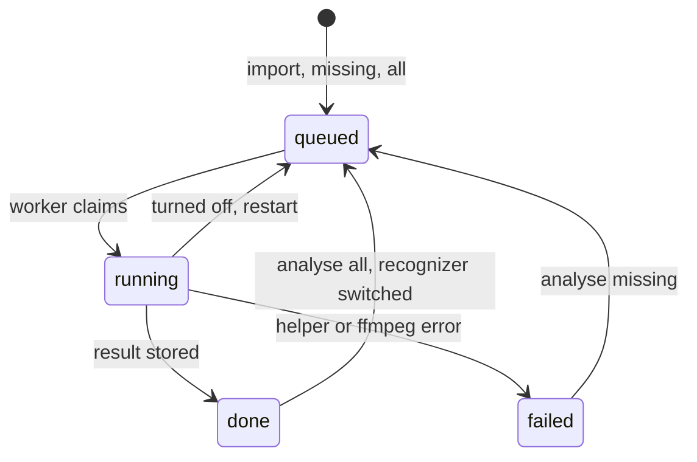

# Data model: Recognizing people by their faces

The rest of the model is unchanged: the people, credits and activity tables
are defined in [`internal/store/migrations`](../../internal/store/migrations)
(`00042_work_info.sql`, `00055_activity.sql`, `00064`–`00068`) and described in
[people.md](../../docs/design-docs/people.md) and
[activity.md](../../docs/design-docs/activity.md).

## Migration

One migration after the latest on `main` (`00069_face_recognition.sql` at the
time of writing; an implementation PR renumbers it if `main` moved on). It
creates the tables below and rebuilds `activity_entries` to widen its
`subject_kind` check with `person`. No existing table gains a column, and no
existing row changes.

## `face_queue`

One row per analysed or queued content key, kept after it is `done`, as
`auto_tag_queue` is ([auto-tagging.md](../../docs/design-docs/auto-tagging.md#queue-and-when-a-video-is-judged)).

| Field | Type | Null | Meaning |
| --- | --- | --- | --- |
| `content_key` | text | No | Primary key |
| `state` | text | No | `queued`, `running`, `done`, `failed` |
| `recognizer` | text | Yes | The recognizer of the last finished analysis |
| `reason` | text | Yes | The helper's or `ffmpeg`'s message when `failed` |
| `activity_id` | integer | Yes | The run's `face_analysis` entry |
| `updated_at` | integer | No | Unix ms |

## `face_appearances`

One main person in one video
([R-4](research.md#r-4-main-people-are-found-per-video-with-the-pocs-rules)).

| Field | Type | Null | Meaning |
| --- | --- | --- | --- |
| `id` | integer | No | Primary key, `autoincrement` |
| `content_key` | text | No | The analysed content; no foreign key to `videos` |
| `recognizer` | text | No | The recognizer that produced `centroid` |
| `person_id` | integer | Yes | The linked person; `on delete set null` |
| `dropped` | integer | No | 1 when the owner removed or undid the link, or deleted the person ([R-10](research.md#r-10-an-automatic-link-is-a-performer-credit-and-removing-it-drops-the-appearance)) |
| `tracks` | text | No | JSON `[[start, end, x, y, w], …]`, one per track: seconds, the mean face centre as a fraction of the frame's width and height, and the mean face box width as a fraction of the frame's width |
| `good_seconds` | real | No | Seconds of good faces |
| `track_count` | integer | No | Tracks in the cluster |
| `centroid` | blob | Yes | The normalized cluster centroid as little-endian `float32`; null once its person is deleted |
| `crop` | blob | Yes | A JPEG of the best good face, the face box doubled around its centre ([R-18](research.md#r-18-a-provisional-persons-face-is-the-best-crop-of-its-first-appearance)); never rewritten, and null once its person is deleted |

**Relationships**: Index on `(content_key)` and on `(person_id)`. A
re-analysis replaces a content key's rows in one transaction: a row carried
over keeps its `id`, `person_id`, `dropped` and `crop`, and takes the new
`tracks`, `good_seconds`, `track_count`, `recognizer` and `centroid`, except
that a row whose person was deleted keeps a null `centroid`; rows nothing is
carried over to are deleted, and new appearances are inserted
([R-8](research.md#r-8-face-data-is-keyed-by-content-key-and-survives-a-model-switch-by-its-spans)).
Rows of a content key no video has any more are kept, so the person page still
lists nothing for them and a returning file keeps its links.

## `person_face_vectors`

The vector of a person's face image
([R-12](research.md#r-12-a-face-image-is-embedded-after-it-is-stored)).

| Field | Type | Null | Meaning |
| --- | --- | --- | --- |
| `person_id` | integer | No | Primary key; `on delete cascade` |
| `image_revision` | integer | No | The `people.image_revision` it was computed from |
| `recognizer` | text | No | The recognizer that computed it |
| `vector` | blob | Yes | Null when the image had no good face or more than one |

A row whose revision or recognizer differs from the current one is stale and
is computed again by the face worker.

## `face_candidates`

([R-14](research.md#r-14-candidates-are-person-pairs-with-a-dismissed-state))

| Field | Type | Null | Meaning |
| --- | --- | --- | --- |
| `provisional_id` | integer | No | `on delete cascade` |
| `person_id` | integer | No | `on delete cascade` |
| `similarity` | real | No | The highest similarity when last computed |
| `dismissed` | integer | No | 1 after the owner dismissed the pair |
| `created_at` | integer | No | Unix ms |

**Relationships**: Primary key `(provisional_id, person_id)`.

## Activity tables

| Table | Fields | Meaning |
| --- | --- | --- |
| `activity_entry_face_links` | `entry_id`, `appearance_id`, `person_id`, `user_key`, `created_person` | Each link a `face_analysis` entry made, for undo one person at a time; `created_person` is 1 when the run created the provisional person. No foreign key to `face_appearances`: a re-analysis keeps a carried-over id, and undo of a link whose appearance is gone still removes the performer row |
| `activity_entry_person_merges` | `entry_id` (primary key), `source_id`, `target_id`, `snapshot` | A `face_merge` entry's snapshot of what it moved other than credits, as JSON ([R-11](research.md#r-11-an-automatic-merge-keeps-what-it-moved-so-undo-can-move-it-back)) |
| `activity_entry_merge_credits` | `entry_id`, `user_key`, `role`, `target_had`, `owner_changed`; primary key `(entry_id, user_key, role)` | Each credit a `face_merge` entry moved from the source to the target; `target_had` is 1 when the target already had it, and `owner_changed` becomes 1 when a work-information write removes it from the target |

New activity values: kinds `face_analysis` and `face_merge`, feature
`face_recognition`, subject kind `person` (subject key is the target's id, the
label is its name or empty when provisional).

## Settings rows

| Key | Values | Default |
| --- | --- | --- |
| `face.enabled` | `true`, `false` | Absent, read as `false` |
| `face.recognizer` | `sface_int8`, `arcface_r50` | Absent, read as `sface_int8` |
| `face.generation` | Integer, increased by a recognizer switch ([R-17](research.md#r-17-a-generation-number-fences-results-computed-before-a-recognizer-switch)) | Absent, read as `0` |

The download state is not stored: at startup, `mdm` reads it from the files
under `<data>/face/` and their hashes.

## Rules

| Rule | Enforced in |
| --- | --- |
| A person is provisional exactly when it has no canonical name | `internal/domain`, read by the store's person queries |
| A merge into a provisional target takes the first named source's canonical name | `CreditStore.Merge` |
| A result or vector computed under an older `face.generation` is not written | `FaceStore`, in the result's transaction |
| A dropped appearance is never linked and its centroid is not a vector of its person | Store reads of person vectors; the domain matching rule |
| Removing a face-linked performer from a video drops that video's appearances of the person | `WorkInfoStore` writes, in the same transaction |
| Removing from the target a credit that a `face_merge` entry not yet undone moved marks it `owner_changed` | `WorkInfoStore` writes, in the same transaction |
| A carried-over appearance keeps its crop, and one whose person was deleted gets no centroid | `FaceStore`, in the result's transaction |
| Deleting a person drops their appearances and clears their centroids and crops ([R-15](research.md#r-15-a-persons-face-data-is-deleted-with-the-person)) | `CreditStore.Delete`, in the same transaction |
| A provisional person created by analysis gets its first appearance's crop as its face | `FaceStore`, in the result's transaction |
| A merge moves the source's appearances, vector and candidate pairs to the target, and deletes pairs that would join the target to itself | `CreditStore.Merge` |

## State transitions

The queue row's states follow `auto_tag_queue`, with one change: turning the
feature off cancels a running analysis back to `queued`
([R-9](research.md#r-9-face-analysis-has-its-own-queue-and-turning-it-off-stops-the-running-video)).

## What does not change

`video_work_people` keeps its columns: a face link is an ordinary `performer`
row, and its origin is read from `face_appearances`
([R-10](research.md#r-10-an-automatic-link-is-a-performer-credit-and-removing-it-drops-the-appearance)).
`people` keeps its columns: provisional is derived
([R-7](research.md#r-7-a-provisional-person-is-a-person-without-a-canonical-name)).
`person_images` is unchanged; vectors live beside it.
