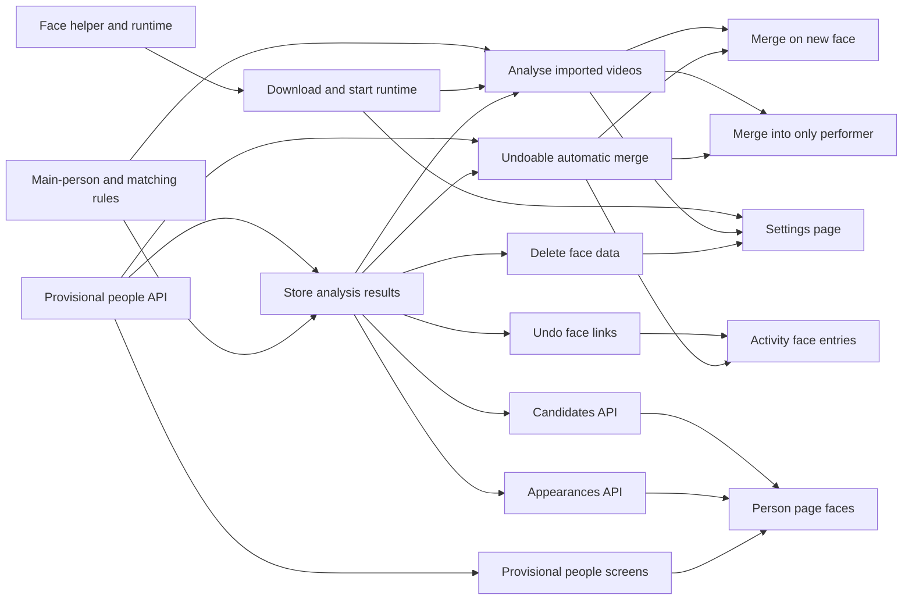

# Implementation Plan: Recognizing people by their faces

**Branch**: `feature/face-recognition` | **Parent Issue**: #1392

**Input**: The parent Issue. It is this feature's specification.

## Summary

When the owner turns face recognition on, vv downloads a face runtime and a
model, finds the main people of each video by face, links them to the video
as performers (creating provisional people for unknown faces), and merges
provisional people into real ones when a face image or the cast identifies
them, with every automatic link and merge recorded and undoable in the
activity log. Inference runs in a helper process that the runtime archive
brings, so `mdm` stays a static, cgo-free binary and nobody who leaves the
feature off downloads anything.

## Technical Context

**Canonical definitions**: [ARCHITECTURE.md](../../ARCHITECTURE.md),
[people.md](../../docs/design-docs/people.md),
[activity.md](../../docs/design-docs/activity.md),
[auto-tagging.md](../../docs/design-docs/auto-tagging.md),
[windows-app.md](../../docs/design-docs/windows-app.md),
[`api/openapi.yaml`](../../api/openapi.yaml), [`go.mod`](../../go.mod), and the
checks in [development.md](../../docs/how-to/development.md#validate-changes).
The POC in PR #1393 (`scripts/facepoc`) is the starting code for inference;
its measurements are in that PR's body.

**Feature-specific context**:

| Item | Delta |
| --- | --- |
| New dependency | `github.com/ebitengine/purego` (already in `go.sum` as indirect) becomes direct, imported only by the helper ([R-1](research.md#r-1-inference-runs-in-a-helper-process-never-inside-mdm)) |
| New binary | `cmd/mdm-face`, shipped only inside the face runtime archive ([R-2](research.md#r-2-the-face-runtime-is-a-pinned-bundle-that-vv-publishes)) |
| New runtime files | `<data>/face/runtime-v<N>/` and `<data>/face/models/`, downloaded on enable |
| New release | `face-runtime-v<N>` GitHub Releases, one archive per platform, published from a tag the maintainer pushes |
| Platforms | `linux-amd64`, `linux-arm64` (the Docker image's two) and `windows-amd64`; other platforms report `unsupported` |
| Performance | Analysis takes about 0.27 times the video's length on 4 CPU cores (POC); onnxruntime gets half of the cores ([R-9](research.md#r-9-face-analysis-has-its-own-queue-and-turning-it-off-stops-the-running-video)) |
| Already built | Requirement 7 (a person's face image, uploaded or from a plugin) shipped with #1398 ([people.md](../../docs/design-docs/people.md#a-face-is-one-fitted-jpeg-in-sqlite)); this feature adds only the face check on upload |
| Measured constraint | A `purego` build of `mdm` does not start in the `alpine:3.24` image (`exec … no such file or directory`), while the helper started through Debian's glibc loader does |

Every unknown is resolved in [research.md](research.md) (R-1..R-16).

## Constitution Check

Checked against [ARCHITECTURE.md](../../ARCHITECTURE.md),
[core-beliefs.md](../../docs/design-docs/core-beliefs.md) and
[AGENTS.md](../../AGENTS.md); re-checked after the design artifacts.

| Rule | Verdict |
| --- | --- |
| Dependency direction | Pass. The use case `FaceRecognizer` is in `internal/app`, the rules in `internal/domain`, the runtime adapter in a new adapter package; depguard gains a rule that only `cmd/mdm-face` imports `purego` and the inference package |
| Static `mdm` binary (`CGO_ENABLED=0`, Alpine) | Pass, enforced: CI checks that the Linux `mdm` has no `INTERP` header |
| Store roles | Pass. A new `FaceStore` role; the merge, delete and work-info writes move face rows through package-private helpers in their own transactions |
| Events after commit | Pass. `PersonImageChanged` is published after the face's transaction commits |
| User data survives a rebuild | Pass. Face rows are keyed by content key or person id, never by `videos.id` |
| One owner for opening files | Pass. The analysis resolves the video's location through `internal/mediafs`, as live transcoding does |
| Only a scan reads the media folders' files | Deviation, justified below |
| Activity entries in the change's transaction | Pass. `face_analysis` and `face_merge` entries are written with the links and merges they record |
| Documentation with behaviour | Pass. A new [face-recognition design document](#documentation-this-feature) |
| Complexity ≤ 25, no copied code | Pass by construction: the POC's code moves, it is not copied, and `scripts/facepoc` is deleted by the unit that moves it |

## Project Structure

### Documentation (this feature)

```text
specs/061-faced/
├── plan.md
├── research.md          # R-1..R-16
├── data-model.md        # face tables, activity tables, settings rows
├── quickstart.md        # checks with the real runtime
└── contracts/
    └── face-recognition-api.md
```

Lasting decisions go to a new `docs/design-docs/face-recognition.md`, created
by the first implementation unit that lands and extended by each later one,
and to [people.md](../../docs/design-docs/people.md),
[activity.md](../../docs/design-docs/activity.md) and
[running-vv.md](../../docs/how-to/running-vv.md) where a unit changes their
subject.

### Source Code

**Affected boundaries**:

| Boundary | What changes |
| --- | --- |
| `internal/domain` | Main-person rules, matching rules, the recognizer table, provisional people, new activity kinds |
| `internal/app` | `FaceRecognizer` (queue worker, embedding, automatic merges), `FaceRecognitionSettings` (download and runtime state) |
| `internal/store` | `FaceStore`; `CreditStore.Merge` and `Delete`, `WorkInfoStore` writes and `ActivityStore` undo gain face rows |
| `internal/media` | A frame source: `ffmpeg` at 2 fps, fitted into 1280 × 1280, as `bgr24` |
| `internal/httpapi`, `api/openapi.yaml`, `api/external-v1.yaml` | The [contract](contracts/face-recognition-api.md) |
| `cmd/mdm` | Wiring, the `PersonImageChanged` subscriber in `events.go` |
| `web/src/settings`, `web/src/credits`, `web/src/activity`, `web/src/player` | Settings page, provisional people, person page sections, activity cards |

**New paths**:

| Path | Owns |
| --- | --- |
| `cmd/mdm-face` | The helper's `main` |
| `internal/faceinfer` | onnxruntime through `purego`, YuNet, alignment, the recognizers (moved from `scripts/facepoc`) |
| `internal/faceproto` | The helper protocol's messages, shared by both sides and free of `purego` |
| `internal/faceruntime` | Download, verification, starting the helper and the protocol client; implements the port `internal/app` declares |
| `scripts/build/face_runtime.go`, `.github/workflows/face-runtime.yml` | Building and publishing the runtime archives |

**Structure decision**: The helper is a second binary rather than a mode of
`mdm`, because one binary cannot be both static and able to load a shared
library ([R-1](research.md#r-1-inference-runs-in-a-helper-process-never-inside-mdm)).

## Complexity Tracking

| Violation | Why Needed | Simpler Alternative Rejected Because |
| --- | --- | --- |
| Face analysis opens a video file outside a scan ("Only a scan reads the media folders' files") | Faces need full frames at 2 fps; "Analyse all" and a recognizer switch run without a scan | Cutting faces from the seek preview: its frames are 320 px or less and 1 per part of the video, too small and too few for the 64 px quality gate. Decoding during import: costs every user, and re-analysis would still need the file. The unit that adds the frame source rewrites the invariant to "only a scan walks the media folders", which is what the folder index relies on |

## Implementation Work

The units and what has to land first:



After "Face inference helper and the published face runtime" merges, the
maintainer pushes the `face-runtime-v1` tag on that commit; "Download and
start the face runtime" pins the published archives' hashes.

### Face inference helper and the published face runtime

**Scope**: `cmd/mdm-face`, `internal/faceinfer` (moved from `scripts/facepoc`,
plus ArcFace r50's input normalization), `internal/faceproto`, the archive
build and its workflow, the depguard rule and the static-binary check
([R-1](research.md#r-1-inference-runs-in-a-helper-process-never-inside-mdm),
[R-2](research.md#r-2-the-face-runtime-is-a-pinned-bundle-that-vv-publishes),
[R-3](research.md#r-3-two-recognition-models-one-detector)). Deletes
`scripts/facepoc`. Creates `face-recognition.md`.

**Dependencies**: None

**Acceptance**: The POC's unit tests pass in `internal/faceinfer`. A
`faceproto` round-trip test encodes and decodes every message and rejects a
wrong protocol version. The workflow builds the three archives on the PR, and
its Linux job runs the archive's helper in `alpine:3.24` through the bundled
loader on one fixture photo and gets one face and a 128-value vector (the
real loader is the boundary under test). `task lint` fails when `cmd/mdm`
imports `internal/faceinfer`, and the CI check fails when the Linux `mdm` has
an `INTERP` header.

### Rules for finding main people in a video and matching them to people

**Scope**: In `internal/domain`: tracks, the quality gate, clustering, the
main-person cutoff
([R-4](research.md#r-4-main-people-are-found-per-video-with-the-pocs-rules)),
the recognizer table with thresholds, ArcFace r50's thresholds measured with
the POC's LFW protocol
([R-6](research.md#r-6-similarity-thresholds-are-constants-per-recognizer)),
matching a main person to people
([R-5](research.md#r-5-a-main-person-is-compared-with-every-stored-vector),
[R-10](research.md#r-10-an-automatic-link-is-a-performer-credit-and-removing-it-drops-the-appearance)),
span carry-over
([R-8](research.md#r-8-face-data-is-keyed-by-content-key-and-survives-a-model-switch-by-its-spans)),
the face-image merge decision
([R-12](research.md#r-12-a-face-image-is-embedded-after-it-is-stored)) and the
one-to-one cast rule
([R-13](research.md#r-13-the-cast-rule-merges-only-one-to-one-pairs)).

**Dependencies**: None

**Acceptance**: Unit tests with hand-made vectors: a person present 8 s in 2
tracks is kept and one at 7.5 s or in 1 track is not; link, candidate and new
provisional at each threshold's boundary; a dropped appearance's person is
neither linked nor recreated; carry-over at an overlap of exactly half and
just under; the face-image rule merges one provisional person above `merge`
and makes candidates for two; the cast rule fires only for one performer and
one provisional person. The ArcFace values and their measured rates are in
`face-recognition.md`.

### Download and start the face runtime

**Scope**: `internal/faceruntime` and `app.FaceRecognitionSettings`: settings
rows, `GET`/`PUT /api/settings/face-recognition`,
`POST /api/face-recognition/download`, pinned URLs and hashes, the download
into `<data>/face/`, the state read at startup, starting the helper through
the loader or with `CREATE_NO_WINDOW`, the handshake, and restarting a helper
that exited ([R-2](research.md#r-2-the-face-runtime-is-a-pinned-bundle-that-vv-publishes),
[R-16](research.md#r-16-download-progress-is-read-from-the-settings-resource);
[contract](contracts/face-recognition-api.md#get-apisettingsface-recognition)).
Documents the download hosts in `running-vv.md`.

**Dependencies**: Face inference helper and the published face runtime

**Acceptance**: Against an `httptest` server: with the feature off, no
request is made and `<data>/face/` is not created (acceptance 1); turning it
on ends `ready` with the files in place; a wrong hash ends `failed` with
`hash_mismatch` and leaves no file outside `.tmp`; the retry endpoint answers
`409 face_recognition_off` while off; startup with a truncated model reads
`failed`. A client test against a fake helper over pipes covers the handshake
and a helper that exits mid-request.

### Provisional people in the people API

**Scope**: Provisional people as people without a canonical name: the
`provisional` property, `name` `""`, the list filter, the name-sort order,
naming, and a merge into a provisional target
([R-7](research.md#r-7-a-provisional-person-is-a-person-without-a-canonical-name);
[contract](contracts/face-recognition-api.md#changed-schemas-and-operations)),
in both API schemas. Updates `people.md`.

**Dependencies**: None

**Acceptance**: Store tests: a person created without names lists with
`provisional: true` and `name: ""`, after named people in both name sorts,
and `provisional=false` leaves it out; `PATCH` with a name makes it ordinary;
merging a named person into it gives it that canonical name. An HTTP test
answers `400 invalid_request` to `provisional` on organizations.

### Store face analysis results and link people to videos

**Scope**: The migration ([data-model.md](data-model.md#migration)), the
`FaceStore` role: the queue, storing one video's result in one transaction
(appearances with carry-over, provisional people, performer rows, candidates,
the `face_analysis` entry with its links, joining the import pipeline), and
the face rows that `CreditStore.Merge`, `CreditStore.Delete` and
`WorkInfoStore` writes move or drop
([data-model.md, Rules](data-model.md#rules)).

**Dependencies**: Provisional people in the people API; Rules for finding main
people in a video and matching them to people

**Acceptance**: Store tests: a result with two main people, one matching a
person, adds one provisional person and two performer rows and lists both
links on the entry; storing the same video again with a re-numbered result
keeps the same people by span; removing a face-linked performer in the
details editor drops the appearance; deleting a person drops theirs; a merge
moves appearances and candidates and deletes a self-pair; the entry joins the
import pipeline when queued from import.

### Analyse imported videos for faces

**Scope**: `app.FaceRecognizer`'s worker: the `internal/media` frame source,
claiming, calling the helper, the domain rules, storing; queuing from the
seek preview stage's final result, `POST /api/face-recognition/runs`, retry
from the activity log, cancelling on turning off, recovery at startup, and
re-queuing every video on a recognizer switch
([R-9](research.md#r-9-face-analysis-has-its-own-queue-and-turning-it-off-stops-the-running-video)).
Rewrites the file-reading invariant in `ARCHITECTURE.md`
([Complexity Tracking](#complexity-tracking)).

**Dependencies**: Download and start the face runtime; Rules for finding
main people in a video and matching them to people; Store face analysis
results and link people to videos

**Acceptance**: App tests with a fake frame source and fake helper returning
scripted vectors: two videos of the same face create one provisional person
linked to both (acceptance 2); a face in one 1 s track creates nobody
(acceptance 3); turning off mid-video leaves the row `queued` and a later run
analyses it from the first frame; `runs` answers `409 face_recognition_off`
while off. A media test runs `ffmpeg` on a short generated rotated video and
gets upright 1280 × 1280 frames (the POC's rotation defect).

### Undo automatic face links from the activity log

**Scope**: The `face_analysis` undoer, one link or all: removing the
performer row unless the owner changed that credit since, dropping the
appearance, deleting a provisional person the run created that has no other
credit left, and the owner's `undo` entry
([R-10](research.md#r-10-an-automatic-link-is-a-performer-credit-and-removing-it-drops-the-appearance);
[contract](contracts/face-recognition-api.md#changed-schemas-and-operations)).
Updates `activity.md`.

**Dependencies**: Store face analysis results and link people to videos

**Acceptance**: Store tests: undoing one of two links removes only that
performer and drops its appearance; a re-analysis afterwards does not link
it; undoing a link whose performer the owner removed and added again since
answers `already_reverted` and keeps the row; a second undo of the same link
answers `409 activity_not_undoable`.

### Undoable automatic merge of a provisional person

**Scope**: A merge that records the `face_merge` entry and its snapshot, and
its undoer, with the `person` subject kind
([R-11](research.md#r-11-an-automatic-merge-keeps-what-it-moved-so-undo-can-move-it-back)).

**Dependencies**: Provisional people in the people API; Store face analysis
results and link people to videos

**Acceptance**: Store tests: undo after a merge brings back the provisional
person under its old id with its two performer rows, appearances, candidates
and smart-rule references (acceptance 5); a performer the target had before
the merge stays on the target; a name the owner gave the target after the
merge stays; a credit the owner removed from the target after the merge is
not restored.

### Merge provisional people when a person gets a face

**Scope**: `PersonImageChanged` after a face is set, replaced or brought by a
merge; embedding in the face worker; the automatic merge or candidates; the
upload refusal for no face or several faces while the runtime is ready
([R-12](research.md#r-12-a-face-image-is-embedded-after-it-is-stored)).

**Dependencies**: Analyse imported videos for faces; Undoable automatic merge
of a provisional person

**Acceptance**: App tests with the fake helper: a face close to one
provisional person merges it, and both of its videos then list the person as
performer (acceptance 4); two provisional people above `merge` give two
candidates and no merge; an upload with no face answers
`400 person_image_no_face` and stores nothing; with the runtime absent the
same upload is stored. A store test shows the event is published after commit
only.

### Merge a provisional person into the only unmatched performer

**Scope**: Applying the cast rule after a video's work information changes or
its analysis ends
([R-13](research.md#r-13-the-cast-rule-merges-only-one-to-one-pairs)).

**Dependencies**: Analyse imported videos for faces; Undoable automatic merge
of a provisional person

**Acceptance**: App tests: applying fetched work information with one new
performer to a video with one provisional person merges them as `face_merge`;
two performers without appearances, or a dismissed pair, merge nothing.

### Face candidates in the people API

**Scope**: `GET /api/people/{id}/face-candidates`, `confirm` and `dismiss`
([R-14](research.md#r-14-candidates-are-person-pairs-with-a-dismissed-state);
[contract](contracts/face-recognition-api.md#get-apipeopleidface-candidates)).

**Dependencies**: Store face analysis results and link people to videos

**Acceptance**: HTTP and store tests: confirm merges the provisional person
into the other one whichever id is in the path; dismiss hides the pair, and a
later result with the same pair does not reopen it; an unknown pair answers
`404 face_candidate_not_found`.

### Delete all face data

**Scope**: `DELETE /api/face-recognition/data`
([R-15](research.md#r-15-deleting-face-data-removes-vectors-and-face-crops-only)).

**Dependencies**: Store face analysis results and link people to videos

**Acceptance**: Store test: afterwards no centroid, crop, vector or open
candidate remains, every queue row is unanalysed, and people, performer rows,
spans, dropped marks and dismissed pairs are unchanged (acceptance 7).

### Person appearances in the people API

**Scope**: `GET /api/people/{id}/appearances` and
`GET /api/face-appearances/{id}/crop`
([contract](contracts/face-recognition-api.md#get-apipeopleidappearances)).

**Dependencies**: Store face analysis results and link people to videos

**Acceptance**: HTTP tests: a person's appearances page across the cursor
without dropped ones; a deleted crop answers `404 not_found`; a guest gets
`403`.

### Face recognition settings page

**Scope**: The settings page for the feature, built as the auto-tagging
section is: the switch, the recognizer choice with the non-commercial notice,
the download progress, failure reason and retry, the queue counts with
"Analyse missing" and "Analyse all", and "Delete face data" with a
confirmation, as `ui-design.md` lays it out.

**Dependencies**: Download and start the face runtime; Analyse imported
videos for faces; Delete all face data

**Acceptance**: Component tests: choosing ArcFace r50 shows the
non-commercial notice (acceptance 6); a `downloading` response shows the
progress and a `failed` one the reason and a retry that calls the endpoint;
the run buttons are hidden while off. Visual review of the page at the design
stage's widths.

### Show provisional people on the people screens

**Scope**: The people grid, the person page, the cast chips on the video
page and the library's person filter show provisional people by face with
the translated label, and naming one on the edit page, as `ui-design.md` lays
it out.

**Dependencies**: Provisional people in the people API

**Acceptance**: Component tests: a provisional person renders the label, not
an empty name, in the grid card, the chip and the filter; saving a name sends
`name`. Visual review of the grid, the person page and the video page.

### Faces, scenes and candidates on the person page

**Scope**: The person page's faces and scenes (crops, videos, spans opening
the video at the span's start) and its candidates with confirm and dismiss in
place, as `ui-design.md` lays it out.

**Dependencies**: Face candidates in the people API; Person appearances in
the people API; Show provisional people on the people screens

**Acceptance**: Component tests: a span opens `/videos/:id` at its start;
confirm replaces the page with the merge target's when the shown person was
the source, and dismiss removes the row without leaving the page. Visual
review of the person page.

### Face entries in the activity log

**Scope**: Cards for `face_analysis` entries, with undo per person and for
all, and for `face_merge` entries with undo, as `ui-design.md` lays them out.

**Dependencies**: Undo automatic face links from the activity log; Undoable
automatic merge of a provisional person

**Acceptance**: Component tests: undoing one person sends its
`appearanceId`; an undone link shows as undone; a `face_merge` card names
both people. Visual review of the activity page.
