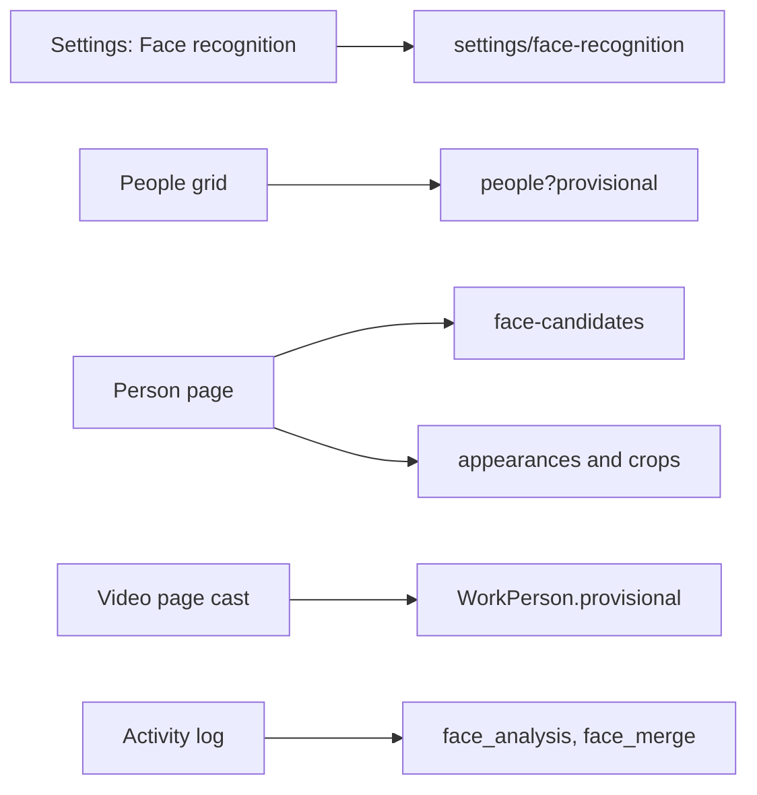
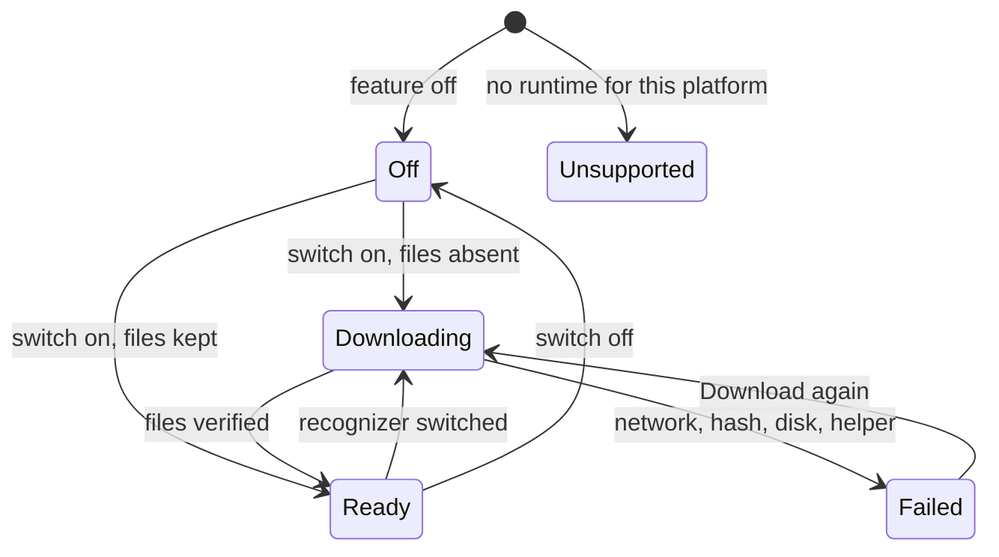
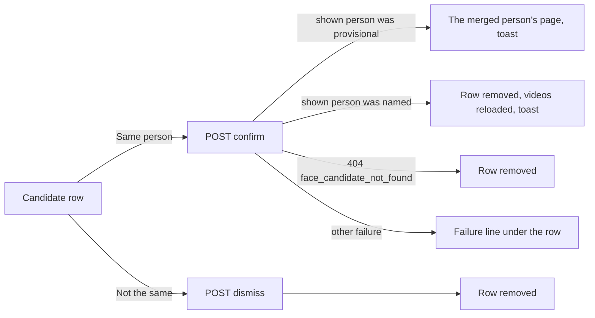

# UI design: Recognizing people by their faces

**Feature**: [parent Issue #1392](https://github.com/syudead/vv/issues/1392) ·
[plan.md](plan.md) ·
[research.md](research.md) ·
[contracts/face-recognition-api.md](contracts/face-recognition-api.md)

Sources that already decide things, linked rather than repeated here:

| Topic | Source |
| --- | --- |
| Tokens, closed scales, library density | [design-system.md, Foundations](../../docs/design-docs/design-system.md#foundations); the values in `@theme` of [`web/src/ui/tokens.css`](../../web/src/ui/tokens.css), named here and never copied |
| `SettingsPage` with its `nav` and `notice`, `PageSection`, `FormRow`; the state blocks | [patterns.md, Settings page](../../web/registry/rules/patterns.md#settings-page), [design-system.md, Page patterns](../../docs/design-docs/design-system.md#page-patterns); the Auto-tagging page in [`web/src/settings`](../../web/src/settings) (`AutoTaggingSection`, `OllamaLockNotice`, `AutoImportSwitch`: the `Progress` section, the lock notice and the switch saved on press, which this feature's page copies) |
| `ProfilePage` and the face grid | [patterns.md, Profile page](../../web/registry/rules/patterns.md#profile-page), [Face grid](../../web/registry/rules/patterns.md#face-grid), [people.md, The people grid](../../docs/design-docs/people.md#the-people-grid), [The person page](../../docs/design-docs/people.md#the-person-page) |
| `CardListItem`, the activity cards, their actions and the detail page | [patterns.md, Sections](../../web/registry/rules/patterns.md#sections), [activity.md](../../docs/design-docs/activity.md), [`web/src/activity`](../../web/src/activity) (`ActivityCard`, `ActivityDetailSections`: the `auto_tag` card's `Undo tags…` menu and the detail's `Tags` section are the models for the face entries) |
| `PersonFace`, `Badge`, `Progress`, `Alert`, `RadioGroup`, `Switch`, `ConfirmDialog`, `DropdownMenu`, `Tooltip` | [components.md](../../web/registry/rules/components.md) |
| Faces on the video page's cast and in the library's person filter | [people.md, Faces elsewhere on the screens](../../docs/design-docs/people.md#faces-elsewhere-on-the-screens), [`WorkInfo.tsx`](../../web/src/player/WorkInfo.tsx), [`ActiveTagFilters.tsx`](../../web/src/library/ActiveTagFilters.tsx) |
| The person edit page, the face upload and its error line | [people.md, The edit page](../../docs/design-docs/people.md#the-edit-page), [`PersonFaceControl.tsx`](../../web/src/credits/person/PersonFaceControl.tsx) |
| Width breakpoints in CSS, layout judged by people | [library-ui.md](../../docs/design-docs/library-ui.md#width-breakpoints-in-css-and-the-sidebar-exception) |
| Screen text | [`web/src/i18n/en.ts`](../../web/src/i18n/en.ts); this feature adds the words below |

This feature adds one settings page and changes three existing screens: a
**Face recognition** page in Settings (requirements 1 to 3, `UI品質` first
point); **provisional people** on the people grid, the person page, the video
page's cast, the credits picker and the library filter (requirement 6,
`UI品質` second point); the person page's **candidates** and **faces in videos** (requirements 10 and 11,
`UI品質` third point); and **face entries** in the activity log (requirement
12). Nothing else on these screens changes.

The diagram shows the screens this document covers and the resource each one
reads.

## Why this shape

The settings page is the Auto-tagging page's shape, `Progress` first and the
feature's own section second, because the parent Issue asks for the same
construction and because the owner comes to this page for the same two
reasons: to see how far the analysis is and to turn the feature on. The
download is one more thing that happens on this page, so its progress and
its failure sit directly under the switch that started it, where the eye
already is after the press, and not in `Progress`, which counts videos. A
notice for the whole page is used only for the one condition that locks
every control, the platform having no runtime, as the Ollama lock does.

The recognizer is a radio group, not a select, because the choice is two
items the owner reads once, and the non-commercial license must be visible
before the choice is made (acceptance criterion 6): a select hides its
options until opened. A switch of the recognizer while the feature is on
confirms first, because one press queues every video for hours of work; the
dialog states that names and confirmations stay, which is the parent
Issue's edge case for a model switch.

A provisional person is drawn as an ordinary person whose name line says
`Unnamed person` in `muted-foreground`, nowhere a badge or a different card.
Its face, cut from a video, is the mark the parent Issue asks for, and the
quieter name line is what separates it from a named person at a glance; a
badge on every unnamed card would compete with the faces, which are the
content of the grid. This is the form photo products converged on (a face
with no name, named by pressing it). The people toolbar's filter gains a
`Name` select so the owner can show only the unnamed ones to name them, or
hide them.

Candidates and faces in videos live in the person page's profile column,
under the face, not in the main column: the owner judges a candidate by
comparing two faces, and the profile face is the large one; the main column
stays the videos, so the page keeps the one header and one grid the pattern
gives it. Confirming and dismissing happen in the row (`UI品質`, third
point); confirming from the provisional person's own page moves to the
merged person's page, because the shown person no longer exists, which the
existing merge already does. The faces list is rows of a crop beside the
video's title and spans, so a scene is one press away; a strip of crops
alone would need a second press to reach the scene and would not say which
video.

The activity entries follow the `auto_tag` card: the subject is the video,
the result names the people linked, and undo is per person from a menu, as
tags are undone, with `All links` after a separator so the owner does not
press four times. A `face_merge` entry has the merged person as its subject,
because that person is what the owner opens to check the result.

## Words

| Place | Text | Notes |
| --- | --- | --- |
| Settings page list entry and title | Face recognition | `settings.pages["face-recognition"]`, after `Auto-tagging` |
| First section heading | Progress | As the Auto-tagging page |
| `Progress` description while on | Waiting 3 · Analysing 1 · Done 340 · Failed 2 | From `counts`, as `settings.autoTagging.queue` |
| `Progress` description while off | Face recognition is off. | |
| `Progress` body while off | Turn on "Use face recognition" under Recognition to find people in videos. | One `
` row |
| Run row | Analyse videos not yet analysed · Analyse all videos again | `outline` `sm`, then `ghost` `sm` |
| Run started | 12 videos were queued for face analysis · There were no videos to analyse | Toast, as auto-tagging's |
| Last failure | Last failure | `warning` `Alert` title; `lastFailure` as its body |
| Second section heading | Recognition | |
| Section description | Finds the main people of each video by their faces and links them to the video as performers. A face nobody is known for becomes an unnamed person, which you name on its page. | |
| Switch row | Use face recognition | `FormRow` label |
| Switch description | Off: no video is analysed and nothing is downloaded. On: the face runtime and the chosen recognizer are downloaded once, and each imported video is analysed. | |
| Runtime line, downloading | Downloading the face runtime and recognizer… 12.3 MB of 184 MB | Above a `Progress`; sizes through `formatBytes` from `bytesDone` and `bytesTotal` |
| Runtime line, ready | Ready | `CircleCheck`, `text-xs text-muted-foreground`, as `checkOk` |
| Runtime failed, title | Face recognition isn't ready | `destructive` `Alert` |
| Runtime failed, `network` | The download couldn't finish. Check the connection and try again. | `AlertDescription` |
| Runtime failed, `hash_mismatch` | A downloaded file didn't match what vv expected. Downloading again replaces it. | |
| Runtime failed, `disk` | The files couldn't be written to the data folder. | |
| Runtime failed, `helper_start` | The face runtime couldn't start. | |
| Runtime failed, action | Download again | `AlertAction`, `outline` `sm`; `POST /api/face-recognition/download` |
| Unsupported notice | Not available on this platform · vv has no face runtime for this platform, so face recognition can't be turned on here. | `notice` slot, default `Alert` with `Unplug`; title and body |
| Recognizer row | Recognizer | `FormRow` label |
| Recognizer description | Both find the same faces; the recognizer decides how faces are compared. Switching analyses every video again. Names you gave and merges you confirmed stay. | |
| Option `sface_int8` | SFace · Apache-2.0 · 10 MB | Name, then the muted line from `license` and `downloadBytes` |
| Option `arcface_r50` | ArcFace r50 · Non-commercial use only · 174 MB | The license words replace the SPDX id when `nonCommercial`; a `warning` `Badge` `Non-commercial` after the name |
| Switch dialog, title | Switch to ArcFace r50? | `ConfirmDialog`; the other direction names SFace |
| Switch dialog, body | Every video is analysed again with ArcFace r50, which takes a while. Names you gave and merges you confirmed stay. ArcFace r50 is licensed for non-commercial use only. | The last sentence only for `arcface_r50` |
| Switch dialog, action | Switch | `Cancel` is `common.cancel` |
| Save failed | Couldn't save the settings: {reason} | `destructive` `Alert`, as the auto-import switch |
| Load failed | Couldn't load the face recognition settings: {reason} | `ErrorState` with `Retry` |
| Provisional person's name, everywhere | Unnamed person | `credits.unnamedPerson`; the grid card, the `h1`, the cast chip, the filter chip, the credits chips, activity subjects and results, the document title |
| People filter select | Name · Any · Named · Unnamed | A `Select` in the `FilterPopover` after `Favorites only`; `Named` sends `provisional=false`, `Unnamed` `provisional=true` |
| People grid, `Unnamed` with nobody | No unnamed people · Unnamed people appear here when face recognition finds a face it doesn't know. | `EmptyState` title and description, with `ScanFace` |
| Person page, naming action | Name… | `outline` `sm`, a link to `/people/:id/edit`; replaces `Edit` as the first action on a provisional person's page |
| Edit page, empty name | Unnamed person | The name input's placeholder on a provisional person |
| Delete dialog note, person | Faces found in videos for this person are deleted too. | After the existing description |
| Face upload, no face | No face was found in this image. Choose a photo where the face is clear. | The error line under the face, `person_image_no_face` |
| Face upload, several faces | This image shows more than one face. Choose one with a single face. | `person_image_many_faces` |
| Candidates group heading | Same person? | `h2` in the profile column |
| Candidate similarity | 72% similar | `text-xs text-muted-foreground` |
| Candidate actions | Same person · Not the same | `outline` `sm`, then `ghost` `sm` |
| Candidate confirmed, shown person stays | Merged "Unnamed person" | Toast; `credits.mergedInto` when the page moves |
| Candidate failed | Couldn't merge: {reason} · Couldn't dismiss: {reason} | One line under the row, `text-sm text-destructive` |
| Credits picker group | Unnamed people | `CreditCommand` group heading in `Performers`, after the name results |
| Credits picker row, name typed | Add as {name} | The hint line of each `Unnamed people` row while the input has text |
| Faces group heading | Faces in videos | `h2` in the profile column |
| Faces row, video gone | Not in the library | `text-muted-foreground`, no link |
| Faces row, span | 0:12–1:40 | `formatDuration` of both ends, each multiplied by 1000 because `spans` are seconds and `formatDuration` takes milliseconds; each span is a link |
| Faces, more | Show more | `link` `sm` `Button`, as `Show more` on the bio |
| Activity kind `face_analysis` | Face analysis | `activity.kind` |
| Activity kind `face_merge` | Person merged | |
| Activity feature filter | Face recognition | `activity.featureValue.face_recognition` |
| `face_analysis` result, links | Linked Alice, Unnamed person (new) | Comma-separated names; `(new)` after a person the run created; names of undone links are left out |
| `face_analysis` result, undone | · 1 link undone | Appended when some links are undone; `· All links undone` when every one is |
| `face_analysis` result, none | No main person found | |
| `face_merge` result | Merged "Unnamed person" into Alice | Names both people: the source by `credits.unnamedPerson`, since a merged source is always provisional, and the target by its name |
| Card action, one link | Undo | The existing `Undo` |
| Card action, several links | Undo links… | The `Undo tags…` form: a menu of the people, then `All links` |
| Card action, person subject | Open person | Icon link `UserRound` to `/people/:id`, in `OpenLinks` |
| Detail section | People | The links, one row each; `New person` muted after a created person's name |
| Detail row action | Undo link to Alice | Icon button per row |
| `undo` entry result, one link | Undid the link to Alice | As `undidTag` |
| Retry while off | Couldn't retry: {reason} | The existing toast with the server's `face_recognition_off` message |

Every number above is an example; the screen reads them from the response.

## Changes to the design system

The "Faces, scenes and candidates on the person page" unit adds two shapes
to `PersonFace`, in `web/src/ui/PersonFace.tsx`, its registry item and
[components.md, PersonFace](../../web/registry/rules/components.md#personface),
before the person page uses them. No token, colour or pattern is added, and
nothing is added to `pairs` in `web/src/theme/tokens.test.ts`: the new rows
use `foreground`, `muted-foreground`, `muted` and `destructive`, which are
already paired.

| Shape | Frame | Where |
| --- | --- | --- |
| `judge` | `size-12`, `rounded-full` | A person's face in a row where the owner decides whether two people are the same |
| `scene` | `size-12`, `rounded-md` | A face cut from a video; square, so it reads as a frame of the video and not as a person |

The "Show provisional people on the people screens" unit gives `CreditCommand`
(`web/src/ui/CreditCommand.tsx`, its registry item and
[components.md, CreditCommand](../../web/registry/rules/components.md#creditcommand))
an optional second group with a heading whose rows lead with a
`PersonFace chip`, before the details editor uses it.

The icons are lucide `Unplug`, `CircleAlert`, `CircleCheck`, `Undo2`,
`UserRound` and `ScanFace` (the `Face recognition` entry has no icon, as no
settings entry has one; `ScanFace` marks nothing but the empty states below).

## Settings: Face recognition page

`/settings/face-recognition`, one `SettingsPage` with the page list in `nav`,
the title `Face recognition`, and two `PageSection`s, `Progress` then
`Recognition`, with the lock in the `notice` slot while the runtime is
`unsupported`. The page reads `GET /api/settings/face-recognition` on mount,
every second while `runtime.state` is `downloading`, and every three seconds
while `counts.queued + counts.running > 0`, as the Auto-tagging page polls.

| `Progress` row | Content |
| --- | --- |
| Description | The counts line while on; `Face recognition is off.` while off |
| Run row | `Analyse videos not yet analysed` (`outline` `sm`), `Analyse all videos again` (`ghost` `sm`), wrapping below `sm`; both `aria-disabled` while a start is pending or the page is locked; absent while off |
| Off hint | While off, the one `
` row of [Words](#words) in place of the run row |
| Last failure | Only while `lastFailure` is present: the `warning` `Alert` |

Videos queued while the runtime is still downloading wait, so the run row is
drawn as soon as the feature is on; the runtime line under the switch says
why nothing is `Analysing` yet.

| `Recognition` row | Content |
| --- | --- |
| Switch | `FormRow` `Use face recognition`, its description, the `Switch`; saved on press as the auto-import switch is, with the same `Saving…` line and failed-save `Alert` |
| Runtime line | Directly under the switch row, inside the same `FormRow` body, one of the states below; absent while `absent` |
| Recognizer | `FormRow` `Recognizer` with its description and a `RadioGroup` of the two options, each `RadioGroupItem` with its `Label` (the name and the `Non-commercial` badge) and the muted license and size line under it |

| Runtime state | What the row shows |
| --- | --- |
| `absent` | Nothing |
| `downloading` | The downloading line in `text-xs text-muted-foreground`, then a `Progress` with `value` `bytesDone` and `max` `bytesTotal`, named by the line |
| `ready` | `CircleCheck` and `Ready` in `text-xs text-muted-foreground`, as the Ollama section's `checkOk` |
| `failed` | The `destructive` `Alert` with the title, the reason's sentence and `Download again` in `AlertAction`; the action spins and is `aria-disabled` while the request runs, and the row turns into `downloading` on `202` |
| `unsupported` | Nothing in the row; the notice above the sections, every switch, radio and button `aria-disabled` at `opacity-50` with its value visible, as the Ollama lock draws the Auto-tagging page |

Choosing the other radio while the feature is on opens the `ConfirmDialog`;
`Switch` sends the `PUT` and the radio shows the saved value when the
response arrives, with the dialog's action spinning meanwhile; `Cancel` and
Esc leave the radio as it was. While the feature is off, choosing saves
without a dialog, because nothing is analysed and the model downloads when
the feature is turned on. The radio never moves before the server answers,
so a failed save leaves the saved recognizer selected and shows the
failed-save `Alert` under the row.

The diagram shows the runtime states the page draws and what moves the page
between them.

Turning the feature off keeps the downloaded files, so the row goes back to
nothing rather than to a removal: the page has no "delete the runtime"
action, and turning the feature on again shows `Ready` at once, with no
download. `Off` is the page drawing nothing, whatever the files' state.

### States

| State | What the page shows |
| --- | --- |
| Loading | `Progress` with one `h-8` `Skeleton`; `Recognition` with two `h-9` `Skeleton`s, as the Auto-tagging page |
| Load failed | `Recognition` with the `ErrorState` and `Retry`; no `Progress` section |
| Off | `Progress` off; `Recognition` with the switch off, no runtime line, the radio enabled |
| On, downloading | `Progress` on with the counts; the switch on; the downloading line and bar; the radio enabled, with the dialog on a change |
| On, ready | As above with `Ready` in the runtime line |
| On, failed | The `destructive` `Alert` in the runtime line; the counts still show the videos waiting |
| Unsupported | The notice; the switch off and every control `aria-disabled`; a press or a keystroke changes nothing and sends nothing |

## People grid

A provisional person's card is the face card of
[Face grid](../../web/registry/rules/patterns.md#face-grid) with the crop as
its face and `Unnamed person` as its name line, in `text-sm
text-muted-foreground` with no `font-medium`, truncated as a name is; the meta
line and the heart are unchanged (`12 videos`; a provisional person has no
age). The card is one link to the person page, as every card is.

The toolbar's `FilterPopover` gains the `Name` select after `Favorites only`:
`Any` (the default, nothing sent), `Named` and `Unnamed`. The filter counts as
one applied filter in the button's count, is kept in the URL as `named=1` or
`named=0`, and `Clear filters` resets it. The grid's sorts are unchanged; the
server puts provisional people after named ones in a name sort, so with
`Any` the unnamed faces follow the names.

| State | What the grid shows |
| --- | --- |
| `Unnamed` with no provisional person | The `EmptyState` with `ScanFace`, `No unnamed people` and `Unnamed people appear here when face recognition finds a face it doesn't know.` |
| `Named` with no named person | The existing empty grid words |

## Person page

### A provisional person

The page is the `ProfilePage` of [people.md](../../docs/design-docs/people.md#the-person-page)
with these differences:

| Part | Provisional person |
| --- | --- |
| `h1` | `Unnamed person`, `text-xl font-semibold text-muted-foreground`; the document title is the same words |
| Aliases line | Absent (a provisional person has none) |
| Action row | `Name…` (`outline` `sm`) first, then `Show in library` (`ghost` `sm`) and the `More actions` menu; `Edit` is not drawn, because `Name…` opens the same page |
| `details` | `Same person?` when there are candidates, then `No profile yet.` with its `Edit` link, then `Faces in videos` |
| Face | The crop as the face, with the same heart and `Change face` menu; uploading replaces it as on any person |

`Name…` is a link to `/people/:id/edit` with the name input focused. On a
provisional person the edit page shows the name input empty with the
placeholder `Unnamed person` and does not require a name: `Save` with the
name still empty sends no `name`, and the person stays provisional. Typing a
name and saving sends it, and the page returns to the person page, now with
the name as its `h1`, the `Edit` action and `Show in library`, as on any named
person.

### Candidates

`Same person?` is the first group of the `details` slot, drawn only while
`GET /api/people/{id}/face-candidates` returns at least one pair, so a page
with nothing to decide looks as it does today. Each pair is one row,
`gap-2`, highest similarity first:

| Row part | Content |
| --- | --- |
| Face | `PersonFace judge` of the other person: its face image, or the placeholder |
| Name | The other person's name, or `Unnamed person` muted, `text-sm`, one line truncated, a link to that person's page named `Open {name}` |
| Similarity | `72% similar` under the name, `text-xs text-muted-foreground` |
| Actions | Under the face and name, `Same person` (`outline` `sm`) and `Not the same` (`ghost` `sm`), `gap-2` |

The diagram shows what each action does and where the page ends up.

A pressed button spins and both buttons of that row are `aria-disabled`
until the response; the other rows stay pressable. After a confirm that keeps
the page, the candidates are read again (the target may have gained the
source's pairs), the faces list is read again and the videos grid reloads,
so the merged videos appear without a reload. A `404 person_not_found` turns
the page into its gone state, as every request on the page does.

### Faces in videos

`Faces in videos` is a group of the `details` slot after the profile groups
(and before links and IDs), drawn only while
`GET /api/people/{id}/appearances` returns at least one appearance. It lists
the first page, newest video first, one row per appearance:

| Row part | Content |
| --- | --- |
| Crop | `PersonFace scene` of `GET /api/face-appearances/{id}/crop`; the placeholder when `hasCrop` is false |
| Title | The video's title, `text-sm`, one line truncated, a link to `/videos/{videoId}?t={start of the first span}`; `Not in the library` muted and no link when `videoId` is absent |
| Spans | Under the title, `text-xs`, the spans in order as `0:12–1:40`, each a link to the video at its start, separated by ` · `; plain text when `videoId` is absent |

`Show more` after the rows reads the next page with the cursor and appends
it, spinning in place meanwhile; it is absent when there is no next page. A
failed read of the group shows one line, `Couldn't load the faces: {reason}`
with `Retry` (`link` `sm`), in place of the rows.

A span link opens the video page with the player at the span's start,
playing, as a promoted cover opens a video; the address carries `t` in
seconds so a reload keeps the position.

### Face upload refusals

While the runtime is `ready`, an upload with no usable face or with several
faces answers `400`, and the page shows the sentence of [Words](#words) in
the error line under the face, where the type and size refusals already
appear; the face stays as it was. With the runtime absent, the upload is
stored as today and no line appears.

## Video page cast and the library filter

In the work details row, a provisional performer is the same `PersonFace
chip` and link as any person, with `Unnamed person` in `text-muted-foreground`
as the name; the link's name is `Open Unnamed person`. In the details
editor's `Credits` panel, the chip reads `Unnamed person` and is removed as any
chip is; removing it drops the face link (the appearance), as the parent
Issue's edge case asks.

The `CreditCommand` picker of `Performers` lists provisional people in an
`Unnamed people` group under the name results, typed or not, read from
`GET /api/people?provisional=true` with the picker's candidate limit and
without the people already chosen. A row is drawn as on the people grid:
`PersonFace chip` of the crop, `Unnamed person` in `text-muted-foreground`
and the video count at the right. Choosing a row with the input empty adds
the chip `Unnamed person`. Choosing one while a name is typed adds the chip
with that name, which the rows show beforehand as the hint `Add as {name}`;
on `Save` the editor sends the name by `PATCH /api/people/{id}` before
writing the credits, so the provisional person becomes that named person,
and a failed `PATCH` stops the save with the editor's existing failure line
and writes nothing. The create row stays last, after the group.

The library's `Filtering by` row shows a person filter on a provisional
person as the `User` chip with `Unnamed person`; its remove button keeps its
existing name.

## Activity log

Both kinds are cards of the activity list with the kind `Badge`, the status
icon and the time as every card, the feature filter value `Face recognition`
and the decider the entry carries, drawn as every card draws it.

| Entry | Subject (title) | Result | Actions |
| --- | --- | --- | --- |
| `face_analysis`, running | The video | `Waiting` or `Running` | `Open` |
| `face_analysis`, done | The video | The linked names, `(new)` after created people, the undone count; or `No main person found` | `Undo` with one link not undone, `Undo links…` with several, nothing when every link is undone; `Open` |
| `face_analysis`, attention | The video | `Failed: {detail}`, `destructive` tone | `Retry`, `Open` |
| `face_merge`, done | The merged person's name | `Merged "Unnamed person" into {name}` | `Undo` until undone; `Open person` |
| `undo` of a link | The video | `Undid the link to {name}`, or `Already changed back` | `Open` |
| `undo` of a merge | The person | `Undid Person merged` | `Open person` |

`Undo links…` opens a `DropdownMenu` as `Undo tags…` does: one item per link
not yet undone, with `PersonFace chip` and the name (`Unnamed person` muted),
then a separator and `All links`. Choosing an item sends the undo with that
`appearanceId`; `All links` sends it without one. The card's actions are
disabled while a request runs and the list refreshes on success, as every
card does.

The detail page of a `face_analysis` entry adds a `People` section after
`Summary`, as the `Tags` section of an auto-tagging run: one `DetailRow` per
link with `PersonFace chip`, the name as a link to the person page, `New
person` muted after a created person, and the per-row undo icon named `Undo
link to {name}`; an undone link's name is struck through in
`muted-foreground`, with no action. The detail page of a `face_merge` entry
shows the person in `Summary` as its subject (`Person` in place of `Video`)
with the `Open person` link, and the `Undo` action in its actions.

A `face_analysis` entry queued by an import is a member of the import's
pipeline card, as `auto_tag` entries are, with the same result words.

## Responsive behaviour

Breakpoints are Tailwind's defaults only, applied in CSS; `sm` is 640px and
`lg` 1024px. The widths judged are 360px, 768px and 1280px.

| Width | Layout |
| --- | --- |
| 1280px | Settings: the page list beside the page; every `FormRow` label left, control right; the run row on one line; the radio's two options stacked with their license lines. Person page: the profile column `profile-aside` wide at the left with candidates and faces under the face, the videos beside it; a candidate row's actions on one line. Activity: the cards' time and action columns aligned; `Undo links…` beside `Open` |
| 768px | Settings: the same two columns, the body narrower; the runtime line and bar span the row. Person page: the profile column stacks above the videos, the face a third of the width beside the identity, then candidates and faces at full width, each row still face left, text right, actions under them. Activity: cards on two lines |
| 360px | Settings: the page under the back link; `FormRow`s stack; the run row wraps to two lines; the radio options and their license lines wrap but stay one option per block. People grid: three cards per row, `Unnamed person` truncated as a long name is. Person page: the face at half the width beside `Unnamed person` and the action row wrapping under it; candidate rows and faces rows at full width, a crop `size-12` with the title and spans beside it, spans wrapping to two lines; the `Same person` and `Not the same` buttons fit on one line. Activity: `Undo links…` opens as a menu the thumb can reach, the `All links` item last |

## Review criteria

Judged by looking at the real screen
([library-ui.md, Layout verified by people, not machines](../../docs/design-docs/library-ui.md#layout-verified-by-people-not-machines))
at the widths above, with the feature off, downloading, ready and failed, on
the page of a provisional person with two candidates and three appearances,
on the page of a named person with none, and on an activity list holding one
entry of each kind. "It exists" alone does not satisfy a criterion (Q-4).

1. **Visual hierarchy, settings**: the eye goes page title → `Progress` →
   its counts and run buttons → `Recognition` → the switch; the runtime line
   reads as a note under the switch, smaller and quieter than the row's
   label, and the failed `Alert` is the only red on the page. The
   `Non-commercial` badge is found on the ArcFace option before the option
   is chosen (acceptance criterion 6).
2. **Visual hierarchy, people**: on the grid, faces are what the eye scans;
   an unnamed card is told from a named one by its quieter name line alone,
   and in a row of eight cards the unnamed ones are found without reading
   the names. On the person page, the large face is the first thing, the
   candidate rows the second, and the videos grid the third; nothing in the
   profile column is bolder than the `h1`.
3. **Information density**: the settings page shows `Progress` and the
   switch row without scrolling at 1280px; a candidate row holds its face,
   name, similarity and two actions in no more than three lines at 360px; a
   faces row holds its crop, title and up to two spans in two lines at
   1280px. The grid's cards per row are those of the face grid at every
   width.
4. **Spacing rhythm**: the settings sections sit `gap-8` apart with the
   rows of the Auto-tagging page; the runtime line keeps the `FormRow`'s
   inner gap; the candidate and faces rows are `gap-2` apart with `gap-2`
   between a face and its text, the same as the fact groups above them;
   the activity cards keep the list's gap with the menu aligned under the
   action column.
5. **Typography**: `Unnamed person` is the body size of the name it replaces
   on each screen (`text-sm` on cards and chips, `text-xl` as the `h1`),
   never smaller or italic; the similarity and the spans are `text-xs`
   muted; the runtime line is `text-xs` muted and the failed title the
   `Alert`'s own weight; no new size or weight appears.
6. **Priority of actions**: on the settings page the run buttons are above
   every other control and the switch is the first control of
   `Recognition`; `Download again` is the only button inside an `Alert`.
   On a provisional person's page `Name…` is the first action, and in a
   candidate row `Same person` is the framed button and `Not the same` the
   quiet one. On a card with several links the undo is one menu, not a
   button per person.
7. **Download states**: turning the switch on shows the downloading line
   and the bar within a second, the bar grows, and `Ready` replaces them
   when the download ends; a truncated model after a restart shows the
   failed `Alert` with its reason and `Download again`, and pressing it
   returns to the bar (parent Issue's edge cases, quickstart's last step).
8. **Recognizer switch**: choosing the other option while the feature is on
   opens the dialog with the consequence and, for ArcFace, the license; the
   radio does not move until `Switch` is confirmed and the server answers;
   `Cancel` leaves it where it was. While off, the choice saves at once.
9. **Unsupported platform**: the notice is the only thing added, every
   control shows its value at half opacity, and nothing changes on a press.
10. **Candidates in place**: `Same person` on a named person's page removes
    the row, reloads the videos and shows the toast without leaving the
    page; on the provisional person's own page it opens the merged person's
    page; `Not the same` removes the row and the pair never returns after a
    reload (requirement 10, `UI品質`, third point).
11. **Faces in videos**: each row shows its own appearance's crop, cut from
    that row's video, of the same person as the profile's face (only a
    provisional person's profile face is its first appearance's crop); its
    title opens the video, and a span opens the video at that
    time, playing; `Show more` appends rows below the first page.
12. **Activity**: a `face_analysis` card names every linked person and marks
    new ones; undoing one from the menu strikes it through on the detail
    and drops the person from the video's cast; `All links` leaves the
    card with no undo action; a `face_merge` card's `Undo` brings the
    unnamed person's page back under its old address (acceptance criterion
    5).
13. **Examples that do not meet the requirement** (`UI品質`): a badge, a
    border or a different card shape marks unnamed people; the name line
    says nothing at all; the non-commercial license shows only after the
    choice, or only in the dialog; the download progress is in `Progress`
    rather than under the switch; the runtime failure is a toast; the
    candidates open a dialog or another page; a span opens the video from
    the start; the undo of a run with three links is three buttons on the
    card.

## Accessibility

The parent Issue does not ask for screen-reader or contrast design, so only
names are decided.

- The `Progress` bar is named by the downloading line; the runtime line is
  `role="status"` so a change of state is announced once.
- The radio group is named `Recognizer`; each option's license line is its
  description.
- A candidate row's buttons carry the other person's name in their accessible
  name (`Same person as Alice`, `Not the same as Alice`), because two rows
  show the same words.
- A span link is named `{title} from 0:12`; a crop image's alternative text is
  the video's title.
- The `Undo links…` menu items are named by the person, with `Unnamed person`
  for a provisional one.
- An `Unnamed people` row in the credits picker is named `Unnamed person,
  {n} videos`, followed by `Add as {name}` while a name is typed.
