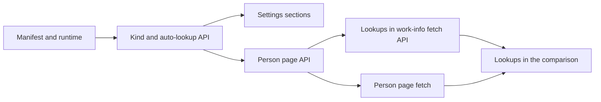

# Implementation Plan: Person plugins

**Branch**: `feature/person-plugins` | **Parent Issue**: #1469

**Input**: The parent Issue. It is this feature's specification.

## Summary

The owner can add person plugins, WebAssembly modules that search an external
source for a person by name and fetch a person's face, profile, aliases and
external IDs by an external ID. The person page fetches and applies them, and
a work-info fetch plans one lookup per fetched person whose external ID an
enabled person plugin accepts, which the comparison then shows and applies
under the person's role. Person plugins are a `kind` of the existing plugin
registry and run in the existing runtime, so only the manifest, the response
parsing, the in-memory results and the apply grow.

## Technical Context

**Canonical definitions**: [ARCHITECTURE.md](../../ARCHITECTURE.md),
[work-info-plugins.md](../../docs/design-docs/work-info-plugins.md),
[Write a work-info plugin](../../docs/how-to/work-info-plugins.md),
[people.md](../../docs/design-docs/people.md),
[`api/openapi.yaml`](../../api/openapi.yaml), the
[design system](../../docs/design-docs/design-system.md), and the checks in
[development.md](../../docs/how-to/development.md#validate-changes).

**Feature-specific context**:

| Item | Delta |
| --- | --- |
| Plugin contract | Contract `1` gains `kind`, `sources`, a person `fetch` and a `person` response ([person-plugin-contract.md](contracts/person-plugin-contract.md)) |
| Screen API | New lookup, person fetch and auto-lookup routes; additions to the plugin, fetch and apply schemas ([person-plugins-api.md](contracts/person-plugins-api.md)) |
| Storage | Three columns on `work_info_plugins` ([data-model.md](data-model.md)) |
| Memory | Kept images grow from 32 MiB to 52 MiB ([R-5](research.md#r-5-lookup-results-live-with-the-fetch-and-the-image-budget-grows-to-52-mib)) |
| Time | A comparison with 5 lookups can wait up to 2.5 minutes for the last person, one run at a time ([R-3](research.md#r-3-the-video-page-asks-for-each-lookup-after-the-work-info-fetch)) |
| Not changed | The external API (`/api/v1`) and MCP: the Issue asks for screens only |
| Migration number | `00069` is taken on `feature/face-recognition`; the storage unit takes the next number free on `main` when it lands |

Every unknown is resolved in [research.md](research.md) (R-1..R-8). The `ui`
label sends this feature through `design` next; layouts and states of the
three screens are decided there, within the API this plan fixes.

## Constitution Check

Checked against [ARCHITECTURE.md](../../ARCHITECTURE.md),
[core-beliefs.md](../../docs/design-docs/core-beliefs.md) and
[AGENTS.md](../../AGENTS.md); re-checked after the design artifacts.

| Rule | Verdict |
| --- | --- |
| Dependency direction | Pass. Manifest, plan and fill rules in `internal/domain`; use cases in `internal/app` behind its existing ports; parsing and image fetching in `internal/wasmplugin` |
| Store roles | Pass. Plugin columns stay in `WorkInfoPluginStore`; the person apply joins `CreditStore`'s write through package-private helpers in one transaction, as the work-info apply does |
| Events after commit | Pass. A person apply publishes what a person `PATCH` publishes, after commit; faces are stored after the commit, as today |
| Generated code | Pass. `api/openapi.yaml` changes and `task generate` regenerates |
| Complexity ≤ 25, no copied code | Pass by construction: one registry ([R-1](research.md#r-1-person-plugins-share-the-work-info-plugin-registry)), the work-info fill rules shared by both applies ([R-6](research.md#r-6-a-lookup-is-applied-per-item-only-through-a-selected-role)), and the person-comparison piece shared by the person page and the video comparison |
| Documentation with behaviour | Pass. A new `docs/design-docs/person-plugins.md`, linked from the index, plus the how-to contract |

## Project Structure

### Documentation (this feature)

```text
specs/062-mandb/
├── plan.md
├── research.md          # R-1..R-8
├── data-model.md        # work_info_plugins columns, in-memory results
└── contracts/
    ├── person-plugin-contract.md   # module contract delta
    └── person-plugins-api.md       # screen API delta
```

No `quickstart.md`: no step needs a real external site, and each unit's
acceptance runs inside the repository's checks with the `plugintest`
fixtures.

Lasting decisions go to a new `docs/design-docs/person-plugins.md`, created
by "Person plugin manifest, fetch response and runtime" and extended by each
later backend unit, to
[Write a work-info plugin](../../docs/how-to/work-info-plugins.md) for the
contract, and to [people.md](../../docs/design-docs/people.md) for the person
page.

### Source Code

**Affected boundaries**:

| Boundary | What changes |
| --- | --- |
| `internal/domain` | Manifest `kind` and `sources`, person request and response, the lookup plan rule, the ID choice for the person page, person item fills and the `taken` skip |
| `internal/wasmplugin` | Parsing a person response, fetching its one image |
| `internal/store` | The migration, plugin columns, the person apply and the lookup items inside `ApplyFetchedWorkInfo` |
| `internal/app` | `WorkInfoPlugins`: lookup plan and runs, person fetches and their apply |
| `internal/httpapi`, `api/openapi.yaml` | The [screen API](contracts/person-plugins-api.md) |
| `cmd/mdm` | `mdm plugin pack` and `run` for person plugins |
| `web/src/settings`, `web/src/credits/person`, `web/src/player/workInfoFetch` | Settings sections, person page fetch, lookups in the comparison |

**New paths**: `docs/design-docs/person-plugins.md`; the person-comparison
piece's place under `web/src` is left to `design`.

## Implementation Work

The units and what has to land first:



### Person plugin manifest, fetch response and runtime

**Scope**: The manifest's `kind` and `sources`, the person `search` and
`fetch` requests and responses, VVMDM's limits on them, and the person's
image fetched after the run
([person-plugin-contract.md](contracts/person-plugin-contract.md),
[R-2](research.md#r-2-the-person-plugin-contract)); `mdm plugin pack` and
`mdm plugin run --source`. Creates `docs/design-docs/person-plugins.md` and
adds the person plugin contract to the how-to guide.

**Dependencies**: None

**Acceptance**: Domain table tests: a manifest without `kind` parses as
`work`; `person` without `sources`, with 11 or duplicate sources, with only
`fetch`, and `work` with `sources` each give `manifest_invalid` naming the
field; a person response keeps 50 aliases and 20 IDs, adds the request's ID
when missing, and a candidate with an undeclared source fails with
`plugin_failed`. One `internal/wasmplugin` run of a `plugintest` fixture
returns a parsed person with its image fetched through the plugin client (the
real runtime is the boundary under test). `cmd/mdm` tests: `run ... fetch 1
--source s` prints `{"person": ...}`, and `--source` on a work-info plugin
exits 2.

### Person plugin kind, sources and automatic lookup switch in the plugin API

**Scope**: The [migration](data-model.md#migration) and columns,
`WorkInfoPlugin`'s `kind`, `sources` and `autoLookup`,
`PUT /api/work-info-plugins/{id}/auto-lookup`, person candidates from
`searchWorkInfo`, and `fetchWorkInfo` refusing a person plugin
([person-plugins-api.md](contracts/person-plugins-api.md#changes-to-existing-operations),
[R-1](research.md#r-1-person-plugins-share-the-work-info-plugin-registry),
[R-8](research.md#r-8-automatic-lookups-are-a-per-plugin-switch-on-the-row)).

**Dependencies**: Person plugin manifest, fetch response and runtime

**Acceptance**: Store tests on SQLite: an upload stores `kind` and `sources`;
a same-name replacement keeps `auto_lookup` off and takes the new kind. HTTP
tests: the list carries the three fields; `auto-lookup` on a work-info plugin
answers `409 plugin_kind_mismatch`; `fetchWorkInfo` with a person plugin
answers `409 plugin_kind_mismatch`; a person plugin's search returns `source`
and `name`.

### Settings screen lists person plugins apart, with their sources and automatic lookup switch

**Scope**: The settings page shows person plugins in their own section with
the same add, approve, settings, last run and delete actions; the approval
dialog shows the accepted sources (`受け入れ条件` 1); each person plugin row
has the automatic lookup switch. The video page's fetch dialog offers only
work-info plugins. Layout from `ui-design.md`.

**Dependencies**: Person plugin kind, sources and automatic lookup switch in
the plugin API

**Acceptance**: Component tests with the settings server fixture: a person
plugin appears only in its section and a work-info plugin only in its own;
the approval dialog lists the sources; turning the switch off sends
`enabled: false` and shows the returned state; the video fetch dialog does not
list a person plugin. Visual review of the settings page at the widths in
`ui-design.md`.

### Fetch and apply a person's information from a person plugin by the person's ID or a name search

**Scope**: `POST /api/people/{id}/plugin-fetches`, its image and apply routes,
the server's choice of the stored ID
([R-7](research.md#r-7-the-person-page-fetches-by-a-stored-id-chosen-by-the-server)),
and the person item rules in `internal/domain` and `internal/store`, written
so the work-info apply reuses them
([R-6](research.md#r-6-a-lookup-is-applied-per-item-only-through-a-selected-role)).

**Dependencies**: Person plugin kind, sources and automatic lookup switch in
the plugin API

**Acceptance**: Domain unit tests of the item fill: an empty field filled, a
stored field and a stored face kept (`受け入れ条件` 8), an invalid value
skipped, aliases and IDs appended up to 50 and 20. Store tests on SQLite: an
ID held by another person is skipped as `taken` and both people stay
separate. App tests with a fake runtime: without `source`, the first stored
accepted ID is sent; with none, `person_external_id_missing` before any run;
a plugin replaced after the fetch makes the apply `work_info_fetch_stale`; a
deleted person answers `person_not_found`. HTTP test of the three routes'
status codes.

### Person page fetches a person's information from a person plugin

**Scope**: The person page's fetch flow: choose a person plugin, fetch by the
stored ID or, on `person_external_id_missing`, search by the person's name and
pick a candidate; compare with the current values and apply the selected
items (`要件` 4, 5; `受け入れ条件` 2, 3; zero candidates shown and nothing
applied). Builds the person-comparison piece the video comparison reuses.
Layout from `ui-design.md`.

**Dependencies**: Fetch and apply a person's information from a person plugin
by the person's ID or a name search

**Acceptance**: Component tests on `PersonPage` with a fake server: a person
with an accepted ID gets the comparison with no search request; one without
gets candidates from the name and the chosen candidate's `source` and `id` in
the fetch; zero candidates shows the empty state and sends no apply; only the
checked items reach the apply; skipped values are listed. Visual review of
the person page and the dialog at the widths in `ui-design.md`.

### Plan and run person lookups from a work-info fetch and apply them with the work information

**Scope**: The lookup plan in the fetch result
([R-4](research.md#r-4-the-lookup-plan-is-decided-by-the-server-at-fetch-time)),
the lookup and lookup image routes, results kept with the fetch and the 52 MiB
budget ([R-5](research.md#r-5-lookup-results-live-with-the-fetch-and-the-image-budget-grows-to-52-mib)),
and `personLookups` in the apply, inside its transaction, with faces after the
commit ([R-6](research.md#r-6-a-lookup-is-applied-per-item-only-through-a-selected-role)).

**Dependencies**: Fetch and apply a person's information from a person plugin
by the person's ID or a name search

**Acceptance**: Domain table tests of the plan: a person with only an
unaccepted ID or only a name gets no lookup (`受け入れ条件` 5); two accepted
IDs give one lookup; two plugins on one source pick the first by name; a
disabled plugin is skipped (`受け入れ条件` 6); the sixth distinct lookup is
`lookupLimited`; IDs in a lookup's result add nothing to the plan
(`受け入れ条件` 7). App tests with a fake runtime: a failed lookup leaves the
fetch and its other lookups usable and reports the failure; a repeated lookup
request does not run again; one fetch with a cover, 7 images and 5 lookup
images stays kept. Store test on SQLite: a selected lookup fills the linked
person's empty fields and face (`受け入れ条件` 4), a lookup item without its
role is `invalid_request`, a person merged away before the apply skips its
lookup and the rest applies.

### Work-info comparison shows and applies person lookups under each person

**Scope**: After a fetch, the comparison requests the planned lookups one by
one, shows each result under its person with the reused person-comparison
piece, shows a failure's reason and the people over the limit, and sends the
selected lookup items with the apply (`要件` 6, 8; `UI品質`). Layout from
`ui-design.md`.

**Dependencies**: Plan and run person lookups from a work-info fetch and apply
them with the work information; Person page fetches a person's information
from a person plugin

**Acceptance**: Component tests with the work-info fetch fixture: lookups are
requested in plan order and the second starts after the first answers; a
person's lookup shows its changed fields and face and not its unchanged ones;
a failed lookup shows its reason while the rest of the comparison stays
appliable; a `lookupLimited` person shows the limit note; unchecking the role
row disables that person's lookup items; the apply body carries exactly the
checked items. Visual review of the comparison at the widths in
`ui-design.md`.
