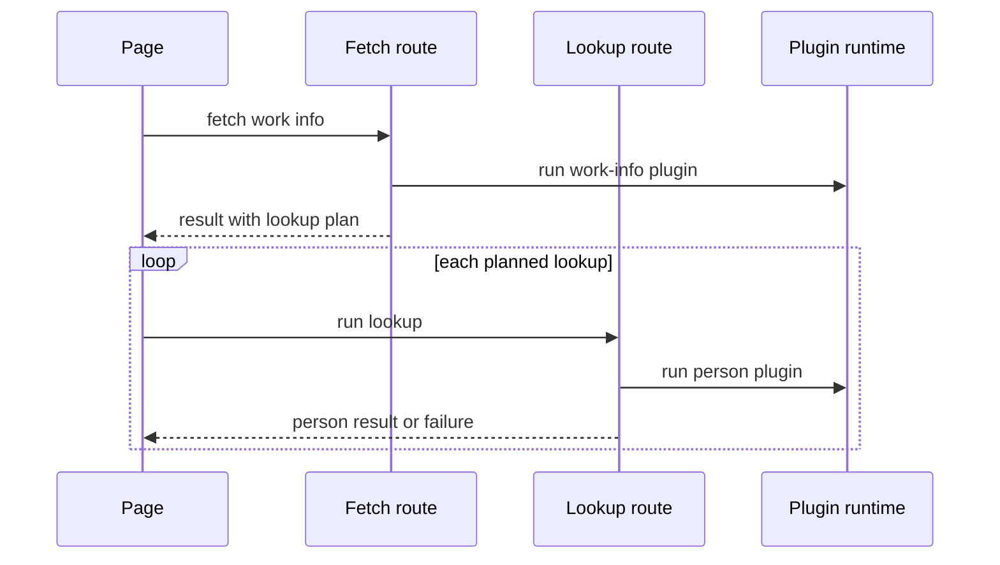
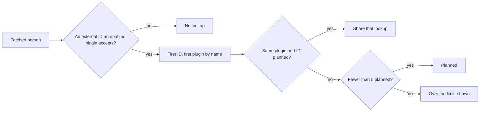

# Research: Person plugins

Inherited decisions: [ARCHITECTURE.md](../../ARCHITECTURE.md) (layers, store
roles, events after commit),
[work-info-plugins.md](../../docs/design-docs/work-info-plugins.md) (sandbox,
limits, network rule, approval bound to the digest, in-memory results, images
fetched by VVMDM, the apply transaction),
[people.md](../../docs/design-docs/people.md) (profiles, faces, external IDs,
merge) and the plugin contract in
[Write a work-info plugin](../../docs/how-to/work-info-plugins.md). This file
records only the decisions this feature adds.

## R-1: Person plugins share the work-info plugin registry

**Decision**: A person plugin is a row of `work_info_plugins` whose manifest
says `"kind": "person"`; upload, approval, settings, last run, deletion and
their endpoints stay the same, and the list carries `kind` so the settings
screen shows two sections.

| Option | New code | Kinds change on replacement | Verdict |
| --- | --- | --- | --- |
| **One registry, `kind` in the manifest** | A column and a manifest field | Allowed; a replacement already revokes approval | Chosen |
| A `person_plugins` table with its own endpoints | A second copy of the store role, approval, settings and last-run code | Not possible | Rejected: copies the registry, which AGENTS.md treats as P1 duplication |
| Rename `WorkInfoPlugin*` to `Plugin*` in this feature | Touches every plugin file, the API and the SPA | Same as chosen | Rejected: churn with no behaviour; the names can move in a refactor of their own |
| One registry, but a replacement must keep its kind | A refusal path at upload | Refused | Rejected: the owner would have to delete the plugin first, and a replacement already revokes approval and is re-approved from the new manifest |

**Rationale**: Requirements 1 and 12 ask for the same flow and the same
runtime, which the registry and `internal/wasmplugin` already give. The
manifest name stays the identity across both kinds, so a module named like an
existing plugin replaces it whatever its kind. A manifest without `kind` is a
work-info plugin, so every existing module keeps working.

## R-2: The person plugin contract

**Decision**: Contract `1` gains `kind` and `sources` in the manifest, a
`source` on the fetch request and on search candidates, and a `person` object
in the fetch response; the full shape is in
[person-plugin-contract.md](contracts/person-plugin-contract.md).

| Option | Owner sees the accepted sources before approval | Old servers | Verdict |
| --- | --- | --- | --- |
| **`kind` and `sources` in contract `1`** | Yes, from the manifest | Ignore `kind` and refuse the `person` response with `plugin_failed` | Chosen |
| Contract `2` for person plugins | Yes | Refuse the module at upload with `contract_unsupported` | Rejected: contract `2` would also have to cover work-info plugins, which do not change |
| Sources returned by a `describe` operation | No | Same as chosen | Rejected: the approval would show values from unapproved code, which [work-info-plugins.md](../../docs/design-docs/work-info-plugins.md#inspection-never-runs-the-module) already rules out |

**Rationale**: A person plugin declares both `search` and `fetch`
(requirement 3), so the person page never needs a branch for a plugin that
cannot search. A search candidate is an external ID (`source` and `id`) with a
name, so fetching a candidate and fetching by a stored external ID are the
same request. A person plugin's search has its own operation,
`POST /api/work-info-plugins/{id}/person-search`, with its own candidate
schema; adding person fields to `searchWorkInfo`'s candidates would turn the
video dialog's generated type into a union it has to narrow. VVMDM adds the external ID it fetched by to the result when the
plugin left it out, so a person found by name is looked up by ID next time.

## R-3: The video page asks for each lookup after the work-info fetch

**Decision**: The work-info fetch returns at once with a lookup plan; the page
then requests each planned lookup, one after another, and VVMDM keeps each
result with the fetch.

| Option | Time to first comparison | Abandoned page | Verdict |
| --- | --- | --- | --- |
| **Page requests each lookup** | One work-info run | No further runs | Chosen |
| Lookups inside the fetch request | Up to 6 runs of 30 s each | Runs to the end | Rejected: one request could last three minutes, and one failure would hold up the whole result |
| Server runs lookups in the background, page polls | One work-info run | Runs to the end and holds the single run slot | Rejected: adds polling, which [testing.md](../../docs/design-docs/testing.md#load-and-waiting) avoids, and blocks other runs for a page nobody reads |

**Rationale**: The runtime runs one module at a time, so lookups are
sequential in every option; doing them one request each shows the work
information first and each person as their result arrives. The server still
decides which lookups exist ([R-4](#r-4-the-lookup-plan-is-decided-by-the-server-at-fetch-time)),
so the page cannot ask for one outside the plan.

## R-4: The lookup plan is decided by the server at fetch time

**Decision**: For each fetched person, VVMDM walks the person's fetched
external IDs in order and picks the first approved person plugin with
automatic lookups on, in list order (name, then file name), that accepts the
ID's source; entries that pick the same plugin and ID share one lookup, and
only the first 5 distinct lookups in result order run.

| Option | Verdict |
| --- | --- |
| **First matching ID, plugins in list order** | Chosen: one plugin per person (requirement 9) with no new setting |
| An owner-set priority between plugins | Rejected: adds an ordering control the Issue does not ask for |
| Also use the matched person's stored external IDs | Rejected: the match is a display snapshot the apply redoes, and requirement 6 names the IDs in the result |
| A limit of 7, as for people's images | Rejected: 5 lookups at the 30 s run limit already keep the page waiting up to 2.5 minutes |

**Rationale**: Only external IDs from the work-info result enter the plan, so
an ID a person plugin returns never triggers another lookup (requirement 7),
and a person known only by name gets none (`対象外`). A person with two
accepted IDs gets one lookup (`Edge Cases`). The plan carries, per entry, the
lookup it shares or `limit` when it is over 5 (requirement 8).

## R-5: Lookup results live with the fetch, and the image budget grows to 52 MiB

**Decision**: A lookup's person and image are kept in the fetch's in-memory
entry, expire with it, and are served and applied from there; person page
results are kept in the same store, and one budget over both kinds of entry
becomes cover + 7 people's images + 5 lookup images at 4 MiB, 52 MiB, evicting
the entry with images that expires first, whatever its kind.

| Option | Verdict |
| --- | --- |
| **Keep with the fetch, 52 MiB budget** | Chosen: one fetch with every image still fits, so a result is never evicted by its own lookups |
| Keep the 32 MiB budget | Rejected: a fetch with a cover and 7 images is already at 32 MiB, so its first lookup image would evict it |
| A separate budget for person page results | Rejected: two budgets would allow 52 MiB plus the person results, and the eviction would need an order between them |
| Send the lookup result to the page and back with the apply | Rejected: the apply would trust values from the client instead of what the plugin returned |
| A lookup image replaces the person's work-info image | Rejected: the 7 kept images and the 5 lookups can be different people |

**Rationale**: The apply already checks a fetch's plugin, digest and
generation; a lookup also records its plugin's digest and generation, and the
apply skips a lookup whose plugin changed since with the reason `stale`,
keeping the rest of the result. A lookup request runs only while its plugin
is approved with the digest and generation the plan saw, and answers
`409 plugin_changed` otherwise; turning automatic lookups off after the fetch
does not stop a planned lookup. A failed lookup keeps no result, so the page
may request it again.

## R-6: A lookup is applied per item, only through a selected role

**Decision**: The apply takes, per lookup, the items the owner selected
(each profile field, `image`, `aliases`, `externalIds`); an item applies to the
person the entry's role links in the same apply, and only when that is the
person the entry matched at fetch time, or a person the apply creates for an
entry that matched none. Selecting a lookup item without its role field is
`400 invalid_request`.

| Item | Rule |
| --- | --- |
| A profile field | Fills the field only when empty, before the work-info profile fills what is left |
| `image` | Becomes the face only when the person has none, and is used before the work-info image |
| `aliases` | Appends aliases the person does not have; those over 50 are skipped as `too_many` |
| `externalIds` | Appends IDs the person does not have; those over 20 are skipped as `too_many`, and an ID another person holds is skipped as `taken` with that person's name, and nothing is merged |

| Skip reason | When |
| --- | --- |
| `invalid`, `too_many` | As in the work-info apply |
| `taken` | An external ID another person holds, the case the people API answers with `external_id_taken` |
| `stale` | The lookup's plugin was replaced, revoked or deleted since it ran |
| `person_changed` | The entry now links another person than it matched at fetch time, or an existing person when it matched none |

| Option | Verdict |
| --- | --- |
| **Items under a selected role** | Chosen: the role is what links the entry to a person, as the work-info profile already requires |
| A lookup item links its entry on its own | Rejected: a role the owner left unselected would gain a person |
| Apply to whoever the entry links at apply time | Rejected: the apply matches again, so a person merged away re-matches the merge target and a deleted one is created anew, and the face and profile fetched for one person would land on another |
| Work-info profile first | Rejected: the person plugin is the source the owner chose for people |

**Rationale**: The rules are those of the work-info apply
([work-info-plugins.md](../../docs/design-docs/work-info-plugins.md#the-apply-merges-the-selected-fields-in-one-transaction))
with three new skip reasons. `taken` covers the Issue's edge case of an ID
already linked elsewhere, and `person_changed` its edge case of a person
deleted or merged away before the apply: that person's lookup is skipped and
the other fields apply.

## R-7: The person page fetches by a stored ID chosen by the server

**Decision**: `POST /api/people/{id}/plugin-fetches` with only `pluginId` uses
the person's first stored external ID, in the stored `(source, value)` order,
whose source the plugin accepts, and answers `409 person_external_id_missing` when there is
none; with `source` and `id` from a search candidate it fetches that ID.

| Option | Verdict |
| --- | --- |
| **Server chooses the stored ID** | Chosen: the rule lives once, in `internal/domain` |
| The page picks the ID and always sends it | Rejected: the rule would live in Go and in TypeScript |

**Rationale**: The page offers a name search only after the `409`, so a person
with an accepted ID never sees candidates (`受け入れ条件` 2 and 3). The search
is the person search of [R-2](#r-2-the-person-plugin-contract), whose query
the page fills with the person's name.

## R-8: Automatic lookups are a per-plugin switch on the row

**Decision**: `work_info_plugins.auto_lookup` is on for a new person plugin,
kept when a module of the same name replaces it, and set through
`PUT /api/work-info-plugins/{id}/auto-lookup`; it does not affect the person
page.

| Option | Verdict |
| --- | --- |
| **A column set by its own endpoint** | Chosen: it is the owner's choice, not a setting the manifest declares |
| A manifest setting | Rejected: settings are values passed to the plugin, and the plugin would have to declare it |
| Off by default | Rejected: requirement 6 makes the lookup automatic, and approval is already the owner's consent |
