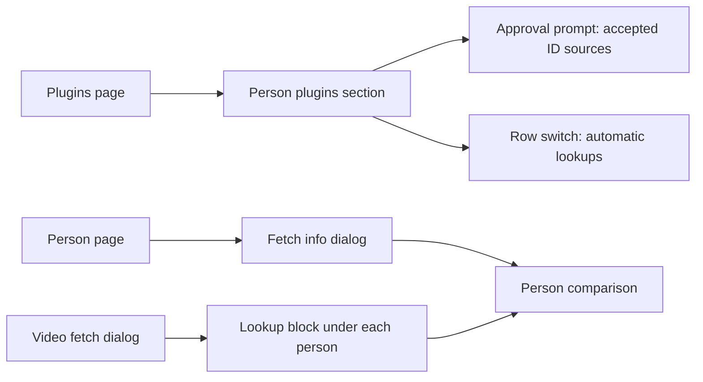
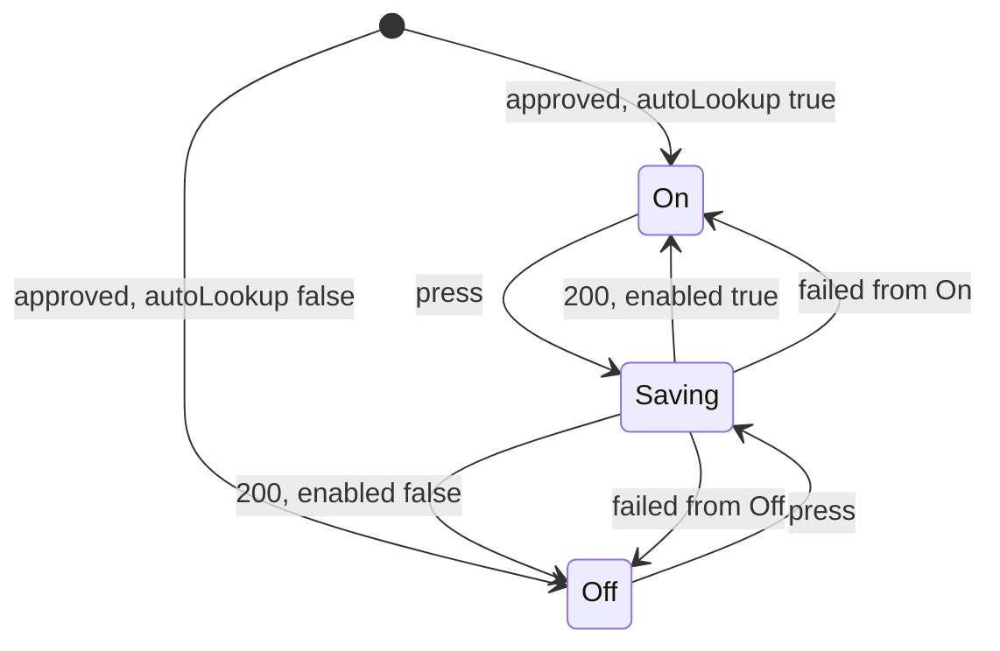
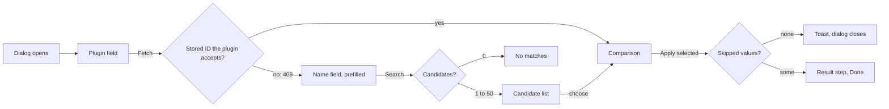
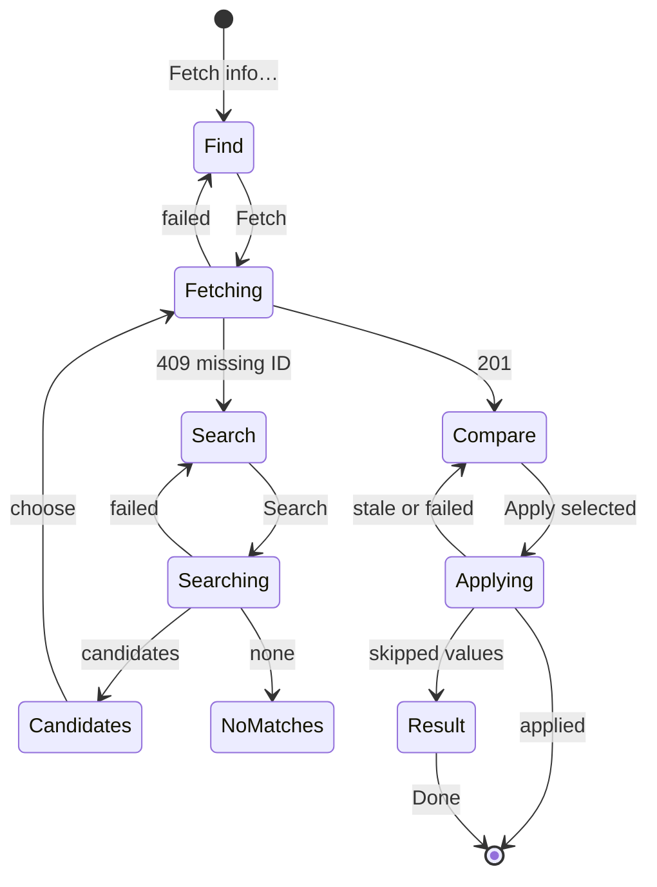
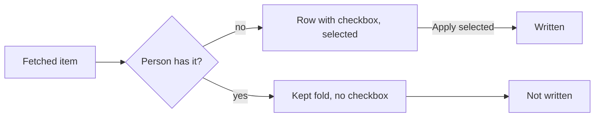
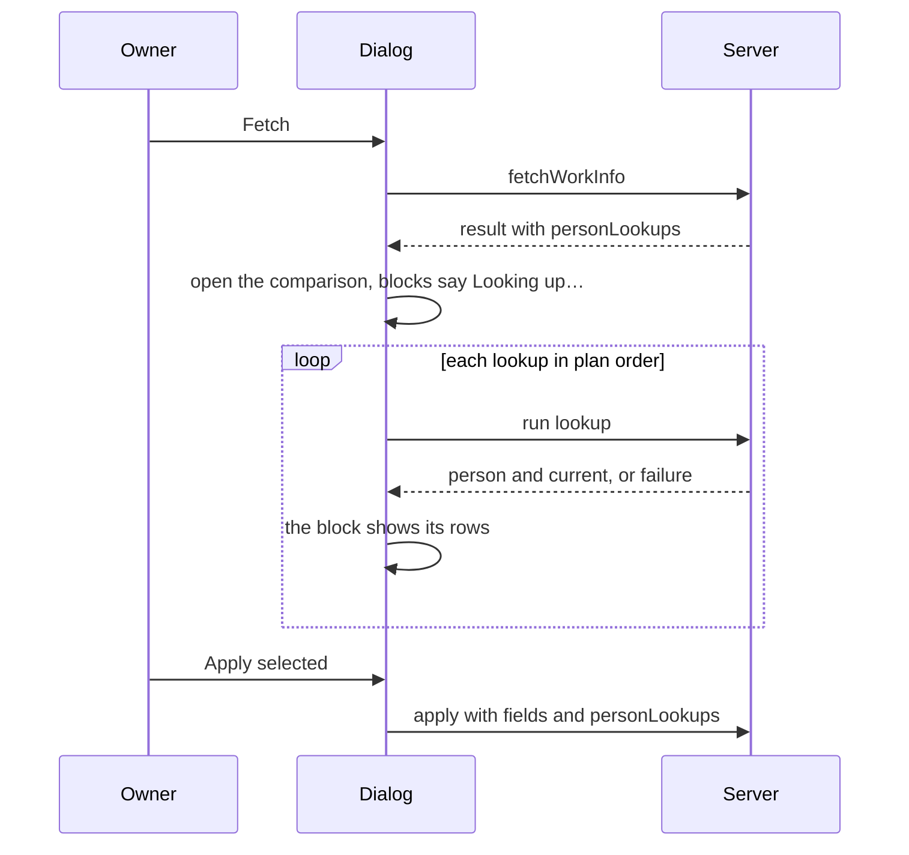
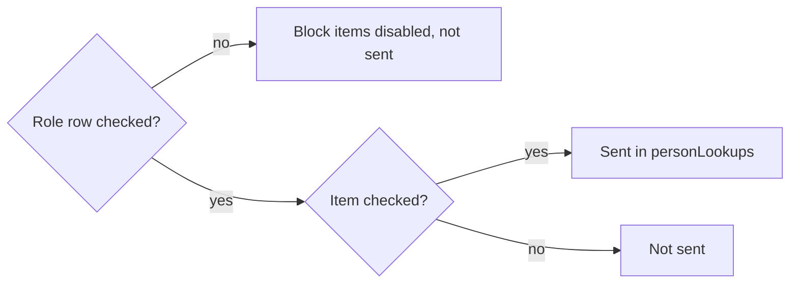
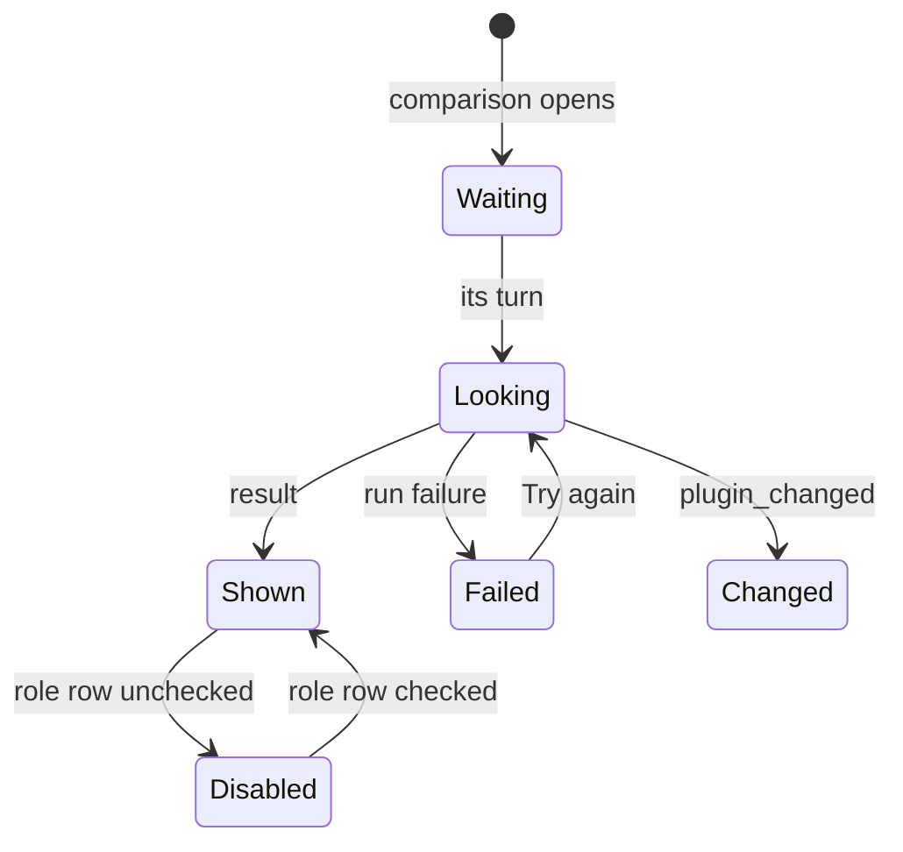

# UI design: Person plugins

**Feature**: [parent Issue #1469](https://github.com/syudead/vv/issues/1469) ·
[plan.md](plan.md) · [contracts/person-plugins-api.md](contracts/person-plugins-api.md) ·
[research.md R-3](research.md#r-3-the-video-page-asks-for-each-lookup-after-the-work-info-fetch) ·
[R-4](research.md#r-4-the-lookup-plan-is-decided-by-the-server-at-fetch-time) ·
[R-6](research.md#r-6-a-lookup-is-applied-per-item-only-through-a-selected-role) ·
[R-7](research.md#r-7-the-person-page-fetches-by-a-stored-id-chosen-by-the-server) ·
[R-8](research.md#r-8-automatic-lookups-are-a-per-plugin-switch-on-the-row)

Sources that already decide things, linked rather than repeated here:

| Topic | Source |
| --- | --- |
| Tokens, closed scales, density | [design-system.md, Foundations](../../docs/design-docs/design-system.md#foundations); the values in `@theme` of [`web/src/ui/tokens.css`](../../web/src/ui/tokens.css), named here and never copied |
| `PageSection`, `FormDialog`, `ProfilePage`, `FactList`, `EmptyState`, `ErrorState` | [patterns.md](../../web/registry/rules/patterns.md) |
| `Switch`, `Checkbox`, `Select`, `Badge`, `Alert`, `Spinner`, `Skeleton`, `PersonFace`, `DropdownMenu` | [components.md](../../web/registry/rules/components.md) |
| The Work-info plugins section, its row, the approval prompt and the row menu | [`WorkInfoPluginsSection.tsx`](../../web/src/settings/WorkInfoPluginsSection.tsx), [`WorkInfoPluginRow.tsx`](../../web/src/settings/WorkInfoPluginRow.tsx), [`WorkInfoPluginApprovalDialog.tsx`](../../web/src/settings/WorkInfoPluginApprovalDialog.tsx) |
| The video page's fetch dialog: find, candidates, compare and result steps, its failures | [`FetchDialog.tsx`](../../web/src/player/workInfoFetch/FetchDialog.tsx), [`FindStep.tsx`](../../web/src/player/workInfoFetch/FindStep.tsx), [`CompareStep.tsx`](../../web/src/player/workInfoFetch/CompareStep.tsx), [`TagChips.tsx`](../../web/src/player/workInfoFetch/TagChips.tsx) |
| The person page, its identity row and its fact groups | [people.md, The person page](../../docs/design-docs/people.md#the-person-page); [`PersonPage.tsx`](../../web/src/credits/person/PersonPage.tsx), [`PersonProfile.tsx`](../../web/src/credits/person/PersonProfile.tsx), [`personFacts.ts`](../../web/src/credits/person/personFacts.ts) |
| Faces in a comparison, the `Fills only empty fields` line | [people.md, Faces elsewhere](../../docs/design-docs/people.md#faces-elsewhere-on-the-screens) |
| Width breakpoints in CSS; layout checked by people | [library-ui.md, Width breakpoints](../../docs/design-docs/library-ui.md#width-breakpoints-in-css-and-the-sidebar-exception), [Layout verified by people](../../docs/design-docs/library-ui.md#layout-verified-by-people-not-machines) |
| Screen text | [`web/src/i18n/en.ts`](../../web/src/i18n/en.ts); this feature adds to `settings.workInfoPlugins`, `credits.personPage` and `player.workInfoFetch` |

This feature changes three screens, all for the owner:

1. The **Plugins settings page** gains a `Person plugins` section with the
   same row, approval prompt and menu as work-info plugins, plus the accepted
   ID sources and the automatic lookup switch (requirements 1, 2, 10;
   acceptance criteria 1, 6).
2. The **person page** gains `Fetch info…`, a dialog that fetches the person
   from a person plugin by a stored ID or a name search and compares the
   result with the person before applying it (requirements 4, 5, 11;
   acceptance criteria 2, 3, 8).
3. The **work-info comparison** shows, under each fetched person with a
   planned lookup, what the person plugin found, selectable item by item and
   applied with the work information (requirements 6, 8; acceptance criteria
   4, 5, 7).

The **person comparison** is one piece, built for the person page's dialog
and reused inside the video comparison's lookup blocks, at
`web/src/credits/person/pluginFetch/PersonCompare.tsx`; the dialog and its
flow sit beside it in `web/src/credits/person/pluginFetch/`. The video
comparison imports it, in the direction `player → credits` that
`CompareStep.tsx` already uses for `useLocalToday`.

Unchanged: the add, settings, last run, revoke and delete flows of a plugin
row, the video fetch dialog's find and result steps, and the comparison's
rows other than the people rows.

## Why this shape

Person plugins get a **section of their own, not a filter or a badge in the
work-info list**: the Issue asks for the two kinds to be told apart in the
list, and a section heading tells them apart at a glance without reading each
row, while the rows, the prompt and the menu stay the same component. A `Kind`
badge on each row was rejected: the owner scanning for the plugin that fetches
people would read every row's badges, and the sections already exist as the
page's unit of topic ([patterns.md, Settings page](../../web/registry/rules/patterns.md#settings-page)).
Each section keeps its own `Add plugin`, because a section's header action is
where the owner looks for adding; the upload is one endpoint and the manifest
decides the kind, so a module added under one heading can land under the
other, and the toast then says where.

The automatic lookup switch is a **`Switch` on the row**, visible with its
name, because it is a setting that takes effect at once
([components.md, Checkbox and Switch](../../web/registry/rules/components.md#checkbox-and-switch))
and the owner turns it off for one plugin while leaving the plugin usable
from the person page (requirement 10). A row menu item (`Stop automatic
lookups`) was rejected: the state would be invisible until the menu opens.
The switch shows on approved rows only; an unapproved or unusable plugin
never runs, so a switch there would be an element with nothing behind it
(Q-5). Its value is kept on the server, so a plugin approved again shows the
value it had.

The person page's fetch is a **dialog with the same steps as the video's
fetch dialog**: plugin, then candidates when needed, then the comparison,
then the result, in a `FormDialog` `size="wide"`. The Issue asks for the same
rhythm as the video's fetch (`UI品質`), and the owner who has used one knows
the other. The first press of `Fetch` sends no ID: the server picks the
stored ID ([R-7](research.md#r-7-the-person-page-fetches-by-a-stored-id-chosen-by-the-server)),
and only its `person_external_id_missing` turns the step into a name search.
Guessing in the page which stored ID the plugin accepts was rejected: the
rule would live twice, and the page would show a search for a person the
server could have fetched directly. An inline panel on the person page was
rejected: the profile column is `profile-aside` wide and sticky, too narrow
for `Now` and `Fetched` side by side.

The **person comparison shows the items that change and folds the rest**:
one row per item the apply would write (an empty field that gets a value, a
face for a person without one, aliases and IDs not stored yet), and one
folded line for the fetched values the person already has, since the apply
never replaces a stored value (requirement 11). The Issue's `UI品質` asks that
unchanged items not fill the screen, and acceptance criterion 8 makes those
rows unappliable. Hiding the kept values entirely was rejected: the owner
compares the fetched birth date with the stored one before trusting the rest
(requirement 5), so the fold opens them with both columns and no checkbox.

In the video comparison, a lookup is a **block under its person's chip, inside
the role row's fetched cell**, indented with a `border-l` line, carrying the
plugin's name in `text-xs text-muted-foreground`. The Issue's `UI品質` makes
the work information primary and the person's information subordinate to the
person's row, and puts the plugin's name in quieter type than the value. A
row per person at the top level of the comparison was rejected: it would put
a performer's birth date beside the video's title. A second dialog after the
apply was rejected: requirement 6 wants one apply screen.

Lookups run **one after another while the comparison is open, and
`Apply selected` does not wait for them**: each block shows `Looking up…`
until its result arrives, and an apply sent while a block is still looking
leaves that person's items out (the fetch is consumed by the apply, so the
pending lookup answers stale and the dialog drops it quietly). Disabling the
apply until the last lookup was rejected: five lookups can take 2.5 minutes
([R-3](research.md#r-3-the-video-page-asks-for-each-lookup-after-the-work-info-fetch)),
and the work information is ready after the first run.

## Words

The English is the draft the catalog takes; after implementation
[`web/src/i18n/en.ts`](../../web/src/i18n/en.ts) is canonical. Plugin names,
source names, IDs, person names and fetched values are user data and are
embedded untranslated.

### Settings section text

| Place | Text | Notes |
| --- | --- | --- |
| Person section heading | Person plugins | A second `PageSection` after `Work-info plugins` |
| Person section description | Plugins fetch a person's face and profile from other sites, from the person page and when fetched work information names a person they know. Approve a plugin before it can run. | Followed by the same `How plugins work` link |
| Person list | Added person plugins | `aria-label` of the list |
| Person section empty | No person plugins yet | `EmptyState` title, lucide `UserRoundSearch` |
| Person section empty hint | Add a .wasm person plugin file to fetch faces and profiles. | |
| Operations, person plugin | Search by name · Fetch by ID | `operations.search` and `operations.fetch` of a person plugin, in the facts line and the prompt's `Can` |
| Accepted sources (facts line) | Accepts IDs from {sources} | `{sources}` joined with `, `; after the operations |
| Switch label | Automatic lookups | The visible `Label` of the row's `Switch` |
| Switch, saving | Saving… | `text-xs text-muted-foreground` under the switch, as `Revoking…` |
| Switch failed | Couldn't change {name}: {reason} | The row's existing failure line |
| Added under the other heading | Added {name} under Work-info plugins. Approve it to use it. / Added {name} under Person plugins. Approve it to use it. | Replaces `Added {name}. Approve it to use it.` only when the kind differs from the section whose button was pressed; `Replaced {name}…` likewise |
| Prompt description, person plugin | Approved person plugins can run from a person page, and when fetched work information names a person with an ID they accept. | Replaces the work-info description in the approval prompt |
| Prompt, sources term | Accepts IDs from | `FactList` term; the value is one `secondary` `Badge` per source |

### Person page text

| Place | Text | Notes |
| --- | --- | --- |
| Entry | Fetch info… | `outline` `sm` button after `Edit` |
| Dialog title | Fetch info for {name} | |
| Dialog description | Nothing changes until you apply. | The same sentence as the video's dialog |
| Plugin | Plugin | The `Select`'s label, or the one-plugin line as the video's |
| Submit, ID step | Fetch | |
| Fetching | Fetching… | With `Spinner` |
| No accepted ID | {plugin} has no ID for this person yet. Search by name instead. | `text-muted-foreground`, above the name field; after `person_external_id_missing` |
| Name field | Name | Prefilled with the person's name, text selected on first focus |
| Submit, search step | Search | |
| Searching | Searching… | |
| Matches | {n} match / {n} matches | As the video's |
| No matches | No matches. Try other words. | Muted; nothing is applied (the Issue's edge case) |
| Candidate detail | {detail} · {source} {id} | `text-xs text-muted-foreground` under the name, after `detail` when present, then the host |
| Back | Back to the matches | Only after a search |
| Source line | From {plugin} · {source} {id} | `text-xs text-muted-foreground` above the comparison; `{source} {id}` is the result's first external ID |
| Submit, compare | Apply selected | |
| Applying | Applying… | |
| Applied | Applied to {name}. | Toast; the dialog closes |
| Result title | Applied, but some values were left out | `success` `Alert`, footer `Done` |
| Gone | This person no longer exists. | Toast when the apply answers `person_not_found`; the dialog closes and the page shows its gone state |
| Fetch failed | Couldn't fetch: {reason} | `destructive` `Alert` in the find step |
| Search failed | Couldn't search: {reason} | |
| Apply failed | Couldn't apply: {reason} | |
| Stale | This result is out of date. Fetch it again to apply it. | With `Fetch again`, as the video's |

### Person comparison text

| Place | Text | Notes |
| --- | --- | --- |
| Column headings | Now · Fetched | As the video's comparison |
| Face row | Face | |
| Profile rows | Born · Died · Gender · Birthplace · Height · Measurements · Cup · Blood type · Career · Bio · Links | The person page's fact terms (`credits.personPage.facts`), one row per fetched value |
| Aliases row | Aliases | |
| IDs row | External IDs | |
| Empty now | Empty | `text-muted-foreground` in the `Now` cell of a field with no value |
| No face now | No face | In the `Now` cell of the face row, beside the placeholder |
| Already on the person | On the person | Tooltip and screen-reader text of a muted chip with lucide `Check`; an alias or ID already stored |
| New count | {n} new | After the chips, as the video's |
| Kept fold | Kept as now ({n}) / Hide kept values | A `FoldButton`; `{n}` counts fetched values the person already has |
| Kept note | Already set; applying keeps the current value. | `text-xs text-muted-foreground` above the kept rows while open |
| Skipped, taken | already linked to {name} | The reason line in the result step, after `{source} {id}` |
| Skipped, too many | over the limit for aliases / over the limit for external IDs | |
| Skipped, invalid | too long or contains characters that can't be used | As the video's |
| Skipped, stale | the plugin changed since the lookup | Video comparison only |
| Skipped, person changed | the person was merged or deleted since the fetch | Video comparison only; the value is the person's name |

### Video comparison text

| Place | Text | Notes |
| --- | --- | --- |
| Lookup source | From {plugin} | `text-xs text-muted-foreground` on the block's first line, after the name |
| Looking up | Looking up… | With `Spinner`, in place of the items |
| Lookup failed | Couldn't look up {name}: {reason} | `text-destructive`, with `Try again` after it |
| Try again | Try again | `link` `sm` `Button` |
| Plugin changed | The plugin changed since the fetch, so this person wasn't looked up. | `text-muted-foreground`; no `Try again` |
| Over the limit | Not looked up: over the limit of 5 automatic lookups per fetch. | `text-xs text-muted-foreground` under the chip of a `lookupLimited` entry |
| Nothing new | Nothing new for this person. | Muted, when the lookup's result has no item that changes anything |
| Dropped by the apply | Applied; {n} people were still being looked up and were left out. | Toast in place of `Applied to the video.` when an apply cut lookups short |

## Changes to the design system

Nothing is added. The sections, the row, the `Switch`, the `FormDialog`
`wide`, the `Checkbox`, `PersonFace` in its `profile` and `compare` shapes
and the `FoldButton` of the comparison already exist. No colour token is
added and nothing is added to `pairs` in `web/src/theme/tokens.test.ts`:
the quiet lines use `text-muted-foreground`, failures `text-destructive`,
and the lookup block's edge the `border` token. The icons are lucide
`UserRoundSearch` (the person section's empty state and the entry's icon),
`Check`, `CircleAlert`, `CircleCheck` and `ExternalLink`, all but the first
in use already.

## Settings: Person plugins section

The Plugins page holds two `PageSection`s: `Work-info plugins` as today, then
`Person plugins`, the target of `/settings/plugins#person-plugins`. The page
reads the list once and splits it by `kind`; the work-info section keeps every
`work` row, including the `invalid` rows, whose kind is `work` because their
manifest could not be read ([data-model.md](data-model.md#work_info_plugins)).
Each section has its own `Add plugin`, loading, error and empty states, as
the work-info section's today.

| Part | Form |
| --- | --- |
| Row | The work-info row: badge, name, version, description, the facts line, the warning lines, the actions. The facts line of a person plugin reads `Search by name · Fetch by ID · Accepts IDs from {sources}`, then the settings summary and the last run, separated by ` · ` |
| Switch | On an `approved` row, first in the actions group: a `Switch` with its `Label` `Automatic lookups` in `text-sm`, `Field orientation="horizontal"`; sends `PUT /api/work-info-plugins/{id}/auto-lookup` on change and shows the returned value |
| Switch saving | The switch is `aria-disabled` with `Saving…` beside it; the other actions stay usable |
| Switch failed | The row's failure line `Couldn't change {name}: {reason}`; the switch returns to the stored value |
| Approval prompt | The work-info prompt with the person description and, after `Can`, the fact `Accepts IDs from` whose value is one `secondary` `Badge` per source in manifest order, wrapping; the network `Alert` and `Settings it receives` unchanged |
| Added under the other heading | The row appears in the section its kind belongs to, the focus moves to it, and the toast names that section |

The video page's fetch dialog lists `work` plugins only, and its entry is
hidden when no approved `work` plugin exists; an approved person plugin alone
shows no entry on the video page.

### States

The row's states and the actions between them are the work-info row's; the
switch adds two of its own.

| State | What the section shows |
| --- | --- |
| Loading, load failed, empty, adding, add failed | As the work-info section, per section; `No person plugins yet` with its hint |
| Rows | One row per person plugin in the API's order |
| Switch on, off | The `Switch` in its `primary` or clear fill; the label is the same in both |
| Switch saving | `aria-disabled` and `Saving…` |
| Switch failed | The row's failure line until the row's next action |

## Person page: fetch entry and dialog

The identity row gains `Fetch info…`, an `outline` `sm` `Button` with lucide
`UserRoundSearch` after `Edit` and before `Show in library`, shown only when
an approved person plugin exists. The page reads `GET /api/work-info-plugins`
on mount, as the video page's entry does, and hides the button until the list
holds one; a failed read hides it quietly. Nothing on the page outranks
viewing, so the button is not `default`
([patterns.md, Profile page](../../web/registry/rules/patterns.md#profile-page)).

The dialog is a `FormDialog` `size="wide"`, titled `Fetch info for {name}`,
with the description `Nothing changes until you apply.`; its steps and their
rhythm are the video's fetch dialog's.

| Step | Form |
| --- | --- |
| Plugin | The plugin field as the video's: a `Select` `sm` when more than one approved person plugin exists, otherwise the `Plugin {name}` line. The submit is `Fetch`; no query field is shown yet |
| Fetching | The submit reads `Fetching…` with a `Spinner`; the field is disabled |
| Name search | After `person_external_id_missing`: the muted note, then a `Field` `Name` prefilled with the person's name, selected on first focus; the submit is `Search` |
| Candidates | `{n} matches` heading, then the video's candidate list: a `ghost` button per candidate with the name in `text-sm text-foreground` and the detail line in `text-xs text-muted-foreground`, the `Open page` link at the right; choosing runs the fetch with the candidate's `source` and `id`, with the `Spinner` beside the chosen row. The first 50 are shown, as the server keeps them |
| No matches | `No matches. Try other words.` in the muted colour; the field stays editable and nothing is applied |
| Comparison | The source line, `Back to the matches` when the step came from a search, then the [person comparison](#person-comparison) with `Face` through `External IDs`; the submit is `Apply selected`, disabled while no item is selected |
| Result | The `success` `Alert` and one line per skipped value, `{label}: {value} — {reason}`, in the response's order; the footer holds only `Done` |

The apply sends `POST /api/people/{id}/plugin-fetches/{fetchId}/apply` with
the selected items. The response's `person` replaces the page's person in
memory, so the face, the facts and the aliases change under the dialog with
no second read, and the toast names the person.

| Answer | What the dialog and the page do |
| --- | --- |
| `200`, nothing skipped | The dialog closes, the toast `Applied to {name}.` shows, the focus returns to `Fetch info…` |
| `200`, values skipped | The page's person is replaced as above; the dialog moves to the result step |
| `work_info_fetch_stale` | The `Stale` `Alert` above the comparison with `Fetch again`, which runs the same plugin and ID; `Apply selected` is disabled |
| `person_not_found` | The dialog closes with the toast `This person no longer exists.` and the page shows its gone state (the Issue's edge case) |
| A run failure | A `destructive` `Alert` in the find step, `Couldn't fetch: {reason}` or `Couldn't search: {reason}`, with the plugin's message under it, as the video's; `plugin_settings_missing` is the `warning` form with `Open Settings` to `/settings/plugins#person-plugins` |
| Another apply failure | `Couldn't apply: {reason}` above the comparison; the selection is kept |

### States

| State | What the dialog shows |
| --- | --- |
| Find | The plugin field and `Fetch` |
| Fetching | `Fetching…` with the `Spinner`; `Cancel` stays enabled and aborts the request |
| Search | The muted note, the `Name` field and `Search` |
| Candidates | The list under the field; `Search` stays for another query |
| No matches | The muted line under the field |
| Compare | The source line, the comparison, `Apply selected` |
| Applying | `Applying…`; every checkbox and `Cancel` disabled; closing is ignored |
| Stale, apply failed | The `Alert` above the comparison |
| Result | The `Alert` and the skipped lines; `Done` |

## Person comparison

The piece lays out one row per item the apply would write, on the video
comparison's five-column grid (`sm:grid-cols-5`, the item one column, `Now`
and `Fetched` two each), with `gap-x-4`, `text-sm`, rows `py-2` apart and a
`border` line between them, so the person page's dialog and the video's
comparison share one rhythm (the Issue's `UI品質`). Each row is a `Checkbox`
with the item's label in `text-muted-foreground` as its `Label`, selected
when the piece opens.

| Row | `Now` | `Fetched` |
| --- | --- | --- |
| `Face` (the person has no face and the result has an image) | The `PersonFace profile` placeholder in a `w-16` frame, `No face` beside it in the muted colour | The fetched image in the same `w-16` frame, from the result's image route |
| A profile fact (the field is empty and the result has a value) | `Empty` in the muted colour | The value as the person page writes it, `text-foreground`, dates with the computed age |
| `Bio` | `Empty` | The text, six lines then `Show more`, as the person page |
| `Links` | `Empty` | One host per line with `ExternalLink`, as the person page |
| `Aliases` (the result has an alias not stored) | The stored aliases as muted `secondary` chips | The fetched aliases as `secondary` chips; one already stored is the muted chip with lucide `Check` and `On the person`; then `{n} new` |
| `External IDs` (the result has an ID not stored) | The stored IDs as muted chips, `tabular-nums` | The fetched IDs likewise, the request's ID first; stored ones muted with `Check` |

Rows for a fetched value the person already has are not drawn in the list.
They sit behind `Kept as now ({n})`, a `FoldButton` after the last row, which
opens them in place under the note `Already set; applying keeps the current
value.`: the same grid, both columns filled, the checkbox absent. A face the
person already has is a kept row too. A fetched value the result does not
carry draws no row at all. When no row changes anything, the piece is the one
muted line `Nothing new for this person.` and nothing is selectable.

In the person page's dialog the rows are headed by `Now` and `Fetched` from
`sm` as the video's comparison; in a lookup block the headings are not
repeated, because the block sits inside a comparison that already has them.

### States

| State | What the piece shows |
| --- | --- |
| Changes | The rows, every checkbox selected, then `Kept as now ({n})` when kept values exist |
| Kept open | The note and the kept rows under the fold; `Hide kept values` |
| Nothing new | `Nothing new for this person.`; the fold still shows when kept values exist |
| Locked | Every checkbox disabled, while the apply runs or the result is stale |

## Video comparison: lookup blocks

After the work-info fetch answers, the comparison opens as today and the
dialog requests the planned lookups one after another, in plan order
([R-3](research.md#r-3-the-video-page-asks-for-each-lookup-after-the-work-info-fetch)).
Each fetched person with a `lookup` gets a block inside the role row's
`Fetched` cell, under the chips and in place of that person's
`Fills only empty fields` line: `basis-full`, `border-l-2 border-border`,
`pl-3`, `mt-1`, `flex-col gap-1`.

| Part | Form |
| --- | --- |
| First line | `PersonFace compare` with the lookup's image when it has one, the person's name in `font-medium`, then `From {plugin}` in `text-xs text-muted-foreground`; the name is the matched person's current name, or the fetched name for a person the apply creates |
| Looking up | The `Spinner` and `Looking up…` under the first line |
| Result | The [person comparison](#person-comparison) without the column headings, its `Now` from the lookup's `current` (every cell `Empty` or `No face` for a person the apply creates) |
| Failed | `Couldn't look up {name}: {reason}` in `text-destructive` with `Try again`, which requests the same lookup again; the rest of the comparison stays as it is (the Issue's edge case) |
| Plugin changed | The muted line without `Try again` |
| Shared lookup | Two entries sharing one lookup draw one block, under the first entry's chip, with both names on the first line joined by ` · ` ([R-4](research.md#r-4-the-lookup-plan-is-decided-by-the-server-at-fetch-time)) |
| Over the limit | A `lookupLimited` entry gets the muted line under its chip and no block (requirement 8) |
| No lookup | Nothing: a person with only a name or an unaccepted ID shows the chips and fill line as today (acceptance criterion 5) |

A role row with a lookup whose result has a selectable item counts as a
change: its checkbox is selectable and selected when the comparison opens,
even when every fetched person is already on the video. Unchecking the row
disables the block's checkboxes and greys them, because a lookup item applies
only through its role ([R-6](research.md#r-6-a-lookup-is-applied-per-item-only-through-a-selected-role));
checking it again restores the items' own selection. The apply sends, per
lookup, the items checked at that moment, and leaves out a lookup whose
block is still looking up or has failed.

`Apply selected` keeps its rule: enabled while any row is selected, whatever
the lookups' state. An apply that cuts lookups short shows the toast
`Applied; {n} people were still being looked up and were left out.` instead
of `Applied to the video.`; the result step's skipped lines include a
lookup's `taken`, `stale` and `person_changed` values under the person's
name. `Fetch again` after a stale result runs the work-info fetch and then
the new plan's lookups.

### States

| State | What the block shows |
| --- | --- |
| Waiting, looking | The first line and `Looking up…`; the same for both, since the owner needs no order |
| Shown | The first line and the comparison rows |
| Nothing new | The first line and `Nothing new for this person.` |
| Failed | The failure line and `Try again` |
| Changed | The plugin-changed line |
| Disabled | The rows with every checkbox disabled, while the role row is unchecked, the apply runs or the result is stale |

## Responsive behaviour

Only Tailwind's default breakpoints are used, switched in CSS. The widths
judged are 360px, 768px and 1280px, as the video's fetch dialog.

| Width | Person plugins section | Person page and dialog | Lookup blocks |
| --- | --- | --- | --- |
| 1280px | Two sections `gap-8` apart; each row's first line holds the badge, name, version and the actions at the right end, the switch with its label first among them; the facts line wraps under the description | `Fetch info…` on the identity row's one line with `Edit`, `Show in library` and the menu; the dialog `max-w-2xl` centred, the comparison's three columns side by side, the `w-16` faces in the `Face` row, candidates one per row | Each block indented inside the `Fetched` cell, which is two of five columns; a block's rows use the cell's width with the item label on its own line above `Now` and `Fetched`, side by side |
| 768px | As 1280px | As 1280px; the dialog fits inside the viewport's side margins; the identity row wraps to two lines beside the face | As 1280px |
| 360px | The actions move under the row's text, right-aligned, the switch and its label first on that line; the facts line wraps | The identity row wraps under the half-width face, `Fetch info…` on its own line when needed; the dialog spans the screen with the 16px margin; each comparison row stacks with `Now` and `Fetched` each on its own line under its heading; candidates keep `Open page` at the right; no horizontal scroll | The block takes the stacked `Fetched` line's width; its rows stack as the dialog's; the `border-l` line stays at the left; no horizontal scroll |

## Review criteria

Judged by looking at the running screen in vv's one dark scheme
([Layout verified by people](../../docs/design-docs/library-ui.md#layout-verified-by-people-not-machines)).
"It exists" alone does not pass (Q-4).

1. **Visual hierarchy**: on the Plugins page the two section headings are the
   first things read, and a person plugin is never found by reading a row.
   In the video comparison the eye goes title → tags → the role rows, and a
   lookup block reads as part of its person's chip: indented, under it, its
   plugin name smaller and quieter than the values. In the person page's
   dialog the `Fetched` column is the only body-colour text in a row.
2. **Information density**: a person with a birth date, a height and a face
   already set and a fetched profile of eight values shows only the rows that
   fill something, and `Kept as now (3)` in one line; opening it shows the
   three. A lookup block for a person whose result changes nothing is one
   muted line. A comparison with five lookups at 1280×800 shows the title,
   the tags and the first role row with its first block without scrolling.
3. **Spacing rhythm**: the person page's dialog has the video dialog's gaps:
   the plugin field, the query field and the candidates `gap-4` apart, the
   comparison rows `py-2` with one line between, the source line above them
   in `text-xs`. A lookup block's rows share that `py-2` and line, inside the
   `border-l` indent, with no second border or card.
4. **Typography**: `From {plugin}` on a block's first line and the dialog's
   source line are `text-xs text-muted-foreground`, smaller and quieter than
   the name and the values beside them. The accepted sources in the facts
   line are `text-xs` like their neighbours, and in the prompt they are
   `secondary` badges that wrap without truncating. External IDs are
   `tabular-nums`.
5. **Action priority**: in each section `Review and approve` stays the only
   filled button, and the switch sits before `Settings` with its name visible
   at every width. On the person page `Fetch info…` has `Edit`'s weight and
   no fill. In both comparisons `Apply selected` is the one filled button;
   clearing one person's face is one press on its `Face` checkbox, and
   clearing a whole person is one press on the role row.
6. **Visible state**: adding a person plugin shows its row under
   `Person plugins` with `Accepts IDs from {sources}` and the prompt lists
   the sources (acceptance criterion 1); turning the switch off and reloading
   shows it off. On a person page with an accepted stored ID, `Fetch` opens
   the comparison with no name field (acceptance criterion 2); without one,
   the name field and the candidates appear, and choosing one opens the
   comparison (acceptance criterion 3); a search with no candidates shows
   `No matches` and the person is unchanged. Applying a comparison fills only
   the rows that were drawn with checkboxes, and the kept values stay
   (acceptance criterion 8). A work-info fetch whose person has an accepted
   ID shows the block with `Looking up…` and then its rows; applying fills
   that person's empty fields and face (acceptance criterion 4); a person
   with only a name or an unaccepted ID has no block (acceptance criterion
   5); a plugin with the switch off produces no block but still fetches from
   the person page (acceptance criterion 6); an ID a lookup returns never
   starts another block (acceptance criterion 7). A failed lookup shows its
   reason while `Apply selected` stays enabled (the Issue's edge case).
7. **Phone width**: at 360px the switch and its label stay together on the
   actions line, the identity row wraps without clipping the face, every
   comparison row stacks, the `w-16` faces keep their frame, and no block or
   candidate list scrolls sideways.
8. **Examples that do not meet the requirement**: person plugins listed in
   the work-info section with a badge; the switch inside the row menu or on
   an unapproved row; a `default` `Fetch info…`; a name field shown before
   the server has answered that no ID applies; rows for every profile field
   with `Same as now` filling the dialog; a lookup drawn as a top-level
   comparison row or in a second dialog; `Apply selected` disabled until the
   last lookup answers; a block whose plugin name is as large as the person's
   name; an unchecked role row whose block items still send.

## Accessibility

The parent Issue does not ask for screen reader or contrast design, so only
names are decided.

- The row's `Switch` is labelled `Automatic lookups` and described by the
  plugin's name, so it reads as `Automatic lookups, {name}`.
- Each comparison checkbox is labelled by its row's term; in a lookup block
  the group is a labelled region named by the person's name, so a row reads
  as `Face, {name}`.
- The `Kept as now` fold is a button with `aria-expanded`; `Looking up…` and
  `Saving…` use `role="status"`, a failed lookup `role="alert"`.
