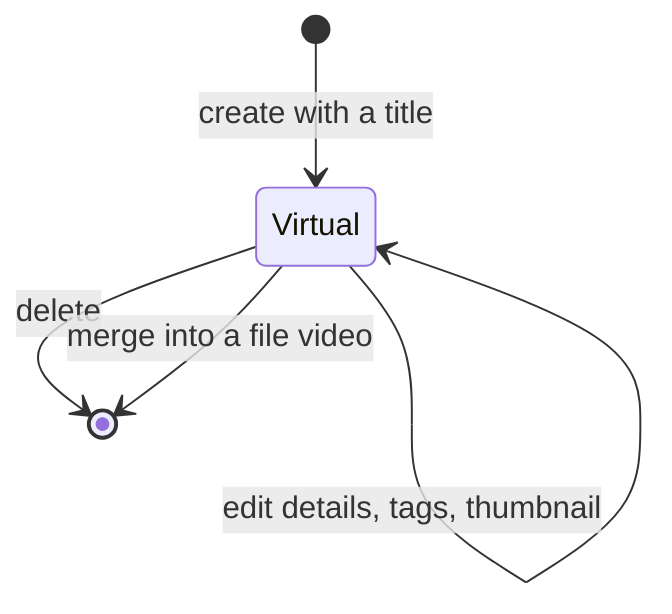

# Data model: Virtual videos

The rest of the model is unchanged: [internal/store/migrations](../../internal/store/migrations)
and [Data and recovery](../../docs/how-to/running-vv.md#data-and-recovery).
Tags, favorites, the public flag, playlist items, work information and
uploaded thumbnail images of a virtual video use the existing user-data tables
under its user key ([research R-1](research.md#r-1-a-persistent-virtual-video-table-projected-into-videos)).

## Migration

`00073_virtual_videos.sql` creates `virtual_videos`. It alters no existing
table.

## `virtual_videos`

| Field | Type | Null | Meaning |
| --- | --- | --- | --- |
| `id` | integer primary key autoincrement | No | Never reused, so `virtual:<id>` is unique for the life of the database |
| `user_key` | text unique | No | `virtual:<id>`; the `content_key` of its projected `videos` row and the key of its user data |
| `title` | text | No | Trimmed, not empty |
| `title_key` | text | No | Title sort key, normalized as `video_locations.title_key` |
| `search_key` | text | No | Search key built from the title, as `video_locations.search_key` |
| `search_version` | integer | No | Normalization version, refreshed at startup with the other keys |
| `created_at` | integer | No | Creation time; the added, created and modified sort value |
| `updated_at` | integer | No | Last details save |

**Relationships**: No foreign key, as for the other user-data tables. The
projected `videos` row is found by `content_key = user_key`.

## Projected `videos` row

| Column | Value |
| --- | --- |
| `content_key` | `virtual_videos.user_key` |
| `added_at` | `virtual_videos.created_at` |
| `duration_ms`, `width`, `height`, codecs | Null |
| `playable` | False |
| Processing states (`probe_state`, `thumbnail_state`, `seek_thumbnail_state`, `preview_state`) | A state no job worker claims; `thumbnail_state` is `done` while an uploaded image exists |

## Rules

| Rule | Enforced in |
| --- | --- |
| A title is not empty after trimming | `internal/domain`, checked by the store on create and save |
| Description, links and dates follow the work-information limits | `internal/domain` work information (unchanged) |
| The orphan sweep never deletes a projected row | `deleteOrphanVideos` in `internal/store` |
| Every `virtual_videos` row has a projected row after startup | Startup key refresh in `internal/store` |
| Deleting a virtual video deletes its row, its projection and every user-data row under its key, in one transaction | `internal/store` |
| A merge moves user data as in [research R-8](research.md#r-8-merge-moves-user-data-into-the-file-videos-user-key) and deletes the virtual row in the same transaction | `internal/store` |
| Save, delete and merge reject a stale `contentVersion` | `internal/store`, as `ErrContentChanged` |

## State transitions

A virtual video ends either by deletion or by merging; neither leaves a row
that a later file removal could turn back into a virtual video.

## What does not change

`video_locations`, the folder index and the version-bundle tables gain no
virtual rows. `video_overrides` is not used for a virtual video's title
([research R-2](research.md#r-2-title-in-the-virtual-video-table-date-description-and-links-in-work-information)).
