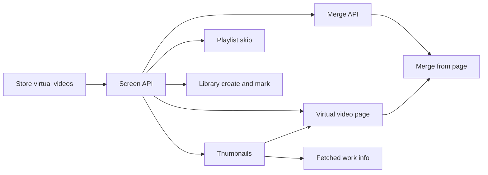

# Implementation Plan: Virtual videos

**Branch**: `feature/062-virtual-videos` | **Parent Issue**: #1015

**Input**: The parent Issue. It is this feature's specification.

## Summary

The owner can keep a video with no file in the library as a virtual video,
with a title, date, thumbnail, description and links, list and organize it
like a file video, and later merge it into a file video. A persistent
`virtual_videos` table gives each virtual video a user key `virtual:<id>`,
and a location-less `videos` row projects it into the index, so the existing
per-video operations and user-data tables serve it; listing, visibility,
playlist playback and merging gain a virtual branch
([research R-1](research.md#r-1-a-persistent-virtual-video-table-projected-into-videos)).

## Technical Context

**Canonical definitions**: [ARCHITECTURE.md](../../ARCHITECTURE.md),
[catalog-organization.md](../../docs/design-docs/catalog-organization.md),
[Data and recovery](../../docs/how-to/running-vv.md#data-and-recovery),
[thumbnail-editing.md](../../docs/design-docs/thumbnail-editing.md),
[api/openapi.yaml](../../api/openapi.yaml),
[library-ui.md](../../docs/design-docs/library-ui.md),
[design-system.md](../../docs/design-docs/design-system.md).

**Feature-specific context**:

| Delta | Decision |
| --- | --- |
| New user-data table `virtual_videos` and projected `videos` rows | [data-model.md](data-model.md), [R-1](research.md#r-1-a-persistent-virtual-video-table-projected-into-videos) |
| Description, links and date are the existing work information | [R-2](research.md#r-2-title-in-the-virtual-video-table-date-description-and-links-in-work-information) |
| Listing, search and sort accept location-less rows | [R-3](research.md#r-3-listing-adds-a-virtual-branch-to-the-location-driven-query) |
| Visibility accepts location-less rows | [R-4](research.md#r-4-visibility-gains-a-virtual-branch) |
| Guests read description and links | [R-5](research.md#r-5-guests-read-description-and-links) |
| Screen API additions | [contracts/screen-api.md](contracts/screen-api.md) |
| Merge rules | [R-8](research.md#r-8-merge-moves-user-data-into-the-file-videos-user-key) |
| Fetched work information applies to a virtual video | [R-11](research.md#r-11-fetched-work-information-applies-to-a-virtual-video) |
| Out of scope: external API, MCP, version bundles, a link plugin for any site and running a plugin by the link's domain | [R-4](research.md#r-4-visibility-gains-a-virtual-branch), [R-10](research.md#r-10-virtual-videos-stay-out-of-version-bundles), [R-11](research.md#r-11-fetched-work-information-applies-to-a-virtual-video) |

The screens follow `ui-design.md`, which the `design` stage adds before
`plan-to-issues` because the parent carries the `ui` label.

## Constitution Check

| Rule (source) | Verdict |
| --- | --- |
| Dependency direction ([ARCHITECTURE.md](../../ARCHITECTURE.md#intended-dependency-direction)) | Pass: title and merge-limit rules go in `internal/domain`, SQL stays in `internal/store`, handlers in `internal/httpapi` |
| Store roles: one role per operation, cross-role work through package-private helpers ([ARCHITECTURE.md](../../ARCHITECTURE.md#cross-cutting-invariants)) | Pass: a new `VirtualVideoStore` role owns create, save, delete and merge; merge reuses the succession helpers that move user data |
| Events after commit | Pass: delete and merge publish `ContentUnreferenced` for the virtual key after commit, so `internal/artifacts` removes its thumbnail |
| Every read knows its viewer | Pass: the virtual branch sits inside `visibleVideoCondition` ([R-4](research.md#r-4-visibility-gains-a-virtual-branch)) |
| User data survives a rebuild | Pass: `virtual_videos` is user data and the projected rows are recreated at startup ([R-1](research.md#r-1-a-persistent-virtual-video-table-projected-into-videos)) |
| Only a scan walks the media folders | Pass: no virtual operation touches the filesystem except thumbnail publication through `internal/artifacts` |
| Generated code ([AGENTS.md](../../AGENTS.md)) | Pass: `api/openapi.yaml` changes, then `task generate` |
| Complexity 25 and no copies ([complexity-and-duplication.md](../../docs/design-docs/complexity-and-duplication.md)) | Pass if the listing's virtual branch and the merge reuse the existing sort expressions and `moveUserData` pieces; units name this in their acceptance |
| Documentation updated with behaviour (core beliefs) | Pass: the store unit updates `catalog-organization.md`, `running-vv.md` and the user-data invariant in `ARCHITECTURE.md` |

## Project Structure

### Documentation (this feature)

```text
specs/062-virtual-videos/
├── plan.md
├── research.md
├── data-model.md
└── contracts/
    └── screen-api.md
```

No `quickstart.md`: the acceptance criteria are covered by the units'
automated checks and browser e2e listed below.

### Source Code

**Affected boundaries**:

| Path | Change |
| --- | --- |
| `internal/domain` | Virtual-video title rule, merge limits, `VideoQuery.Kind`, playlist step skipping |
| `internal/store` | Migration, `VirtualVideoStore`, projection and orphan sweep, visibility, listing, playlist reads |
| `internal/app` | Thumbnail upload for a virtual video at 16:9 |
| `internal/httpapi`, `api/openapi.yaml` | [contracts/screen-api.md](contracts/screen-api.md) |
| `web/src/library`, `web/src/videoList` | Create action and the virtual mark |
| `web/src/player` | Virtual video page, delete and merge, playlist no-playable state |

**New paths**: `internal/store/migrations/00073_virtual_videos.sql`,
`internal/store/virtual_videos.go`, `internal/httpapi/virtual_videos.go`.

**Structure decision**: Follows the existing layout
([ARCHITECTURE.md](../../ARCHITECTURE.md#subsystem-map)).

## Implementation Work



### Store virtual videos that survive scans and appear in library reads

**Scope**: Migration and `VirtualVideoStore` create, title save and delete
([data-model.md](data-model.md)); projected rows, the orphan-sweep exemption
and startup recreation ([R-1](research.md#r-1-a-persistent-virtual-video-table-projected-into-videos));
visibility ([R-4](research.md#r-4-visibility-gains-a-virtual-branch)); listing,
search, sort, filters and `VideoQuery.Kind`
([R-3](research.md#r-3-listing-adds-a-virtual-branch-to-the-location-driven-query)).
Updates `catalog-organization.md`, `running-vv.md` and `ARCHITECTURE.md`.

**Dependencies**: None

**Acceptance**: Store tests against SQLite (the contract is SQL) show: a
created virtual video is listed and found by a title term for the owner, for a
guest only when public, and by a tag name for the owner only, and never in a folder read; it remains after a manual
scan removes missing locations, and its projected row is recreated after the
row is deleted and startup runs; each sort places it by the values in R-3;
deleting it removes its tags, favorite, public flag, playlist items and work
information. A stale `contentVersion` returns `ErrContentChanged`. No function
added or changed exceeds complexity 25.

### Screen API for creating, editing and deleting virtual videos

**Scope**: `Video.virtual` and the field values, `POST /api/virtual-videos`,
`DELETE /api/videos/{id}`, `contentVersion` on details and display-name saves,
guest `workInfo` subset, `kind` on `GET /api/videos`, and `409 virtual_video`
on every version-bundle operation, `POST /api/organize/bundle` included ([contracts/screen-api.md](contracts/screen-api.md),
[R-5](research.md#r-5-guests-read-description-and-links),
[R-6](research.md#r-6-optimistic-check-by-contentversion),
[R-10](research.md#r-10-virtual-videos-stay-out-of-version-bundles)). New error
codes get screen text in `web/src/i18n/en.ts`.

**Dependencies**: Store virtual videos that survive scans and appear in library reads

**Acceptance**: Handler tests with a faked store show each status and code in
the contract, guests receiving only `description` and `urls` and a `403` on
create, delete and save, and the route-security test passing for the new
operations. `task generate` leaves no diff.

### Virtual video thumbnails from an uploaded image

**Scope**: Upload and removal of a virtual video's thumbnail fitted to 16:9,
publication through `internal/artifacts`, republication at startup, and
`409 virtual_video` on frame position and thumbnail edits
([R-7](research.md#r-7-thumbnails-from-an-uploaded-image-only)).

**Dependencies**: Screen API for creating, editing and deleting virtual videos

**Acceptance**: An `internal/app` test with fakes shows the image fitted to
16:9 and stored under the virtual key; a handler test shows the thumbnail URL
served after upload and `409 virtual_video` on frame position; deleting the
virtual video releases the artifact.

### Apply fetched work information to virtual videos

**Scope**: The work-info plugin apply for a virtual video: the title written
to `virtual_videos`, the cover applied through the virtual thumbnail path,
and the other fields as for a file video
([R-11](research.md#r-11-fetched-work-information-applies-to-a-virtual-video)).
The video page's existing fetch dialog works unchanged.

**Dependencies**: Virtual video thumbnails from an uploaded image

**Acceptance**: Store tests against SQLite show a fetched title, description,
date and link applied to a virtual video, its title in `virtual_videos` and
none in `video_overrides`, and a stale plugin approval leaving it unchanged.
An `internal/app` test with fakes shows the chosen cover stored under the
virtual key at 16:9. A handler test shows the apply answering `200` for a
virtual video instead of `404`.

### Skip virtual videos in playlist continuous play

**Scope**: `PlaylistPlayback.next` skipping virtual items and `playableCount`
([R-9](research.md#r-9-playlist-playback-skips-virtual-videos-on-the-server)),
and the playlist screen and player states for `playableCount` `0` from
`ui-design.md`. Changes a screen.

**Dependencies**: Screen API for creating, editing and deleting virtual videos

**Acceptance**: Domain table tests of `PlaylistPlaybackOf` cover a virtual item
between file items and a playlist of only virtual items. A browser e2e plays a
playlist of a file, a virtual and a file video and reaches the second file
video (acceptance criterion 4). Visual review of the no-playable state.

### Merge a virtual video into a file video

**Scope**: The merge transaction and `POST /api/virtual-videos/{id}/merge`
([R-8](research.md#r-8-merge-moves-user-data-into-the-file-videos-user-key),
[contracts/screen-api.md](contracts/screen-api.md)).

**Dependencies**: Screen API for creating, editing and deleting virtual videos

**Acceptance**: Store tests against SQLite show each row of the R-8 table,
merging into a bundled file video landing on the bundle key, the virtual video
gone from lists afterwards, and an over-limit description or a stale version
leaving both videos unchanged. Handler tests cover each error code. The merge
reuses the succession helpers instead of copying them.

### Create virtual videos from the library and mark them in lists

**Scope**: The library create action and dialog, and the virtual mark on grid
cards and list rows, as `ui-design.md` specifies. Changes a screen.

**Dependencies**: Screen API for creating, editing and deleting virtual videos

**Acceptance**: Component tests show the create action rejecting a blank title
and the mark on a virtual card with no duration or play affordance. A browser
e2e creates a virtual video with a title only and finds it in the library list
and in search results with the mark (acceptance criterion 1). Visual review at
the review widths in `ui-design.md`, with card size equal to a file card.

### Show a virtual video's page without a player

**Scope**: The video page for a virtual video (thumbnail, description, links
opening in a new tab, no player), editing and deleting it, handling of
`404` and `409 content_changed` on save, the owner-only controls hidden from
guests, and description and links shown to guests on every video, as
`ui-design.md` specifies. Changes a screen.

**Dependencies**: Screen API for creating, editing and deleting virtual
videos; Virtual video thumbnails from an uploaded image

**Acceptance**: Component tests show links with `target="_blank"`, a save
answered `404` telling the owner the video is gone without recreating it, and
no create, edit, merge or delete controls for a guest. Browser e2e: a link on a
virtual page opens a new tab (criterion 2); description and links saved on a
file video remain after reload (criterion 3); a guest sees a public virtual
video and not a hidden one (criterion 7). Visual review.

### Merge a virtual video from its page

**Scope**: The secondary merge action on the virtual video page, the picker of
file videos (`kind=file`), the confirmation and the error states, as
`ui-design.md` specifies. Changes a screen.

**Dependencies**: Merge a virtual video into a file video; Show a virtual
video's page without a player

**Acceptance**: Component tests show the picker offering file videos only and
the error text for each merge code. A browser e2e merges a virtual video with a
tag and a link into a file video, then finds one entry in the library that
plays and carries that tag and link (criterion 5). Visual review.
