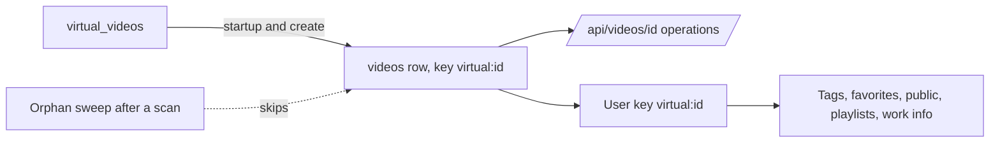
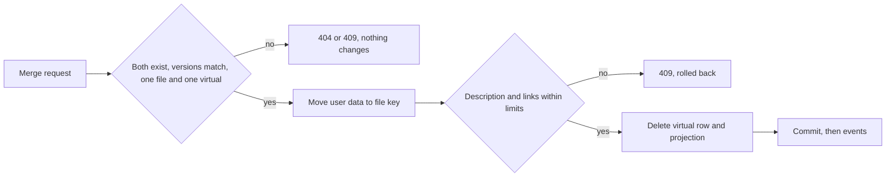

# Research: Virtual videos

Inherited decisions: [ARCHITECTURE.md](../../ARCHITECTURE.md) (store roles,
events after commit, every read knows its viewer, user data survives a
rebuild), [catalog-organization.md](../../docs/design-docs/catalog-organization.md)
(content keys and user keys), [thumbnail-editing.md](../../docs/design-docs/thumbnail-editing.md)
(uploaded images and `contentVersion`). This file records only the decisions
this feature adds.

## R-1: A persistent virtual-video table projected into `videos`

**Decision**: A virtual video is a row of a new user-data table
`virtual_videos`, whose own id gives it the user key `virtual:<id>`, and a
`videos` row with that `content_key` and no location projects it into the
index, so every `/api/videos/{id}` operation, event and user-data join works
unchanged.

| Option | Survives a rebuild | Reuses per-video endpoints | Touches file-only code | Verdict |
| --- | --- | --- | --- | --- |
| **Persistent table plus a projected `videos` row** | Yes, the table is user data and the row is recreated from it | Yes, by `videos.id` | Visibility and listing only | Chosen |
| Separate table and id space (`/api/virtual-videos/{id}` for everything) | Yes | No: tags, favorites, playlists, public flag, details and thumbnails each need a second endpoint | None | Rejected: duplicates every per-video operation and the screens that call them |
| A `videos` row only, marked virtual | No: `videos` is the rebuildable index | Yes | Visibility and listing | Rejected: breaks the rule that user data is not keyed by or stored in the index |
| A synthetic location row | Yes | Yes | Scanner, folder screens, `mediafs`, removal of missing locations | Rejected: the scanner removes the location as missing, and folder screens and file access would see it |

**Rationale**: The `virtual:` prefix cannot collide with a content key
(`<hex>:<size>`) or a bundle key (`bundle:<id>`), so the user-data tables need
no new column. The orphan sweep that deletes location-less `videos` rows skips
projected rows, and startup recreates any projected row that is missing, which
keeps `videos` rebuildable.

## R-2: Title in the virtual-video table; date, description and links in work information

**Decision**: The virtual video's title lives in `virtual_videos.title` with
its own title and search keys; its date, description and links are the
existing work information (release date, description, URLs), which every video
already has.

| Option | Requirement 3 (description and links on any video) | Merge rule | Verdict |
| --- | --- | --- | --- |
| **Title in `virtual_videos`, the rest in work information** | Already met by work information | Work information already moves between keys | Chosen |
| Title in `video_overrides.display_name` | Same | Same | Rejected: listing sorts and searches the title through the location's keys, so a location-less row needs its own keys anyway |
| New description and link columns on `virtual_videos` | Needs the same fields again for file videos | A second copy to merge | Rejected: duplicates `video_work_info` and `video_work_urls` |

**Rationale**: The details editor already edits description, URLs and dates
and validates URLs as absolute HTTP(S), which covers the Edge Case of a string
that is not a link. Saving a virtual video's details writes its title to
`virtual_videos` instead of `video_overrides`.

## R-3: Listing adds a virtual branch to the location-driven query

**Decision**: The library list, search and playlist reads add a union branch
for projected rows to the `chosen` step of the listing query, and every sort
key falls back to a virtual value.

| Sort or filter | Virtual value |
| --- | --- |
| Added | Creation time |
| Created, modified | Creation time, as creation time already falls back to modification time |
| Title | `virtual_videos.title_key` |
| Duration, size | Unknown, sorted last as unknown durations already are |
| Played, favorited, random, tags, people, tag kind, added within | Unchanged, they read the user key or `videos.id` |
| Duration range | Excluded, as a video of unknown duration is |
| Playable only | Excluded |
| Search | Each term matches `instr` on `virtual_videos.search_key`, or, for the owner, the tag, work code, person and organization condition file videos already use |

**Rationale**: Search on virtual rows uses substring matching instead of a
second FTS table: a trigram match and `instr` return the same rows, and the
owner creates virtual videos by hand, so their count stays small enough to
scan. Folder reads filter by location path and so exclude virtual videos with
no change (requirement 8).

## R-4: Visibility gains a virtual branch

**Decision**: `visibleVideoCondition` accepts a projected row for the owner,
and for a guest when its user key is public; the location condition stays for
file videos.

**Rationale**: Every read that returns videos already goes through this one
predicate, so guests see public virtual videos and never hidden ones
(requirement 14) without per-screen checks. The external API (`/api/v1`) and
MCP keep their own location-required reads, so virtual videos stay out of them;
the parent Issue asks for no external access.

## R-5: Guests read description and links

**Decision**: `GET /api/videos/{id}` returns `workInfo.description` and
`workInfo.urls` to guests for every visible video; the other work-information
fields stay owner-only.

| Option | Verdict |
| --- | --- |
| **Description and links for guests on every video** | Chosen |
| Description and links for guests on virtual videos only | Rejected: requirement 14 asks for the same view as a public file video, and requirement 3 makes the fields common to both |
| Full work information for guests | Rejected: people and organizations have their own owner-only reads |

## R-6: Optimistic check by `contentVersion`

**Decision**: Saving details, deleting and merging a virtual video carry the
`contentVersion` the screen read, and a virtual video's `contentVersion` is its
whole user key.

**Rationale**: `videos.id` is a plain rowid that SQLite can reuse after a
delete, so a stale editor could otherwise save into another video; the check
answers `409 content_changed` and a missing id answers `404`, so nothing is
recreated (Edge Case). The first 12 characters used for file videos would let
`virtual:12345` and `virtual:12346` share a version.

## R-7: Thumbnails from an uploaded image only

**Decision**: A virtual video's thumbnail is an image the owner uploads through
the existing upload endpoint, fitted to 16:9, stored in `thumbnail_images`
under its user key and published by `internal/artifacts`; startup republishes
it when the file is missing.

| Option | Verdict |
| --- | --- |
| **Upload, fit to 16:9, publish through artifacts** | Chosen |
| Serve the stored blob from the database | Rejected: bypasses the one owner of thumbnail files and its size variants, so a list would send the full upload per card |
| Fetch the image from a link | Rejected: the parent Issue asks for no fetching, and requests to arbitrary hosts need the plugin network rules |

**Rationale**: 16:9 is the card frame, so a virtual card keeps the size of a
file card (UI quality, information density). Without an image the card and the
page show the existing placeholder.

## R-8: Merge moves user data into the file video's user key

**Decision**: Merging runs in one store transaction that moves the virtual
key's user data to the file video's user key (its bundle key when bundled),
then deletes the virtual row and its projection.

| Data | Rule |
| --- | --- |
| Tags | Union |
| Favorite | Favorite when either is |
| Playlist items | Re-keyed in place; when both are in one playlist, the file video's item stays |
| Description | The file video's, then a blank line and the virtual video's, when both exist |
| Links | The file video's, then the virtual video's not already present |
| Dates, code | The file video's per field when present, otherwise the virtual video's |
| People, organizations, external ids | Union |
| Title, thumbnail | The file video's, which always has both |
| Public flag | The file video's |

**Rationale**: A combined description over 10,000 characters or more than 20
links answers `409` and changes nothing, so the owner shortens one side
instead of losing text. The public flag is not carried because publishing a
file as a side effect of a merge would show guests a file the owner never
published. A merge has no undo: the Issue asks for none, and undo would keep
the virtual key alive as bundles keep absorbed keys.

## R-9: Playlist playback skips virtual videos on the server

**Decision**: `domain.PlaylistPlaybackOf` skips virtual items when it computes
the continuous-playback step, and reports how many visible items have a file,
so a playlist of only virtual videos shows that nothing can be played.

| Option | Verdict |
| --- | --- |
| **Skip on the server** | Chosen |
| Extend the client-side `useUnplayableSkip` | Rejected: it opens each virtual page and then navigates away, and it cannot tell a playlist of only virtual videos from one that ends (Edge Case) |

**Rationale**: The manual previous and next steps still reach a virtual
video, so the owner can open its page from the playlist.

## R-10: Virtual videos stay out of version bundles

**Decision**: Every operation that bundles, unbundles, makes a representative
or dismisses a version pair, including `POST /api/organize/bundle`, rejects a
virtual video with `409 virtual_video`.

**Rationale**: A bundle chooses a representative file to play, and a virtual
video has no fingerprints, so it is never a duplicate candidate; merging
(R-8) is the operation that joins a virtual video to a file video.
