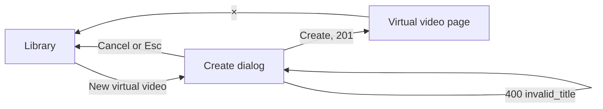
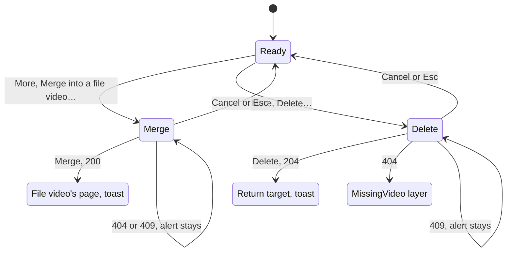

# UI design: Virtual videos

Sources: [design-system.md](../../docs/design-docs/design-system.md),
[components.md](../../web/registry/rules/components.md),
[patterns.md](../../web/registry/rules/patterns.md),
[library-ui.md](../../docs/design-docs/library-ui.md) (Cards, List view,
Video page layout, Information rows, Details editor),
[plan.md](plan.md), [contracts/screen-api.md](contracts/screen-api.md),
[research R-5 to R-9](research.md). Screens narrowed:
`web/src/library/LibraryPage.tsx`, `web/src/videoList/VideoCard.tsx`,
`web/src/player/VideoPage.tsx`, `web/src/player/VideoFacts.tsx`,
`web/src/player/WorkInfo.tsx`, `web/src/player/detailsEditor/`,
`web/src/playlists/PlaylistPage.tsx`, `web/src/playlists/PlaylistPanel.tsx`.

## Why this shape

A virtual video is a library item like any other, so it takes the shapes the
library already has and differs only where its lack of a file shows: one mark
in the place of the duration, a video page whose media is the thumbnail and
whose main action is a link, and two owner actions, merge and delete, one
step below the page's main actions. The alternative, a separate list and page
for virtual videos, was rejected: requirement 4 puts them in the same list,
and a second page would copy the title, tags, favorite, playlist and
visibility controls the video page has.

The mark is the word `Virtual` with the `SquareDashed` icon (lucide), in the
duration's place. A dashed outline reads as "no content here" and is distinct
from the `CircleDashed` of a tentative tag, the `Layers` of versions and the
`Globe` of a public video. A colour or a badge on the thumbnail was rejected:
the Issue asks for a distinction that does not stand out from file videos, and
the duration pill is where the eye already reads a card's status.

On the virtual video page, the links are drawn as `outline` `Button`s under
the title, not as the `Links` item of the work details row. On a file video
the main action is playing and links stay details; on a virtual video there
is nothing to play, so the link is the main action and takes the main
action's form. The description keeps the `Description` component (`text-sm`,
folded to three lines) that every video page uses, so no second type scale
appears.

## Words

| Place | Text | Notes |
| --- | --- | --- |
| Library header action | `New virtual video` | `outline` `sm` `Button`, `SquareDashed` icon |
| Create dialog title | `New virtual video` | `FormDialog` |
| Create dialog description | `A video without a file. Add links, a description and a thumbnail on its page.` | |
| Create dialog field | `Title` | `Input` |
| Create dialog rule | `Enter a title.` | `FieldError`, also for `400 invalid_title` |
| Create dialog submit | `Create` / `Creating…` | |
| Create dialog failure | `Couldn't create the virtual video: {reason}` | `destructive` `Alert` |
| Mark | `Virtual` | Next to the `SquareDashed` icon in the duration's place on cards, rows and playlist items |
| Mark, accessible | `Virtual video, no file` | `sr-only` after the mark |
| Video page band | `Virtual video` | In the breadcrumb's place, with the icon, not a link |
| Thumbnail placeholder (owner) | `No thumbnail yet` / `Upload an image…` | Inside the media frame |
| Thumbnail placeholder (guest) | `No thumbnail` | Inside the media frame |
| Facts row | `Added`, `Edited` | Existing words |
| Thumbnail item | `Uploaded thumbnail` / `Remove image` | `Remove image` replaces `Use the frame instead` |
| Change thumbnail menu | `Upload an image…`, `Current thumbnail` | Existing words; `Frame on screen` absent |
| More menu | `Merge into a file video…` | After `Edit details` in the actions row |
| More menu | `Delete…` | `destructive` item after a separator |
| Merge dialog title | `Merge into a file video` | `FormDialog` |
| Merge dialog description | `Tags, favorite, playlists, links and the description move to the file video. The file video keeps its title and thumbnail. This can't be undone.` | |
| Merge dialog search | `Search file videos` | `CommandInput` placeholder |
| Merge dialog list | `File videos` | `aria-label` of the list |
| Merge dialog empty | `No file video matches` | `CommandEmpty` |
| Merge dialog load failure | `Couldn't load file videos` | `destructive` `Alert` with `Retry` |
| Merge dialog submit | `Merge` / `Merging…` | Disabled until a file video is chosen |
| Merge failure, too long | `The two descriptions together are too long. Shorten one and try again.` | `409 description_too_long` |
| Merge failure, links | `The two videos have more than 20 links together. Remove some and try again.` | `409 too_many_urls` |
| Merge failure, changed | `One of the videos changed in another tab. Reload and try again.` | `409 content_changed`, with `Reload` |
| Merge failure, gone | `One of the videos is no longer in the library.` | `404` |
| Merge failure, other | `Couldn't merge: {reason}` | |
| Merge done toast | `Merged into "{title}"` | On the file video's page |
| Delete dialog title | `Delete "{title}"?` | `ConfirmDialog` |
| Delete dialog description | `The virtual video is removed with its tags, favorite, links, description and playlist entries. This can't be undone.` | |
| Delete dialog action | `Delete` / `Deleting…` | `destructive` |
| Delete failure, changed | `This video changed in another tab. Reload and try again.` | `409 content_changed`, with `Reload` |
| Delete failure, other | `Couldn't delete: {reason}` | |
| Delete done toast | `Deleted "{title}"` | On the list the page returns to |
| Already gone toast | `"{title}" was already removed` | `404` on delete, or on save from the details editor |
| Details editor aside | `Virtual video` | In the file name's place, with the icon |
| Details editor title rule | `Enter a title.` | Under `Title`, for an empty value |
| Details editor gone | `This virtual video was deleted or merged. Nothing was saved.` / `Back to the library` | `404` on save |
| Details editor changed | `This video changed in another tab. Reload it to keep editing.` / `Reload` | `409 content_changed` on save |
| Playlist page description | `These are all virtual videos, so there's nothing to play.` | `playableCount` `0` with items |
| Playlist panel line | `Nothing to play` | Under the panel's heading when `playableCount` is `0` |

## Library: create action and the mark

The owner's `New virtual video` sits in the library header's `actions` slot
(`PageHeader`), at the right end, as `Save as smart folder` does while filters
apply; with filters both show, `Save as smart folder` first. On the unfiltered
home the header's title is hidden, so the row holds the button alone, right
aligned, above the grid. It is `outline`, not `default`: the library's main
activity is browsing, and a create action that is occasional must not be the
brightest control on the screen. The empty library keeps `Set up library` as
its one action; the header button is still there, so creation stays one press
away. Guests have no button and no row.

Pressing it opens the create dialog, a `FormDialog` with one `Title` field
(`NameDialog` shape). `Create` sends `POST /api/virtual-videos`; on success
the dialog closes and the page opens the new video's page with the library as
its return target, so the owner adds links, a description and a thumbnail
next. Staying on the list was rejected: a title alone is rarely the whole
intent, and the page is where the rest is entered.

### Grid card

A virtual card is a video card of the same width, border and bottom padding,
so rows keep their height. What differs:

| Part | Virtual card |
| --- | --- |
| Thumbnail | The uploaded image at 16:9, or the frame with no image, as a file video whose thumbnail is not made yet |
| Duration pill | `SquareDashed` icon and `Virtual`, after the versions and public marks' place (a virtual video has no versions; the public `Globe` may precede it) |
| Progress, hover preview, scrub band | None |
| Unplayable notice | None: the `AlertTriangle` notice is for a file that cannot play, and would say the video is broken |
| Title, tags row, favorite heart, `Add to playlist`, `Add to group`, selection check | Unchanged |

The pill carries the word `Virtual` in the duration's place. This narrows the
`VideoThumbnail` rule (no text on the image but the duration and the notice):
the card unit updates that sentence in components.md to allow the mark where
a duration would be.

### List row

The duration cell shows the mark instead of a time; the quality and size
cells are empty (not `0 B`), and the date cell shows the creation time. The
unplayable line under the title is absent.

## Video page

The page is the `DetailPage` of a file video with the player replaced by the
thumbnail. Nothing on the media can be pressed, and the page says what it is
in two places: the band and the frame.

| Part | Virtual video |
| --- | --- |
| Header band | Logo, then `SquareDashed` icon and `Virtual video` in the breadcrumb's place (muted, not a link), then × |
| Media | The player frame (`bg-navbar`, `aspect-player`, `rounded-lg` from `lg`) holding the uploaded image, `object-contain`. Without an image: the `SquareDashed` icon (`size-8`, `text-muted-foreground`) over `No thumbnail yet` in `text-sm` muted, and for the owner the `secondary` button `Upload an image…`, which opens the same picker as `Change thumbnail` → `Upload an image…`. No play button, no control bar, no cursor change, no previous and next arrows outside a playlist |
| Title unit | Title with the pencil, tags, auto-tag and visibility switch as today |
| Links | One `outline` `Button` (`default` size) per link, wrapping with `gap-2`, directly under the title unit: `ExternalLink` icon and the link without its scheme, truncated at `max-w-xs`, full URL in `title`; opens in a new tab (`target="_blank"`, `rel="noreferrer"`). Absent without links |
| Description | The `Description` component under the links, `text-foreground`, three lines then `Show more`. Absent without a description |
| Facts row | `Added` and `Edited` with their icons; no length, size or created item; the thumbnail item with `ImageUp`, `Uploaded thumbnail` and `Remove image` while an image exists. Actions at the right end |
| Actions | Favorite, `Add to playlist`, `Add to group`, `Edit details`, the work-info fetch entry, `Change thumbnail` (menu without `Frame on screen`), then `More` (`Ellipsis`, `ghost`, `icon-sm` with tooltip). No `Use current frame as thumbnail`, `Open file`, `Copy path` or `Read again` |
| `More` menu | `Merge into a file video…`, a separator, `Delete…` (`destructive`) |
| Work details row | Owner only, as today, without `Links` and the description, which are above |
| Technical line, media information | Absent |
| Right column | Playlist panel, `Up next` and related videos as today |

The links sit above the facts divider, with the title unit, because a reader
of this page came to follow them. They are buttons so that the first bright
control on the page is a link, not a thumbnail that looks like a poster. The
thumbnail is the one element with no behaviour (Q-5): its value is naming the
video at a glance and matching its card; the risk is a press that expects
playback, prevented by the band label, the absence of a play button, control
bar and hover change, and the links taking the action form right below.

Merge and delete are one step below the actions, in `More`, because both are
irreversible and rare; `Delete…` is the only destructive item and sits after
a separator, as in the playlist page's menu.

A file video's page changes in one way: the work details row shows its
description and `Links` item to guests too (nothing else of the row), so a
guest sees on a public file video what they see on a public virtual video.

### Guests

A guest sees the band label, the thumbnail (placeholder with `No thumbnail`
and no button), the title, the links, the description and the facts row with
`Added` only; no actions, no `More`, no tags, no visibility switch.

### States

| State | What the screen shows |
| --- | --- |
| Loading | The frame with the loading indicator, title skeletons, as today |
| Ready, with image | The image in the frame, links and description under the title |
| Ready, no image | The placeholder in the frame; owner sees `Upload an image…` |
| Upload sending | `Change thumbnail` and the placeholder button spin; one at a time |
| Image removed | The frame returns to the placeholder; the thumbnail item disappears |
| Merge dialog open | See [Merge dialog](#merge-dialog) |
| Delete dialog open | `ConfirmDialog`; `Delete` runs `DELETE /api/videos/{id}` with the page's `contentVersion` |
| Deleted | Toast `Deleted "{title}"`, the page closes to its return target, the cached list drops the card |
| Gone (`404` on delete, save or refresh) | The `MissingVideo` layer as today; the delete dialog closes with the `already removed` toast |
| Changed (`409 content_changed`) | The dialog stays with the `changed` alert and `Reload`, which re-reads the video and closes the dialog |

### Merge dialog

A `FormDialog` (`max-w-lg`) titled `Merge into a file video`, with the
description line, a `Command` whose `CommandInput` searches file videos
(`GET /api/videos?kind=file&query=`), and a footer with `Cancel` and `Merge`.

| Part | Rule |
| --- | --- |
| Rows | Thumbnail at `w-list-thumb`, title on one line (`truncate`), and under it the duration and the folder path in `text-xs` muted; 20 rows per read, more on scroll |
| Choosing | A row is chosen by press or Enter; it takes the `primary-soft` fill with `primary` text as a selected toggle does, with a `Check` at its end; choosing another moves the mark. Only one row is chosen |
| Search | The owner's search expression, as the library's; typing re-reads from the first row; while reading, a `Spinner` in the input's frame |
| `Merge` | Disabled until a row is chosen; `pending` while the request runs |
| Success | The dialog closes, the page replaces itself with the file video's page (same return target), toast `Merged into "{title}"`; the cached library list drops the virtual card and refreshes the file card |
| Failure | A `destructive` `Alert` above the footer with the code's text; the dialog stays open with the choice kept. `content_changed` offers `Reload` |

A popover picker, as `Add to playlist` uses, was rejected: choosing the wrong
file video is costly, so the rows need a thumbnail and a path to tell videos
apart, which a popover of names cannot hold.

### Details editor

`/videos/:id/edit` for a virtual video names it in the aside with the
thumbnail (or the placeholder) and `Virtual video` in the file name's place;
duration, size, resolution and folder lines are absent. The name field is
labelled `Title` and refuses an empty value with `Enter a title.` under it,
before sending. `Save` sends the page's `contentVersion`; a `404` turns the
form into a `destructive` `Alert` with `Back to the library`, and a `409`
shows the `changed` alert with `Reload`, which re-reads the video and keeps
the editor open. Nothing is recreated.

## Playlists

| Place | Virtual item |
| --- | --- |
| Playlist page row | The mark in the duration cell; the thumbnail, title, reorder handle and `Remove from playlist` unchanged; the title opens the virtual video page in the playlist context |
| Playlist page header | `Play` as today, starting at the first item with a file. With items but `playableCount` `0`, no `Play` and the header's `description` reads `These are all virtual videos, so there's nothing to play.` |
| Player's playlist panel | The row shows the mark instead of the duration; with `playableCount` `0` the panel's heading gets `Nothing to play` in `text-xs` muted under it |
| Continuous play | The server's `next` skips virtual items, so the ended notice names the next file video. Reaching the last file video with only virtual items after it shows `End of playlist` as today |
| Manual steps | Previous and next reach a virtual item; its page shows the playlist line and panel and never advances by itself |

## Responsive behaviour

The video page follows the `DetailPage` widths in
[library-ui.md](../../docs/design-docs/library-ui.md#video-page-layout); the
library follows the toolbar widths in the same document. Judged at:

| Width | Layout |
| --- | --- |
| 360px | Library: one column; the header action row holds `New virtual video` right aligned above the grid, and with filters `Save as smart folder` wraps to its own line before it. Card pill reads `Virtual` in full. Video page: the frame edge to edge under the band, the band shows the icon and `Virtual video`, links wrap one or two per line at full width minus the padding, `More` stays visible at the row's end. Merge dialog spans the screen with the 16px margin; rows keep the thumbnail and a one-line title |
| 768px | Library: cards in the zoom's columns; the action row holds both buttons on one line. Video page: the frame at the column's width, links in a row, the actions row on one line |
| 1280px | Video page: the frame at `player-width-lg`, title, links and description at the frame's width in the middle of the column, the right column at `detail-aside`; the merge dialog at `max-w-lg` in the middle |

## Review criteria

1. In a grid of mixed videos at 768px and 1280px, every row of cards has the
   same height whether or not it holds a virtual card, and a virtual card is
   found within a second by its pill without reading titles.
2. The virtual pill is no brighter than the duration pill beside it: same
   fill, same `text-2xs`, the icon the height of the text.
3. A virtual card shows no warning triangle, no progress bar and no change
   on hover beyond the heart and checks a file card also shows.
4. On the virtual video page at 1280px, the first bright controls under the
   band are the link buttons; the thumbnail has no play button, control bar
   or cursor change, and the band says `Virtual video` where a folder path
   would be.
5. The links and the description sit between the title unit and the facts
   divider with the page's `gap-4` rhythm, and the description uses the same
   `text-sm` as the work details row of a file video; no heading is added.
6. The facts row of a virtual video reads `Added`, `Edited`, then the
   thumbnail item when an image exists, with no empty item, `0 B` or dash.
7. `More` is the last control of the actions row, `ghost` like its
   neighbours; `Merge into a file video…` is a plain item and `Delete…` is
   the only red item, after a separator.
8. In the merge dialog, the chosen row and only the chosen row carries the
   `primary-soft` fill and a check; `Merge` is disabled until then.
9. On a playlist page of virtual items only, there is no `Play` button and
   the description line under the title explains why.
10. As a guest, the public virtual video page shows the band label,
    thumbnail, title, links, description and `Added`, and no control besides
    the links and ×.
