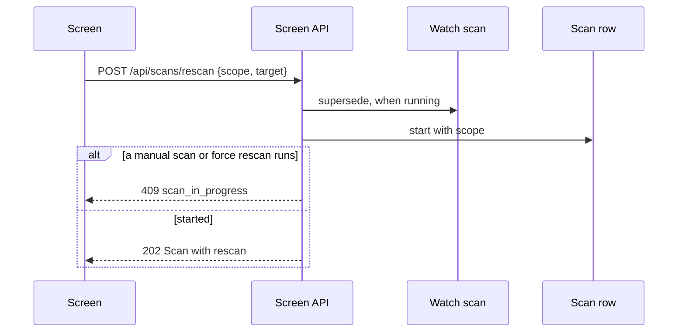

# Contract: screen API, force rescan

Source of truth: [`api/openapi.yaml`](../../../api/openapi.yaml), operation
`startRescan` and schema `Scan`. The external API (`api/external-v1.yaml`) is
unchanged.

## `POST /api/scans/rescan`

Starts a force rescan of the given scope and answers the new scan.

| Field | In | Type | Required | Meaning |
| --- | --- | --- | --- | --- |
| `scope` | body | `library`, `folder`, `video` | Yes | What is read again |
| `folderId` | body | integer | With `folder` | A media folder's `id` |
| `videoId` | body | integer | With `video` | A video's `id` |

**Response**: `202` with `Scan`, whose `rescan` field describes the scope.
Owner only.

| Status | `code` | When |
| --- | --- | --- |
| 400 | `invalid_request` | Unknown `scope`, or a target that does not match it |
| 404 | `not_found` | The folder or the video does not exist |
| 409 | `media_folders_not_configured` | No media folder exists |
| 409 | `scan_in_progress` | A manual scan or a force rescan is running; a watch scan is superseded instead |

## `Scan.rescan`

`Scan` gains an optional `rescan` object, present for a force rescan in every
response and SSE `scan` event that carries `Scan`.

| Field | Type | Meaning |
| --- | --- | --- |
| `scope` | `library`, `folder`, `video` | The scope the owner chose |
| `folder` | `{ id, path }` | The media folder of a `folder` scope |
| `videoId` | integer | The video of a `video` scope |

`origin` stays `manual`; `status`, `videos`, `issues` and `activity` count the
rescan as they count a manual scan.

## Client use

`Video.thumbnailUrl`, `seekThumbnailUrl`, the sprite sheet URLs and the
preview URL gain `-b<n>` in their `v` query once the artifact has been rebuilt
by a force rescan (`n` is its build count,
[R-2](../research.md#r-2-force-travels-on-the-job-not-on-the-stage-states)).
The `video` SSE event after each forced stage makes the screen read the video
again, and the new URL makes a mounted image, a fetched sprite sheet and the
hover preview load the rebuilt file; the screen code needs no change. A video
never rebuilt keeps its current URL.
