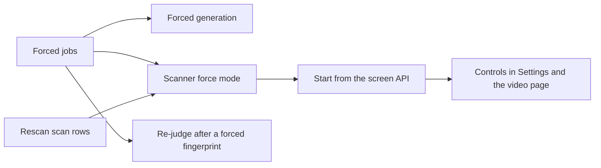

# Implementation Plan: Force rescan

**Branch**: `feature/force-rescan` | **Parent Issue**: #1508

**Input**: The parent Issue. It is this feature's specification.

## Summary

The owner starts a force rescan of the library, one media folder or one video,
and every video in that scope is read again and gets new metadata, thumbnail,
seek sprite, hover preview and fingerprint even when its file is unchanged,
after which the automatic duplicate decisions of those videos are judged
again. The rescan is a manual scan that carries a scope and runs the scanner in
force mode ([R-1](research.md#r-1-a-force-rescan-is-a-scan-with-a-scope-and-a-force-flag)),
and force travels on the queued jobs so the old artifacts stay visible until
each new one is published ([R-2](research.md#r-2-force-travels-on-the-job-not-on-the-stage-states)).

## Technical Context

**Canonical definitions**: [ARCHITECTURE.md](../../ARCHITECTURE.md) (layers,
cross-cutting invariants), [import-pipeline.md](../../docs/design-docs/import-pipeline.md),
[folder-watching.md](../../docs/design-docs/folder-watching.md),
[process-lifecycle.md](../../docs/design-docs/process-lifecycle.md) (resume),
[duplicate-judging.md](../../docs/design-docs/duplicate-judging.md),
[auto-tagging.md](../../docs/design-docs/auto-tagging.md),
[thumbnail-editing.md](../../docs/design-docs/thumbnail-editing.md),
[activity.md](../../docs/design-docs/activity.md),
[`api/openapi.yaml`](../../api/openapi.yaml), [design-system.md](../../docs/design-docs/design-system.md),
[testing.md](../../docs/design-docs/testing.md) and
[`Taskfile.yml`](../../Taskfile.yml) (`task check`, `task check-docs`).

**Feature-specific context**: the decisions in [research.md](research.md)
(R-1 to R-7), the columns in [data-model.md](data-model.md) and the endpoint
in [contracts/screen-api.md](contracts/screen-api.md). No new dependency.

## Constitution Check

| Rule | Verdict |
| --- | --- |
| Dependency direction: `internal/app` reaches the store, the scanner and `internal/artifacts` through its interfaces | Pass: the scope and the force flag are `internal/domain` values (`RescanScope`, `Job.Force`); the scanner's `Index` and `Queue` interfaces gain methods |
| The domain decides, the store enforces | Pass: the one-running-scan index refuses a second start; the force pass's skip rule and the re-judge rule are store transactions |
| One owner for generated files | Pass: `internal/artifacts` publishes the forced artifact under `.tmp` and replaces it; the force flag only switches off adoption of a complete artifact |
| User data survives a rebuild | Pass: no owner table is written; applied images, positions, tags and owner bundles are read as the ordinary jobs read them (R-2, R-6) |
| Only a scan walks the media folders | Pass: every scope is a scan; the `video` scope reads only that video's registered locations |
| Events after commit | Pass: `ScanChanged`, `JobsQueued` and `VersionCandidatesChanged` come from the store's commit |
| Complexity 25 and no copies | Checked per PR; the force pass extends `visit` and `ingest`, so the implementer splits the force branch into its own function |
| Generated files via `task generate` | Pass: `api/openapi.yaml` is the source |

## Project Structure

### Documentation (this feature)

```text
specs/063-force-rescan/
├── plan.md              # This file
├── research.md          # R-1 to R-7
├── data-model.md        # New columns on scans, scan_videos, jobs, video_version_candidates
├── quickstart.md        # Manual check on real media
└── contracts/
    └── screen-api.md    # POST /api/scans/rescan and Scan.rescan
```

### Source Code

**Affected boundaries**:

| Boundary | Change |
| --- | --- |
| `internal/domain` | `RescanScope` on `Scan`, `Force` on `Job`, the scope's walk and removal rules (R-3) |
| `internal/store` | Migration `00071`, rescan start and resume, forced queueing and propagation, no follow-up for forced seek stages, re-judge candidates |
| `internal/scanner` | Force mode: scope-limited walk, content key for unchanged files, forced-mark skip (R-4) |
| `internal/app` | `Scans.StartRescan`, forced generation in `Ingest`, the judge worker's apply for a re-judged pair |
| `internal/artifacts` | Publish without adopting the complete artifact on disk |
| `internal/httpapi`, `api/openapi.yaml`, generated clients | `startRescan`, `Scan.rescan` |
| `web/src/settings`, `web/src/player`, `web/src/shell` | The three controls, confirmation, blocked reason, scope text (R-7) |
| `docs/design-docs` | New `force-rescan.md`; `duplicate-judging.md` and `auto-tagging.md` updated |

**New paths**: `internal/store/migrations/00071_force_rescan.sql`,
`docs/design-docs/force-rescan.md`.

**Structure decision**: Follows the existing layout
([ARCHITECTURE.md](../../ARCHITECTURE.md#subsystem-map)); the force pass is a
mode of the existing scanner, not a second scanner, because the walk, the
issue reporting and the removal rules are the manual scan's (R-1).

## Implementation Work

The diagram shows the units and what has to land first.



### Forced jobs: the force flag, its propagation and no follow-up processes

**Scope**: `jobs.force` and `domain.Job.Force` ([data-model.md, jobs](data-model.md#jobs));
`IngestStore.ForceJobs` queues forced `probe`, `thumbnail` and
`seek_thumbnail` jobs, replacing finished rows, flagging a `queued` row and
leaving a `running` one; `ApplyProbeForJob` and `SetSeekThumbnailStateForJob`
copy the flag to the job they queue; a forced seek stage skips
`queueAfterSeekStage` ([R-2](research.md#r-2-force-travels-on-the-job-not-on-the-stage-states),
[R-5](research.md#r-5-a-forced-seek-stage-queues-no-follow-up-process)).
`auto-tagging.md`'s trigger table gains the forced case.

**Dependencies**: None.

**Acceptance**: Store tests on SQLite (the boundary is the queue's unique
index and the propagation transaction): `ForceJobs` over a `done` row yields a
`queued` forced row, over a `queued` row sets its flag, over a `running` row
changes nothing; a forced probe result queues a forced `preview`; a forced seek
result queues a forced `fingerprint` and no `auto_tag_queue` or `face_queue`
row even when the switches are on. `task check SCOPE=go GO_PACKAGES="./internal/store/..."`
passes.

### Rescan scan rows: scope, resume and issue carry

**Scope**: `domain.RescanScope` and `Scan.Rescan`; migration `00071` for
`scans` and `scan_videos` ([data-model.md](data-model.md#scans));
`ScanStore.StartRescan(scope)` refuses a running scan with `ErrScanRunning`
and supersedes nothing itself; `ResumeScan` copies the rescan columns and the
`forced` marks; the previous scan's issues are carried by scope
([R-3](research.md#r-3-what-each-scope-walks-removes-and-carries));
`MarkForced(scanID, videoID)` and `ForcedVideos(scanID)` for the scanner.

**Dependencies**: None.

**Acceptance**: Store tests on SQLite: a `folder` start keeps the issues
outside the folder and clears those inside; a `video` start keeps every issue
but that video's; a `library` start clears all; resuming an interrupted
`folder` rescan yields a scan with the same scope and the same `forced` set;
a running scan makes `StartRescan` return `ErrScanRunning`.
`task migrations-check` and `task check SCOPE=go GO_PACKAGES="./internal/store/... ./internal/domain/..."`
pass.

### Scanner force mode for the library, a media folder and a video

**Scope**: `Scanner.Rescan(ctx, scope, decider)`: walks the scope's paths,
recomputes the content key of an unchanged file, queues forced jobs through
`Queue.ForceJobs` and marks the video, skips videos already forced in the
scan, removes missing locations only inside the scope and records the manual
scan's issues for a missing or unreadable file of a `video` scope
([R-3](research.md#r-3-what-each-scope-walks-removes-and-carries),
[R-4](research.md#r-4-an-unchanged-file-in-force-mode)).

**Dependencies**: Forced jobs: the force flag, its propagation and no
follow-up processes; Rescan scan rows: scope, resume and issue carry.

**Acceptance**: Scanner tests with the fake `Index` and `Queue` the package
already uses, on a temporary directory (the walk is the boundary): an
unchanged file gets `ForceJobs` with the three kinds and `MarkForced`; a file
whose bytes changed under the same size and mtime takes `UpsertVideo`; a video
already in `ForcedVideos` gets neither; a `folder` scope leaves the other
folder's missing location in place and removes the one inside; a `video`
scope with a missing file reports `changed_during_import` with the video id and
calls `DeleteVideoLocations` with nothing.
`task check SCOPE=go GO_PACKAGES="./internal/scanner/..."` passes.

### Forced generation: thumbnails, seek sprites and previews regenerate

**Scope**: `Ingest.Thumbnail` generates for a forced job whose state is
`done`, republishing an applied image or extracting the chosen position
again; `ArtifactStore.PublishSeekThumbnails` and `PublishPreview` take the
force flag and skip adoption of the complete artifact
([R-2](research.md#r-2-force-travels-on-the-job-not-on-the-stage-states)).

**Dependencies**: Forced jobs: the force flag, its propagation and no
follow-up processes.

**Acceptance**: `internal/app` tests with the fake generator and artifact
store: a forced thumbnail job on a `done` video with an applied image calls
`PublishThumbnail` with the image bytes and never the generator; with a
position calls `ThumbnailAt` at that position; without either calls
`Thumbnail`. `internal/artifacts` tests on a temporary directory: a forced
publish over a complete sprite directory calls `write` and replaces the
directory, the old sheets readable until the rename; an unforced publish over
it still adopts without `write`. `task check SCOPE=go GO_PACKAGES="./internal/app/... ./internal/artifacts/..."`
passes.

### Start a force rescan from the screen API

**Scope**: `Scans.StartRescan(ctx, scope)`: supersedes a watch scan, starts
the rescan row, runs `Scanner.Rescan` as `run` runs a manual scan, with
`ActivityByOwner`; `POST /api/scans/rescan` and `Scan.rescan`
([contracts/screen-api.md](contracts/screen-api.md)) with `task generate`;
the folder and video lookups for `404`; `docs/design-docs/force-rescan.md`
describing the scopes, the force flag and resume, linked from
`docs/design-docs/index.md`.

**Dependencies**: Scanner force mode for the library, a media folder and a
video.

**Acceptance**: `internal/app` tests with the fake store and scanner: a
running manual scan makes `StartRescan` return `ErrScanRunning`; a running
watch scan is cancelled with `ErrScanSuperseded` and the rescan starts; the
scanner receives the scope. HTTP tests with the fake `scans`: each error row
of the contract answers its status and `code`; `202` carries `rescan`. The
`openapi_routes_test` owner-only check passes for the new route.
`task check SCOPE=go GO_PACKAGES="./internal/app/... ./internal/httpapi/..."`
and `task check-docs` pass.

### Re-judge automatic duplicate decisions after a forced fingerprint

**Scope**: `video_version_candidates.rejudge_of`
([data-model.md](data-model.md#video_version_candidates));
`ApplyFingerprintForJob` of a forced job lists the key's automatically
decided, unheld pairs again while judging is on; `ClaimJudgement` claims them;
`ApplyJudgement` applies the verdict table of
[R-6](research.md#r-6-automatic-duplicate-decisions-are-judged-again-in-place)
and removes the row; `duplicate-judging.md` gains the re-judge section.

**Dependencies**: Forced jobs: the force flag, its propagation and no
follow-up processes.

**Acceptance**: Store tests on SQLite (the undo rules and the candidate query
are the boundary): a forced fingerprint lists a pair bundled by the judge and
one dismissed by the judge, not a pair the owner bundled, dismissed or
re-decided after the judgement, and nothing while judging is off; the
verdicts of the R-6 table on each prior: `same` on a judged bundle changes no
membership, `different` on it splits the joined side and dismisses, `same` on
a judged dismissal removes it and bundles. `task check SCOPE=go GO_PACKAGES="./internal/store/..."`
and `task check-docs` pass.

### Force rescan controls in Settings and on the video page

**Scope**: `startRescan` in `web/src/api/client.ts`; the three controls, the
`ConfirmDialog` for the library and folder scopes, the disabled reason and the
scope text in the scan progress indicator and the scan status section
([R-7](research.md#r-7-where-the-owner-starts-it)); screen text in
`web/src/i18n/en.ts`. This unit changes screens, so it owes a visual review
against [design-system.md](../../docs/design-docs/design-system.md) at phone
and desktop widths.

**Dependencies**: Start a force rescan from the screen API.

**Acceptance**: Component tests: the library control opens the dialog and
sends `{scope: "library"}` only on confirm, nothing on cancel; the folder row
sends `{scope: "folder", folderId}`; the video control sends
`{scope: "video", videoId}` without a dialog; each control is disabled with
the reason while `scan.running`; the indicator names the scope from
`Scan.rescan`. A page test on Settings: `409 scan_in_progress` shows the
reason inline. `task check SCOPE=web WEB_FILES="src/settings src/player src/shell src/api" WEB_TESTS="src/settings src/player src/shell src/api"`
passes; a screenshot of each control and the dialog is in the PR.
