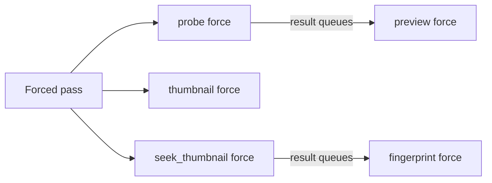
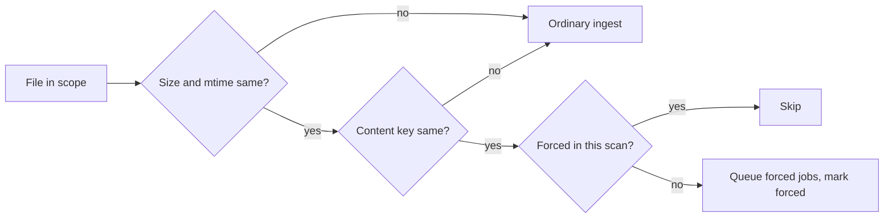

# Research: Force rescan

Inherited decisions: [import-pipeline.md](../../docs/design-docs/import-pipeline.md)
(scan membership, progress, recovery),
[folder-watching.md](../../docs/design-docs/folder-watching.md) (watch scans,
supersession), [seek-sprite-generation.md](../../docs/design-docs/seek-sprite-generation.md),
[thumbnail-editing.md](../../docs/design-docs/thumbnail-editing.md) (applied
images and positions), [duplicate-judging.md](../../docs/design-docs/duplicate-judging.md),
[auto-tagging.md](../../docs/design-docs/auto-tagging.md) and
[activity.md](../../docs/design-docs/activity.md).
This file records only the decisions this feature adds.

## R-1: A force rescan is a scan with a scope and a force flag

**Decision**: Every scope (library, one media folder, one video) starts a
`scans` row of origin `manual` that carries a rescan scope, and the scanner runs
in force mode for it.

| Option | Progress, issues, activity | Exclusivity and resume | Verdict |
| --- | --- | --- | --- |
| **A scan row with scope and force** | Reuses the scan progress, issue list and import entries | The one-running-scan index refuses a second start; startup resumes it | Chosen |
| A job-only requeue for the video scope (as `RetryProbe` does) | Needs a second way to show an unreadable file (requirement 9, edge case) | Not refused while a manual scan runs; nothing to resume | Rejected: two mechanisms for one feature |
| A new scan origin `rescan` | Same | Supersession, busy, resume and succession all test `origin`, and a rescan behaves as `manual` for each | Rejected: changes every origin check for no new behaviour |

**Rationale**: The scan row already gives requirement 9 (progress and issues
like a manual scan) and the edge cases on exclusivity and restart; the video
scope is a scan whose walk is the video's own locations.

## R-2: Force travels on the job, not on the stage states

**Decision**: A forced job (`jobs.force`) regenerates its artifact whatever the
video's stage state is, and the stage states stay as they are until the job
records its result.

| Option | Old thumbnail while rebuilding (requirement 8) | Failed stages (requirement 4) | Verdict |
| --- | --- | --- | --- |
| **`jobs.force`** | `thumbnail_state` stays `done`, so `thumbnailUrl` stays and the file is replaced atomically | A forced job runs for a `failed` state too, and success sets `done` | Chosen |
| Reset the stage states to `pending` | `thumbnailUrl` is sent only for `thumbnailState=done`, so cards lose the thumbnail | Same | Rejected: breaks requirement 8 |

The flag propagates along the pipeline, because the preview and fingerprint
jobs are queued by the stage before them, not by the scan.

| Forced job | Differs from an ordinary job by |
| --- | --- |
| `thumbnail` | Generates when the state is `done`; an applied image is republished, a chosen position is extracted again, otherwise the automatic frame |
| `seek_thumbnail`, `preview` | `internal/artifacts` does not adopt the complete sprite or preview already on disk; it generates under `.tmp` and replaces the published one |
| `probe`, `fingerprint` | Nothing; they always read the source and always write |

A forced flag on a job queued while an ordinary job of the same kind is
`queued` sets the flag on that row; a `running` job keeps its own behaviour,
and its result is accepted (edge case: the same video twice does not run
twice).

**Rationale**: Requirement 8 rules out the state reset, and the job row is the
one value every stage handler and `internal/artifacts` already receives.

## R-3: What each scope walks, removes and carries

**Decision**: The scope decides the walked paths, the removal scope and the
issues carried from the previous scan.

| Scope | Walks | Removes missing locations | Issues of the previous scan |
| --- | --- | --- | --- |
| `library` | Every media folder | Everywhere, as a manual scan | Cleared, as a manual scan |
| `folder` | That media folder's tree | Under that folder only | Kept outside the folder, as a watch scan keeps them |
| `video` | The video's registered locations, each read as one target | Nothing | Kept except that video's |

A `video` scope whose location is missing or unreadable records the issue a
manual scan would (`changed_during_import`, `unreadable`) and keeps the video
(edge case). A file that changes or vanishes during a `library` or `folder`
rescan is the manual scan's `changed_during_import`.

**Rationale**: Requirement 10 asks the folder scope for the manual scan's
additions and removals inside the folder and nothing outside it; issues
outside the folder describe files the rescan did not read.

## R-4: An unchanged file in force mode

**Decision**: In force mode the scanner recomputes the content key of a file
whose size and modification time are unchanged (requirement 3) and, when the
key is unchanged, queues forced `probe`, `thumbnail` and `seek_thumbnail` jobs
and marks the video `forced` in the scan's set; a changed key takes the
ordinary changed-content path.

The `forced` mark is carried into the scan that resumes an interrupted force
rescan, so the resumed walk skips the videos the interrupted run already
queued (edge case: restart continues with the remaining videos).

| Rejected | Why |
| --- | --- |
| Force every file again on resume | Regenerates the videos finished before the restart a second time |
| Skip the content key when size and mtime match | Requirement 3 asks the file to be read again; a replaced file with the same size and time would keep stale artifacts |

## R-5: A forced seek stage queues no follow-up process

**Decision**: The transaction that finishes a forced `seek_thumbnail` job
queues neither auto-tagging nor face analysis.

| Rejected | Why |
| --- | --- |
| Keep the seek-stage trigger as it is | It queues a video with no queue row, so a video imported before auto-tagging or face recognition was turned on would be tagged or analysed by a rescan (requirement 7) |

**Rationale**: Requirement 7 and the parent's table limit the rescan to the five
import stages and duplicate judging; the owner re-runs tagging with `Tag all
videos again`.

## R-6: Automatic duplicate decisions are judged again in place

**Decision**: When a forced fingerprint is applied and automatic judging is on,
each pair of that key whose last decision was automatic (`version_judgement`
entry with decider `ai` or `rule`, not undone, not held by a later owner
decision under the undo rules) is listed as a candidate again, flagged with
that prior entry, and the judge worker claims it although the pair is bundled
or dismissed. The prior decision stays in force until the new verdict.

| New verdict | Prior `same` (bundled) | Prior `different` (dismissed) |
| --- | --- | --- |
| `same` | Nothing changes; the new entry closes `done`/`same` | The dismissal is removed as the undo removes it, then the pair is bundled |
| `different` | The joined side leaves as the undo splits it, then the pair is dismissed | Nothing changes; the new entry closes `done`/`different` |
| Undecided, failed, no connection | Prior decision kept; the new entry shows the reason for the owner | Same |

A pair whose prior decision the owner changed since (the undo's hold rules) is
not listed. Judging off lists nothing: there is no automatic judgement to
redo. A pair whose both keys are rescanned is judged after each fingerprint;
the second judgement sees both new fingerprints.

| Rejected | Why |
| --- | --- |
| Undo the automatic decision first, then judge | Bundles dissolve while the pair waits, and stay dissolved when the model is unreachable (`no_connection`) |
| Judge only pairs with no decision | Requirement 5 asks the automatic decisions to be made again |

## R-7: Where the owner starts it

**Decision**: Settings holds the library and media-folder controls, and the
video page's file facts hold the video control.

| Scope | Control | Confirmation |
| --- | --- | --- |
| Library | A `Force rescan` button beside `Scan library` in the scan status section | `ConfirmDialog` saying it rereads every video and takes long |
| Media folder | A `Force rescan` action on the folder's row in the media folders section | Same dialog naming the folder |
| Video | A `Force rescan` action beside `Open file` and `Copy path` | None (requirement 2 names the library and folder scopes) |

Each control is disabled with the reason while a manual scan or a force rescan
runs or no media folder exists, as `Scan library` is; a watch scan does not
disable it, because the start supersedes it. The scan progress indicator and
the scan status section name the scope of a running force rescan.

| Rejected | Why |
| --- | --- |
| The folder page's root menu | The folder page shows folder groups; media folders are managed in Settings |
| One dialog with a scope picker | Three entry points already name their scope; a picker adds a step |
