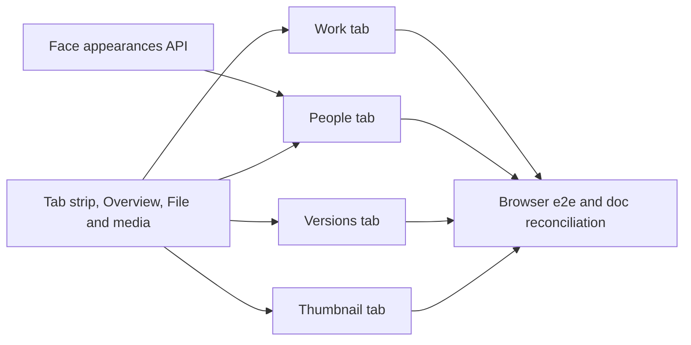

# Implementation Plan: Video page tabs

**Branch**: `feature/064-video-page-tabs` | **Parent Issue**: #1557

**Input**: The parent Issue. It is this feature's specification.

## Summary

The video page replaces its information rows and its icon-only action group
with six tabs under the tags (Overview, Work, People, Versions, Thumbnail,
File & media), labelled actions in the title row and at the tab strip's end,
and a People tab that shows, for the first time on this page, when each
recognized person is on screen. The player, the tags and the right column
stay as they are. One pure rule over the video response and the plugin list
decides which tabs a video has ([R-1](research.md#r-1-which-tabs-a-video-has-is-a-pure-rule-over-the-video-response)),
the page keeps the selected tab in memory
([R-2](research.md#r-2-the-selected-tab-lives-in-page-memory-not-in-the-address)),
and one new owner-only read lists a video's face appearances
([contracts/screen-api.md](contracts/screen-api.md)).

## Technical Context

**Canonical definitions**: [ARCHITECTURE.md](../../ARCHITECTURE.md),
[library-ui.md, Video page layout](../../docs/design-docs/library-ui.md#video-page-layout),
[design-system.md](../../docs/design-docs/design-system.md) and
[patterns.md, Detail page](../../web/registry/rules/patterns.md#detail-page),
[thumbnail-editing.md](../../docs/design-docs/thumbnail-editing.md),
[video-versions.md](../../docs/design-docs/video-versions.md),
[face-recognition.md](../../docs/design-docs/face-recognition.md),
[people.md](../../docs/design-docs/people.md),
[media-information.md](../../docs/design-docs/media-information.md),
[api/openapi.yaml](../../api/openapi.yaml),
[testing.md](../../docs/design-docs/testing.md).

**Feature-specific context**:

| Delta | Decision |
| --- | --- |
| Which tabs a video has, and the Work tab for an empty work | [R-1](research.md#r-1-which-tabs-a-video-has-is-a-pure-rule-over-the-video-response), [R-5](research.md#r-5-the-work-tab-is-shown-for-an-empty-work-when-a-plugin-can-fill-it) |
| Selected tab across videos and refreshes | [R-2](research.md#r-2-the-selected-tab-lives-in-page-memory-not-in-the-address) |
| A video's face appearances | [R-3](research.md#r-3-a-per-video-read-of-face-appearances), [contracts/screen-api.md](contracts/screen-api.md) |
| Thumbnail and fetch operations across tab switches | [R-4](research.md#r-4-operations-in-flight-belong-to-the-tabs-container-not-to-a-panel) |
| The three thumbnail replacement ways | [R-6](research.md#r-6-the-three-replacement-ways-map-to-the-existing-flows) |
| Span bars seek the mounted player | [R-7](research.md#r-7-a-span-bar-seeks-the-player-in-place) |
| `Last watched` | [R-8](research.md#r-8-last-watched-is-the-progress-rows-time) |
| Out of scope (parent `対象外`): the right column, portrait players filling the window, the details editor, scene bookmarks (#788) | Unchanged |

The screens follow `ui-design.md`, which the `design` stage adds before
`plan-to-issues` because the parent carries the `ui` label; it settles the
tab strip, each panel's layout, the labelled actions and the review widths.
The units below name the behaviour, not the visuals.

No `data-model.md`: the new read joins existing tables and adds no entity or
field. No `quickstart.md`: the acceptance criteria are covered by the units'
automated checks, the browser e2e of the last unit and the visual review each
screen unit owes.

## Constitution Check

| Rule (source) | Verdict |
| --- | --- |
| Dependency direction ([ARCHITECTURE.md](../../ARCHITECTURE.md#intended-dependency-direction)) | Pass: the read's SQL stays in `internal/store`, span joining stays in `internal/domain` (`FaceTimeSpans`), the handler in `internal/httpapi` |
| Store roles ([ARCHITECTURE.md](../../ARCHITECTURE.md#cross-cutting-invariants)) | Pass: the read is a `CreditStore` method beside `PersonAppearances`, which already owns appearances |
| Every read knows its viewer | Pass: the new operation is owner-only by the global `security` default, and the route-security test covers it |
| Generated code ([AGENTS.md](../../AGENTS.md)) | Pass: `api/openapi.yaml` changes, then `task generate` |
| Screens are built from the design system ([design-system.md](../../docs/design-docs/design-system.md)) | Pass: `Tabs` `variant="line"` is the page-level tabs component; `FactList` is the labelled facts section; the `DetailPage` children rule in `patterns.md` changes from "facts as one icon row" to the tab strip and its panels, in the unit that makes the change |
| Complexity 25 and no copies ([complexity-and-duplication.md](../../docs/design-docs/complexity-and-duplication.md)) | Pass if the panels share the thumbnail and fetch hooks moved out of `VideoFacts` ([R-4](research.md#r-4-operations-in-flight-belong-to-the-tabs-container-not-to-a-panel)) and the Versions rows reuse `VersionDetails`; units name this in their acceptance |
| Documentation updated with behaviour (core beliefs) | Pass: each screen unit updates [library-ui.md, Video page layout](../../docs/design-docs/library-ui.md#video-page-layout), the API unit updates `face-recognition.md`, and the last unit reconciles the section as a whole |
| Tests follow [testing.md](../../docs/design-docs/testing.md) and [write-tests](../../.agents/skills/write-tests/SKILL.md) | Pass: the tab rule and span clamping are pure functions with unit cases; panels are component tests with faked `api/`; the acceptance criteria that need the whole page are browser e2e in one spec |

## Project Structure

### Documentation (this feature)

```text
specs/064-video-page-tabs/
├── plan.md
├── research.md
└── contracts/
    └── screen-api.md
```

`ui-design.md` is added by the `design` stage.

### Source Code

**Affected boundaries**:

| Path | Change |
| --- | --- |
| `internal/store` | `CreditStore.VideoFaceAppearances` over `face_appearances` and `face_queue` by content key |
| `internal/httpapi`, `api/openapi.yaml` | `listVideoFaceAppearances` ([contracts/screen-api.md](contracts/screen-api.md)) |
| `web/src/api` | The client function and types for the new operation |
| `web/src/player` | The tabs container replaces `VideoFacts`; `VersionsFact`, the thumbnail entries and the icon-only actions go; `WorkInfo` becomes the Work panel's list |
| `web/src/ui` | `FavoriteToggle` gains a labelled page form; `AddToPlaylistButton` and `AddToGroupButton` likewise |
| `web/src/i18n` | Tab names, labels and the new texts |
| `web/registry/rules/patterns.md`, `docs/design-docs/library-ui.md`, `docs/design-docs/face-recognition.md` | The rules the change moves |
| `web/e2e` | One spec for the tabbed page |

**New paths**: `web/src/player/tabs/` (the container, `videoTabs.ts` and one
file per panel), `internal/store/video_face_appearances.go`,
`internal/httpapi/video_face_appearances.go`.

**Structure decision**: The tab strip and the panels sit in
`web/src/player/tabs/` as one container with one file per panel, and the
availability rule is a pure module beside them, so a panel unit touches its
own file and the rule's table. Keeping everything in `VideoFacts.tsx` was
rejected: it is already 644 lines and holds the hooks every panel shares.

## Implementation Work

The diagram shows the units and what each one needs merged first.



### Screen API lists the people face recognition found in a video

**Scope**: `GET /api/videos/{id}/face-appearances` as in
[contracts/screen-api.md](contracts/screen-api.md): the `CreditStore` read
over `face_appearances` and `face_queue` by the video's content key, sharing
`PersonAppearances`'s track decoding
([R-3](research.md#r-3-a-per-video-read-of-face-appearances)); the handler;
the schema and `task generate`; the client function in `web/src/api`. Adds
the read to [face-recognition.md](../../docs/design-docs/face-recognition.md)
beside "The faces page reads a person's appearances".

**Dependencies**: None

**Acceptance**: Store tests against SQLite (the contract is SQL) show a
`done` content key answering its not-dropped appearances in first-span order
with the person's `CreditRef`, `imageRevision` and spans, a dropped
appearance and one of a deleted person left out, `analysed` false with
`items` empty for a key without a row and for a `queued` row, and an unknown
video answering not found. Handler tests with a faked store show `200`,
`404 video_not_found` and a guest's `401`; the route-security test passes for
the new operation. `task generate` leaves no diff.

### Tab strip, action placement, Overview and File & media on the video page

**Scope**: The container in `web/src/player/tabs/` with the `Tabs`
`variant="line"` strip under the tags, scrollable sideways on narrow widths;
`videoTabs.ts` with the availability rule and the selection rule
([R-1](research.md#r-1-which-tabs-a-video-has-is-a-pure-rule-over-the-video-response),
[R-2](research.md#r-2-the-selected-tab-lives-in-page-memory-not-in-the-address));
the thumbnail and fetch hooks moved into the container
([R-4](research.md#r-4-operations-in-flight-belong-to-the-tabs-container-not-to-a-panel));
the Overview panel (description, `Length`, `Resolution`, `Added`,
`Last watched` ([R-8](research.md#r-8-last-watched-is-the-progress-rows-time)),
the one-line work summary of code, release date and performers); the
File & media panel (location with `Copy path` and `Rescan` for the owner,
and `Open file` only when `video.location?.openable` is true, as today;
`MediaInfoGroups`, size and the three dates with labels; no location and no
actions for a guest or a video without a location);
`Favorite`, `Add to playlist` and `Add to group` with labels in the title
row; the visibility switch and `Edit details` at the strip's end; the
information rows, the technical line, the media rows and the icon-only
action group removed. Until the panel units land, the owner's work
information, versions, thumbnail and fetch entries are absent from the page
on the feature branch. Updates
[library-ui.md, Video page layout](../../docs/design-docs/library-ui.md#video-page-layout)
and the `DetailPage` children rule in
[patterns.md](../../web/registry/rules/patterns.md#detail-page). Layout per
`ui-design.md`.

**Dependencies**: None

**Acceptance**: Unit cases on `videoTabs.ts` cover each row of R-1's table
for owner and guest, the plugin list not yet read counted as no plugin, and
R-2's keep-or-Overview rule. Component tests of the
page with a faked `api/` show: an owner's video with a code, performers and
three versions lists the six tabs with Overview selected and no icon-only
button in the title area (criterion 1); Overview shows the four facts with
their labels (criterion 2); `Copy path` writes the location to the clipboard
(criterion 6); a location with `openable` false shows `Copy path` and
`Rescan` without `Open file`; a guest's public video lists Overview and File & media, plus
Versions with two versions, with no location, tags, visibility switch or
`Edit details` (criterion 8); moving from a video with Work to one without
selects Overview (criterion 9, with Work's row of R-1 stubbed through the
rule). Existing `VideoFacts` tests move to the panels they still describe
and the rest are removed. The screen changes, so the implementation reviews
it at the widths `ui-design.md` names, including the strip's sideways scroll
at 390px.

### Work tab with the work information list and the fetch entry

**Scope**: The Work panel: `FactList` of the code, the dates, the people of
roles other than performer, the organizations, the links and the external
IDs, keeping `WorkInfo`'s fold after three entries and the person chips;
`Fill in from a site` (today's fetch entry, with its dialog rendered by the
container) with no items when the work is empty
([R-5](research.md#r-5-the-work-tab-is-shown-for-an-empty-work-when-a-plugin-can-fill-it)).
The description stays in Overview. Updates the Work row of
[library-ui.md, Video page layout](../../docs/design-docs/library-ui.md#video-page-layout).

**Dependencies**: Tab strip, action placement, Overview and File & media on the video page

**Acceptance**: Component tests with a faked `api/` show each item kind with
its label, performers left out, the fold on a role with four people, the
fetch entry present only with an approved plugin, and the fetch dialog
staying open across a switch to Overview and the applied result shown on
return (reusing `VideoPage.workInfoFetch*.test.tsx` cases where they still
apply). The screen changes, so the implementation reviews it at the widths
`ui-design.md` names.

### People tab with credits and on-screen spans

**Scope**: The People panel: the credited people as face, name and role,
each a link to the person page; below them one row per item of
`GET /api/videos/{id}/face-appearances` with the person's face, name (the
provisional form from `displayName.ts`) and a bar per span scaled to the
video's length in seconds, `durationMs / 1000`, since span `start` and `end`
are seconds; pressed to seek the player
([R-7](research.md#r-7-a-span-bar-seeks-the-player-in-place)); the lower
section only when `analysed` is true and `items` is not empty, and bars only
with a known length. Updates the People row of
[library-ui.md, Video page layout](../../docs/design-docs/library-ui.md#video-page-layout).

**Dependencies**: Screen API lists the people face recognition found in a video; Tab strip, action placement, Overview and File & media on the video page

**Acceptance**: Unit cases on the span placement rule show a span of 15 to
30 seconds on a `durationMs` of 60000 placed at 25% with a width of 25%, a
span clamped to the length and a span past the end drawn to the end. Component tests with a
faked `api/` show a credited person's link to `/people/{id}` (criterion 3),
a bar press calling `seekTo` with the span's start and then `play`
(criterion 3), the lower section absent for `analysed` false and for no
items, bars absent without `durationMs`, and an unnamed person shown as
`#{id}`. The screen changes, so the implementation reviews it at the widths
`ui-design.md` names.

### Versions tab replacing the versions popover

**Scope**: The Versions panel reading `GET /api/videos/{id}/versions` when
selected: one row per version with title, resolution, codec, size, container
and place, the representative and the playing version marked, and the
other rows playing their version. For the owner every row, the playing one
included, has `Remove from versions`, and every row but the representative
has `Make representative`, as `VersionsFact`'s row menu does today, keeping
its request, focus and failure rules; a guest's rows play only.
`VersionsFact` and the `3 versions` item go. Updates the Versions row of
[library-ui.md, Video page layout](../../docs/design-docs/library-ui.md#video-page-layout).

**Dependencies**: Tab strip, action placement, Overview and File & media on the video page

**Acceptance**: Component tests with a faked `api/` show the marks on the
representative and the playing rows, `Make representative` moving the mark
and `Remove from versions` removing the row (criterion 4), the playing row
offering `Remove from versions` and the representative row no
`Make representative`, removing the playing version from its own row
replacing the page's video and selecting Overview
(the edge case through R-2), a guest's rows without actions, and the list
read only once the tab is selected. `VersionsFact` tests move to the panel.
The screen changes, so the implementation reviews it at the widths
`ui-design.md` names.

### Thumbnail tab replacing the thumbnail entries

**Scope**: The Thumbnail panel: the current thumbnail with its origin
(frame position, uploaded, generated or automatic) and `Back to automatic`
while an image is applied or a position is recorded, sending the position
`null` that removes both in one request
([R-6](research.md#r-6-the-three-replacement-ways-map-to-the-existing-flows)); `Use this frame` only while the player shows a
frame, `Upload…` and `Touch up with ComfyUI`
([R-6](research.md#r-6-the-three-replacement-ways-map-to-the-existing-flows)),
with the preview rendered by the container and one send at a time as today.
The capture button, `Change thumbnail` and the thumbnail item in the first
row go. Updates the Thumbnail row of
[library-ui.md, Video page layout](../../docs/design-docs/library-ui.md#video-page-layout)
and the entry section of
[thumbnail-editing.md](../../docs/design-docs/thumbnail-editing.md#one-entry-opens-the-preview-from-any-source).

**Dependencies**: Tab strip, action placement, Overview and File & media on the video page

**Acceptance**: Component tests with a faked `api/` show `Back to automatic`
on a video with both a recorded position and an applied image calling
`setVideoThumbnailPosition` with `null` and not `revertThumbnailImage`, and
absent on an automatic thumbnail; `Use this frame`
sending the player's position and the `Current` image changing to the
response's thumbnail (criterion 5), `Use this frame` absent while the player
is not shown with `Upload…` and `Touch up with ComfyUI` still present (the
edge case), `Upload…` and `Touch up with ComfyUI` opening the preview from
the file and from the current thumbnail, a send started before a switch to
Overview finishing and showing on return, and the other entries
`aria-disabled` during a send (reusing `VideoPage.thumbnailEdit.test.tsx`
and `VideoPage.thumbnailUpload.test.tsx` cases where they still apply). The
screen changes, so the implementation reviews it at the widths
`ui-design.md` names.

### Browser e2e for the tabbed video page

**Scope**: One spec `web/e2e/video-tabs.e2e.ts` over the e2e fixtures:
criteria 1, 7, 8, 9 and 10 end to end, and the `Copy path` of criterion 6
in the real browser clipboard. Reconciles
[library-ui.md, Video page layout](../../docs/design-docs/library-ui.md#video-page-layout)
into one description of the finished page and removes what the panel units
left about the rows.

**Dependencies**: Work tab with the work information list and the fetch entry; People tab with credits and on-screen spans; Versions tab replacing the versions popover; Thumbnail tab replacing the thumbnail entries

**Acceptance**: The spec passes in a manual run of `ci.yml` on the feature
branch (`Browser E2E`): an owner's video with work information, performers
and three versions shows six tabs with Overview selected and no icon-only
button in the title area; a video with none of them and one file shows
Overview, Thumbnail and File & media only; a guest's public video shows
Overview and File & media with no location, tag, visibility or edit control;
moving from Work to a video without work information selects Overview; at
390px every tab is reached by scrolling the strip without page overflow.
`task check-docs` passes.
