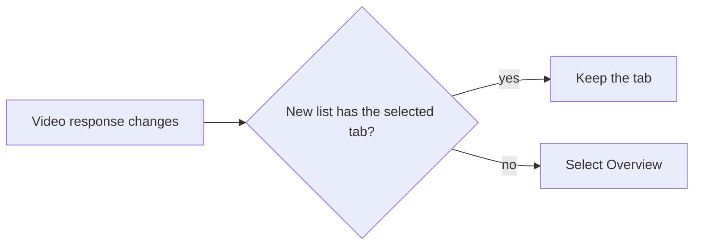

# Research: Video page tabs

Inherited decisions:
[library-ui.md, Video page layout](../../docs/design-docs/library-ui.md#video-page-layout),
[design-system.md](../../docs/design-docs/design-system.md),
[thumbnail-editing.md](../../docs/design-docs/thumbnail-editing.md),
[video-versions.md](../../docs/design-docs/video-versions.md),
[face-recognition.md](../../docs/design-docs/face-recognition.md),
[people.md](../../docs/design-docs/people.md),
[work-info-plugins.md](../../docs/design-docs/work-info-plugins.md).
This file records only the decisions this feature adds.

## R-1: Which tabs a video has is a pure rule over the video response

**Decision**: One function in `web/src/player/tabs/videoTabs.ts` maps the
`Video` response, the audience and whether an approved work-info plugin exists
to the ordered list of available tabs; nothing else decides a tab's presence.

| Tab | Shown when |
| --- | --- |
| Overview | Always |
| Work | Owner, and the work information has an item other than the description and the performers, or an approved work-info plugin exists ([R-5](#r-5-the-work-tab-is-shown-for-an-empty-work-when-a-plugin-can-fill-it)) |
| People | Owner, and `workInfo.people` is not empty |
| Versions | `versions.count` is 2 or more |
| Thumbnail | Owner |
| File & media | Always |

| Option | Flicker on open | Where the rule lives | Verdict |
| --- | --- | --- | --- |
| **Rule over `GET /api/videos/{id}` alone** | None: the response that shows the page decides the tabs | One tested function | Chosen |
| People waits for the appearances read | The tab appears after a second request | Split between the page and the panel | Rejected: an analysis's main people are always performers of the video, so credits already tell whether People has content |
| Each panel reports whether it is empty | Tabs change while panels mount | Spread over six components | Rejected: requirement 2 needs the list before a tab is selected |

**Rationale**: Requirement 3 hides empty tabs and requirement 2 keeps the
selected tab across videos only when the next video has it, so the list must
be known from the data the page already has. Face recognition writes a
`performer` row for every linked main person and drops the appearance when
the credit is removed ([face-recognition.md](../../docs/design-docs/face-recognition.md#one-videos-result-is-stored-in-one-transaction)),
so a video whose credits are empty has no appearance to show either.

## R-2: The selected tab lives in page memory, not in the address

**Decision**: The page keeps the selected tab in React state keyed by nothing;
on a video change it keeps the tab when [R-1](#r-1-which-tabs-a-video-has-is-a-pure-rule-over-the-video-response)
lists it for the new video and otherwise returns to Overview, and the same
rule runs whenever the video response is replaced, so a tab whose content a
refresh removed returns to Overview.

The diagram shows the rule.

| Option | Reload | Links from other screens | Verdict |
| --- | --- | --- | --- |
| **Page state** | Opens on Overview, as requirement 2 asks | Unchanged | Chosen |
| `?tab=` in the address | Reopens the tab, against requirement 2 | Every link that carries `?t=`, `?group=` or `?smartFolder=` would have to preserve it | Rejected |

**Rationale**: Requirement 2 defines the tab on open as Overview and the
carry-over as a property of moving between videos, which is what the route's
reused component holds in memory.

## R-3: A per-video read of face appearances

**Decision**: `GET /api/videos/{id}/face-appearances`, owner-only, answers
the not-dropped appearances of the video's content key with their person,
spans and whether the analysis finished
([contracts/screen-api.md](contracts/screen-api.md#get-apivideosidface-appearances)).
The store read is a `CreditStore` method beside `PersonAppearances`, sharing
its track decoding and `domain.FaceTimeSpans`.

| Option | Data on the page | Cost | Verdict |
| --- | --- | --- | --- |
| **New per-video endpoint** | Every person on screen with their spans | One request when People opens | Chosen |
| Spans on `Video.workInfo.people` | The same | Every owner detail read joins `face_appearances` and decodes every track, People open or not | Rejected |
| `GET /api/people/{id}/appearances` per credited person | The same | One request per performer, each listing every video of the person | Rejected |

**Rationale**: The person page reads appearances by person; the video page
needs them by content key, and `face_appearances` is indexed by it. Keeping
the read out of the detail response keeps `GET /api/videos/{id}` unchanged
for the five tabs that do not need it.

## R-4: Operations in flight belong to the tabs container, not to a panel

**Decision**: The thumbnail position, upload and work-info fetch state
(`useThumbnailPosition`, `useThumbnailUpload`, the fetch dialog's open state)
move from `VideoFacts` into the component that renders the tab strip; a panel
receives them as props. Panels render only while selected, except that an
open dialog (`UploadPreview`, `FetchDialog`) is rendered by the container, so
it survives a tab switch.

| Option | A send started in Thumbnail, then Work is opened | Requests on open | Verdict |
| --- | --- | --- | --- |
| **State in the container, panels unmounted when inactive** | The send continues and the result shows on return | Only the open panel reads | Chosen |
| Every panel mounted and hidden (`forceMount`, as the person's faces page) | The same | Versions and People would read on every video, opened or not | Rejected |
| State inside each panel | Unmounting aborts the request, against the edge case | Only the open panel reads | Rejected |

**Rationale**: The edge case "switching tabs during a fetch or a thumbnail
send keeps the operation running" is a lifetime rule; the container is the
one component that lives as long as the page.

## R-5: The Work tab is shown for an empty work when a plugin can fill it

**Decision**: For the owner, Work is listed when the video has work
information or an approved work-info plugin exists; with no work information
the panel holds `Fill in from a site` and no items.

| Option | Video without work information, plugin approved | Verdict |
| --- | --- | --- |
| **Work with the fetch action alone** | Fetching stays reachable from the page, in the one place requirement 7 gives it | Chosen |
| Work hidden; fetch in Overview while Work is absent | The same action moves between tabs, against the placement rule in `UI品質` | Rejected |
| Work hidden; no fetch entry | The owner loses today's way to fill an empty work from the page | Rejected |

**Rationale**: Requirement 3 hides tabs with nothing in them; a tab holding
the action that creates its content is not empty. Acceptance criterion 7 is
checked with no plugin approved, where Work stays hidden. The PR body lists
this reading for the maintainer to confirm.

## R-6: The three replacement ways map to the existing flows

**Decision**: In Thumbnail, `Use this frame` sends the player's position as
`PUT /api/videos/{id}/thumbnail-position` (today's capture button), `Upload…`
opens the file picker and the preview (today's `Upload an image…`), and
`Touch up with ComfyUI` opens the preview on the current thumbnail (today's
`current thumbnail` source), whose ComfyUI section is unchanged. The menu
entry `Change thumbnail`, the `frame on screen` preview source and the
icon-only capture button go.

| Option | Acceptance criterion 5 | Verdict |
| --- | --- | --- |
| **Frame sent directly, image and touch-up through the preview** | `Use this frame` changes the thumbnail in the same flow as today | Chosen |
| Every way opens the preview first | A frame would need a confirmation it does not need today | Rejected |
| Keep `frame on screen` as a fourth, preview-first way | Two entries for the same frame | Rejected: requirement 11 names three ways |

**Rationale**: Requirement 11 fixes the three entries and keeps the preview
and touch-up flows as they are; mapping each entry to an existing flow changes
no request and no session rule in
[thumbnail-editing.md](../../docs/design-docs/thumbnail-editing.md).

## R-7: A span bar seeks the player in place

**Decision**: Pressing a span bar calls `PlayerControls.seekTo` with the
span's start and then `play`; the bars are buttons only while the player is
shown, and are drawn without a button otherwise. The bar's width is the
span clamped to `durationMs`; with no `durationMs` the row shows the person
without bars.

| Option | Playback | Verdict |
| --- | --- | --- |
| **Seek the mounted player** | Continues in the same player at the span's start | Chosen |
| Navigate to `/videos/{id}?t=` as the person page does | Recreates the player and the page for the video already open | Rejected |

**Rationale**: The person page links because it is another screen; on the
video page the player is already mounted, and `?t=` stays the entry for
links from elsewhere ([pageDecisions.ts](../../web/src/player/pageDecisions.ts)).

## R-8: Last watched is the progress row's time

**Decision**: Overview's `Last watched` shows `Video.progress.updatedAt`, the
same value the list cards aggregate as `lastPlayedAt`, and is absent without
a progress row and for guests, whose responses omit `progress`.

| Option | New contract | Verdict |
| --- | --- | --- |
| **`progress.updatedAt`** | None | Chosen |
| A `lastPlayedAt` field on the detail | A field repeating `progress.updatedAt` | Rejected |

**Rationale**: The library's `lastPlayedAt` is `progress.updated_at`
([library_items.go](../../internal/store/library_items.go)), so the page
shows the same date as the card.
