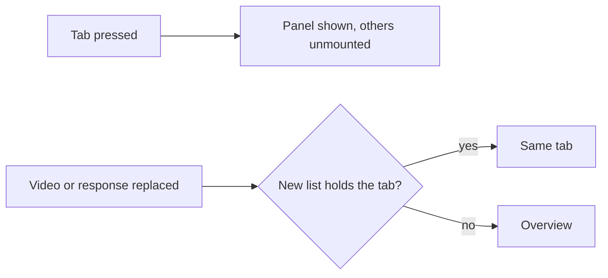
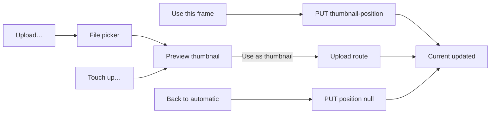

# UI design: Video page tabs

**Feature**: [parent Issue #1557](https://github.com/syudead/vv/issues/1557) ·
[plan.md](plan.md) · [research.md](research.md)

**Revision**: the maintainer made the layout canvas linked from the Issue
(`動画ページ レイアウト案`, <https://claude.ai/artifact/9iUGgdEgXoQdsJJH96QZMs>)
the source of truth for the visual design. This revision follows the canvas
for layout, hierarchy, component styles and sizes, and keeps the Issue's
requirements and the behaviour the first version settled
([R-1](research.md#r-1-which-tabs-a-video-has-is-a-pure-rule-over-the-video-response)
to [R-8](research.md#r-8-last-watched-is-the-progress-rows-time)). Where the
canvas and the first version differ on what the viewer sees, the canvas wins.
[Implementation delta](#implementation-delta) lists what the code on the
feature branch must change.

Sources that already decide things, linked rather than repeated here:

| Topic | Source |
| --- | --- |
| Tokens, closed scales, viewing density | [design-system.md, Foundations](../../docs/design-docs/design-system.md#foundations); the values in `@theme` of [`web/src/ui/tokens.css`](../../web/src/ui/tokens.css), named here and never copied |
| `DetailPage`, its slots and widths; `FactList`, `CardGrid size="face"`, the state blocks | [patterns.md, Detail page](../../web/registry/rules/patterns.md#detail-page), [Sections](../../web/registry/rules/patterns.md#sections), [design-system.md, Page patterns](../../docs/design-docs/design-system.md#page-patterns) |
| The video page as it is: band, player, title, tags, right column, widths | [library-ui.md, Video page layout](../../docs/design-docs/library-ui.md#video-page-layout) and [Tabs](../../docs/design-docs/library-ui.md#tabs), which describe the first version and change with this revision; [`web/src/player`](../../web/src/player) |
| `Tabs` (`line`), `Button`, `Toggle`, `Switch`, `Badge`, `Separator`, `Skeleton`, `Tooltip`, `FavoriteToggle`, `PersonFace`, `SpanBar`, `VideoThumbnail` | [components.md](../../web/registry/rules/components.md) |
| Faces on the video page, provisional people as `#1042` | [people.md, Faces elsewhere on the screens](../../docs/design-docs/people.md#faces-elsewhere-on-the-screens), [Provisional people on the screens](../../docs/design-docs/people.md#provisional-people-on-the-screens) |
| The thumbnail preview, the touch-up and the upload rules | [thumbnail-editing.md](../../docs/design-docs/thumbnail-editing.md#the-thumbnail-tab-offers-three-ways-to-replace-the-thumbnail), unchanged behind the rows |
| The versions list's requests, focus and failure rules | [video-versions.md](../../docs/design-docs/video-versions.md), [`VersionsPanel.tsx`](../../web/src/player/tabs/VersionsPanel.tsx) |
| The seek sprite, whose cells the Thumbnail tab reuses for the frame preview | [seek-sprite-generation.md](../../docs/design-docs/seek-sprite-generation.md), [`web/src/lib/seekSprite.ts`](../../web/src/lib/seekSprite.ts) |
| Width breakpoints in CSS, layout judged by people | [library-ui.md](../../docs/design-docs/library-ui.md#width-breakpoints-in-css-and-the-sidebar-exception) |
| Screen text | [`web/src/i18n/en.ts`](../../web/src/i18n/en.ts); this feature adds the words below |
| Which tabs a video has, the selected tab, in-flight operations | [R-1](research.md#r-1-which-tabs-a-video-has-is-a-pure-rule-over-the-video-response), [R-2](research.md#r-2-the-selected-tab-lives-in-page-memory-not-in-the-address), [R-4](research.md#r-4-operations-in-flight-belong-to-the-tabs-container-not-to-a-panel) |

This feature changes one screen, the video page, below its tags: the title
row gains three labelled pill actions, the visibility switch and `Edit details`
sit at the end of a tab strip, and six panels replace the information rows,
the work details row, the technical line and the media rows. The band, the
player, the lines above the title, the title, the tags and the right column
are unchanged.

The diagram shows the parts of the main column from the title down, and
which panel each part of the old rows moves into.

```mermaid
flowchart LR
  title[Title row: name, pencil, pill actions] --> tags[Tags, auto-tag]
  tags --> strip[Tab strip + switch, Edit details]
  strip --> overview[Overview: description | facts]
  strip --> work[Work: two fact columns | fetch]
  strip --> people[People: credits, spans]
  strip --> versions[Versions: rows with Play]
  strip --> thumb[Thumbnail: Current | Replace with]
  strip --> file[File & media: location, media | file]
```

## Why this shape

The page keeps its reading order, player, title, tags, then the rest, and
puts the rest behind one strip of `line` tabs, because the content under the
title is six kinds of information read on different occasions. One strip with
the selected panel under it shows one kind at a time, so the column no longer
stacks every kind.

A panel is laid out in two columns from `md`, as the canvas draws it at the
player's width: what is read (the description, the work's items, the location
and the media) takes the left column, and the figures (length, dates, size)
or the one action stand in a narrow right column. The first version's single
column of `text-base` facts was rejected on review: at the player's width it
left the right two thirds of the panel empty and pushed the facts below the
fold, and the panel's values read as large as the title. The canvas sets the
panel in the library's type (`text-sm` body, `text-xs` figures, `text-2xs`
labels), so the panel reads as quieter than the title and the tags, which is
the first point of the Issue's `UI品質`.

Actions are labelled pills in three fixed places, so the owner never reads an
icon: what the viewer does with the video as a whole (favorite, playlist,
group) sits beside the title, what changes the record as a whole (visibility,
`Edit details`) sits at the strip's end, and what changes one kind of
information sits in that kind's panel. A pill (`rounded-full`, the
`secondary` fill) was chosen over the first version's `ghost` buttons because
a ghost word beside a `text-video-title` heading reads as a caption, not as a
control; the filled pill is visibly pressable and still lighter than a
`default` button. Row actions inside a list (`Make representative`,
`Remove from versions`, `Back to automatic`) stay `ghost`, so the one pill in
a row (`Play`) is the row's first action.

Panels carry no frame: the strip's bottom line is the one divider between the
title unit and the panel, and inside a panel the figures stand in divided
rows (a hairline under each) while sections are separated by spacing and a
small muted uppercase label. Labels and values keep two colours, muted term
and body value.

A panel is read when it is selected: Versions and People read their lists
then. The work-info fetch and the thumbnail sends belong to the strip's
container and keep running while another tab is open
([R-4](research.md#r-4-operations-in-flight-belong-to-the-tabs-container-not-to-a-panel)).
The selected tab is page memory, not the address
([R-2](research.md#r-2-the-selected-tab-lives-in-page-memory-not-in-the-address)).

## Words

| Place | Text | Notes |
| --- | --- | --- |
| Tabs | Overview · Work · People · Versions · Thumbnail · File & media | In this order; `People` and `Versions` carry a count after the label |
| Title row actions | Favorite · Add to playlist · Add to group | The visible labels; the canvas's `+ Playlist` and `+ Group` stand for the icon and the word |
| Strip end | Private · Public · Edit details | Existing words; `Private`/`Public` is the word before the switch |
| Overview facts | Length · Resolution · Added · Last watched | `Last watched` is new ([R-8](research.md#r-8-last-watched-is-the-progress-rows-time)) |
| Overview work summary | `KYT-002 · Released 2024-03-15 · 山田 花子, 佐藤 健太` | The code, `Released {date}` and the performers' names joined by `, `, the three parts joined by ` · `, a missing part left out |
| Work, empty | No work details yet. | One muted line in place of the list |
| Work action column | Fill in from a site | The column's label |
| Work action | Fetch again · Fetch | `Fetch again` while the work has items, `Fetch` while it has none; the dialog's words are unchanged |
| People headings | Credits · Seen in this video | |
| People hint | `0:00 — 0:35 · press a bar to jump` | At the right end of the `Seen in this video` heading line: `0:00 — {length}`, then ` · press a bar to jump` only while the bars are buttons |
| Span tooltip | 0:12–0:30 | The span's start and end |
| People, read failed | Couldn't load the people seen in this video: {reason} | With `Retry` |
| Versions marks | Representative · Now playing | Existing words, both visible chips |
| Versions actions | Play · Make representative · Remove from versions | `Play` is new as a visible word, on every row but the playing one; `Make representative` on every row but the representative; `Remove from versions` on every row |
| Thumbnail headings | Current · Replace with | |
| Thumbnail origin | Frame at 0:12 · Uploaded image · Generated image · Automatic | One line under the image |
| Thumbnail revert | Back to automatic | |
| Thumbnail rows | The frame on screen · An image · Touch up with ComfyUI | The row titles |
| Thumbnail notes | `0:03` · PNG, JPEG or WebP, up to 64 MB · Frame the image, then run an instruction | One muted note under each title; the frame row's note is the player's position |
| Thumbnail buttons | Use this frame · Upload… · Touch up… | The pill at each row's end |
| File & media headings | Location · Media · File | `File` labels the right column for screen readers only; its rows carry their own words |
| Location actions | Open file · Copy path · Rescan | |
| Media facts | Video · Audio · Subtitles · Chapters · Container · Embedded · Broadcast | `Subtitles` and `Chapters` read `None` when the probe is done and found none |
| Media, none | None | Muted, in the value column |
| File facts | Size · Added · Edited · File created | `File created` replaces `Created`, so the three dates read apart |

Every value above is an example; the screen reads them from the response.

## Changes to the design system

The design system is changed first, in the same unit as the screen that
needs the change, and the screen then composes it. The registry items are
rebuilt with `task generate`.

| Change | Where | What |
| --- | --- | --- |
| Pill shape | `Button`, `Toggle` (`web/src/ui/shadcn/button.tsx`, `toggle.tsx`); [components.md, Button](../../web/registry/rules/components.md#button) | A `shape` axis, `default` (`rounded-md`) and `pill` (`rounded-full`), so a screen never sets a radius itself. The rule: the video page's labelled actions beside the title, at a section's end and a row's `Play` are `secondary` `sm` pills; actions inside a row stay `ghost` |
| Favorite fill | `FavoriteToggle` `page` form (`web/src/ui/FavoriteToggle.tsx`); `tokens.css`; `web/src/theme/tokens.test.ts`; [foundations.md, Colour roles](../../web/registry/rules/foundations.md#colour-roles) | The `page` form is a `sm` pill `Toggle`: off, the `secondary` fill with `foreground` text and the outlined heart; on, the new token `favorite-soft` as the fill with `favorite` text and the heart filled. `favorite-soft` is a six-digit hex in `tokens.css`, paired as `["favorite", "favorite-soft", 4.5]`, and its role row reads "The fill behind the favorite pill when on" |
| Visibility is a `Switch` | `VisibilitySwitch` (`web/src/player/VisibilitySwitch.tsx`); [components.md, Checkbox and Switch](../../web/registry/rules/components.md#checkbox-and-switch) | The exception for the video page's visibility button is removed: the control is the `Switch` component (checked when public) with the current state's word before it in `text-xs`, the word a `Label` bound to the switch. The lock and globe icons go |
| Divided and two-column facts | `FactList` (`web/src/ui/patterns/fact-list.tsx`); [patterns.md, Sections](../../web/registry/rules/patterns.md#sections) | `variant="divided"`: one row per fact, the term at the left in `text-xs text-muted-foreground`, the value at the right end in `text-xs font-mono tabular-nums`, `py-2`, `border-b border-border` under every row; for a column of figures. `columns={2}`: the `grid` variant splits its facts into two equal lists from `md`, the first half left, `gap-x-10` apart; for a long list of terms. The default stays the three-column grid |
| Named steps | `tokens.css`; [foundations.md, Spacing and sizes](../../web/registry/rules/foundations.md#spacing-and-sizes) | `facts-column` (15rem): the right column of a two-column panel. `replace-preview` (6rem): the small preview at the start of a `Replace with` row. Both are listed among the named steps |
| Detail page rhythm | `DetailPage` (`web/src/ui/patterns/detail-page.tsx`); [patterns.md, Detail page](../../web/registry/rules/patterns.md#detail-page) | The children stack `gap-3` apart and sit `gap-4` under the media, instead of `gap-5` for both; the children row of the slot table adds "the tab panel is set in `text-sm`, the library's type, under the page's viewing-density spacing" |
| Tab count type | `TabsTrigger` count ([components.md, Tabs](../../web/registry/rules/components.md#tabs)) | "A count follows the label in `text-2xs text-muted-foreground`" |
| Credited person's tile | [components.md, PersonFace](../../web/registry/rules/components.md#personface) | The `scene` row's "Where" adds "a credited person's tile on the video page's People tab" |

No other component or token is added. The icons are lucide `Heart`,
`ListPlus`, `FolderPlus`, `ExternalLink`, `Copy`, `RefreshCw`, `Star` and
`AlertCircle`; the panel pills carry no icon, as the canvas draws them.

## Title row

The `h1` and its pencil are unchanged. The actions follow on the same line
from `sm`, bottom-aligned with the title's last line as the canvas draws
them, the title taking the remaining width and wrapping; below `sm` they are
a row of their own under the title. The three are `sm` pills `gap-2` apart:

| Action | Form |
| --- | --- |
| `Favorite` | `FavoriteToggle page`: the heart and the word; off, `secondary`; on, `favorite-soft` with `favorite` text and the heart filled |
| `Add to playlist` | `secondary` pill, `ListPlus` and the word; opens the playlist picker as today |
| `Add to group` | `secondary` pill, `FolderPlus` and the word; opens the group picker as today |

A failed favorite change shows one line under the row, `text-sm
text-destructive` with `AlertCircle`. The row is absent for guests.

The page's controls below the player are `sm` (`h-8`); `default` and `lg`
stay the player's.

## Tab strip

The strip sits under the tags with no line above it: a `Tabs`
`variant="line"` whose row carries a `border-b border-border`, the selected
tab's `primary` underline lying on that line. The row holds the `TabsList` at
the left and, for the owner, the visibility switch then `Edit details` at the
right end, `gap-1` apart, bottom-aligned with the tabs:

| Control | Form |
| --- | --- |
| Visibility | `Private` or `Public` in `text-xs`, then the `Switch`, checked when public; one control, pressing the word or the track toggles |
| `Edit details` | `ghost` `sm`, the word alone, a link to `/videos/:id/edit` with today's hand-off and return focus |

A tab is the word in `text-sm font-medium`; `People` and `Versions` add the
count after it in `text-2xs text-muted-foreground`. The `People` count is the
number of tiles in `Credits`, the distinct people of `workInfo.people` by
person id; the `Versions` count is `versions.count`. Only the tabs of
[R-1](research.md#r-1-which-tabs-a-video-has-is-a-pure-rule-over-the-video-response)
are drawn; a strip never holds a disabled tab.

| Width | Strip row |
| --- | --- |
| `sm` and above | One line: the tabs, then the two controls at the right end |
| Below `sm` | The two controls on a line of their own above the strip, right-aligned; the tabs alone on the strip line |

The tabs never wrap: when they are wider than the row, the list scrolls
sideways inside the row, the page keeps no horizontal scroll, and selecting
a tab scrolls it into view. The panel starts `pt-2` under the line.

The diagram shows what a press on a tab, a change of video and a refresh do
to the selection.



An open `FetchDialog` or `UploadPreview` is rendered by the strip's container
and stays open across a switch
([R-4](research.md#r-4-operations-in-flight-belong-to-the-tabs-container-not-to-a-panel)).

### Panel conventions

| Part | Form |
| --- | --- |
| Type | The panel is set in `text-sm`; figures, dates, paths and details in `text-xs`; labels, counts, roles and notes in `text-2xs`. The canvas's 13px values map to `text-sm`, the nearest step; no step is added to the closed type scale |
| Two columns | From `md`: the reading column `flex-1 min-w-0` at the left, the figures or the action in a `w-facts-column` column at the right, `gap-12` apart, both top-aligned. Below `md` the right column follows the left one, full width |
| Section label | `h2`, `text-2xs font-medium tracking-wider uppercase text-muted-foreground`; a label and its content `gap-3` |
| Sections | `gap-6` apart within a column |
| Figures | `FactList variant="divided"` in the right column; a fact whose value is unknown is absent |
| Terms and values | `FactList` (grid) in the left column, `text-sm`, the term in `muted-foreground`, the value in `foreground` |
| Dates | The date only, in the divided row's `text-xs font-mono`; the time in `title` and in the popover opened by pressing the date, as today |
| Section action | A `secondary` `sm` pill, with no icon |
| Row action | `ghost` `sm` with the word |
| Busy | The pressed action spins; the other actions of the same panel are `aria-disabled` while one request runs |
| Failure | One line at the end of the panel, `text-sm text-destructive` with `AlertCircle`; cleared on the next action and on a video change |
| Loading a list | Two `Skeleton` rows `h-12` in place of the list |
| List read failed | The failure words and `Retry` (`link` `sm`) in place of the list |

## Overview

Two columns: the description and the work summary at the left, the four
facts at the right.

| Column | Content |
| --- | --- |
| Left | `workInfo.description` in `text-sm leading-relaxed text-foreground`, folded to three lines with `Show more` and `Show less`; under it, `gap-4` apart, the work summary in `text-xs text-muted-foreground`; both owner only, each absent when empty |
| Right | `FactList variant="divided"` of `Length`, `Resolution` (as `1920×1080`), `Added`, `Last watched`, `w-facts-column` wide |

Without a description and a summary (a guest, or a video with no work
information) the facts stand alone at the panel's start, still
`w-facts-column` wide from `md` and full width below.

`Last watched` is `progress.updatedAt`
([R-8](research.md#r-8-last-watched-is-the-progress-rows-time)) and is absent
without a progress row and for guests. While the probe is pending or failed,
`Length` and `Resolution` are absent here and File & media says why.

## Work

Two columns: the work's items at the left, the fetch action at the right.

The left column is a `FactList columns={2}` of the items other than the
description and the performers, in this order, so the first half (the code
and the dates) stands left and the second half (the people, the
organizations, the links and the ids) right from `md`:

| Fact | Value |
| --- | --- |
| `Code` | The code, `tabular-nums` |
| `Released`, `Recorded`, `Published` | Each date as stored |
| `Director`, `Photographer`, `Streamer` (plural with several) | `PersonFace chip` and name per person, each a link to the person page, wrapping; three shown, then `+{n} more` in place, as today |
| `Maker`, `Label` (plural with several) | Text links to the filtered library in `foreground`, as today |
| `Links` | Each link without its scheme in `text-primary`, `ExternalLink` after it, one per line |
| `IDs` | `{source}: {value}` per id |

With no item, the left column holds `No work details yet.` in `text-sm
text-muted-foreground`
([R-5](research.md#r-5-the-work-tab-is-shown-for-an-empty-work-when-a-plugin-can-fill-it)).

The right column, present only while an approved work-info plugin exists, is
the label `Fill in from a site` over one pill, `Fetch again` (or `Fetch`
while the work has no item), which pauses the player and opens the fetch
dialog as today's entry does. An `Empty` block was rejected: it would move the
one action into the block, so the action's place would change with the list.

## People

Two sections in one column, `Credits` and `Seen in this video`, `gap-6`
apart.

`Credits` is a `CardGrid size="face"` of the credited people, one tile per
person, in the order of the work's people with a person of two roles once:

| Tile part | Content |
| --- | --- |
| Face | `PersonFace scene`: the person's image or the placeholder in a square `rounded-md` frame, as the canvas draws it |
| Name | `text-sm text-foreground`, left-aligned, one line truncated; a provisional person as `#1042` in `muted-foreground` |
| Role | `text-2xs text-muted-foreground`, roles joined by ` · ` |

The tile is one link to `/people/{id}`, `gap-1.5` between its parts.

`Seen in this video` is drawn only while the appearances read answers
`analysed` true with at least one item; it is read when the tab is selected
and again after the video is replaced. Its label line holds the label at the
left and the hint at the right end in `text-2xs text-muted-foreground`:
`0:00 — {length}`, then ` · press a bar to jump` while the bars are buttons.
One row per item, `gap-3` apart:

| Row part | Content |
| --- | --- |
| Person | `PersonFace option` and the name in `text-sm`, `#1042` muted when provisional, in a column `w-list-thumb` wide from `sm` (the name truncated) and on a line above the lane below `sm`; the pair is a link to the person page |
| Spans | A `SpanBar` filling the rest of the row, the lane being `durationMs` long and each span placed at `start / (durationMs / 1000)` with the width of its length, clamped to the lane; a span past the end is drawn to the end |

A span block is a button, with the span as its tooltip, while the player is
shown; pressing it seeks the player to the span's start and plays
([R-7](research.md#r-7-a-span-bar-seeks-the-player-in-place)). While the
player is not shown the blocks are plain, in `muted-foreground`, and the
hint's second part is absent. Without `durationMs` the row shows the person
alone, with no lane, and the hint is absent.

| State | What the section shows |
| --- | --- |
| Reading | The two `Skeleton` rows |
| `analysed` false, or no item | Nothing; `Credits` stands alone |
| Read failed | `Couldn't load the people seen in this video: {reason}` with `Retry` |

## Versions

One row per version from `GET /api/videos/{id}/versions`, read when the tab
is selected, representative first as the response orders them. A row is
`py-3` with `border-b border-border` under it, its parts `gap-3` apart and
vertically centred:

| Row part | Content |
| --- | --- |
| Thumbnail | `VideoThumbnail` `w-list-thumb-cell` (`aspect-video`, `rounded-md`), the duration at its corner as a card has; the playing version's carries `selected`, the `primary` ring, and nothing else in the row is marked |
| Title line | The title in `text-sm text-foreground`, plain text on every row, two lines at most; after it the chips `Representative` (`Badge secondary`, with `Star`) on the representative and `Now playing` (`Badge soft`) on the playing version, `gap-2` |
| Details | Resolution · codec · size · container, `text-xs text-muted-foreground tabular-nums`, in this order |
| Path | For the owner `location.path`, for a guest the version's place, `text-2xs font-mono text-muted-foreground`, one line truncated from the left so the file name stays |
| Actions | `Play`, a `secondary` `sm` pill around the link that opens that version as today's title links did, on every row but the playing one; then, owner only, `Make representative` (not on the representative) and `Remove from versions` (on every row, the playing one included), `ghost` `sm`; `gap-1`, at the row's end from `sm`, under the path below `sm` |

The playing row has no `Play`, since it is already playing, and the
representative row has no `Make representative`; the owner can remove every
version, the playing one included, as the Issue and the first version
require. A row's pressed action spins and that row's other actions are
`aria-disabled`; `Make representative` moves the chip on the response,
`Remove from versions` removes the row and shows today's toast, and removing
the playing version replaces the page's video as today. The selection then follows
[R-2](research.md#r-2-the-selected-tab-lives-in-page-memory-not-in-the-address):
Versions stays selected while the new video still has two or more versions,
and Overview is selected when one version is left. A per-row `More` menu was
rejected: it is an icon-only control holding the two actions the `UI品質`
third point asks to see as words.

| State | What the panel shows |
| --- | --- |
| Reading | The two `Skeleton` rows |
| Read failed | `Couldn't load the versions` with `Retry` |
| Guest | The rows with `Play` only |

## Thumbnail

Two columns divided by a vertical `Separator`: `Current` at the left,
`Replace with` at the right, `gap-6` from the line on each side.

| `Current` part | Content |
| --- | --- |
| Image | `VideoThumbnail` `w-card-0` (`aspect-video`, `rounded-md`), the thumbnail as stored; the placeholder frame while there is none |
| Origin | One line, `text-xs text-muted-foreground`: `Frame at {time}` with the time in `font-mono`, `Uploaded image`, `Generated image`, or `Automatic` |
| Action | `Back to automatic` (`ghost` `sm`, pulled to the column's left edge), only while the origin is not `Automatic`; sends the position `null`, which removes the image and the position in one request ([R-6](research.md#r-6-the-three-replacement-ways-map-to-the-existing-flows)) |

`Replace with` fills the rest of the panel: the label, then three rows, each
`py-2` with `border-b border-border` between rows, its parts `gap-3` apart
and vertically centred: a `w-replace-preview` preview (`VideoThumbnail`,
`aspect-video`, `rounded-md`), the title in `text-sm` with its note under it
in `text-2xs text-muted-foreground`, and the pill at the row's end.

| Row | Preview | Title and note | Pill | What it does |
| --- | --- | --- | --- | --- |
| The frame on screen | The seek sprite's cell at the player's position, drawn as the seek preview draws it; the empty frame while the sprite is unavailable | `The frame on screen`; the player's position in `font-mono`, as `0:03` | `Use this frame` | Sends the player's position as today's capture button did; the row is present only while the player shows a frame |
| An image | The empty frame with a dashed `border-input` edge and no fill | `An image`; `PNG, JPEG or WebP, up to 64 MB` | `Upload…` | Opens the browser's file picker, refuses a wrong type or a file over 64 MB on the failure line, then opens the preview |
| Touch up with ComfyUI | The current thumbnail at `opacity-50`; the placeholder frame while there is none | `Touch up with ComfyUI`; `Frame the image, then run an instruction` | `Touch up…` | Opens the preview on the current thumbnail; its ComfyUI section is unchanged, and without a connection it says so with `Open Settings` |

The diagram shows how each way reaches the stored thumbnail.



One send at a time: while any of the four sends, the other three are
`aria-disabled` and the sending one spins. The `Current` image changes to the
response's thumbnail when the send ends, also when another tab was open
meanwhile.

Below `md` the `Current` column stands first, a horizontal `Separator`
follows, then the rows; below `sm` a row's pill moves under its title and
note, in the text column, so the preview stays at the row's start.

## File & media

Two columns: `Location` and `Media` at the left, the file's figures at the
right. `Location` is absent for guests and for a video without a location,
and `Media` then starts the left column.

| `Location` part | Content |
| --- | --- |
| Path | `location.path` in `text-xs font-mono leading-relaxed text-foreground`, wrapping anywhere so the whole path is read |
| Actions | `Open file` only while `openable` is true, `Copy path`, `Rescan`; `secondary` `sm` pills in one wrapping row, `gap-1.5` |

`Copy path` writes the path and shows today's toast; `Rescan` is
`aria-disabled` with the blocked reason as its tooltip while a scan runs or
no media folder exists, as today.

`Media` is a `FactList` (grid), one row per fact, in this order:

| Fact | Value |
| --- | --- |
| `Video` | The codec and resolution from the `Video` response's `videoCodec`, `width` and `height`, then `videoItems(mediaInfo.video)` (HDR, frame rate, bit depth, bit rate and the other marks it returns), all joined by ` · ` |
| `Audio` | One line per track, joined by ` · `; more than six fold to six and `+{n} more` |
| `Subtitles` | As `Audio`; `None` in `muted-foreground` when `mediaInfo` is present and has no subtitle track and no closed captions |
| `Chapters` | `{n} chapters`; `None` in `muted-foreground` when `mediaInfo` is present and has none |
| `Container` | The container in upper case |
| `Embedded`, `Broadcast` | The groups' items, as today; absent without content |

Without `mediaInfo` the rows come from the technical summary: `Video`
(resolution and codec), `Audio` (codec) and `Container`, and `Subtitles` and
`Chapters` are absent. While the probe is pending the section shows
`Reading technical details…` in place of the list, and after a failed probe
`Couldn't read the technical details` in `warning`, the existing words.

The right column is a `FactList variant="divided"` of `Size`, `Added`,
`Edited` and `File created`, `w-facts-column` wide, labelled `File` for
screen readers.

## Guests

A guest's page has no title row actions, no tags, no strip controls and the
tabs Overview, Versions (with two or more versions) and File & media. Overview
holds the facts without `Last watched`; Versions rows have `Play` only; File &
media has no `Location`. Nothing else differs.

## States

| State | What the page shows |
| --- | --- |
| Loading the video | The title skeletons as today; no strip |
| Video ready, owner | The title row with its pills, the tags, the strip with the tabs of R-1 and the two controls, Overview selected |
| Video ready, guest | The title, the strip with the guest's tabs, Overview selected |
| Plugin list not yet read | The strip without Work for an empty work; Work is added in its place when the list arrives, the selection unchanged |
| Player not shown | The same strip; the frame row absent in Thumbnail, the span blocks plain in People |
| Operation in flight, other tab open | The dialog or preview still open over the page; on return the panel shows the result or the failure line |
| Selected tab gone after a refresh | Overview selected |

## Responsive behaviour

Breakpoints are Tailwind's defaults only, applied in CSS; `sm` is 640px,
`md` 768px and `lg` 1024px. The widths judged are 390px, 768px, 1280px, and
1440×900 for the background's complaint.

| Width | Layout |
| --- | --- |
| 1440×900 | The `lg` layout: the column scrolls on its own. With a 16:9 video the player is width-limited and the title, the tags, the strip and the top of the selected panel are in view without scrolling; the rest of the panel is read by scrolling the column. The canvas is drawn at 1440×1200, where the whole Overview panel fits; at 900px high it does not, and the strip in view is the claim |
| 1280px | The `lg` layout: the pills at the right end of the title's last line; the strip on one line with the switch and `Edit details` at its end; every panel in two columns, the right one `w-facts-column`; Versions rows with the thumbnail, the title line, the details and the path left and `Play` and the quiet actions right; `Credits` tiles about `card-face` wide; a span row's name column then the lane; Thumbnail's `Current` beside the three rows across the vertical line |
| 768px | Everything stacks and the page scrolls as one; the strip still fits on one line with its controls; the panels keep two columns, the reading column narrower; Versions actions still at the row's end; the Work list in two columns; the path wraps to two lines |
| 390px | The pills on a row of their own under the title; the two controls on their own line above the strip; the strip scrolls sideways and every tab is reached without the page scrolling sideways; every panel in one column, the figures full width in divided rows; the Work list in one column; Versions actions under the path; `Credits` three tiles across; a span row's name above its lane; Thumbnail's `Current`, a horizontal line, then the rows with the pill under the text; the path wraps |

## Review criteria

Judged by looking at the real screen
([library-ui.md, Layout verified by people, not machines](../../docs/design-docs/library-ui.md#layout-verified-by-people-not-machines))
at the widths above, as the owner on a video with a description, a code,
performers, three versions, a recorded thumbnail position and a location, on
a video with none of these and one file, and as a guest on a public video.
"It exists" alone does not satisfy a criterion (Q-4).

1. **Visual hierarchy**: the eye goes player → title → tags → strip → panel;
   nothing in a panel is larger than `text-sm`, so the panel reads quieter
   than the title and the tags, and the selected tab's underline and the
   playing version's ring are the only `primary` between the title and the
   panel's actions. A section label reads as a label, smaller and quieter
   than the values under it.
2. **Information density**: at 1280px Overview shows the description's first
   three lines and the summary at the left and the four figures in divided
   rows at the right, with no empty right half; Work shows its items in two
   columns and the one action in its own column; at 390px a Versions row
   holds its thumbnail, title line, details and path in no more than four
   lines before its actions.
3. **Spacing rhythm**: the title unit, the strip and the panel keep the
   `DetailPage` children's `gap-3`; the strip's line is the one horizontal
   divider between the title unit and the panel, with no line above the
   strip; the two columns of a panel are `gap-12` apart; divided rows are
   `py-2` with one hairline each; sections inside a column are `gap-6`
   apart and a label sits `gap-3` over its content.
4. **Typography**: tabs are `text-sm font-medium`, counts `text-2xs` muted;
   section labels `text-2xs` uppercase muted; the panel body `text-sm`;
   figures, dates, details and paths `text-xs` (mono for figures, dates and
   paths); notes, roles and the People hint `text-2xs`; no new size or weight
   appears, and no label is bold.
5. **Priority of actions**: `Favorite` is the first control after the title
   and the only filled one when on; `Edit details` is the last control of the
   strip row and the only ghost there; in a panel every section action and
   `Play` is a `secondary` pill, row actions are `ghost`, and the page shows
   no `default` button and no icon-only button between the title and the
   panel.
6. **Labels tell dates apart**: in Overview and File & media each date is
   read with its word (`Added`, `Edited`, `File created`, `Last watched`) in
   its own divided row, and no two look the same (acceptance criterion 2).
7. **Strip at 390px**: every tab is reached by scrolling the strip, the page
   never scrolls sideways, and the two controls stay in view above the strip
   (acceptance criterion 10).
8. **Selection**: a fresh open shows Overview; moving to a related video
   keeps the tab when the next video has it and shows Overview otherwise;
   `Work` open on a video with no work information and no approved plugin
   is not reachable (acceptance criteria 1, 7, 9).
9. **People**: pressing a credit tile opens the person page; pressing a span
   block starts playback at that time without reloading the page; a
   provisional person reads `#1042` in both sections; with the player not
   shown the blocks are grey and the hint ends at the length (acceptance
   criterion 3).
10. **Versions**: the playing row is the one with the ringed thumbnail, the
    `Now playing` chip and no `Play`, and offers the owner
    `Remove from versions`; `Make representative` moves the chip
    without a reload; `Remove from versions` drops the row; `Play` on
    another row opens that version (acceptance criterion 4).
11. **Thumbnail**: `Current` and `Replace with` stand across one vertical
    line; `Use this frame` changes `Current` and its origin line to
    `Frame at {time}` in the same flow as today; `Back to automatic` returns
    the automatic frame in one request; while one sends the other three are
    at half opacity (acceptance criterion 5).
12. **File & media**: `Copy path` fills the clipboard and shows the toast;
    `Open file` is absent when the file cannot be opened from here; a guest
    sees `Media` and the file figures and no `Location` (acceptance criteria
    6, 8).
13. **Examples that do not meet the requirement** (`UI品質`): a card or a
    border around a panel; a `text-base` value in a panel; a ghost word as a
    title action; a `ring` or an `accent` fill around a whole Versions row;
    `Now playing` present only for screen readers; a `Replace with` way drawn
    as a bare button without its preview and note; an icon-only button
    anywhere between the title and the panel; the same action in two tabs; a
    date shown with an icon and no word; a tab that is present but empty; a
    strip that wraps to two lines or pushes the page wider at 390px;
    `Edit details` inside a panel; a span block that is pressable while
    nothing can play.

## Implementation delta

What the code on the feature branch (`bf93b88`) must change to meet this
revision, by file. Tests and the e2e spec follow the same renames
(`web/e2e/video-tabs.e2e.ts`, the `*.test.tsx` next to each file), selected
under [write-tests](../../.agents/skills/write-tests/SKILL.md). The permanent
documents change with the behaviour: [library-ui.md, Video page
layout](../../docs/design-docs/library-ui.md#video-page-layout) and
[Tabs](../../docs/design-docs/library-ui.md#tabs),
[design-system.md](../../docs/design-docs/design-system.md), and the rules
files named in [Changes to the design system](#changes-to-the-design-system).

### `web/src/ui`

| File | Change |
| --- | --- |
| `tokens.css` | Add `--color-favorite-soft` (six-digit hex), `--spacing-facts-column: 15rem`, `--spacing-replace-preview: 6rem` |
| `shadcn/button.tsx`, `shadcn/toggle.tsx` | Add the `shape` axis (`default`, `pill` = `rounded-full`) to `buttonVariants` and `toggleVariants`, default `default` |
| `FavoriteToggle.tsx` | The `page` form: `shape="pill"`, `bg-secondary text-foreground` off, `bg-favorite-soft text-favorite` on (`data-[state=on]`, `aria-pressed`), the heart filled when on |
| `patterns/fact-list.tsx` | Add `variant?: "grid" \| "divided"` and `columns?: 1 \| 2`; `divided` draws `flex justify-between py-2 border-b border-border` rows with `text-xs` terms and `text-xs font-mono tabular-nums text-right` values; `columns={2}` splits the facts into two `dl`s in a `md:grid-cols-2 gap-x-10` grid |
| `patterns/detail-page.tsx` | `gap-5` → `gap-4` on the content stack and `gap-3` on the children stack |
| `../theme/tokens.test.ts` | Add `["favorite", "favorite-soft", 4.5]` to `pairs` |
| `../../registry/rules/components.md`, `foundations.md`, `patterns.md`; `../../registry.json` descriptions where they name the changed behaviour; `task generate` | The rule changes in [Changes to the design system](#changes-to-the-design-system) |

### `web/src/player`

| File | Change |
| --- | --- |
| `TitleRow.tsx` | `sm:items-start` → `sm:items-end`; the actions `gap-2`; `FavoriteToggle page` as above |
| `../library/PickerButton.tsx` (`page` form, used by `AddToPlaylistButton` and `AddToGroupButton`) | `ghost` → `secondary` `sm` `shape="pill"`, `text-foreground`; the icon stays |
| `VisibilitySwitch.tsx` | Replace the `Button role="switch"` with a `Label` holding the word (`text-xs`) and the `Switch` (`checked={isPublic}`, `aria-disabled` while sending, `aria-label` from the catalog); drop `Lock`/`Globe`; keep the failure line |
| `detailsEditor/DetailsEntry.tsx` | Drop the `Clapperboard` icon; the word alone |
| `tabs/VideoPageTabs.tsx` | The strip and controls row `gap-1` at the end; `TabsContent` `pt-4 text-base` → `pt-2 text-sm`; `TabTrigger` count `text-2xs` |
| `tabs/panelParts.tsx` | `PanelSection` heading `text-xs` → `text-2xs`; `DateValue` trigger `text-base` → `text-xs font-mono`; add `PanelColumns` (left `flex-1 min-w-0`, right `md:w-facts-column shrink-0`, `flex-col md:flex-row gap-6 md:gap-12 items-start`) and `PanelLabel` (the label without a `section`) for the right column's label |
| `tabs/OverviewPanel.tsx` | Lay out with `PanelColumns`: left `Description size="sm"` and the summary (`text-xs`), right `FactList variant="divided"`; the facts alone when the left is empty |
| `WorkInfo.tsx` | `Description` gains `leading-relaxed`; `linkEntry` text `text-primary`; one link per line; `WorkInfo` passes `columns={2}` |
| `tabs/WorkPanel.tsx` | `PanelColumns`: left the list or `No work details yet.`, right `PanelLabel` `Fill in from a site` over the pill `Fetch again` / `Fetch` (`secondary` `sm` `shape="pill"`, no icon) |
| `tabs/PeoplePanel.tsx` | `Credits` tiles: `PersonFace shape="scene"`, `items-start text-left`, name `text-sm`, role `text-2xs`, `gap-1.5`; the `Seen in this video` label line as a flex row with the hint (`0:00 — {length}` + the press part) at the right in `text-2xs`; the name column `sm:w-list-thumb`; `seenHint` reworded |
| `tabs/VersionsPanel.tsx` | Row: `py-3 border-b border-border` on every row, no `bg-accent`/`ring` on the row; thumbnail `w-list-thumb-cell` with `selected={current}`; title plain text on every row (no `Link`); chips `Representative` (`Badge secondary` + `Star`) and `Now playing` (`Badge soft`, visible, replacing the `sr-only` span); details line without the place; a path line (`text-2xs font-mono text-muted-foreground`, `dir="rtl"` truncation) with `location.path` for the owner and the place for a guest; `Play` only when `!current` (`Button secondary sm shape="pill" asChild` around the `Link` with today's `state` and `aria-label`), then the owner's ghost actions with today's conditions (`Remove from versions` on the playing row too); `RowActions` `gap-1` |
| `../versions/VersionDetails.tsx` | `versionDetails` specs order: resolution, codec, size, container; `VersionDetailsLine` takes `place` optionally so the versions row can leave it out while other callers keep it |
| `tabs/ThumbnailPanel.tsx` | Lay out as `Current` column, `Separator orientation="vertical"` (`md`) / horizontal (below), `Replace with` column; `CurrentImage` `max-w-card-0` → `w-card-0`; origin line `text-xs` with the time in `font-mono`; `Back to automatic` `ghost sm -ml-2`; replace `WayRow` with a row of preview (`VideoThumbnail` `w-replace-preview`), title + note, pill (`secondary sm shape="pill"`, no icon); previews: the seek sprite cell at `capture.positionMs()` (reuse `seekSpriteCell`/`spriteCellBackground` from `lib/seekSprite`, fetching the sprite as `seekPreview.ts` does), the dashed empty frame, the current thumbnail at `opacity-50` |
| `tabs/FileMediaPanel.tsx` | `PanelColumns`: left `Location` (path `text-xs font-mono leading-relaxed`, pills `gap-1.5`) and `Media`; right `FactList variant="divided"` of `Size`, `Added`, `Edited`, `File created` with an `aria-label` `File` |
| `RescanVideoButton.tsx` | `outline` → `secondary` `shape="pill"`, no icon |
| `MediaInfoGroups.tsx` | `subtitleFact` and `chapterFact` return a `None` (`text-muted-foreground`) fact when `mediaInfo` is present and empty, instead of `null` |
| `../i18n/en.ts` | Add `fetch`, `fetchAgain`, `play`, `frameOnScreen`, `anImage`, `touchUpButton` (`Touch up…`), `none`, `fileCreated` (`File created`), `seenRange` (`0:00 — {length}`), `seenPress` (`press a bar to jump`); reword `touchUpNote`; the `thumbnailFrameNote` is no longer needed |
| Tests and e2e | Rename the queries: the versions title link → `Play` button, the `sr-only` `Now playing` → the visible chip, `Created` → `File created`, `Use current frame` notes → the row titles; add the cases the changed contracts need (the playing row has no `Play` and keeps `Remove from versions`, the `None` rows, the pill shape on the title actions) |
