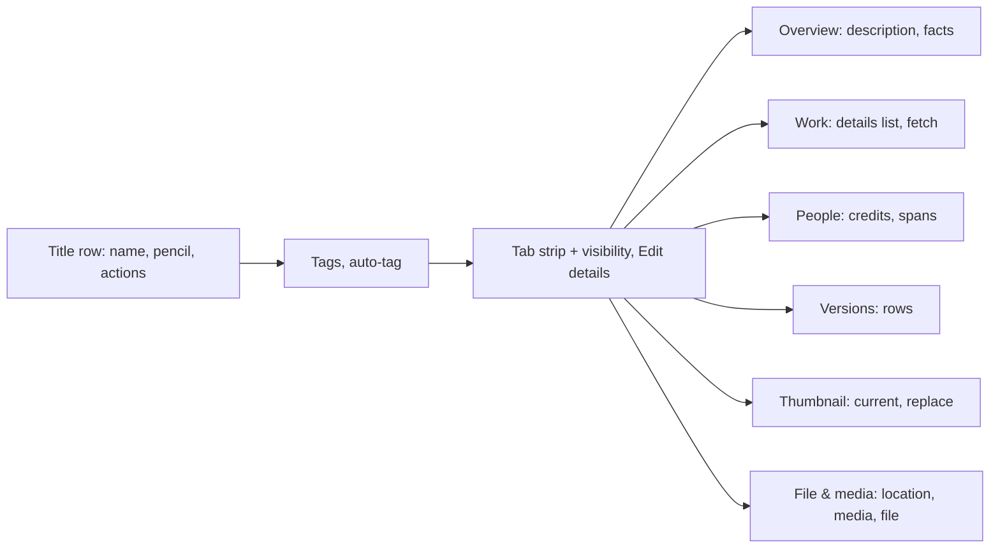
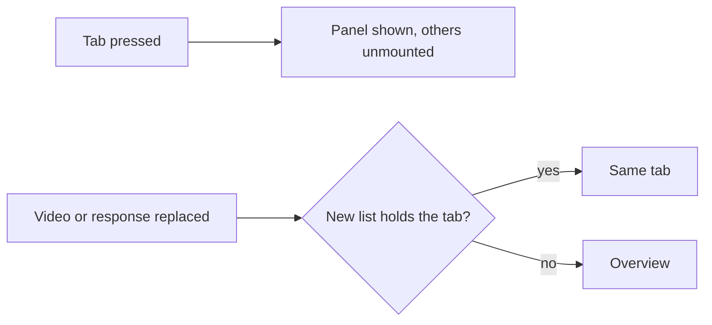
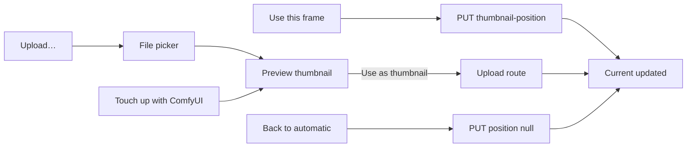

# UI design: Video page tabs

**Feature**: [parent Issue #1557](https://github.com/syudead/vv/issues/1557) ·
[plan.md](plan.md) · [research.md](research.md) ·
[contracts/screen-api.md](contracts/screen-api.md)

Sources that already decide things, linked rather than repeated here:

| Topic | Source |
| --- | --- |
| Tokens, closed scales, viewing density | [design-system.md, Foundations](../../docs/design-docs/design-system.md#foundations); the values in `@theme` of [`web/src/ui/tokens.css`](../../web/src/ui/tokens.css), named here and never copied |
| `DetailPage`, its slots and widths; `FactList`, `CardGrid size="face"`, the state blocks | [patterns.md, Detail page](../../web/registry/rules/patterns.md#detail-page), [Sections](../../web/registry/rules/patterns.md#sections), [design-system.md, Page patterns](../../docs/design-docs/design-system.md#page-patterns) |
| The video page as it is: band, player, title, tags, right column, widths | [library-ui.md, Video page layout](../../docs/design-docs/library-ui.md#video-page-layout) and [Information rows](../../docs/design-docs/library-ui.md#information-rows), which this feature replaces; [`web/src/player`](../../web/src/player) (`VideoPageDetails`, `VideoFacts`, `WorkInfo`, `VersionsFact`, `MediaInfoGroups`) |
| `Tabs` (`line`), `Button`, `Toggle`, `Badge`, `Skeleton`, `Tooltip`, `FavoriteToggle`, `PersonFace`, `VideoThumbnail` | [components.md](../../web/registry/rules/components.md); the faces page's `line` tabs with a button after them in [`PersonFacesPage.tsx`](../../web/src/credits/person/PersonFacesPage.tsx) |
| Faces on the video page, provisional people as `#1042` | [people.md, Faces elsewhere on the screens](../../docs/design-docs/people.md#faces-elsewhere-on-the-screens), [Provisional people on the screens](../../docs/design-docs/people.md#provisional-people-on-the-screens) |
| The thumbnail preview, the touch-up and the upload rules | [thumbnail-editing.md](../../docs/design-docs/thumbnail-editing.md#one-entry-opens-the-preview-from-any-source), unchanged behind the new entries |
| The versions list's requests, focus and failure rules | [video-versions.md](../../docs/design-docs/video-versions.md), [`VersionsFact.tsx`](../../web/src/player/VersionsFact.tsx) |
| Width breakpoints in CSS, layout judged by people | [library-ui.md](../../docs/design-docs/library-ui.md#width-breakpoints-in-css-and-the-sidebar-exception) |
| Screen text | [`web/src/i18n/en.ts`](../../web/src/i18n/en.ts); this feature adds the words below |
| Which tabs a video has, the selected tab, in-flight operations | [R-1](research.md#r-1-which-tabs-a-video-has-is-a-pure-rule-over-the-video-response), [R-2](research.md#r-2-the-selected-tab-lives-in-page-memory-not-in-the-address), [R-4](research.md#r-4-operations-in-flight-belong-to-the-tabs-container-not-to-a-panel) |

This feature changes one screen, the video page, below its tags: the title
row gains three labelled actions, the visibility switch and `Edit details`
move to the end of a new tab strip, and six panels replace the information
rows, the work details row, the technical line and the media rows. The band,
the player, the lines above the title, the title, the tags and the right
column are unchanged.

The diagram shows the parts of the main column from the title down, and
which panel each part of today's rows moves into.

## Why this shape

The page keeps its reading order, player, title, tags, then the rest, and
puts the rest behind one strip of `line` tabs, because the content under the
title is six kinds of information that are read on different occasions: a
viewer reads the description and the length, an owner checks the versions or
changes the thumbnail. One strip with the selected panel under it shows one
kind at a time at the depth the rows had, so the column no longer stacks
every kind. A second level of tabs, an accordion and a two-column facts
layout were rejected: an accordion keeps the stack, a second level hides
what a tab is for, and two columns break at `lg`, where the column is the
player's width.

Actions are labelled buttons in three fixed places, so the owner never reads
an icon: what the viewer does with the video as a whole (favorite, playlist,
group) sits beside the title, what changes the record as a whole (visibility,
`Edit details`) sits at the strip's end, and what changes one kind of
information sits in that kind's panel. The alternative, every action in one
`More` menu beside the title, was rejected because it hides the favorite
state and makes the panel actions two presses away from their content.

Panels carry no frame, as the rows carried none: the strip's bottom line is
the one divider between the title unit and the panel, and inside a panel
sections are separated by spacing and a small muted heading in the type the
media groups already use for their names, so the panel reads as part of the
page and not as a card laid on it. Labels and values keep `FactList`'s two
colours, muted term and body value, which is what the `UI品質` second point
asks for.

A panel is read when it is selected (Versions and People read their lists
then), and its request keeps running while another tab is open
([R-4](research.md#r-4-operations-in-flight-belong-to-the-tabs-container-not-to-a-panel)),
so a switch during a fetch or a send shows the result on return. The
selected tab is page memory, not the address
([R-2](research.md#r-2-the-selected-tab-lives-in-page-memory-not-in-the-address)).

## Words

| Place | Text | Notes |
| --- | --- | --- |
| Tab strip name | About this video | `aria-label` of the `TabsList` |
| Tabs | Overview · Work · People · Versions · Thumbnail · File & media | In this order; `People` and `Versions` carry a count after the label |
| Title row actions | Favorite · Add to playlist · Add to group | The visible labels; the accessible names stay today's (`Favorite`, `playlists.add.label`, `list.card.addToGroup`) |
| Strip end | Private · Public · Edit details | Existing words |
| Overview facts | Length · Resolution · Added · Last watched | `Last watched` is new ([R-8](research.md#r-8-last-watched-is-the-progress-rows-time)) |
| Overview work summary | KYT-002 · Released 2024-03-15 · 山田 花子, 佐藤 健太 | The code, `Released {date}` and the performers' names joined by `, `, the three parts joined by ` · `, a missing part left out |
| Work, empty | No work details yet. | One muted line in place of the list |
| Work action | Fill in from a site | Replaces `Fetch work info from a plugin` as the entry's label; the dialog's words are unchanged |
| People headings | Credits · Seen in this video | |
| People hint | Press a bar to play from that moment | Muted, after the `Seen in this video` heading, only while the bars are buttons |
| Span button | Play from 0:12 | The accessible name; the tooltip is the span, `0:12–0:30` |
| People, read failed | Couldn't load the people seen in this video: {reason} | With `Retry` |
| Versions marks | Representative · Now playing | Existing words |
| Versions actions | Make representative · Remove from versions | Existing words, now visible |
| Thumbnail headings | Current · Replace with | |
| Thumbnail origin | Frame at 0:12 · Uploaded image · Generated image · Automatic | One line under the image |
| Thumbnail revert | Back to automatic | Replaces `Use automatic thumbnail` and `Use the frame instead` |
| Thumbnail ways | Use this frame · Upload… · Touch up with ComfyUI | Replace `Use current frame as thumbnail`, `Change thumbnail` and `Upload an image…` |
| Thumbnail notes | The frame the player shows now · PNG, JPEG or WebP, up to 64 MB · Frames the current thumbnail, then runs an instruction | One muted note beside each way |
| File & media headings | Location · Media · File | |
| Location actions | Open file · Copy path · Rescan | `Rescan` replaces `Force rescan this video` as the label; the blocked reason stays its tooltip and name |
| Media facts | Video · Audio · Subtitles · Chapters · Container · Embedded · Broadcast | `Chapters` and `Container` are new rows; the value of `Chapters` is `3 chapters` |
| File facts | Size · Added · Edited · Created | Existing words |

Every value above is an example; the screen reads them from the response.

## Changes to the design system

The "People tab" unit adds one vv component before the panel uses it:
`SpanBar` (`web/src/ui/SpanBar.tsx`, registry item `span-bar`, a section in
[components.md](../../web/registry/rules/components.md)): one lane the
length of a video, `h-3`, `bg-muted`, `rounded-full`, with one block per span
at the span's place and width, `bg-primary`, `rounded-full`, at least
`min-w-1` wide so a one-second span stays visible. Each block is a `Button`
when the lane is pressable, with `primary-hover` on hover and the shared focus
ring; otherwise the blocks are plain and `bg-muted-foreground`, so they do
not look pressable. No token, colour or pair is added: the fills are already
paired with `background`.

The "Tab strip" unit gives `FavoriteToggle`'s `page` form, `AddToPlaylistButton`
and `AddToGroupButton` a visible label after the icon, and changes the
`DetailPage` children rule in
[patterns.md](../../web/registry/rules/patterns.md#detail-page) from "facts
as one icon row" to the tab strip and its panels.

The icons are lucide `Heart`, `ListPlus`, `FolderPlus`, `Lock`, `Globe`,
`Clapperboard`, `CloudDownload`, `Camera`, `ImageUp`, `WandSparkles`,
`ExternalLink`, `Copy`, `RefreshCw`, `Star` (the representative mark) and
`AlertCircle`, all in use today except `RefreshCw` on the rescan and `Star`.

## Title row

The `h1` and its pencil are unchanged. The actions follow on the same line
from `sm`, top-aligned with the first title line, the title taking the
remaining width and wrapping; below `sm` they are a row of their own under
the title. The three are `sm` and `ghost`, each an icon and its label,
`gap-1` apart:

| Action | Form |
| --- | --- |
| `Favorite` | `FavoriteToggle page`: a `Toggle` with the heart and the word; on, the `primary-soft` fill with the heart filled in `favorite` and the word in the same colour; off, `muted-foreground` |
| `Add to playlist` | `ListPlus` and the word; opens the playlist picker as today |
| `Add to group` | `FolderPlus` and the word; opens the group picker as today |

A failed favorite change shows one line under the row, `text-sm
text-destructive` with `AlertCircle`, where the rows' failure line was. The
row is absent for guests.

The page's controls are `sm` (`h-8`), as the visibility switch, the title's
`Save` and the tag chips already are; `default` and `lg` stay the player's.

## Tab strip

The strip sits under the tags, in the `DetailPage` children's `gap-5` rhythm,
with no line above it: it is a `Tabs` `variant="line"` whose row carries a
`border-b border-border`, and the selected tab's `primary` underline lies on
that line. The row holds the `TabsList` at the left and, for the owner, the
visibility switch then `Edit details` at the right end, `gap-2` apart,
bottom-aligned with the tabs:

| Control | Form |
| --- | --- |
| Visibility | The existing `Button` `role="switch"`, `secondary` `sm`, `Lock`/`Globe` and `Private`/`Public` |
| `Edit details` | `ghost` `sm`, `Clapperboard` and the word, a link to `/videos/:id/edit` with today's hand-off and return focus |

A tab is the word in `text-sm font-medium`; `People` and `Versions` add the
count after it in `font-normal text-muted-foreground`, as the faces page
does. Only the tabs of
[R-1](research.md#r-1-which-tabs-a-video-has-is-a-pure-rule-over-the-video-response)
are drawn; a strip never holds a disabled tab.

| Width | Strip row |
| --- | --- |
| `sm` and above | One line: the tabs, then the two controls at the right end |
| Below `sm` | The two controls on a line of their own above the strip, right-aligned; the tabs alone on the strip line |

The tabs never wrap: when they are wider than the row, the list scrolls
sideways inside the row, as `Toolbar nowrap` does, the page keeps no
horizontal scroll, and selecting a tab scrolls it into view. The panel starts
`pt-4` under the line.

The diagram shows what a press on a tab, a change of video and a refresh do
to the selection.

An open `FetchDialog` or `UploadPreview` is rendered by the strip's container
and stays open across a switch
([R-4](research.md#r-4-operations-in-flight-belong-to-the-tabs-container-not-to-a-panel)).

### Panel conventions

| Part | Form |
| --- | --- |
| Section heading | `h2`, `text-xs font-medium tracking-wider uppercase text-muted-foreground`, the type the media groups use for their names today |
| Sections | `gap-6` apart; a heading and its content `gap-3` |
| Facts | `FactList` at viewing density: `text-base`, the term in `muted-foreground`, the value in `foreground`, rows `gap-y-3`; a fact whose value is unknown is absent |
| Dates | The date only; the time in `title` and in the popover opened by pressing the date, as today |
| Section action | `outline` `sm` with its icon, in a row under the section's content, `gap-2` between actions |
| Row action | `ghost` `sm` with the word, in the row's action column |
| Busy | The pressed action spins; the other actions of the same panel are `aria-disabled` while one request runs, as the thumbnail actions are today |
| Failure | One line at the end of the panel, `role="alert"`, `text-sm text-destructive` with `AlertCircle`; cleared on the next action and on a video change |
| Loading a list | Two `Skeleton` rows `h-12` in place of the list |
| List read failed | The failure words and `Retry` (`link` `sm`) in place of the list |

## Overview

Three blocks in this order, each absent when it has nothing: the
description, the work summary, the facts.

| Block | Content |
| --- | --- |
| Description | `workInfo.description` in `text-base`, folded to three lines with `Show more` and `Show less`, as `WorkInfo` folds it today; owner only |
| Work summary | One line, `text-sm text-muted-foreground`, from the code, the release date and the performers; owner only; absent when the three are empty |
| Facts | `FactList` of `Length`, `Resolution` (as `1920×1080`), `Added`, `Last watched` |

`Last watched` is `progress.updatedAt`
([R-8](research.md#r-8-last-watched-is-the-progress-rows-time)) and is absent
without a progress row and for guests. While the probe is pending or failed,
`Length` and `Resolution` are absent here and File & media says why.

## Work

A `FactList` of the work's items other than the description and the
performers, then the action row.

| Fact | Value |
| --- | --- |
| `Code` | The code |
| `Released`, `Recorded`, `Published` | Each date as stored |
| `Director`, `Photographer`, `Streamer` (plural with several) | `PersonFace chip` and name per person, each a link to the person page, wrapping; three shown, then `+{n} more` in place, as today |
| `Maker`, `Label` (plural with several) | Text links to the filtered library, as today |
| `Links` | Each link without its scheme, `ExternalLink` after it |
| `IDs` | `{source}: {value}` per id |

The action row holds `Fill in from a site` (`CloudDownload`), present only
while an approved work-info plugin exists; it pauses the player and opens the
fetch dialog as today's entry does. With no item in the list, the list is
replaced by `No work details yet.` in `text-sm text-muted-foreground` and the
action row stays where it is
([R-5](research.md#r-5-the-work-tab-is-shown-for-an-empty-work-when-a-plugin-can-fill-it)).
An `Empty` block was rejected: it would move the one action into the block,
so the action's place would change with the list.

## People

Two sections, `Credits` and `Seen in this video`.

`Credits` is a `CardGrid size="face"` of the credited people, one tile per
person, in the order of the work's people with a person of two roles once:

| Tile part | Content |
| --- | --- |
| Face | `PersonFace card`, the person's image or the placeholder |
| Name | `text-sm` body colour, one line truncated; a provisional person as `#1042` in `muted-foreground` |
| Role | `text-xs text-muted-foreground`, roles joined by ` · ` |

The tile is one link to `/people/{id}`, named `Open {name}`.

`Seen in this video` is drawn only while the appearances read answers
`analysed` true with at least one item; it is read when the tab is selected
and again after the video is replaced. One row per item, `gap-3` apart:

| Row part | Content |
| --- | --- |
| Person | `PersonFace option` and the name in `text-sm`, `#1042` muted when provisional, in a column `w-chip-label` wide from `sm` (the name truncated) and on a line above the lane below `sm`; the pair is a link to the person page |
| Spans | A `SpanBar` filling the rest of the row, the lane being `durationMs` long and each span placed at `start / (durationMs / 1000)` with the width of its length, clamped to the lane; a span past the end is drawn to the end |

A span block is a button named `Play from {start}` while the player is shown;
pressing it seeks the player to the span's start and plays
([R-7](research.md#r-7-a-span-bar-seeks-the-player-in-place)). While the
player is not shown the blocks are plain, in `muted-foreground`, and the hint
line after the heading is absent. Without `durationMs` the row shows the
person alone, with no lane.

| State | What the section shows |
| --- | --- |
| Reading | The two `Skeleton` rows |
| `analysed` false, or no item | Nothing; `Credits` stands alone |
| Read failed | `Couldn't load the people seen in this video: {reason}` with `Retry` |

## Versions

One row per version from `GET /api/videos/{id}/versions`, read when the tab
is selected, representative first as the response orders them, rows `gap-3`
apart with `border-b border-border` under each but the last:

| Row part | Content |
| --- | --- |
| Thumbnail | `VideoThumbnail` `w-24` (`aspect-video`, `rounded-md`), the duration at its corner as a card has; the playing version's carries `ring-2 ring-primary ring-inset` on `bg-accent`, the mark the right column gives the current card |
| Title | `text-sm font-medium`, two lines at most; a link named `Play {title}` that opens that version as today's rows do, except the playing version's, which is plain text with `Now playing` for screen readers |
| Marks | `Representative` as a `Badge` `soft` with `Star` after the title, on the representative only |
| Details | `VersionDetailsLine`: resolution · container · codec · size · place, `text-xs` muted, the place truncated from the left |
| Actions | Owner only: `Make representative` on every row but the representative, `Remove from versions` on every row, the playing one included; `ghost` `sm`, at the row's end from `sm`, under the details below `sm` |

A row's pressed action spins and that row's other action is `aria-disabled`;
`Make representative` moves the badge on the response, `Remove from versions`
removes the row and shows today's toast, and removing the playing version
replaces the page's video and, since the tab is then gone or the list has one
row, selects Overview
([R-2](research.md#r-2-the-selected-tab-lives-in-page-memory-not-in-the-address)).
A per-row `More` menu was rejected: it is an icon-only control holding the
two actions the `UI品質` third point asks to see as words.

| State | What the panel shows |
| --- | --- |
| Reading | The two `Skeleton` rows |
| Read failed | `Couldn't load the versions` with `Retry` |
| Guest | The rows without actions; the title link plays |

## Thumbnail

Two sections, `Current` and `Replace with`.

| `Current` part | Content |
| --- | --- |
| Image | `VideoThumbnail` at the right column's card width (`aspect-video`, `rounded-md`), the thumbnail as stored; the placeholder frame while there is none |
| Origin | One line, `text-sm text-muted-foreground`: `Frame at {time}` with a recorded position, `Uploaded image`, `Generated image`, or `Automatic` |
| Action | `Back to automatic` (`ghost` `sm`), only while the origin is not `Automatic`; sends the position `null`, which removes the image and the position in one request ([R-6](research.md#r-6-the-three-replacement-ways-map-to-the-existing-flows)) |

`Replace with` is three rows, `gap-2` apart, each the way's `outline` `sm`
button and its muted `text-xs` note after it, the note wrapping under the
button below `sm`:

| Way | Button | What it does |
| --- | --- | --- |
| The frame on screen | `Use this frame` (`Camera`) | Sends the player's position as today's capture button does; present only while the player shows a frame |
| A picked file | `Upload…` (`ImageUp`) | Opens the browser's file picker, refuses a wrong type or a file over 64 MB on the failure line, then opens the preview |
| The stored thumbnail | `Touch up with ComfyUI` (`WandSparkles`) | Opens the preview on the current thumbnail; its ComfyUI section is unchanged, and without a connection it says so with `Open Settings` |

The diagram shows how each way reaches the stored thumbnail.

One send at a time: while any of the four sends, the other three are
`aria-disabled` and the sending one spins. The `Current` image changes to the
response's thumbnail when the send ends, also when another tab was open
meanwhile.

## File & media

Three sections, `Location`, `Media` and `File`; `Location` is absent for
guests and for a video without a location.

| `Location` part | Content |
| --- | --- |
| Path | `location.path` in `text-sm` body colour, `font-mono`, wrapping anywhere so the whole path is read |
| Actions | `Open file` (`ExternalLink`) only while `openable` is true, `Copy path` (`Copy`), `Rescan` (`RefreshCw`); `outline` `sm` in one wrapping row |

`Copy path` writes the path and shows today's toast; `Rescan` is
`aria-disabled` with the blocked reason as its tooltip and name while a scan
runs or no media folder exists, as today.

`Media` is a `FactList`, one row per group that has content, in this order:

| Fact | Value |
| --- | --- |
| `Video` | The video group's items joined by ` · ` (codec, resolution, frame rate, HDR, bit depth, bit rate), as `MediaInfoGroups` words them |
| `Audio` | One line per track, joined by ` · `; more than six fold to six and `+{n} more` |
| `Subtitles` | As `Audio` |
| `Chapters` | `{n} chapters` |
| `Container` | The container in upper case, as the technical line shows it |
| `Embedded`, `Broadcast` | The groups' items, as today |

Without `mediaInfo` the rows come from the technical summary: `Video`
(resolution and codec), `Audio` (codec) and `Container`. While the probe is
pending the section shows `Reading technical details…` in place of the list,
and after a failed probe `Couldn't read the technical details` in `warning`,
the existing words.

`File` is a `FactList` of `Size`, `Added`, `Edited` and `Created`.

## Guests

A guest's page has no title row actions, no tags, no strip controls and the
tabs Overview, Versions (with two or more versions) and File & media. Overview
holds the facts without `Last watched`; Versions rows have no actions;
File & media has no `Location`. Nothing else differs.

## States

| State | What the page shows |
| --- | --- |
| Loading the video | The title skeletons as today; no strip |
| Video ready, owner | The title row with its actions, the tags, the strip with the tabs of R-1 and the two controls, Overview selected |
| Video ready, guest | The title, the strip with the guest's tabs, Overview selected |
| Plugin list not yet read | The strip without Work for an empty work; Work is added in its place when the list arrives, the selection unchanged |
| Player not shown | The same strip; `Use this frame` absent in Thumbnail, the span blocks plain in People |
| Operation in flight, other tab open | The dialog or preview still open over the page; on return the panel shows the result or the failure line |
| Selected tab gone after a refresh | Overview selected |

## Responsive behaviour

Breakpoints are Tailwind's defaults only, applied in CSS; `sm` is 640px and
`lg` 1024px. The widths judged are 390px, 768px, 1280px, and 1440×900 for the
background's complaint.

| Width | Layout |
| --- | --- |
| 1440×900 | The `lg` layout: the column scrolls on its own; with a 16:9 video the strip is in view without scrolling. Overview's description, summary and four facts fit in the column with the strip, so the first panel needs no scroll beyond what the title needed |
| 1280px | The `lg` layout: the title row's actions at the right end of the title line; the strip on one line with the two controls at its end; Versions rows with the thumbnail, title and details left and the two actions right; People's `Credits` five tiles across, a span row's name column then the lane; Thumbnail's `Current` image beside nothing, the three ways as rows with their notes after the buttons |
| 768px | Everything stacks and the page scrolls as one; the strip still fits on one line with its controls; Versions actions still at the row's end; `Credits` four tiles across; File & media's path wraps to two lines |
| 390px | The actions row under the title; the two controls on their own line above the strip; the strip scrolls sideways and every tab is reached without the page scrolling sideways; Versions actions under the details; `Credits` three tiles across; a span row's name above its lane, the lane the full row width; the three ways' notes under their buttons; the path wraps |

## Review criteria

Judged by looking at the real screen
([library-ui.md, Layout verified by people, not machines](../../docs/design-docs/library-ui.md#layout-verified-by-people-not-machines))
at the widths above, as the owner on a video with a description, a code,
performers, three versions, a recorded thumbnail position and a location, on
a video with none of these and one file, and as a guest on a public video.
"It exists" alone does not satisfy a criterion (Q-4).

1. **Visual hierarchy**: the eye goes player → title → tags → strip → panel;
   nothing in a panel is larger or heavier than the title, and the selected
   tab's underline is the only `primary` in the strip. Inside a panel a
   section heading reads as a label, smaller and quieter than the values
   under it, and a value is never set in the heading's type.
2. **Information density**: Overview shows the description's first three
   lines, the summary and four facts without a scroll at 1280px; at 390px a
   Versions row holds its thumbnail, title, marks and details in no more
   than four lines before its actions; People's `Credits` keeps the face
   grid's tiles per row at every width.
3. **Spacing rhythm**: the title unit, the strip and the panel keep the
   `DetailPage` children's `gap-5`; the strip's line is the one horizontal
   divider between the title unit and the panel, with no line above the
   strip; sections inside a panel are `gap-6` apart and a heading sits
   `gap-3` over its content; `FactList` rows are `gap-y-3`.
4. **Typography**: tabs are `text-sm font-medium`, counts `font-normal`
   muted; section headings are `text-xs` uppercase muted; facts are
   `text-base` with muted terms; the work summary, the origin line and the
   version details are `text-sm` or `text-xs` muted; no new size or weight
   appears, and no label is bold.
5. **Priority of actions**: `Favorite` is the first control after the
   title; `Edit details` is the last control of the strip row; in a panel
   the section action (`Fill in from a site`, the three ways, the location
   actions) is the only framed button, and row actions are quiet; the page
   shows no `default` button and no icon-only button between the title and
   the panel.
6. **Labels tell dates apart**: in Overview and File & media each date is
   read with its word (`Added`, `Edited`, `Created`, `Last watched`) and no
   two look the same (acceptance criterion 2).
7. **Strip at 390px**: every tab is reached by scrolling the strip, the page
   never scrolls sideways, and the two controls stay in view above the strip
   (acceptance criterion 10).
8. **Selection**: a fresh open shows Overview; moving to a related video
   keeps the tab when the next video has it and shows Overview otherwise;
   `Work` open on a video with no work information and no approved plugin
   is not reachable (acceptance criteria 1, 7, 9).
9. **People**: pressing a credit tile opens the person page; pressing a span
   block starts playback at that time without reloading the page; a
   provisional person reads `#1042` in both sections; with the player not
   shown the blocks are grey and the hint is absent (acceptance criterion 3).
10. **Versions**: `Make representative` moves the badge without a reload;
    `Remove from versions` drops the row; the playing row is the one with
    the ring and no link (acceptance criterion 4).
11. **Thumbnail**: `Use this frame` changes `Current` and its origin line to
    `Frame at {time}` in the same flow as today; `Back to automatic` returns
    the automatic frame in one request; while one sends the other three are
    at half opacity (acceptance criterion 5).
12. **File & media**: `Copy path` fills the clipboard and shows the toast;
    `Open file` is absent when the file cannot be opened from here; a guest
    sees `Media` and `File` and no `Location` (acceptance criteria 6, 8).
13. **Examples that do not meet the requirement** (`UI品質`): a card or a
    border around a panel; an icon-only button anywhere between the title
    and the panel; the same action in two tabs; a date shown with an icon
    and no word; a tab that is present but empty; a strip that wraps to two
    lines or pushes the page wider at 390px; `Edit details` inside a panel;
    a span block that is pressable while nothing can play.

## Accessibility

The parent Issue does not ask for screen-reader or contrast design, so only
names are decided.

- The `TabsList` is named `About this video`; a tab's count is part of its
  name (`Versions 3`).
- A span block's name is `Play from {start}`; a plain block has no name and
  the row's spans are read as text in its `title`.
- A credit tile is named `Open {name}`; `#1042` is the name of a provisional
  person.
- `Rescan` keeps the blocked reason in its name while it is `aria-disabled`.
- A date fact's popover trigger is named `{term} {date}`, as today.
