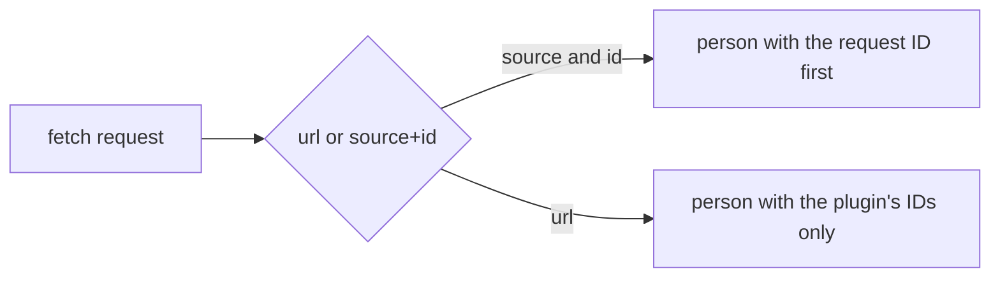
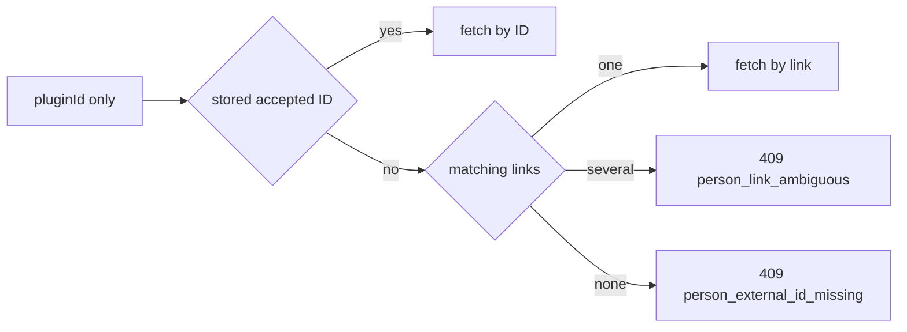
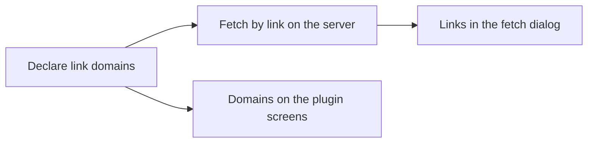

# Implementation Plan: Person plugins fetch by a stored link

**Branch**: `feature/065-person-plugin-links` | **Parent Issue**: #1600

**Input**: The parent Issue. It is this feature's specification.

## Summary

A person plugin declares the link domains it handles, and the person page's
`Fetch info…` uses a stored link under one of them, or a link typed into the
`Name` field, as the fetch key when the person has no external ID the plugin
accepts. The key order becomes external ID, link, name search. The fetch by
link is the existing `fetch` operation with a `url` instead of `source` and
`id`, run once, and the result is compared and applied exactly as a fetch by
ID is, so the only new screens are a link choice in the dialog and the domains
on the plugin list and approval dialog.

This feature extends [person-plugins.md](../../docs/design-docs/person-plugins.md)
and the author's contract in
[work-info-plugins.md (how-to)](../../docs/how-to/work-info-plugins.md#person-plugins).
Sibling Issue #1551 plans a domain declaration for work-info plugins; this
plan uses the same manifest field so that feature can lift one check instead
of adding a second field, and depends on nothing from it.

## Technical Context

**Canonical definitions**: [ARCHITECTURE.md](../../ARCHITECTURE.md) for the
dependency direction, [person-plugins.md](../../docs/design-docs/person-plugins.md)
for the person plugin contract and the person page's fetch,
[people.md](../../docs/design-docs/people.md) for the person's links (up to
20 HTTP(S) URLs, stored as typed), [api/openapi.yaml](../../api/openapi.yaml)
for the HTTP API, and [testing.md](../../docs/design-docs/testing.md) for test
levels.

**Feature-specific context**: the deltas are in
[contracts/person-plugin-links.md](contracts/person-plugin-links.md). No
`research.md`: every choice is recorded below with its alternative. No
`data-model.md`: the one storage change is a `domains` column beside
`sources`, recorded under [Storage](#storage). No `quickstart.md`: `task
check` and the unit acceptance below validate the feature.

## Constitution Check

Checked [AGENTS.md](../../AGENTS.md) and [ARCHITECTURE.md](../../ARCHITECTURE.md):
the matching rules stay in `internal/domain`, the key choice in `internal/app`,
and the SPA sends what the server decides, as the existing fetch does. No new
dependency, no generated file edited by hand (`api/openapi.yaml` changes go
through `task generate`), and no function is planned above complexity 25.
Nothing is at stake.

## Decisions

### The manifest declares domains, not link patterns

A person plugin lists the hosts whose links it fetches in a manifest field
`domains`: 1 to 10 distinct lowercase host names such as `example.com`,
without scheme, port or path. The owner reads them before approving, as the
`sources`, and inspection still never runs the module. The field is refused
on a `kind: work` manifest for now, with the same error shape as `sources`;
#1551 lifts that check when work-info plugins get a use for it.

| Rejected | Why |
| --- | --- |
| URL patterns or regular expressions in the manifest | The owner cannot read at approval which links the plugin will receive, and the plugin parses the link itself anyway |
| A `describe` operation that returns the domains | The approval would show values that unapproved code produced (the same reason `sources` are in the manifest) |
| Accepting `domains` on work-info plugins now | The list would show a declaration nothing acts on until #1551 lands |
| A field named `links` | It would read as the person's links, which the fetch consumes |

### A link matches a domain by host suffix

A link matches a domain when its host, lowercased, is the domain or ends with
`.` followed by the domain, so `www.example.com` and `m.example.com` match
`example.com`. Only `http` and `https` links are considered, as the person's
links already are. The rule is one domain function used by the stored-link
choice and by the typed-link check.

| Rejected | Why |
| --- | --- |
| Exact host only | Most sites serve a person's page under `www.` and a bare host, and the author would list every variant |
| Matching the path too | The manifest would need patterns, rejected above |

### Fetching by link is the fetch operation with a url

The run request for a link is `{"contract": 1, "operation": "fetch", "url":
"<the link as stored>", "settings": {...}}`, with no `source` and `id`; the
plugin reads the person out of the page or the site's API and answers the
same `person` object. VVMDM prepends no request ID to `externalIds`, since
there is none; the plugin's own IDs are kept as now, so a person fetched by
link gains the site's ID when the owner applies it, and the next fetch goes by
that ID through the existing `PersonFetchID` rule (requirement 7). A plugin
that declares `domains` must accept the `url` form of `fetch`.



| Rejected | Why |
| --- | --- |
| A third operation `resolve` that maps a URL to a candidate, then the existing fetch by ID | Two runs per fetch, each up to 30 s and serialized by the one-run limit, for a person the plugin had already loaded in the first |
| Requiring the plugin to return an ID of a declared source for a link fetch | A site without a stable ID could never be fetched by link |

### The server picks the key: ID, then link, then name

`POST /api/people/{id}/plugin-fetches` with only `pluginId` keeps picking the
first stored external ID the plugin accepts; with none, it folds the person's
matching links and runs the fetch with the only one, answers
`409 person_link_ambiguous` with the choices as `links` when there are
several, and keeps answering `409 person_external_id_missing` when there is no
link either, so the dialog's name search opens as it does now. A request with
`link` fetches that link after checking it against the domains, and a request
with `source` and `id` is unchanged; the three forms are exclusive. A link
whose page is missing, private or silent fails the run as any fetch does,
writes nothing, and leaves the plugin step with `Search by name` offered, as
now.



| Rejected | Why |
| --- | --- |
| The page computes the matching links from the plugin's `domains` and the person's links | The matching rule would live in Go and in TypeScript, the reason the page does not pick the ID either |
| A lookup endpoint the dialog calls before every fetch to learn the key | One request more on every fetch for a choice that is needed only when several links match |
| Folding the choice into the comparison, fetching every matching link | Up to 20 runs of 30 s each before the owner sees anything |

### Link variants fold into one choice, the rest is the plugin's

Before the choice, links that differ only in scheme, host case, a trailing
slash or a fragment count as one, and the first stored one is offered and
sent. Query strings stay, since some sites carry the ID there, and the plugin
treats path case and tracking parameters as the how-to tells it to.

| Rejected | Why |
| --- | --- |
| Dropping query strings when folding | A link whose ID is a query parameter would fold into the site's front page |
| A list of tracking parameters to strip | A list VVMDM maintains for every site, which the plugin knows better |

### A typed link is sent as a link, and the server says when the plugin cannot handle it

The dialog sends a `Name` field value that parses as an `http` or `https` URL
as `link` instead of running a search; the server answers
`400 person_link_unsupported` when no declared domain matches, and the dialog
shows that with the plugin's domains and keeps the field, so the owner can
edit it or search it as a name. A value that is not a URL is searched as a
name, as now.

| Rejected | Why |
| --- | --- |
| Searching an unhandled link as a name | A URL as a search query returns nothing on every site, and the owner would not learn why |
| Detecting the domain match in the page | The matching rule in two languages, rejected above |

### The result tells the dialog which link it came from

`PersonPluginFetch` gains an optional `link`, the link the fetch ran with, so
the comparison's `From <plugin> · …` line can show the link VVMDM picked when
the request had only `pluginId`; a fetch by ID keeps showing the first
external ID. The run rechecks the link against the domains of the plugin it
executes, as it rechecks a `source`, and answers `400 invalid_request` when a
replacement no longer declares them.

| Rejected | Why |
| --- | --- |
| The dialog remembers the link it sent | It never knows the link the server picked |

### Storage

`work_info_plugins` gains a `domains` column, a JSON array like `sources`,
filled at upload from the manifest and read into the plugin list. Rows
uploaded before this feature have no domains until the owner uploads the
module again, as `sources` did in migration `00070`.

| Rejected | Why |
| --- | --- |
| A `work_info_plugin_domains` table | A join for a list of at most 10 strings that is read with the row and never queried alone |

## Project Structure

### Documentation (this feature)

```text
specs/065-person-plugin-links/
├── plan.md                          # This file
└── contracts/person-plugin-links.md # Manifest, run, HTTP API and CLI deltas
```

### Source Code

**Affected boundaries**: `internal/domain` (manifest rules, link matching and
folding, the `url` run request and its response), `internal/app` (the key
choice and the typed-link check), `internal/store` (the `domains` column),
`internal/httpapi` and `api/openapi.yaml` (the request, result and error
deltas), `cmd/mdm` (`plugin pack` output and `plugin run --url`),
`web/src/settings` (domains on the row and the approval dialog),
`web/src/credits/person/pluginFetch` (the link choice, the typed link and the
source line), `docs/design-docs/person-plugins.md` and
`docs/how-to/work-info-plugins.md`.

**New paths**: one migration under `internal/store/migrations/`.

**Structure decision**: follows the existing layout; each unit below updates
the two documents for the behaviour it adds.

## Implementation Work



### Declare the link domains a person plugin handles in its manifest

**Scope**: the `domains` manifest field and its rules, the `domains` column
and migration, `domains` on `WorkInfoPlugin` in the API, `mdm plugin pack`
printing them, and the Manifest and Person plugins tables of the how-to;
[contracts, Manifest](contracts/person-plugin-links.md#manifest).

**Dependencies**: None

**Acceptance**: domain unit cases accept 1 to 10 distinct lowercase hosts and
reject an uppercase host, a scheme, a port, a path, a duplicate, an 11th
domain and `domains` on a `kind: work` manifest (extending the manifest
cases in `internal/domain`); a store case reads back the domains of an
uploaded module and keeps a row without them readable; the HTTP list case in
`internal/httpapi/person_plugins_test.go` carries `domains` for a person
plugin and an empty list for a work-info plugin; the `mdm plugin pack` case
prints `Domains:`; `task check SCOPE=go` and `task check-docs` pass.

### Fetch a person by a link the plugin handles

**Scope**: the domain link matching and folding rules, the `url` form of the
run request and its person response without a request ID, the app's key
choice and typed-link check, the HTTP request's `link`, the result's `link`,
the codes `person_link_ambiguous` with `links` and `person_link_unsupported`,
`mdm plugin run --url`, and the person-plugins design doc;
[contracts, Run request](contracts/person-plugin-links.md#run-request) and
[HTTP API](contracts/person-plugin-links.md#http-api).

**Dependencies**: Declare the link domains a person plugin handles in its
manifest

**Acceptance**: domain unit cases prove the suffix match, the `http`-only
rule and the folding of scheme, host case, trailing slash and fragment while
a query string is kept; a run case with a small WASM module
(`internal/wasmplugin`) shows the `url` request reaching the module and the
response's `externalIds` without a prepended ID; app cases with the fake
plugin store show, in order, a stored accepted ID winning over a matching
link, one matching link fetched without a search, two matching links
answering `ErrPersonLinkAmbiguous` with the folded links before any run,
no link answering `ErrPersonExternalIDMissing`, a typed link outside the
domains answering `ErrPersonLinkUnsupported` with zero runs, and a replaced
plugin without the domain answering `ErrWorkInfoRunInvalid`; HTTP cases map
those to `201` with `link`, `409 person_link_ambiguous` with `links`,
`409 person_external_id_missing` and `400 person_link_unsupported`; an
apply case shows a person fetched by link gaining the plugin's ID, after
which the fetch with only `pluginId` runs by that ID (requirement 7); the
CLI case runs a fetch with `--url` and refuses `--url` with `--source`;
`task check SCOPE=go` and `task check-docs` pass.

### Show the handled link domains on the plugin list and approval dialog

**Scope**: the person plugin row's facts line and the approval dialog list
each `domains` beside the accepted sources, following `ui-design.md`;
the settings strings in `web/src/i18n/en.ts`.

**Dependencies**: Declare the link domains a person plugin handles in its
manifest

**Acceptance**: `WorkInfoPluginsSection` and approval dialog component cases
show the domains of a person plugin with them and nothing for one without;
a visual review of the row and the dialog at the widths `ui-design.md` names;
`task check SCOPE=web` passes.

### Fetch from a stored or typed link in the person page's fetch dialog

**Scope**: `usePersonFetchFlow` and `PersonFetchDialog`: the link choice
after `person_link_ambiguous`, sending a URL-shaped `Name` value as `link`,
the `person_link_unsupported` message with the plugin's domains, the source
line showing the result's `link`, and `Back` from a link comparison to the
plugin step with the choice kept, following `ui-design.md`; the dialog
strings in `web/src/i18n/en.ts`.

**Dependencies**: Fetch a person by a link the plugin handles

**Acceptance**: `PersonPage.pluginFetch.test.tsx` cases show, against the
fake server, `Fetch` with only `pluginId` reaching the comparison with the
result's link on the source line (acceptance 2), a `409 person_link_ambiguous`
answer rendering the links as a choice whose pick sends `link` (acceptance
4), a URL typed into `Name` sent as `link` instead of a search (acceptance 6),
a `400 person_link_unsupported` answer shown with the field kept, and the
existing `person_external_id_missing` path unchanged (acceptance 5); a visual
review of the choice and the source line; `task check SCOPE=web` passes.
