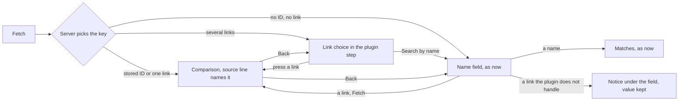
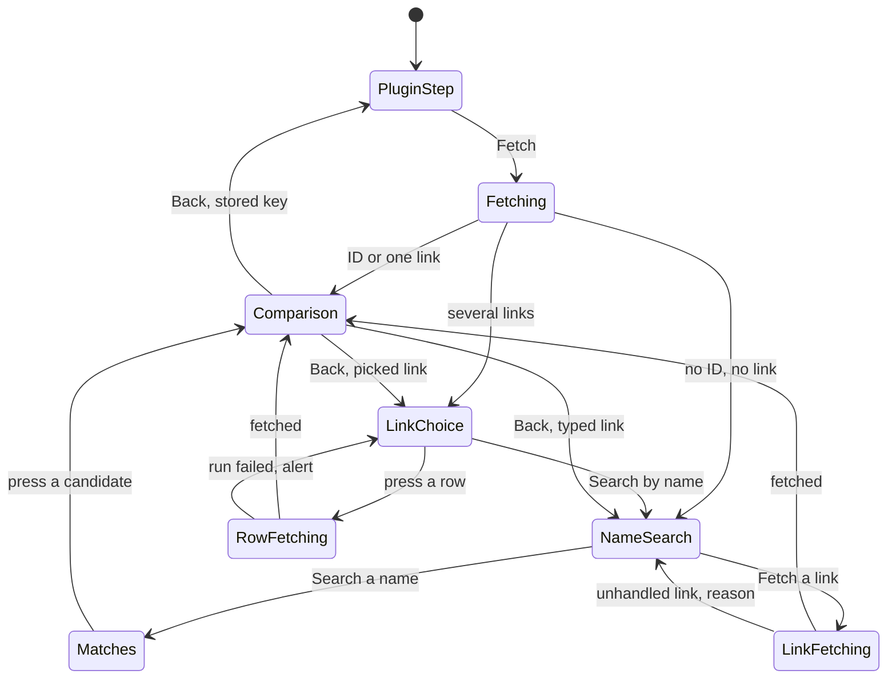

# UI design: Person plugins fetch by a stored link

**Feature**: [parent Issue #1600](https://github.com/syudead/vv/issues/1600) ·
[plan.md](plan.md) · [contracts](contracts/person-plugin-links.md)

Sources that already decide things, linked rather than repeated here:

| Topic | Source |
| --- | --- |
| Tokens, closed scales, library density | [design-system.md, Foundations](../../docs/design-docs/design-system.md#foundations); the values in `@theme` of [`web/src/ui/tokens.css`](../../web/src/ui/tokens.css), named here and never copied |
| `FormDialog size="wide"`, `FactList`, `Field`, `Alert`, `Badge`, `Button`, `Spinner` | [patterns.md](../../web/registry/rules/patterns.md), [components.md](../../web/registry/rules/components.md) |
| The person page's fetch dialog as it is: plugin step, name search, candidates, comparison, result | [person-plugins.md, The person page compares a fetched person before applying it](../../docs/design-docs/person-plugins.md#the-person-page-compares-a-fetched-person-before-applying-it); [`PersonFetchDialog.tsx`](../../web/src/credits/person/pluginFetch/PersonFetchDialog.tsx), [`usePersonFetchFlow.ts`](../../web/src/credits/person/pluginFetch/usePersonFetchFlow.ts) |
| The candidate rows and the failure alert the dialog shares with the video's fetch dialog | [`FindStep.tsx`](../../web/src/player/workInfoFetch/FindStep.tsx) (`CandidateList`, `FailureAlert`, `QueryField`) |
| The plugin row's facts line and the approval dialog's fact list | [person-plugins.md, The settings page lists each kind in its own section](../../docs/design-docs/person-plugins.md#the-settings-page-lists-each-kind-in-its-own-section); [`WorkInfoPluginRow.tsx`](../../web/src/settings/WorkInfoPluginRow.tsx), [`WorkInfoPluginApprovalDialog.tsx`](../../web/src/settings/WorkInfoPluginApprovalDialog.tsx) |
| A link on the person page reads as its host | [`LinkList` in `PersonProfile.tsx`](../../web/src/credits/person/PersonProfile.tsx), `hostOf` in [`fetchRules.ts`](../../web/src/player/workInfoFetch/fetchRules.ts) |
| Which key the server picks, the folded links, the error codes | [plan.md, The server picks the key](plan.md#the-server-picks-the-key-id-then-link-then-name), [contracts, HTTP API](contracts/person-plugin-links.md#http-api) |
| Width breakpoints in CSS, layout judged by people | [library-ui.md](../../docs/design-docs/library-ui.md#width-breakpoints-in-css-and-the-sidebar-exception) |
| Screen text | [`web/src/i18n/en.ts`](../../web/src/i18n/en.ts); this feature adds the words below |

This feature changes two screens and adds no screen. On the Plugins settings
page, a person plugin's row and its approval dialog list the link domains it
handles beside the ID sources it accepts. In the person page's `Fetch info…`
dialog, the plugin step gains a link choice for a person with several
handled links, the `Name` field takes a link, and the comparison's source
line names the link a result came from. Nothing else in either screen moves.

The diagram shows the plugin step after `Fetch` with only the plugin chosen,
and where each server answer leaves the dialog.

## Why this shape

The dialog shows nothing before the first `Fetch` about which key the server
will use, because the server picks it
([plan.md](plan.md#the-server-picks-the-key-id-then-link-then-name)) and a
person with one handled link reaches the comparison with the same one press
as a person with a stored ID. The Issue's first quality point, no added
steps for a person with a matching link, rules out a preview of the key or a
confirmation; the comparison's source line tells the owner afterwards, in the
same place and type as the ID, what the fetch ran with.

The link choice is the candidate list the name search already draws, not a
radio group with a second `Fetch` press: pressing a row runs the fetch, the
row shows the spinner, and the result reads exactly as a chosen candidate's
does. One form for "pick the person to fetch" keeps the Issue's failure
condition (a link fetch that looks different from an ID or name fetch) from
happening, and a person has up to 20 links, more than a `RadioGroup` is for
([components.md, Select and RadioGroup](../../web/registry/rules/components.md#select-and-radiogroup)).
Each row shows the link's path over its host, the way the person page shows
a link as its host, so two links on the same site are told apart by the part
that differs.

A link typed into `Name` changes the submit button's word from `Search` to
`Fetch` and adds one muted line under the field; that is the whole signal
that the field now fetches instead of searching. A separate `Link` field or a
`Find by` toggle, as the video's dialog has, was rejected: the Issue puts the
link in the name field, and the server tells the two apart. When the plugin
does not handle the typed link, the dialog says so under the field and keeps
the value, so the owner edits it into a handled link or a name, instead of
searching a URL as words, which the plan rules out.

On the plugin row and the approval dialog, the domains sit beside the
accepted ID sources in the same form (the facts line's ` · ` parts, the fact
list's `Badge`s), so the two keys of a plugin are compared in one glance, as
the Issue's density point asks. The approval dialog's `Can` row keeps the
manifest's operations; `Accepts links from` is the row that says the plugin
fetches by link, so the operation is not repeated.

## Words

| Place | Text | Notes |
| --- | --- | --- |
| Plugin row, facts line | `Accepts links from example.com, other.example` | `t.settings.workInfoPlugins.person.acceptsLinks(domains)`; the domains in manifest order, joined by `, `; after `Accepts IDs from …` and before `Reaches internet sites` |
| Approval dialog, fact term | `Accepts links from` | `t.settings.workInfoPlugins.approval.domains`; the row after `Accepts IDs from` |
| Plugin step, over the link choice | `{plugin} has no ID for this person. Choose the link to fetch from.` | `t.credits.personPage.pluginFetch.chooseLink(plugin)`; the place of `{plugin} has no ID for this person yet. Search by name instead.` |
| Link choice heading | `Links {plugin} handles` | `t.credits.personPage.pluginFetch.handledLinks(plugin)`; `CandidateList` takes it as its heading in place of the matches count |
| Link choice row | `/people/123?tab=about` over `example.com` | The link's path, query and fragment as stored; `/` for a link with none; the host line as every candidate row draws it |
| Name field, under the field, while the value is a link | `Fetches the person on this page instead of searching.` | `t.credits.personPage.pluginFetch.linkTyped`; a `FieldDescription` |
| Name field, under the field, after `400 person_link_unsupported` | `{plugin} doesn't handle links on {host}. It accepts links from example.com, other.example.` | `t.credits.personPage.pluginFetch.linkUnsupported(plugin, host, domains)`; the host from `hostOf`, the plugin's `domains` joined by `, ` |
| The same, for a plugin without domains | `{plugin} doesn't fetch by link. Search by name instead.` | `t.credits.personPage.pluginFetch.noLinkFetch(plugin)` |
| Comparison source line | `From {plugin} · https://example.com/people/123` | `t.credits.personPage.pluginFetch.sourceLink(plugin, link)`; the link as the result's `link` holds it; a result without `link` keeps `From {plugin} · {source} {id}` |
| Submit button | `Fetch` · `Fetching…` | Existing words; `Fetch` replaces `Search` while the `Name` value is a link |

Every value above is an example; the screen reads them from the response.

## Plugin list and approval dialog

The row's facts line ([`FactsLine`](../../web/src/settings/WorkInfoPluginRow.tsx))
gains one part for a person plugin with `domains`, in this order:
operations, `Accepts IDs from …`, `Accepts links from …`, the network mark,
the settings summary, the last run. The part is text in the line's
`text-xs text-muted-foreground`, wrapping with the line; a domain wider than
the line, up to the contract's 253 characters, breaks inside itself through
the line's `break-words` instead of widening the row. A plugin without
`domains` shows no part and no empty words. A work-info plugin's row never
shows it.

The approval dialog's `FactList` gains the row `Accepts links from` after
`Accepts IDs from`, each domain a `secondary` `Badge` in a wrapping row of
`gap-1`, as the sources are. A domain's `Badge` is capped at the row's width
(`max-w-full`) and, for a domain wider than that, grows in height and wraps
its label inside itself (`h-auto whitespace-normal break-all`); it is never
clipped or shortened with an ellipsis, because the owner approves exactly
the sites it names. A person plugin with domains and no sources
shows the links row alone. The description and the network alert are
unchanged: the domains say which sites the plugin reads a person from, and
the alert already says it can reach any site.

### States

| State | What the screen shows |
| --- | --- |
| Person plugin with sources and domains | Row: `Fetch by ID · Search by name · Accepts IDs from a, b · Accepts links from example.com · …`; dialog: the `Accepts IDs from` row, then the `Accepts links from` row of badges |
| Person plugin with domains only | Row: the operations, then `Accepts links from …`; dialog: the links row without an IDs row |
| Person plugin without domains | As today, no links part and no links row |
| Person plugin with a 253-character domain | Row: the domain breaks inside itself within the column; dialog: that domain's badge wraps to several lines within the dialog, the other badges as usual |
| Work-info plugin | As today |
| Plugin uploaded before this feature | As a person plugin without domains, until its module is uploaded again ([plan.md, Storage](plan.md#storage)) |

## The fetch dialog's plugin step

The plugin step keeps its parts and order: the plugin (a line or a `Select`),
then either `Search by name` or the name search, then a failure alert. This
feature adds one part between the plugin and `Search by name`, the link
choice, and changes what the name search does with a link.

### The link choice

After the server answers `409 person_link_ambiguous`, the step shows, in the
place `{plugin} has no ID for this person yet…` takes for a missing ID:

1. The line `{plugin} has no ID for this person. Choose the link to fetch
   from.` in `text-sm text-muted-foreground`.
2. A `CandidateList` headed `Links {plugin} handles`, one row per folded link
   in the response's order, choosable; each row's first line is the link's
   path, query and fragment in `text-sm text-foreground` (two lines at most,
   then clipped), its second the host in `text-xs text-muted-foreground`,
   and its end the existing `Open page` action that opens the link in a new
   tab, so the owner can check a page before fetching from it.
3. `Search by name`, the `ghost` `sm` button, under the list, as it stands
   under the plugin today.

Pressing a row runs the fetch with that link: the row shows the `Spinner`
beside its text, every row is inert and the submit button reads `Fetch`,
disabled, as the candidate rows behave during a chosen candidate's fetch.
The submit button is disabled from the moment the choice appears, since
pressing `Fetch` again would only ask the same question; the rows are the
action. On success the dialog moves to the comparison. On a failed run the
step shows the existing `FailureAlert` (`Couldn't fetch: …`, with the
plugin's message) under the list, the list stays, and `Search by name`
remains one press away, which is the Issue's edge case for a missing,
private or silent page.

Choosing another plugin clears the choice, as it clears the name search.
`Back` from a comparison fetched through the choice returns to the step with
the list still shown and no row busy, so another link is one press away
(requirement 8).

### A link in the name field

The name search is unchanged for a name. While the `Name` value parses as an
`http` or `https` URL:

- the submit button reads `Fetch` instead of `Search`, and `Fetching…` while
  it runs;
- a `FieldDescription` under the field reads `Fetches the person on this
  page instead of searching.`;
- the `Also search for` buttons stay, since pressing one replaces the value
  with a name and searches it;
- the matches of an earlier search stay under the field until a fetch or a
  search replaces them, as they do while the owner edits the words.

`Fetch` sends the value as `link`. On `400 person_link_unsupported` the
field keeps its value and its focus, the description line is replaced by a
`FieldError` (the `destructive` text the `Field` draws) reading `{plugin}
doesn't handle links on {host}. It accepts links from …`, or `{plugin}
doesn't fetch by link. Search by name instead.` for a plugin without
domains, and the input carries `aria-invalid`. The line clears on the next
change to the value. No alert is drawn: the mistake is in the field, so the
reason stands under it, as a form error does. A run that fails for any other
reason shows the existing `FailureAlert`.

A fetch by a typed link reaches the comparison exactly as a chosen
candidate's does, and `Back` returns to the name search with the link still
in the field.

### The comparison's source line

The comparison keeps its first line, `text-xs text-muted-foreground`, above
`Back`: `From {plugin} · {link}` when the result carries `link`, else
`From {plugin} · {source} {id}` as today. The link is drawn as stored and
wraps (`break-words`); it is text, not a link, as the ID is, since the choice
rows and the person's facts card already open the page. The line is where
the Issue asks for it: under the dialog's title and above the result, quieter
than both, read before the values. `Search by name` stands beside `Back` on a
comparison the server fetched by a picked link or by the stored key, as it
does for a stored ID; it is absent after a fetch from the name field, where
`Back` already leads to the field.

`Fetch again` after `The result is out of date` resends the link the owner
picked or typed, so the choice is not asked twice, and only the plugin when
the server picked the key ([plan.md](plan.md#the-result-tells-the-dialog-which-link-it-came-from)).

### States

| State | What the dialog shows |
| --- | --- |
| Plugin step, before the first `Fetch` | As today: the plugin, `Search by name`, the submit `Fetch` |
| Fetching with only the plugin | As today: `Fetching…`, the controls inert |
| Server picked a stored ID or the one handled link | The comparison; the source line names the ID or the link |
| Server found several handled links | The plugin, the `Choose the link…` line, the list `Links {plugin} handles`, `Search by name`; the submit `Fetch` disabled |
| A row pressed | That row's spinner, the rows inert, `Fetch` disabled |
| The pressed link's page missing, private or silent | The list as before, `Couldn't fetch: {reason}` under it with the plugin's message, `Search by name` offered |
| Server found no ID and no handled link | The name search, as today, with `{plugin} has no ID for this person yet. Search by name instead.` |
| `Name` holds a name | As today: the submit `Search`, the matches after it |
| `Name` holds a link | The submit `Fetch`; `Fetches the person on this page instead of searching.` under the field |
| The typed link is not handled | The field keeps the value and the focus, `aria-invalid`; the reason under it; no run started |
| Comparison after a link fetch | As an ID fetch, with the link on the source line; `Back` and, unless fetched from the name field, `Search by name` |
| `Back` from a link-choice comparison | The plugin step with the list shown and no row busy |
| `Back` from a typed-link comparison | The name search with the link still in the field |
| Stale after apply, fetched by a picked or typed link | The existing stale alert; `Fetch again` reruns the same link without the choice |

The diagram shows the dialog's states in this feature and what the owner
does, or the server answers, to move between them; the result and stale
states after `Apply` are unchanged and left out.

`Back, stored key` covers a comparison the server fetched by a stored ID or
the one handled link. A run that fails for a reason other than an unhandled
link returns to the state it started from with the existing `FailureAlert`.

## Responsive behaviour

Breakpoints are Tailwind's defaults only, applied in CSS; `sm` is 640px.
The dialog is a `FormDialog size="wide"` and the row is in the settings
page's column; neither gains a width rule. The widths judged are 390px, 768px
and 1280px.

| Width | Layout |
| --- | --- |
| 1280px | The dialog at `max-w-2xl`; a link row's path on one line with the host under it and `Open page` at the row's end; the source line on one line for a link of ordinary length. The plugin row's facts line on one or two lines with ` · ` between parts; the approval dialog's badges in one row |
| 768px | The same dialog width; the facts line wraps at a ` · `, and inside a domain only when that domain alone is wider than the line |
| 390px | The dialog spans the screen with the 16px margin; a long path wraps to its second line and is then clipped, the host under it stays whole or truncates with an ellipsis, and `Open page` stays at the row's end without pushing the text under it; the source line wraps the link across lines inside the dialog, never widening it; the facts line's parts wrap one under another; the approval dialog's badges wrap to two or three rows with `gap-1`; a 253-character domain breaks across lines in the facts line and inside its own badge, and neither the row nor the dialog scrolls sideways |

## Review criteria

Judged by looking at the real screen
([library-ui.md, Layout verified by people, not machines](../../docs/design-docs/library-ui.md#layout-verified-by-people-not-machines))
at the widths above, with a person plugin that declares two domains and two
sources, a person plugin without domains, and a person holding three links on
the first plugin's domains (two differing only in a trailing slash) and no
accepted ID, plus a person with one such link, and a person plugin that
declares one 253-character domain. "It exists" alone does not
satisfy a criterion (Q-4).

1. **Visual hierarchy**: in the comparison the eye goes title → source line →
   `Back` → values; the source line with a link is the same size and grey as
   the line with an ID and is lighter than every value under it, and nothing
   on it is `primary` (Issue: the link shown quietly but not missed). In the
   plugin step the `Choose the link…` line reads as a caption and the rows'
   paths read as the choices, darker than the hosts under them.
2. **Information density**: on the plugin row `Accepts IDs from …` and
   `Accepts links from …` sit in one facts line, so the two keys are read in
   one glance without opening the dialog; in the approval dialog the two rows
   are adjacent and their badges share one size; the link choice shows two
   rows for the three stored links (the trailing-slash pair folded), each
   with its own path and the shared host, with no empty line between them.
3. **Spacing rhythm**: the link choice keeps the candidate list's rhythm,
   `gap-1` between the heading and the rows, a hairline between rows,
   `py-1` rows; the new `Choose the link…` line and the list sit in the
   step's existing gap, so the step's spacing matches a name search with
   matches; the facts line's new part adds no second line of its own at
   1280px for two domains.
4. **Typography**: no new size or weight; the facts part and the source line
   are `text-xs` muted, the choice line `text-sm` muted, a row's path
   `text-sm` foreground and its host `text-xs` muted, the field description
   and error the `Field`'s own, the badges the `Badge`'s own, and a domain is
   never bold or mono.
5. **Priority of actions**: on a person with one handled link, `Fetch` is
   the only press between opening the dialog and the comparison, as it is
   for a stored ID (acceptance 2); with several links, the rows are the
   visible action and `Fetch` is disabled, so nothing competes with the row
   press; `Search by name` stays a `ghost` button under the list and never
   reads as the first choice; in the name search with a link typed, the
   button says `Fetch` before the owner presses it.
6. **The same look for every key**: a comparison reached by a link, by an
   ID and by a chosen candidate differ only in the source line's text, in
   `Search by name` beside `Back`, and in where `Back` leads; a reviewer
   cannot tell the key from the values, the parts or the buttons (Issue:
   the failing change).
7. **The unhandled link**: typing a link outside the plugin's domains and
   pressing `Fetch` leaves the link in the field, draws the reason under it
   with the plugin's domains, starts no run, and the next edit clears the
   reason; typing a name afterwards searches as today (acceptance 5, 6).
8. **Settings**: adding a plugin that declares domains shows them on its
   row and in `Review and approve` before the owner approves; a plugin
   without domains shows no empty words in either place (acceptance 1); a
   253-character domain is shown whole in both places, wraps inside the
   column and the dialog at 390px, and makes neither scroll sideways.
