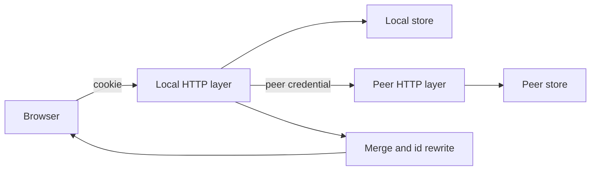
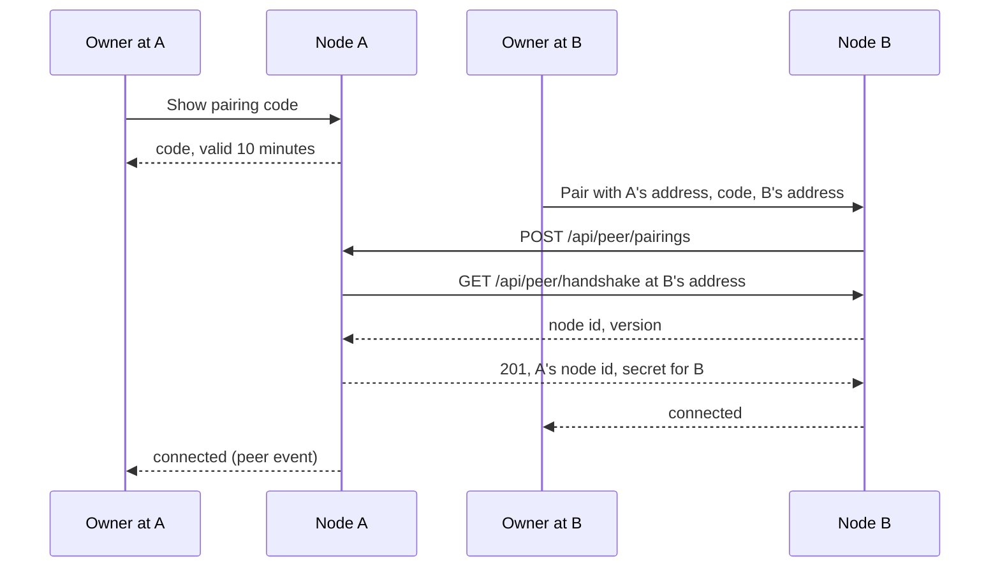
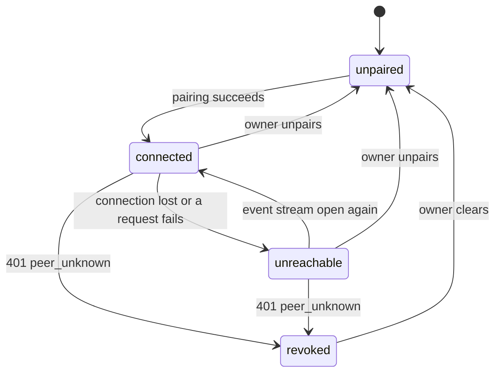
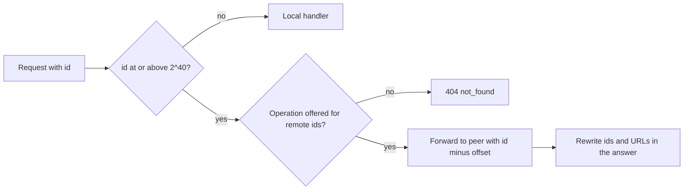
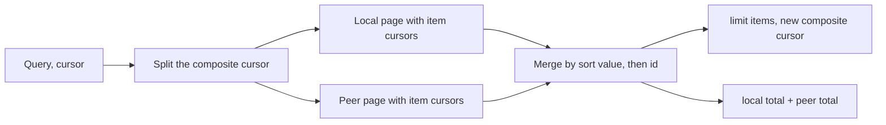
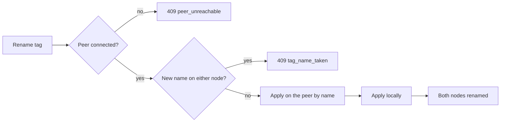
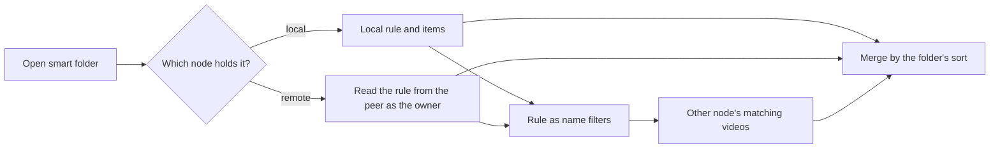

# Implementation Plan: Pair two VVMDMs on one LAN into one library

**Branch**: `feature/066-paired-library` | **Parent Issue**: #1629

**Input**: The parent Issue. It is this feature's specification.

## Summary

The owner pairs this VVMDM with one other VVMDM (the **peer**) from the
Settings page, and from then on each node answers its own screens with both
nodes' videos, groups and smart folders. Nothing is copied: a request that
needs the peer's data calls the peer's own screen API with a peer credential,
merges the two answers and returns them in the shapes the screens already
read. A video, group, folder or smart folder of the peer keeps its id plus a
fixed offset, so the screens address it through the same routes and the
local node forwards those requests to the peer. Tags, tag kinds, people and
organizations are joined by name, and a rename, merge or deletion of a tag,
person or organization is applied on both nodes.

The diagram shows one request from the browser to both nodes.



## Technical Context

**Canonical definitions**: [ARCHITECTURE.md](../../ARCHITECTURE.md) for
layers, store roles, viewer classification and the one owner for opening
files; [authentication.md](../../docs/design-docs/authentication.md) for the
audience and the API tokens; [api/openapi.yaml](../../api/openapi.yaml) for
the screen API; [catalog-organization.md](../../docs/design-docs/catalog-organization.md)
for content keys, bundles, groups and smart folders;
[home.md](../../docs/design-docs/home.md) for the library list and the
collection information; [related-videos.md](../../docs/design-docs/related-videos.md)
for the scorer and its cursor; [live-transcode-seek.md](../../docs/design-docs/live-transcode-seek.md)
and [sidecar-subtitles.md](../../docs/design-docs/sidecar-subtitles.md) for
playback; [bulk-editing.md](../../docs/design-docs/bulk-editing.md) for the
operations over a selection; [process-lifecycle.md](../../docs/design-docs/process-lifecycle.md)
for startup and shutdown; [design-system.md](../../docs/design-docs/design-system.md)
for the screens; [testing.md](../../docs/design-docs/testing.md) and
[web-testing.md](../../docs/design-docs/web-testing.md) for test levels.

**Feature-specific context**:

| Item | Delta |
| --- | --- |
| Second node | Every merged read and forwarded write talks to one other VVMDM over HTTP or HTTPS on the LAN; the peer's address is the owner's input, with no discovery |
| Versions | Both nodes run the same release; a peer with another version is not connected ([Pairing and the peer credential](#pairing-and-the-peer-credential)) |
| Latency budget | A merged list waits for the peer at most 10 s and a connection attempt 5 s; past that the peer counts as unreachable ([Connection state](#connection-state)) |
| Id space | Local ids stay below 2^40, so an id at or above the offset names an entity of the peer ([Remote ids](#remote-ids)) |
| New adapter | `internal/peer` is the HTTP client to the peer, beside the other adapters |

## Constitution Check

*GATE: Must pass before Phase 0 research. Re-check after Phase 1 design.*

| Rule | Source | Verdict |
| --- | --- | --- |
| Dependency direction | ARCHITECTURE.md | `internal/peer` imports `internal/domain` and the generated types under `internal/httpapi/gen`, never `internal/httpapi` itself; `internal/httpapi` and `internal/app` reach it through interfaces they declare, wired in `cmd/mdm` ([Project Structure](#project-structure)) |
| Domain decides, store enforces | ARCHITECTURE.md | The offset rule, the merge of two sorted pages, the composite cursor and the pairing state machine are pure rules in `internal/domain`; the store holds the peer record |
| One role per operation | ARCHITECTURE.md | A new `PeerStore` role owns the peer record and the node id; no other role reads them |
| Every read knows its viewer | ARCHITECTURE.md | A peer request carries the viewer's audience in a header, and the peer filters with it before paging ([Pairing and the peer credential](#pairing-and-the-peer-credential)); a guest sees the peer's public videos only |
| One owner for opening files | ARCHITECTURE.md | A remote video's file is opened only by the node that holds it; this node streams what the peer returns ([Remote ids](#remote-ids)) |
| Credential changes invalidate sessions and API tokens | authentication.md | The peer credential is not bound to `account_version`, so a password change keeps the pairing (requirement 6) |
| User data survives a rebuild | ARCHITECTURE.md | The peer record is configuration (`peer`, `settings`), rebuilt by pairing again; no user data gains a node column |
| Pages never call `fetch` | ARCHITECTURE.md, Web layer | `web/src/api/peer.ts` is the only caller of the pairing operations; lists keep calling the existing modules |
| Complexity 25 and no copies | AGENTS.md | The id rewrite is one table-driven pass and the merge one function over an interface, shared by every merged list |

No gate is at stake after Phase 1; `## Complexity Tracking` is left out.

## Pairing and the peer credential

One pairing action on one node pairs both: node B sends node A's pairing
code to A, A calls B back at the address B gave, and each node stores a secret
the other presents on every later request
([contracts/peer-api.md](contracts/peer-api.md),
[data-model.md](data-model.md)).

The diagram shows the pairing from B's Settings page.



| Decision | Rejected | Why |
| --- | --- | --- |
| The peer calls this node's screen API (`/api/*`) with its own credential, plus a few `/api/peer/*` operations the screens never use | A third contract `api/peer-v1.yaml` with its own generated server and client | The screens already read every shape the merge needs; a peer contract would restate 30 operations and drift from them |
| Both nodes must report the same release `version` (`/api/health`); pairing and every reconnection check it, and `dev` matches `dev` | A protocol number beside the version | The peer reads the screen API, which changes without notice between releases; only an equal release keeps the two shapes identical |
| The credential is a per-direction random secret (`vvp_` plus 32 bytes), hashed on the receiving node like an API token, stored in plain text on the sending node | Reusing API tokens | A credential change revokes API tokens, and requirement 6 keeps the pairing; the peer also needs a secret in both directions |
| The pairing code is 8 characters from an unambiguous alphabet, one at a time per node, valid 10 minutes, consumed on use, kept in memory | A code in SQLite | A restart invalidating the code is the right behaviour, and nothing else reads it |
| A calls B back at the address B sent before storing anything, so a failed callback answers `409 peer_unreachable` and leaves A unpaired | Trusting B's address and discovering the failure later | Both directions must work before either node shows `connected` (acceptance 1) |
| A node already paired answers `409 already_paired`; the owner unpairs first | Replacing the pairing | The Issue limits a node to one peer and names this as an edge case |
| `X-VV-Peer-Audience: guest` lowers a peer request to the guest audience; without it the peer reads as the owner | A second credential per audience | One credential, and the audience is already a value every read takes |
| Pairing stores the node's name (host name) and address; the owner edits the address in Settings without pairing again | Re-pairing on an address change | Requirement 4 |
| HTTPS verifies with the system roots; when that fails at pairing, the response names the certificate's SPKI fingerprint and the owner confirms it, which pins it; a pinned certificate that changes stops connections until confirmed again | Pinning every certificate | A reverse proxy with a public certificate rotates it every 90 days; a self-signed one is pinned once |

Unpairing from either node deletes the local record and tells the peer; a
peer that cannot be told learns it from the `401 peer_unknown` its next
request receives ([Connection state](#connection-state)).

## Connection state

`app.Pairing` owns the state the Settings page shows and publishes a `peer`
event on each change; `internal/peer` reports the outcome of its connection
and of every request to it.

The diagram shows the states and what moves between them.



| Decision | Rejected | Why |
| --- | --- | --- |
| One open `/api/events` stream to the peer is the liveness signal: open means `connected`, closed or failing means `unreachable`, retried after 5 s doubling to 60 s | Polling `/api/health` | The stream also carries the peer's `video`, `group` and `smartFolder` events, which the local screens need to refresh remote cards |
| `unreachable` carries a `reason`: `network`, `version` or `certificate`; `revoked` is its own state | One `unreachable` state with free text | The Issue's edge cases ask for the reason on screen, and only `revoked` ends with the owner clearing it |
| While `unreachable`, merged reads skip the peer without a request, and the reconnect loop alone tries again | Trying the peer on every read | Every list would wait 10 s per page while the peer is down |
| A request failure during a read marks the node `unreachable` at once and the read answers with the local part | Failing the read | Requirement 15 and the paging edge case: the list continues with the local part and the screen shows the notice |
| Forwarded peer events arrive as local events with remote ids | Dropping them | A tag added on the peer must refresh the remote card on this screen |
| The state is in memory; a restart begins as `unreachable` until the stream opens | Persisting the state | The first connection decides it within seconds |
| The peer's `revoked` is derived from `401 peer_unknown`, which a reinstalled or wiped peer also answers | Distinguishing a wiped peer | Both need the owner to clear the record and pair again |

## Remote ids

An entity of the peer is addressed through the screen API by its id plus
`2^40`; `internal/domain` holds the rule, and the HTTP layer forwards any
request whose path id carries the offset to the peer, rewriting the id in the
path and the ids in the answer
([contracts/screen-api.md, Remote ids](contracts/screen-api.md#remote-ids)).

The diagram shows how a request with a remote id is answered.



| Decision | Rejected | Why |
| --- | --- | --- |
| Remote ids are the peer's ids plus `2^40` in every path, body and response of the screen API | String ids such as `peer:123` | Every path parameter and generated type is `int64`, and 2^40 stays below JavaScript's safe integer; the screens change no route or type |
| Ids of videos, groups, smart folders, media-folder roots and group items always carry the offset; a tag, tag kind, person or organization of the peer takes the local id of the same-named local entity, else the offset | The offset for every id | Requirement 11 joins the vocabulary by name, so a remote video's tag chip must open the local tag |
| Forwarded responses are decoded into the generated types of the operation and rewritten by one table (`internal/httpapi/peer_rewrite.go`): ids, `thumbnailUrl`, `previewUrl`, `seekThumbnailUrl` and the fields the peer alone holds | Rewriting the JSON text by field name | Only the type says whether an `id` is a video or a tag |
| Media operations (`stream`, `transcode.mp4`, `transcode-start`, `preview`, `thumbnail`, `seek-thumbnail`, `subtitles`, `frame`) are proxied as byte streams with the request's `Range`, `If-None-Match` and the response's `Content-Range`, `ETag` and `Cache-Control` passed through | Redirecting the browser to the peer | The browser has no session on the peer, and the local node must apply the viewer's audience |
| A remote video's `progress` and `favorite` are stripped from forwarded answers, and `open`, `progress`, favorites, playlists, `auto-tag`, `probe` and activity are not offered for remote ids (`404 not_found`) | Forwarding them | The Issue leaves playback position, history, favorites, playlists, remote analysis and the activity log out of scope |
| Forwarded writes keep the peer's status, `code` and `reason` | Mapping them to local errors | The peer validates with the same rules; the screens already handle those codes |
| A connection lost during a forwarded request answers `503 peer_unreachable`, and the peer's transaction has either committed or not | Retrying the write | The peer's writes are single transactions, so no half state exists on either node (the Issue's edge case); the owner repeats the action after reconnection |

## Merged lists

`GET /api/videos`, `GET /api/library` and `GET /api/folders` merge the local
page with the peer's page in the request's order, and one composite cursor
continues both sides
([contracts/peer-api.md, Per-item cursors](contracts/peer-api.md#per-item-cursors)).

The diagram shows one page of a merged list.



| Decision | Rejected | Why |
| --- | --- | --- |
| A list response to a peer carries, per item, the cursor after that item and its sort value (`peerItems`), and the composite cursor holds one cursor per side | Decoding the peer's opaque cursor, or re-reading a page and skipping consumed items | A cursor is opaque by contract, and skipping shifts when a video is added between pages (acceptance 6) |
| Items compare by the sort value both nodes compute with the same rule (title key, times, sizes, `ShuffleKey(seed, id)` for `random`), then by id, so local ties come first | Comparing the fields the items show | `titleAsc` orders by the normalized title key, which the items do not carry |
| `favorite=true` lists local videos only, and `played*` and `favorited*` sorts place every remote item after the local items in the peer's `addedDesc` order | The peer's favorites and history | Favorites and history across nodes are out of scope, and a favorite the owner cannot toggle would be shown |
| A filter by a local tag, kind, person or organization is sent to the peer by name (`tagName`, `tagKindName`, `personName`, `organizationName`), and a filter by a remote-only id by the peer's id | A cache of the peer's vocabulary | Names are the join rule, no cache goes stale, and the peer resolves its own ids |
| A name the peer does not have makes the peer's part empty | Dropping the filter for the peer | The filters are ANDed; a missing name matches no video |
| `total` is the sum of both totals; `missingTagIds` is the union | The local total | Acceptance 1 counts both nodes |
| A composite cursor whose peer side was skipped because the peer was unreachable keeps skipping the peer for that listing | Resuming the peer when it is back | The page would repeat remote items already counted as missing, and the owner reloads to see them |
| `GET /api/folders` lists both nodes' roots, remote roots with the offset; a remote root's listing and videos are forwarded | Merging folder trees by path | A folder belongs to one node's disk |
| The same file on both nodes is two items | Joining by content key | Duplicate judging across nodes is out of scope, and the Issue's edge case asks for two items |

## Vocabulary by name

Tags, tag kinds, people and organizations with the same name are one entity
on the screens: lists merge both nodes' entries by name with summed counts,
and a rename, merge or deletion of a tag, person or organization is applied
on the peer first and then locally
([contracts/peer-api.md, Vocabulary](contracts/peer-api.md#post-apipeervocabulary)).

The diagram shows a rename from the tag page.



| Decision | Rejected | Why |
| --- | --- | --- |
| Admin and picker lists read the peer's whole list in one request and merge it in memory with the local list before sorting and paging | Merging two sorted pages | A merged entry's `videoCount` is a sum, which no stream order can produce |
| A remote-only entry appears with the offset id; its page, image and edits are forwarded | Creating the entry locally | Pairing then changes local data, which acceptance 12 rules out |
| Rename, merge and delete of a tag, person or organization are refused with `409 peer_unreachable` while the peer is not connected | Applying locally and replaying later | The Issue's edge case refuses them, and a replay queue would need its own conflict handling |
| The peer is written first, by name, and the local write follows; a local failure after the peer's success is reported and the owner repeats the action | Local first | The common failure is the peer, and peer-first leaves nothing changed then |
| A new name that exists on either node is refused with the same `tag_name_taken` (or person and organization equivalents) as today | Merging into the existing one | The Issue keeps today's conflict rule |
| Synonyms, tag kinds of a tag, tentative state, rejected names, `card-first`, images and links stay per node | Propagating them too | Requirement 12 names renames, merges and deletions only |
| A merge on one node merges the same-named sources into the same-named destination on the peer, creating the destination there when absent | Refusing when the destination is missing | The sources' videos would otherwise lose the tag on one node only |
| Two tags created separately under one name are one entry with no write | Deduplicating on pairing | Name is the identity; nothing needs to change |

## Collections

Groups of the peer appear in the library with the offset, their pages and
edits are forwarded, and a group never mixes nodes; smart folders of either
node list the matching videos of both nodes.

The diagram shows how a smart folder page is built.



| Decision | Rejected | Why |
| --- | --- | --- |
| A smart folder's items are its own node's items plus the other node's videos matching its rule, sent as name filters, merged by the folder's sort; child folders stay those of the owning node | Evaluating only on the owning node | Requirement 14 |
| Smart folder cards add the other node's `videoCount`, `durationMs` and `sizeBytes`, read in one `POST /api/peer/rule-counts` per cards request; covers and watch values stay local | One list request per card | Up to 60 cards per request |
| A guest's smart folder page reads the rule from the peer as the owner and lists the other node's videos as the guest | Omitting the remote part for guests | The rule is not shown; only the matches are, filtered for the guest |
| Creating a group or adding members with videos of both nodes is refused with `400 invalid_request` and `reason` `mixed_nodes`; a group picker lists the groups of the node the selected videos belong to | Groups across nodes | Out of scope by the Issue |
| `organize` operations (reorder, group, move, merge, bundle, undo) and `POST /api/video-bundles` run on one node: all local as today, all remote forwarded, mixed refused with `mixed_nodes` | Forwarding part of a move | A move between nodes would be a copy, which the Issue does not ask for |
| `POST /api/collections/delete` splits its ids by node and runs one transaction per node | One transaction | Two databases have no shared transaction; the local part is applied first and a peer failure reports the remaining ids |

## Related videos

The related list of any video page ranks the videos of both nodes with the
existing scorer: the node that holds the open video supplies its clues, each
node scores its own candidates, and the two score-ordered pages merge
([contracts/peer-api.md, Related](contracts/peer-api.md#post-apipeerrelated)).

| Decision | Rejected | Why |
| --- | --- | --- |
| `POST /api/peer/related` takes the open video's clues and returns the peer's visible candidates scored and paged by `score.addedAt.id`; `GET /api/peer/videos/{id}/clues` returns a remote video's clues | Forwarding `/api/videos/{id}/related` | The peer's list would score only against a video it holds; the open video may be local |
| The same-directory clue is 0 across nodes | Comparing paths | Two disks share no directory |
| The merged list orders by score, then `addedAt`, then id, and the composite cursor holds one cursor per side | One list from the owning node | Requirement 8 |
| The next video is the head of the merged list; group members of a remote video are forwarded | Keeping next on the owning node | The arrows follow the related list ([related-videos.md](../../docs/design-docs/related-videos.md)) |

## Edits of remote videos

A single edit of a remote video is forwarded by its id; an operation over a
selection splits its targets by node, applies the local part in one
transaction, then the remote part in one request, and reports the remote
failures per video
([contracts/screen-api.md, Operations over a selection](contracts/screen-api.md#operations-over-a-selection)).

| Decision | Rejected | Why |
| --- | --- | --- |
| `POST /api/video-tags`, `/api/video-visibility`, `/api/video-edits`, `/api/video-code-edits` and their summaries split by node; the response gains `remote` with the applied count and the failed video ids | One atomic request across nodes | Two databases have no shared transaction; the Issue's edge case keeps the local part and names the failed videos |
| A smart folder among the targets expands on both nodes: the local node reads the other node's matching ids as a list by name filters and sends explicit ids | Sending the rule to the peer | The peer's bulk operations take ids, and the 20,000 limit then counts the union |
| A tag sent to the peer goes by name (`TagInput.name`), creating it there when missing | By id | The peer's ids differ; `TagInput` already accepts a name and the single tag write resolves it |
| People and organizations in a bulk credit edit go by name, created on the peer when missing | By id | Same join rule as tags; a provisional person (empty name) is local only and refused for remote targets |
| The summary of a mixed selection merges value counts by name | Two summaries | The editor shows one list of values |

## The screens

The design stage (`ui-design.md`) draws the Pairing page, the remote mark,
the disconnected notice and the disabled actions; the decisions below fix
what the screens have to show.

| Decision | Rejected | Why |
| --- | --- | --- |
| A new Settings page `pairing` holds the code, the pairing form (peer address, code, this node's address prefilled with the browser's origin), the state with its reason, the address field, the certificate confirmation, unpair and clear | A section on the `network` page | That page exists on the desktop build only |
| `web/src/lib/remoteId.ts` decides from the id whether an item is remote, and cards, rows, the video page and the sidebar show the peer's name as the mark | A `remote` field on every item | The id already says it, and the schemas change nothing |
| The disconnected state is read from `GET /api/peer` (guests get the state only) and the `peer` event, and shown as a notice that does not block the list | A flag on every page response | One state for the whole screen, pushed when it changes |
| Favorite, playlist, open-in-app, progress and activity actions are hidden for remote items; the group picker follows the selection's node | Showing them disabled | They are not offered by the server, and a disabled control asks for an explanation |

## Project Structure

### Documentation (this feature)

```text
specs/066-paired-library/
├── plan.md                    # This file
├── data-model.md              # The peer record and the node id
├── quickstart.md              # Two-node checks the automated checks cannot run
└── contracts/
    ├── peer-api.md            # What one node calls on the other
    └── screen-api.md          # What the screens gain: pairing, remote ids, selection results
```

`research.md` is not created: the decisions above name their alternatives.
`ui-design.md` is written by the design stage, since the parent carries `ui`.

### Source Code

**Affected boundaries**:

| Boundary | Change |
| --- | --- |
| `api/openapi.yaml` | The `/api/peer/*` operations, the `peer` event, `peerItems`, the name filters, `remote` in selection results, `mixed_nodes` and `peer_unreachable` reasons; `task generate` |
| `internal/domain` | Remote id offset and rewrite rules, merged page and composite cursor, pairing state machine, pairing code rule, peer record type |
| `internal/app` | `Pairing`: code, acceptance, unpairing, state and events, over `PeerStore` and `PeerLink` interfaces |
| `internal/peer` (new) | HTTP client to the peer: credential, audience header, TLS pinning, event stream and reconnect loop, typed reads, byte proxy |
| `internal/store` | `PeerStore` role (`peer.go`), migration `00079_peer.sql`, per-item cursors in list reads, name filters in `VideoQuery` |
| `internal/httpapi` | Peer credential in the auth boundary, `/api/peer/*` handlers, the remote id forwarder and rewrite table, merged lists, split selection operations, vocabulary propagation |
| `cmd/mdm` | Wiring and the node name; stop order: the peer stream closes with the event streams |
| `web/src/api` | `peer.ts`, the `peer` event in `serverEvents.ts`, `remote` in selection results |
| `web/src/settings` | The Pairing page |
| `web/src/lib/remoteId.ts`, `videoList/`, `library/`, `player/`, `shell/` | Remote mark, notice, hidden actions, picker rule |
| `docs/design-docs/peer-library.md` (new), `ARCHITECTURE.md`, `authentication.md`, `running-vv.md`, `external-api.md` | The lasting decisions, the new adapter and tables, and that `/api/v1` lists local videos only |

**New paths**: `internal/peer/`, `internal/store/peer.go`,
`internal/store/migrations/00079_peer.sql`, `internal/httpapi/peer*.go`,
`web/src/api/peer.ts`, `web/src/settings/PairingSection*.tsx`,
`web/src/lib/remoteId.ts`, `docs/design-docs/peer-library.md`.

**Structure decision**: the merge and the forwarder live in `internal/httpapi`
with their rules in `internal/domain`, not in `internal/app`, because they
compose a local store read with a peer read in the shapes of the screen API,
which the application layer does not know; `internal/app` keeps the pairing
use case, whose state and events do not depend on HTTP. `internal/peer` is a
separate adapter because it imports `net/http` and `crypto/tls`, which
`internal/httpapi` may not hand to `internal/app` and the siblings may not
import from each other.

## Implementation Work

### Store the peer record and verify the peer credential

**Scope**: Migration `00079_peer.sql` and `PeerStore` ([data-model.md](data-model.md));
the node id in `settings`; `domain.PeerRecord`, the pairing code rule and the
credential format; `app.Pairing` with code issue, acceptance, unpair and
address change; the peer credential and `X-VV-Peer-Audience` in the auth
boundary; `POST /api/peer/pairings`, `GET /api/peer/handshake`,
`DELETE /api/peer/pairings/{nodeId}` and the screen operations under
`/api/peer` except the certificate confirmation; the minimal `internal/peer`
client for the callback, with the version check and TLS verification by the
system roots ([Pairing and the peer credential](#pairing-and-the-peer-credential),
[contracts/peer-api.md](contracts/peer-api.md), [contracts/screen-api.md](contracts/screen-api.md)).

**Dependencies**: None

**Acceptance**:

- `task generate` leaves no diff; `task check SCOPE=go` passes for
  `./internal/domain/... ./internal/app/... ./internal/store/... ./internal/peer/... ./internal/httpapi/...`.
- Domain tests: the code alphabet and length, expiry at 10 minutes through
  virtual time, a second code replacing the first, a secret's format.
- Store tests (SQLite): one peer row at most, the incoming secret stored as a
  hash and verified by plaintext, the record kept across an account version
  change, `DeletePeer` leaving tags, videos and settings untouched.
- Application tests with fakes: an expired or wrong code, a node already
  paired and a version mismatch each refuse with the contract's `code` and
  store nothing; a callback failure stores nothing; a success stores both
  secrets.
- HTTP tests with two in-process servers (the boundary under test): the
  handshake pairs both; a request with the peer credential is classified as
  owner, with the header as guest, and without a valid secret as `401`;
  `GET /api/peer` answers the state for the owner and only the state for a
  guest; the owner-only classification test covers the new paths.

### Keep the connection state and forward the peer's events

**Scope**: The event-stream subscription and reconnect loop in
`internal/peer`; the state machine and `peer` event in `app.Pairing`;
`unreachable` reasons `network`, `version` and `certificate`; `revoked` from
`401 peer_unknown`; forwarded `video`, `group` and `smartFolder` events with
remote ids; unpair notification to the peer; the certificate confirmation
operation and the pin; shutdown order in `cmd/mdm`
([Connection state](#connection-state)).

**Dependencies**: Store the peer record and verify the peer credential

**Acceptance**:

- Application tests with a fake link and virtual time: open → `connected`,
  failure → `unreachable` with its reason, retry after 5 s then 10 s up to
  60 s, `401` → `revoked`, clear → `unpaired`; each change publishes one
  `peer` event.
- Adapter tests with an `httptest` peer: a forwarded `video` event arrives
  with the offset; a changed pinned certificate stops with reason
  `certificate` and the fingerprint; the confirmation re-pins and connects.
- HTTP tests: `/api/events` delivers `peer` to a guest; unpairing calls the
  peer's `DELETE` and, when that fails, the peer's next request answers
  `401 peer_unknown`.

### Pair, watch and unpair on the Settings Pairing page

**Scope**: The `pairing` Settings page: the code, the pairing form, the state
with reason, the address field, the certificate confirmation, unpair and
clear, following `ui-design.md`; `web/src/api/peer.ts` and the `peer` event in
`serverEvents.ts`; `settingsPages.ts` and `en.ts`
([The screens](#the-screens)).

**Dependencies**: Keep the connection state and forward the peer's events

**Acceptance**: Page tests with the fake server: showing a code; pairing
sends address, code and this node's address and shows `connected`; each
`409` shows its reason and keeps the form; a `peer` event moves the shown
state; changing the address sends `PUT /api/peer/address`; the certificate
confirmation sends the fingerprint it showed; unpair and clear remove the
peer. This unit changes a screen: the implementation reviews the page at the
widths `ui-design.md` names.

### Forward requests for one remote video and play it

**Scope**: `domain.RemoteID` (offset, test and rewrite); the forwarder in
`internal/httpapi` for `/api/videos/{id}` and its sub-paths, with the rewrite
table and the byte proxy for the media operations; the operations not offered
for remote ids; the audience header; the `PeerLink` interface `internal/peer`
implements for forwarding ([Remote ids](#remote-ids)).

**Dependencies**: Keep the connection state and forward the peer's events

**Acceptance**:

- Domain tests: the offset boundary, a local id below it, the rewrite of a
  `Video` with its URLs and a tag joined by name or given the offset.
- HTTP tests with two in-process servers: `GET /api/videos/{remote}` returns
  the peer's video with rewritten ids and URLs and no `progress` or
  `favorite`; `stream` with `Range` returns the peer's `206` bytes and
  `Content-Range`; `subtitles` and one `.vtt` pass through; `transcode.mp4`
  streams what the peer produces (fake encoder); a guest gets `404` for a
  private remote video and `200` for a public one; `open` and `progress`
  answer `404`; a forwarded `PUT display-name` writes on the peer and keeps
  its error code on a bad value; an unreachable peer answers `503
  peer_unreachable`.

### Merge the video and library lists of both nodes

**Scope**: `peerItems` in list responses to a peer; the name filters in
`VideoQuery` and the list operations; `domain.MergedPage` and the composite
cursor; merged `GET /api/videos`, `GET /api/library` and `GET /api/folders`,
with forwarded remote roots; the rules for `favorite`, `played*`,
`favorited*` and `random`; totals and `missingTagIds`; the unreachable skip
([Merged lists](#merged-lists)).

**Dependencies**: Forward requests for one remote video and play it

**Acceptance**:

- Domain tests: merging two pages for every sort with ties, nulls, a side
  exhausted and the final partial page gives no duplicate and no gap over the
  whole run; the composite cursor round-trips and keeps the skipped flag.
- Store tests: `peerItems` cursors continue correctly for each sort; the
  `tagName` filter matches by name and synonym; an unknown name matches
  nothing.
- HTTP tests with two in-process servers: a list over both nodes paged to the
  end with `limit=2` returns every video once in `addedDesc`, `titleAsc` and
  `random` with a seed; `total` is the sum; a local tag filter reaches the
  peer by name; a guest's list holds only public videos of both nodes; a peer
  stopped between pages continues with the local part and the next page
  keeps skipping it.

### Show tags, kinds, people and organizations of both nodes by name

**Scope**: Merged `GET /api/tags`, `/api/tag-kinds`, `/api/people`,
`/api/organizations` and their `q` pickers, with summed counts and the offset
for remote-only entries; forwarded pages, images and single edits for offset
ids; the name join in the rewrite table ([Vocabulary by name](#vocabulary-by-name)).

**Dependencies**: Merge the video and library lists of both nodes

**Acceptance**: HTTP tests with two in-process servers: a tag on both nodes
is one entry with the summed `videoCount` and the local id; a remote-only tag
carries the offset and its page is forwarded; the people grid lists a
remote-only person whose image is forwarded; sorting by `videoCount` orders by
the sums; paging of the merged tag list with `limit=100` is complete over
250 entries. Logic tests for the in-memory merge with ties and same names
differing only by width (normalized as today).

### Apply renames, merges and deletions on both nodes

**Scope**: `POST /api/peer/vocabulary`; the two-phase rename, merge, delete
and batch for tags, people and organizations in `internal/httpapi`, with the
refusal while not connected and the conflict check on both nodes
([Vocabulary by name](#vocabulary-by-name)).

**Dependencies**: Show tags, kinds, people and organizations of both nodes by
name

**Acceptance**: HTTP tests with two in-process servers: renaming a tag on A
renames it on B and a filter by it lists videos of both; a new name present
only on B answers `409 tag_name_taken` and changes nothing; with B stopped
the rename answers `409 peer_unreachable` and changes nothing; merging two
tags on A merges the same names on B and creates the destination there when
missing; deleting a person on A deletes the same-named person on B; a
synonym added on A stays on A.

### List and edit the peer's groups

**Scope**: Remote groups in the library list and `GET /api/groups` by the
selection's node; forwarded group pages, items and edits; `mixed_nodes` for
`POST /api/groups`, `/api/groups/{id}/items`, `organize` operations and
`POST /api/video-bundles`; `POST /api/collections/delete` split by node
([Collections](#collections)).

**Dependencies**: Merge the video and library lists of both nodes

**Acceptance**: HTTP tests with two in-process servers: a group of B appears
in A's library with the offset and opens with its members; adding a local
video to it answers `400 mixed_nodes`; an `organize` move of only remote
videos is forwarded; deleting one group of each node removes both and, with B
stopped, removes A's and reports B's id.

### Evaluate smart folders over both nodes

**Scope**: Merged `GET /api/smart-folders`; items of a local folder with the
peer's matches by name filters and of a remote folder with the local matches;
`POST /api/peer/rule-counts` and the summed card values; forwarded create,
edit and delete of remote folders; `smartFolder` events for remote folders
([Collections](#collections)).

**Dependencies**: Show tags, kinds, people and organizations of both nodes by
name

**Acceptance**: HTTP tests with two in-process servers: a folder on A with a
tag rule lists A's and B's tagged videos in the folder's sort, paged without
duplicates; B's folder appears in A's sidebar list and lists A's matches
too; a guest sees only public matches of both; the card of A's folder counts
both nodes; with B stopped the folder lists A's matches and the card counts
A's.

### Rank related videos across both nodes

**Scope**: `POST /api/peer/related` and `GET /api/peer/videos/{id}/clues`;
the merged related list and its composite cursor; next and previous video;
forwarded group members for a remote video ([Related videos](#related-videos)).

**Dependencies**: Forward requests for one remote video and play it

**Acceptance**: Application tests with a fake peer: the merged order follows
score, `addedAt`, id across two pages with no duplicate; the directory clue
is 0 for a remote candidate. HTTP tests with two in-process servers: the
related list of a local video includes a remote video sharing its tags above
a local one in the same folder, per the weights; the related list of a
remote video scores local candidates; a guest's list holds public videos of
both nodes.

### Edit remote videos in operations over a selection

**Scope**: Splitting `POST /api/video-tags`, `/api/video-visibility`,
`/api/video-edits`, `/api/video-code-edits` and their summaries by node;
smart-folder expansion on both nodes; names for tags, people and
organizations sent to the peer; the `remote` result
([Edits of remote videos](#edits-of-remote-videos),
[contracts/screen-api.md, Operations over a selection](contracts/screen-api.md#operations-over-a-selection)).

**Dependencies**: Apply renames, merges and deletions on both nodes;
Evaluate smart folders over both nodes

**Acceptance**: HTTP tests with two in-process servers: tagging a mixed
selection by a local tag id tags B's videos by name, creating the tag on B;
the summary of a mixed selection counts a value held on both nodes once per
video; with B stopped, A's part is applied and `remote.failedVideoIds` lists
B's ids; a smart-folder target expands to B's matches; a provisional person
in a credit edit with remote targets answers `400 invalid_request`.

### Mark remote items, show the disconnected notice and hide unsupported actions

**Scope**: `web/src/lib/remoteId.ts`; the peer's name as the mark on cards,
rows, the video page and the sidebar; the notice from `GET /api/peer` and
the `peer` event; hidden favorite, playlist, open, progress and activity
actions for remote items; the group picker by the selection's node; the
`remote` result in the selection bar's toasts; `en.ts`
([The screens](#the-screens)).

**Dependencies**: Pair, watch and unpair on the Settings Pairing page; Edit
remote videos in operations over a selection

**Acceptance**: Logic tests for `remoteId.ts` at the offset boundary.
Component tests: a remote card shows the mark; a remote video page shows no
favorite or open action and sends no progress. Page tests with the fake
server: the notice appears on a `peer` event with `unreachable` and leaves on
`connected` while the list stays usable; a mixed selection offers no group
picker; a `remote` result with failed ids shows them. This unit changes
screens: the implementation reviews the mark, the notice and the video page
at the widths `ui-design.md` names.

### Check two nodes in the browser and record the design

**Scope**: A second Go server in `web/playwright.config.ts` with its own data
directory and port; e2e specs for pairing from Settings, a library of both
nodes with the mark, playback and seek of a remote video with a subtitle, and
the notice when the second server stops; `docs/design-docs/peer-library.md`
with the lasting decisions of this plan, `ARCHITECTURE.md` (the adapter, the
offset, the peer credential), `authentication.md`, `running-vv.md`
(configuration tables) and `external-api.md` (local videos only); the
quickstart run once by hand ([quickstart.md](quickstart.md)).

**Dependencies**: Mark remote items, show the disconnected notice and hide
unsupported actions; Rank related videos across both nodes; List and edit the
peer's groups

**Acceptance**: The `Browser E2E` job of a manual CI run on the feature
branch passes with the new specs; `task check-docs` passes;
`docs/design-docs/index.md` links the new document; the quickstart's steps
are recorded in the PR body with their results.
