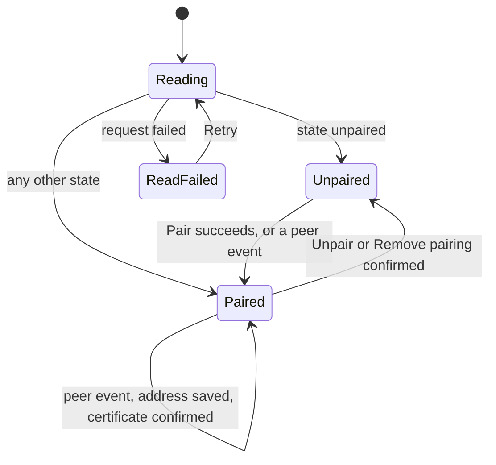
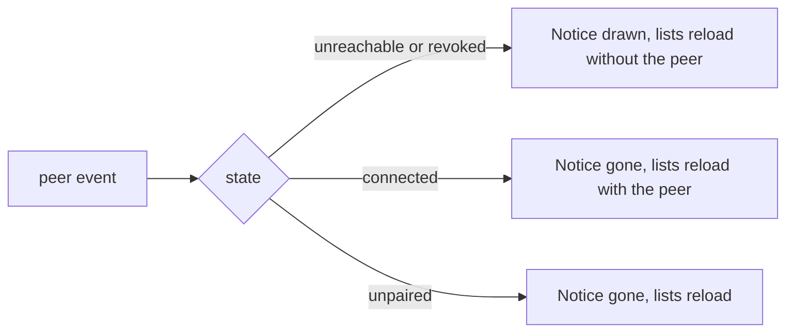

# UI design: Pair two VVMDMs on one LAN into one library

**Feature**: [parent Issue #1629](https://github.com/syudead/vv/issues/1629) ·
[plan.md](plan.md) ·
[plan.md, Connection state](plan.md#connection-state) ·
[plan.md, The screens](plan.md#the-screens) ·
[contracts/screen-api.md](contracts/screen-api.md)

Sources that already decide things, linked rather than repeated here:

| Topic | Source |
| --- | --- |
| Tokens, closed scales, library density | [design-system.md, Foundations](../../docs/design-docs/design-system.md#foundations); the values in `@theme` of [`web/src/ui/tokens.css`](../../web/src/ui/tokens.css), named here and never copied |
| `SettingsPage` with its page list, `PageSection`, `FormRow`, `FactList`; the state blocks | [patterns.md, Settings page](../../web/registry/rules/patterns.md#settings-page), [Sections](../../web/registry/rules/patterns.md#sections), [States](../../web/registry/rules/patterns.md#states) |
| `Button`, `Input`, `Field`, `Alert`, `Badge`, `Tooltip`, `Sonner`, `Skeleton`, `ConfirmDialog`; disabled is `opacity-50` everywhere | [components.md](../../web/registry/rules/components.md), [patterns.md, Confirm dialog](../../web/registry/rules/patterns.md#confirm-dialog) |
| The Settings pages, their list and the back link below `sm` | [patterns.md, Page list](../../web/registry/rules/patterns.md#page-list), [`SettingsPage.tsx`](../../web/src/settings/SettingsPage.tsx), [`settingsPages.ts`](../../web/src/settings/settingsPages.ts) |
| Video, group, smart folder and media-folder cards and rows; the marks in the duration pill (`VersionsMark`, the public globe, `VirtualMark`) | [library-ui.md, Cards](../../docs/design-docs/library-ui.md#cards), [List view and selection](../../docs/design-docs/library-ui.md#list-view-and-selection), [components.md, VideoThumbnail](../../web/registry/rules/components.md#videothumbnail), [`VideoCard.tsx`](../../web/src/videoList/VideoCard.tsx), [`GroupCard.tsx`](../../web/src/library/GroupCard.tsx), [`SmartFolderCard.tsx`](../../web/src/smartFolders/SmartFolderCard.tsx) |
| The video page: header band, title row, tabs, the virtual band | [library-ui.md, Video page layout](../../docs/design-docs/library-ui.md#video-page-layout), [`VideoHeader.tsx`](../../web/src/player/VideoHeader.tsx), [`TitleRow.tsx`](../../web/src/player/TitleRow.tsx) |
| The selection bar, its disabled reasons and its toasts; drag refusal (`Can't drop here`) | [library-ui.md, Selection bar](../../docs/design-docs/library-ui.md#selection-bar), [`SelectionBar.tsx`](../../web/src/library/SelectionBar.tsx), [bulk-editing.md](../../docs/design-docs/bulk-editing.md) |
| The shell: top bar, rail from `sm`, drawer below it; the bottom-right scan indicator | [library-ui.md, Width breakpoints](../../docs/design-docs/library-ui.md#width-breakpoints-in-css-and-the-sidebar-exception), [Scan entry and progress](../../docs/design-docs/library-ui.md#scan-entry-and-progress), [`AppShell.tsx`](../../web/src/shell/AppShell.tsx) |
| A text input saved on blur or Enter, with `Saved.` after it | [`PluginProxyRow.tsx`](../../web/src/settings/PluginProxyRow.tsx), [`SaveStatus.tsx`](../../web/src/settings/SaveStatus.tsx) |
| A secret shown once in a `code` block with `Copy` | [`APITokensSection.tsx`](../../web/src/settings/APITokensSection.tsx) |
| Screen text | [`web/src/i18n/en.ts`](../../web/src/i18n/en.ts); this feature adds the words below |

This feature changes five things on the screen: a new Settings page
**Pairing** (requirements 1 to 6); a **remote mark** on every card, row and
page of a video, group, smart folder or media folder that the peer holds
(`UI品質`, first point); a **peer notice** on every shell page while the peer
cannot be reached (requirement 15, `UI品質`, second point); the **actions the
peer does not offer** disappear from remote items, and the group picker and
drag follow the item's node; and an operation over a selection **reports its
remote part** (the Issue's bulk-edit edge case). Lists, cards, the player,
tags, people and organizations otherwise look and work as today: remote
items are the same components with ids above the offset
([plan.md, Remote ids](plan.md#remote-ids)).

## Why this shape

The Pairing page is one page of two faces, not a wizard. Before pairing it
holds the two halves of the handshake side by side, this node's code and the
form for the other node's code, because the owner stands at one of the two
PCs and needs only one half; a wizard would ask which half first. After
pairing the same page holds the peer's state, name, address and version and
the one way out, so the owner reads "who, how, and whether it answers" in
one glance (`UI品質`, visual hierarchy). The state is the first row and the
only coloured one: `success` for `connected`, `warning` for everything that
needs waiting or an action. `destructive` was rejected for `unreachable` and
`revoked`: nothing is broken on this node, and the controls that fix it sit
in the same section.

The remote mark is an icon in the place the cards already use for marks, the
duration pill, with the peer's name in a tooltip, not the name on the card.
Two nodes exist, so "the other one" is the whole message; a host name of up
to 100 characters on every remote card would wrap under titles and repeat the
same word down the grid. The video page and the collection pages, which have
room, name the node. The mark is the same component everywhere
(`RemoteMark`, added to the design system), so the viewer learns it once. A
coloured badge or a border was rejected: the Issue asks for a quiet mark,
and colour on cards is reserved for selection and status.

The peer notice is one `Alert` at the top of the content column on every
shell page, under the top bar and above the page, not a toast and not the
bottom-right indicator. A toast leaves and the condition does not; the
indicator is the scan's, and two framed pills in one corner would compete.
A line at the top of the content is where comparable products put "cannot
reach the server" (Plex, Syncthing, Google Drive offline), it moves nothing
on the page but its top edge, and the list keeps every control (`UI品質`,
second point). It has no close button: it is the only sign that the hidden
items exist, and it leaves on its own when the peer answers.

Actions the peer does not offer are not drawn for remote items rather than
disabled: a disabled heart asks why, and the answer ("favorites stay on the
PC that holds the video") is longer than the control. The selection bar is
the exception where it already explains itself with a tooltip on a disabled
button; there `Add to group`, `New group` and `Bundle` keep that form for a
mixed selection, because hiding three buttons as the selection changes would
make the bar jump.

A partial result of a bulk operation keeps the failed videos selected. The
toast can say how many were not changed but not which; the selection can
show which, with no new component, and `Clear selection` dismisses it.

The Issue's requirement 14 says the peer's smart folders appear "in the
sidebar"; in the product, root smart folders are cards in the unfiltered
library and the sidebar holds screens only
([library-ui.md, Sidebar navigation](../../docs/design-docs/library-ui.md#sidebar-navigation)).
The peer's smart folders therefore appear where this node's do, as cards with
the mark; the sidebar does not change.

## Words

`{name}` is the peer's host name (`peer.name`), `{address}` its base URL,
`{origin}` the browser's origin. Texts live under `settings.pairing`,
`shell.peer`, `list.card.remote` and `errors.reason`.

| Place | Text | Notes |
| --- | --- | --- |
| Settings page list and title | Pairing | `settings.pages.pairing`, after `Network` |
| Unpaired section heading | Pair with another VVMDM | `PageSection` title |
| Unpaired section description | Pair this VVMDM with one other on your local network to browse, play and organize both libraries from either one. Show a pairing code on one of them and enter it on the other. | |
| Code row, before a code | Pairing code | `FormRow` label; description: "Show a code here when you are pairing from the other VVMDM." |
| Code row action | Show pairing code | `outline` `sm` `Button` |
| Code row, while a code is shown | Enter this code on the other VVMDM, together with an address it can reach this one at, such as {origin}. | One line under the code, `text-sm text-muted-foreground`; `{origin}` in `code` |
| Code expiry | Expires in {m:ss} | Under the code, `text-xs text-muted-foreground tabular-nums`, counting down |
| Code expired | Expired | Replaces the countdown; the code is drawn `text-muted-foreground` |
| New code action | New code | `ghost` `sm` `Button` beside the countdown |
| Code read failed | Couldn't make a pairing code: {reason} | `FieldError` under the row |
| Form title | Enter the other VVMDM's code | `h3` `text-sm font-medium`, first line of the form row |
| Address field | Address of the other VVMDM | `Label`; placeholder `http://192.168.1.20:8080`; description: "http:// or https://, as you open it in a browser." |
| Code field | Its pairing code | `Label`; description: "The 8 characters its Pairing page shows." |
| Own address field | Address of this VVMDM | `Label`; prefilled with `{origin}`; description: "How the other VVMDM reaches this one. Change it when this page's address only works on this PC, such as localhost." |
| Submit | Pair | `default` `sm` `Button`; `Pairing…` with a `Spinner` while pending |
| `invalid_address` | Enter an address starting with http:// or https://, with a host and no path. | `FieldError` under the field the response names |
| `invalid_code` | The other VVMDM didn't accept this code. Codes last 10 minutes; show a new one there and try again. | `FieldError` under the code field |
| `already_paired` | One of the two VVMDMs is already paired. Unpair it on its Pairing page first. | `destructive` `Alert` under the fields |
| `unsupported_version` | The other VVMDM runs VVMDM {theirs} and this one {ours}. Update both to the same version. | `destructive` `Alert` |
| `peer_unreachable` at pairing | Couldn't complete the pairing: {message} | `destructive` `Alert`; `message` says which direction failed |
| `certificate_untrusted` title | Certificate not trusted | `warning` `Alert` under the fields |
| `certificate_untrusted` body | {address} uses a certificate this VVMDM can't verify. Compare this fingerprint with the certificate on the other side before you trust it. | `AlertDescription`; the fingerprint follows in a `code` block |
| Trust at pairing | Trust and pair | `outline` `sm` `Button` in `AlertAction` |
| Paired section heading | Paired VVMDM | `PageSection` title |
| Paired section description | Both libraries show as one on either VVMDM while they are connected. | |
| State `connected` | Connected | `text-success`, `Link` icon |
| State `unreachable`, `network` | Can't reach it | `text-warning`, `Unplug` icon; detail: "Its videos, groups and smart folders are hidden until it answers. Check that it is running and that the address below is right." |
| State `unreachable`, `version` | Versions differ | `text-warning`, `Unplug` icon; detail: "It runs VVMDM {theirs} and this one {ours}. Update both to the same version." |
| State `unreachable`, `certificate` | Certificate changed | `text-warning`, `ShieldAlert` icon; detail: "Its certificate is not the one you trusted. Confirm the new one below to reconnect." |
| State `revoked` | Unpaired by the other side | `text-warning`, `Unlink` icon; detail: "It no longer shares its library with this VVMDM. Remove the pairing to pair again from either side." |
| Facts | Name · Address · Version | `FactList` terms; `Address` is the editable row below instead of a fact |
| Address row | Address | `FormRow` label; description: "Changing it keeps the pairing; the connection is retried at once." |
| Address saved | Saved. | `SaveStatus` |
| Address invalid | Enter an address starting with http:// or https://, with a host and no path. | `FieldError` |
| Address save failed | Couldn't change the address: {reason} | `SaveStatus` error |
| Certificate changed title | Confirm the new certificate | `warning` `Alert` row; body as `certificate_untrusted` with the fingerprint |
| Trust after a change | Trust and reconnect | `outline` `sm` `Button` in `AlertAction` |
| `fingerprint_changed` | The certificate changed again. Compare the new fingerprint. | `destructive` `Alert` replacing the warning one |
| Unpair action | Unpair | `ghost-destructive` `sm` `Button`, opens a `ConfirmDialog` |
| Unpair dialog | Unpair from {name}? / Each VVMDM keeps its own videos, tags, groups and smart folders; neither shows the other's any more. / Unpair / Cancel | Title / description / action / cancel |
| Unpair done | Unpaired from {name} | Toast |
| Unpair failed | Couldn't unpair: {reason} | `destructive` `Alert` inside the dialog |
| Remove action (`revoked`) | Remove pairing | `outline` `sm` `Button`, no dialog |
| Section loading | Loading the pairing | `role="status"` name of the `Skeleton` rows |
| Section read failed | Couldn't load the pairing: {reason} | `ErrorState` with `Retry` |
| Peer notice title, owner | Can't reach {name} | `warning` `Alert`, `Unplug` |
| Peer notice body, owner, `network` | Its videos, groups and smart folders are hidden until it answers. | `AlertDescription` |
| Peer notice, owner, `version` | Can't connect to {name} / It runs VVMDM {theirs} and this one {ours}. | Title / body |
| Peer notice, owner, `certificate` | {name}'s certificate changed / Confirm it in Pairing to reconnect. | Title / body, `ShieldAlert` |
| Peer notice, owner, `revoked` | Unpaired by {name} / It no longer shares its library with this VVMDM. | Title / body, `Unlink` |
| Peer notice action, owner | Open Pairing | `outline` `sm` `Button` as a link to `/settings/pairing`, in `AlertAction` |
| Peer notice, guest | The other library isn't available right now / Some videos aren't shown until it is. | Title / body, `Unplug`; the same for every reason and for `revoked`; no action |
| Remote mark tooltip and sr text | On {name} | `RemoteMark`; `Laptop` icon |
| Video page band | {name} | After the `Laptop` icon, before the breadcrumb |
| Collection page count line | {name} · 12 videos · 1:32:10 | The mark and the name before the existing count |
| Group picker heading, peer | Groups on {name} | `text-xs text-muted-foreground`, first line of the picker's list |
| Selection bar reason, mixed nodes | Select videos from one VVMDM to do this | Tooltip of the disabled `Add to group`, `New group` and `Bundle` |
| Partial result toast | Saved here. {n} videos on {name} weren't changed: {reason}. They stay selected. | One toast, 8 seconds, no action; `n` from `remote.failedVideoIds` |
| Partial delete toast | Deleted here. {n} on {name} weren't: {reason}. They stay selected. | Same form for `POST /api/collections/delete` |
| `errors.reason.peer_unreachable` | Couldn't reach the other VVMDM | Used by every failed forwarded request, rename, merge and deletion |
| `errors.reason.mixed_nodes` | Videos from both VVMDMs can't go in one group | |
| `errors.reason.provisional_person_remote` | Give the person a name before adding them to videos on the other VVMDM | |

## Changes to the design system

Added by the "Mark remote items, show the disconnected notice and hide
unsupported actions" unit, before the screens use them; the Pairing page unit
needs neither.

| Change | What it is |
| --- | --- |
| `RemoteMark` | A vv component, item `remote-mark`: the `Laptop` icon at `size-3` with a `Tooltip` and sr-only text "On {name}", in the duration pill of a card, the duration cell of a row, a band or a count line. It is not a control; the element around it carries no extra name. Documented in [components.md, vv components](../../web/registry/rules/components.md#vv-components) |
| `AppShell` `notice` | A slot on the shell: one `Alert` at the top of the content column (`SidebarInset`), under the top bar and above the page, with the page's side padding (`p-3`, `p-4` from `sm`) and nothing below it but the page, so the page's own header keeps its position relative to the notice's bottom edge. Not sticky. Without `notice` nothing is drawn. Documented in [patterns.md, Shared rules](../../web/registry/rules/patterns.md#shared-rules) |

No colour token is added and nothing is added to `pairs` in
`web/src/theme/tokens.test.ts`: the states use `success`, `warning`,
`destructive` and their `-soft` fills, which the `Alert` and `Badge`
variants already pair. The icons are lucide `Link`, `Unlink`, `Unplug`,
`ShieldAlert`, `Laptop`, `Copy` and `CircleAlert`.

## Settings: Pairing page

One `SettingsPage` with the list in `nav`, `Pairing` as its title and one
section, whose face follows `GET /api/peer` and the `peer` event
([contracts/screen-api.md](contracts/screen-api.md#get-apipeer)). The page
is at `/settings/pairing`, between `Network` and `Account` in the list.

The diagram shows the page's faces and what moves between them.

### Unpaired

`PageSection` headed `Pair with another VVMDM` with two rows.

| Row | Content |
| --- | --- |
| Code row | A `FormRow` labelled `Pairing code` with `Show pairing code` as its control. Once pressed, the control's place holds the code in `font-mono text-xl font-semibold tabular-nums select-all`, drawn as two groups of four with a space between them, then the countdown line and `New code`, then the hint line with `{origin}`. `Copy` (`ghost` `icon-sm`, tooltip `Copy`) follows the code and toasts `Copied` |
| Form row | A `form` whose first line is the title, then three `Field`s stacked `gap-3`: the address, the code (`font-mono`, uppercase as typed, accepting the space or a hyphen between the groups), this node's address; then `Pair`. The fields are `sm:max-w-sm`; `Pair` stands under them at the left |

The code row and the form row are independent: showing a code does not
touch the form, and a successful `Pair` from the form discards the code. A
new code replaces the one shown; a code that expired stays legible in
`text-muted-foreground` under `Expired` so the owner sees it is the old one.

| State | What the section shows |
| --- | --- |
| No code | The code row with its button; the form empty but for `{origin}` |
| Code shown | The code, `Expires in 9:58` counting down each second, `New code`, the hint |
| Code expired | `Expired` in place of the countdown; the code muted; `New code` |
| Pairing | `Pair` shows `Pairing…` with a `Spinner`; the fields and `Show pairing code` are `disabled` |
| `400` | The named field's `FieldError`; the other values kept |
| `409` | The `Alert` of [Words](#words) under the fields; the values kept; `certificate_untrusted` shows the fingerprint and `Trust and pair`, which sends the same form again with the fingerprint |
| Paired | The section becomes [Paired](#paired) with `Connected`; the form is gone |

A `peer` event that says `connected` while the owner is on this face (the
other node completed the pairing with this node's code) moves the section
to Paired without a press; the form's draft is discarded, since it was for a
pairing that is now done.

### Paired

`PageSection` headed `Paired VVMDM`. Its rows, top to bottom:

| Row | Content |
| --- | --- |
| State | One line: the icon at `size-4`, the state word in `text-sm font-medium` in the state's colour; under it the detail sentence in `text-sm text-muted-foreground`. `Connected` has no detail |
| Facts | `FactList` with `Name` and `Version`; with reason `version` the value is `{theirs}` in `text-warning` |
| Address | `FormRow` `Address`: an `Input` `sm:w-sm`, saved on blur or Enter as the proxy row is, `Saved.` after it; while saving the input is `aria-disabled` |
| Certificate | Only with reason `certificate`: the `warning` `Alert` with the fingerprint in a `code` block and `Trust and reconnect`; `fingerprint_changed` turns it `destructive` with the new fingerprint |
| Action | `Unpair` for `connected` and `unreachable`; `Remove pairing` for `revoked` |

Saving the address or confirming the certificate does not change the state
line by itself; the next `peer` event does, within seconds, so the owner sees
`Can't reach it` become `Connected` on the same screen (acceptance criterion
3). The `ConfirmDialog` of `Unpair` keeps its `pending` state until the
`DELETE` answers and shows a failure inside itself.

| State | What the section shows |
| --- | --- |
| `connected` | `Connected` in `success`; `Unpair` |
| `unreachable`, `network` | `Can't reach it` in `warning` with its detail; the address row is the natural next thing to read; `Unpair` |
| `unreachable`, `version` | `Versions differ` with both versions; `Unpair` |
| `unreachable`, `certificate` | `Certificate changed`, the certificate row, `Unpair` |
| `revoked` | `Unpaired by the other side`; no address row (nothing to retry); `Remove pairing`, after which the section is [Unpaired](#unpaired) |
| Reading | `Skeleton` rows: one line, two facts, one input |
| Read failed | `ErrorState` with `Retry` in place of the rows |

## Remote mark

`RemoteMark` sits where the item already keeps its marks, first among them,
so a remote video's pill reads mark, versions, public, duration in that order
and a remote smart folder's reads mark, `FolderSearch`, count, duration.

| Place | Where the mark goes |
| --- | --- |
| Video card | First in the duration pill |
| Group and smart folder card | First in the count panel |
| Media folder card on `/folders` | Before the `Folder` icon in the title line; the path line shows the peer's path |
| List rows (video, group, smart folder, folder) | First in the duration cell, before the versions and public marks |
| Video page | In the header band after the logo: the mark and `{name}` in `text-sm text-muted-foreground`, where the virtual band sits, before the breadcrumb, which links to the peer's folders through their offset ids; below `md` the name truncates at `max-w-chip-label` |
| Group page, smart folder page, remote root folder page | The count line under the name starts with the mark and `{name}` followed by `·` |
| Group picker | The list is headed `Groups on {name}` when the selection is remote; the rows carry no mark, since every row is on that node |
| Related videos, `Up next`, home shelves, history, playlists | The card's own mark; history and playlists never hold remote items |
| Tags, tag kinds, people, organizations | No mark anywhere: the same name is one entry on both nodes, and a remote-only entry is still one tag or one person to the viewer |

The mark is `size-3` in pills, cells and count lines and `size-4` in the
band, as the other marks and the virtual band are. It has no fill, border or
colour of its own: it is drawn in the text colour of its line. A remote card
is otherwise the local card: same box, same hover preview, same scrub band,
same tag row with tag chips that open the local tag of that name.

## Peer notice

The shell draws the `warning` `Alert` of [Words](#words) in its `notice` slot
while the state is `unreachable` or `revoked`, on every shell page except
`/settings/pairing`, whose section already shows the state in full. The video
page is outside the shell and shows no notice: a remote video that cannot be
read shows the page's own error state with the `peer_unreachable` reason, and
one that stops mid-play shows the player's playback error.

| Part | Content |
| --- | --- |
| Icon | `Unplug`; `ShieldAlert` for reason `certificate`; `Unlink` for `revoked` |
| Title and body | By reason and audience, from [Words](#words) |
| Action | `Open Pairing` for the owner; none for a guest |
| Close | None |

The diagram shows what the lists do around the notice.

On each of those transitions every list on screen (library, folder, group,
smart folder, tag, people and organization pages and their pickers) re-reads
its loaded pages as it does on a `smartFolder` event, so the peer's items
leave when the notice appears and return when it leaves, with no reload by
the owner (acceptance criterion 11). A page that is between pages when the
peer drops keeps its local items and shows the notice; its next pages stay
local until the lists reload on `connected`.

| State | What the screen shows |
| --- | --- |
| `connected`, `unpaired` | No notice |
| `unreachable` | The notice at the top of the content; the page below it unchanged in width and controls; every list without the peer's items; the totals count this node only |
| `revoked` | The notice with `Unlink`; otherwise as `unreachable` |
| Guest | The one guest notice, no action |
| Page loaded while the stream has not opened yet after a restart | The notice is drawn from `GET /api/peer` as from an event; it leaves when the first `connected` arrives |

## Actions on remote items

Remote items do not draw the controls the peer does not offer
([contracts/screen-api.md, Remote ids](contracts/screen-api.md#remote-ids)).
The space they took is not kept: a list row's favorite and playlist cells
are empty for a remote row, the columns staying aligned; the video page's
title row holds `Group` and `Edit` and the visibility switch.

| Place | Remote item | Why |
| --- | --- | --- |
| List row | No heart, no `Add to playlist`; `Add to group` stays | Favorites and playlists are per node |
| Video page title row | No `Favorite`, no `Playlist`; `Group`, `Edit` and `Private`/`Public` stay | The flag and the group are the peer's data, forwarded |
| Video page tags | `Auto-tag` absent; adding and removing tags as today | Analysis stays on the owning node |
| File & media tab | `Open file` and `Rescan` absent; the facts as today | The file is on another PC |
| Player | No progress saved, no resume prompt; related videos, `Up next`, subtitles, quality and theater mode as today | Playback position is out of scope |
| Thumbnail edit and work-info fetch | As today: they write the peer's cover and work information through the forwarded operations | Requirement 10 |
| Smart folder card and row | No heart, no `Add to playlist`; the check, the tag row and `Edit…`, `New child smart folder…`, `Delete…` on its page as today | Same as videos |
| Group card and row | No heart, no `Add to playlist`; `Add to group` stays | Same |

The selection bar reads the selection's nodes from the ids:

| Selection | Bar |
| --- | --- |
| Local only | As today |
| Remote only | No `Favorite`, no `Add to playlist`; `Add to group`, `New group` and `Bundle` work on the peer; `Edit`, tags, `Visibility`, `Delete` as today |
| Mixed | No `Favorite`, no `Add to playlist`; `Add to group`, `New group` and `Bundle` `disabled` with the mixed-nodes tooltip, as `New group` is disabled today when the selection does not allow it; `Edit`, tags, `Visibility` and `Delete` work, split by node |

The group picker opened from a remote item or a remote-only selection lists
the peer's groups under `Groups on {name}`, and its `New group` creates the
group there. Dragging an item onto a group, video or folder of the other
node shows `Can't drop here`, as a drop on a smart folder card does today, so
`mixed_nodes` is never reached by a drop. A move or reorder among items of
one node is unchanged.

## Operations over a selection with a remote part

`Edit`, tags, `Visibility`, the code editor and `Delete` send one request and
read `remote` from the answer
([contracts/screen-api.md, Operations over a selection](contracts/screen-api.md#operations-over-a-selection)).

| Result | What the screen shows |
| --- | --- |
| `failedVideoIds` empty | The toast of today, counting both nodes (`Updated 12 videos`) |
| `failedVideoIds` not empty | The partial-result toast of [Words](#words); the selection narrows to the failed videos, which stay checked in the list; the local items leave the selection as they do after a successful operation; the bulk editor closes as it does today |
| The whole request failed | As today: the editor or popover keeps the draft and shows the error, with `Couldn't reach the other VVMDM` when the reason is `peer_unreachable` |

The narrowed selection is the way the failed videos are "seen" (the Issue's
edge case): the toast says how many and where, the checks say which, and
`Clear selection` ends it. The same holds for `Delete` of collections, where
the remaining remote collections stay checked.

Renames, merges and deletions of a tag, person or organization while the
peer is not connected answer `409 peer_unreachable`; the dialogs show it as
they show `tag_name_taken` today, under the field, with the reason text of
[Words](#words), and keep the draft.

## Entry points

| Entry | Goes to | What the viewer sees on arrival |
| --- | --- | --- |
| Settings list, `Pairing` | `/settings/pairing` | The Unpaired or Paired face; below `sm`, under the back link |
| Peer notice, `Open Pairing` | `/settings/pairing` | The Paired face with the state that raised the notice at the top |
| Remote video card, row, related card | `/videos/{remote id}` | The video page with the band naming the peer |
| Remote group or smart folder card | `/groups/{remote id}`, `/smart-folders/{remote id}` | The collection page with the mark in its count line |
| Remote root on `/folders` | `/folders/{remote rootId}` | The folder page with the mark in its count line; its breadcrumb starts at the root's name |

## Responsive behaviour

Breakpoints are Tailwind's defaults only, applied in CSS
([library-ui.md, Width breakpoints](../../docs/design-docs/library-ui.md#width-breakpoints-in-css-and-the-sidebar-exception));
`sm` is 640px, `md` 768px, `lg` 1024px. The widths judged are 360px, 768px
and 1280px.

| Width | Layout |
| --- | --- |
| 1280px | Pairing: the page list column and the section beside it; the code row is label left, code right with the hint under it; the form's three fields stack at `sm:max-w-sm` with `Pair` under them; the address row is label left, input right. Notice: one line of title and body side by side with `Open Pairing` at the right end. Cards: the mark in the pill at every card size |
| 768px | Pairing: the same two columns, the section narrower; the `FormRow`s still label left, control right. Notice: title and body on one line, the action at the right. Video page band: the peer's name in full before the breadcrumb |
| 360px | Pairing: the page under the back link; the code row stacks, the code at `text-xl` on one line with its `Copy` beside it; the fields take the full width; the address row stacks. Notice: title, body and the action on three lines, `p-3` from the edges, above the page's header. Video page band: the name truncated at `max-w-chip-label`, the breadcrumb's last segment after it. List rows: the mark in the duration cell, which stays visible below `sm` |

## Review criteria

Judged by looking at the real screens of two paired nodes
([library-ui.md, Layout verified by people, not machines](../../docs/design-docs/library-ui.md#layout-verified-by-people-not-machines))
at the widths above, as the owner and as a guest, with the peer running,
stopped and unpaired from its side. "It exists" alone does not satisfy a
criterion (Q-4).

1. **Visual hierarchy, Pairing page**: on the Paired face the eye lands on
   the state word first, then the name, then the address; the state is the
   only coloured text in the section and nothing else in it is bolder than
   `font-medium`. On the Unpaired face the code, once shown, is the largest
   text on the page after the title, and the form's `Pair` is the only
   filled button (`UI品質`, visual hierarchy; priority of actions).
2. **Information density, Pairing page**: at 1280px each face fits without
   scrolling, including a shown code or a certificate `Alert`; the Paired
   face shows no row that the state does not need (no address row while
   `revoked`, no certificate row while the certificate is trusted).
3. **Spacing rhythm**: the section's rows sit on the dividers and padding
   every settings section uses; the code, its countdown and its hint are
   three lines `gap-1` apart inside one row; moving from Unpaired to Paired
   keeps the section heading at the same vertical position.
4. **Typography**: the code is `font-mono text-xl` in two groups of four and
   nothing else on the page is `text-xl` but the title; the state word is
   `text-sm font-medium`, its detail `text-sm` muted; the countdown is
   `text-xs` and `tabular-nums`, so its digits do not shift the line.
5. **Pairing flow**: showing a code on A and entering it with both addresses
   on B turns B's section into `Connected` and, within seconds and without a
   reload, A's section too; the library of either node then counts both
   (acceptance criterion 1). A wrong code, an expired code, a node already
   paired and a differing version each leave the form filled and name the
   reason where [Words](#words) puts it; the owner corrects one field and
   presses `Pair` again.
6. **Certificate**: pairing to an `https://` address with a self-signed
   certificate shows the fingerprint in the form and `Trust and pair`;
   pressing it pairs. After the certificate changes, the Paired face shows
   `Certificate changed` with the new fingerprint and `Trust and reconnect`
   turns it `Connected` (acceptance criterion 2, the certificate edge cases).
7. **Address and password**: changing the address returns the state to
   `Connected` with no new code (acceptance criterion 3); changing the
   password on one node leaves both pages at `Connected` (acceptance
   criterion 5).
8. **Revoked**: with the peer stopped, unpairing on this node and starting
   the peer shows `Unpaired by the other side` on the peer's page and
   `Remove pairing` returns it to the Unpaired face (acceptance criterion
   4); pairing again from either side works.
9. **Remote mark**: in the library grid at 1280px a remote video is told
   from a local one at a glance by the icon at the pill's start, with no
   change of card size, title or tag row; hovering the icon names the peer;
   the same icon opens the row and the collection pages, and the video page
   band names the peer before the breadcrumb (`UI品質`, first point).
   Tag chips on remote cards open the local tag of that name.
10. **Peer notice**: stopping the peer makes the notice appear at the top of
    the content on the library, a folder page, the tags page and a smart
    folder page, in the same place and words on each; the lists below it
    lose the peer's items and keep every control (search, filters, sort,
    selection, drag); starting the peer removes the notice and the items
    return, with no reload by the owner (acceptance criterion 11; `UI品質`,
    second point). The guest browser shows the guest notice with no action.
11. **Priority of actions in the notice**: `Open Pairing` is an `outline`
    button at the end of the line, not a filled one; the notice never
    covers the page's header or toolbar and never scrolls with the viewer.
12. **Hidden actions**: a remote row shows no heart and no `Add to
    playlist`; a remote video page shows `Group`, `Edit` and the visibility
    switch and no `Favorite` or `Playlist`; its File & media tab shows no
    `Open file` or `Rescan`; playing it, seeking it and turning on its
    subtitle work (acceptance criterion 9). A mixed selection shows `Add to
    group` disabled with the mixed-nodes tooltip; a remote-only selection
    opens the picker headed `Groups on {name}`.
13. **Partial result**: with the peer stopped between selecting a mixed set
    and pressing a tag action, the local videos get the tag and leave the
    selection, the remote ones stay checked, and the toast says how many
    were not changed and where.
14. **Narrow width**: at 360px the Pairing page's code fits on one line
    with its `Copy`, the fields take the full width, the notice stands above
    the page header on three lines, and the mark stays visible in a row's
    duration cell.
15. **Examples that do not meet the requirement** (`UI品質`): the peer's
    name written on every card; a coloured badge or border as the mark; the
    notice as a toast that leaves or an indicator the owner can close; the
    notice drawn on `/settings/pairing` beside the state line; a disabled
    heart on a remote row; the Pairing page as a wizard; `destructive`
    colour on `Can't reach it`; the state word and its detail in the same
    weight and colour.

## Accessibility

The parent Issue does not ask for screen-reader or contrast design, so only
names are decided.

- `RemoteMark` is `aria-hidden` with sr-only text "On {name}" in the same
  element, referenced by a card link's `aria-describedby` as `VersionsMark`
  is; the video page band's text is read as part of the header.
- The peer notice is the `Alert` component's own role; its action is a link
  named `Open Pairing`.
- The pairing code is in a `code` element with `select-all`; `Copy` is an
  icon button named `Copy` with the same tooltip; the countdown is
  `role="status"` so a screen reader hears `Expired` when it happens.
- The state line is one paragraph read as "Connected" or "Can't reach it.
  Its videos…"; the icon is `aria-hidden`.
- The `Unpair` dialog is the `ConfirmDialog` with its action named `Unpair`.
