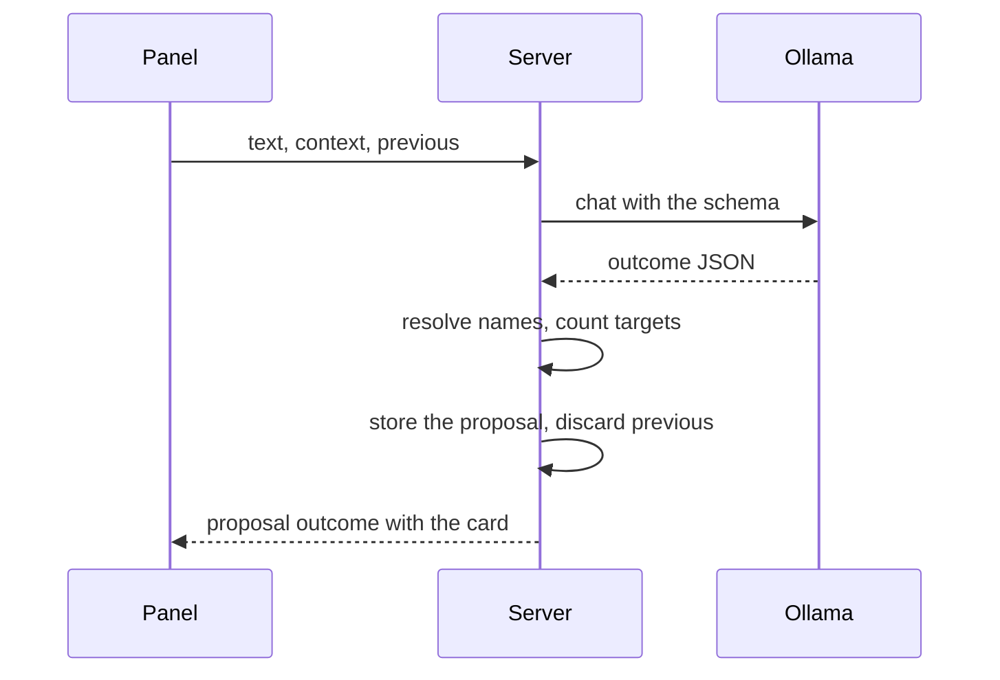

# Contract: screen API additions for the assistant

Source of truth: [api/openapi.yaml](../../../api/openapi.yaml), operations
`getAssistantReadiness`, `createAssistantTurn`, `executeAssistantProposal`,
`getAssistantProposal`, `listAssistantProposals`, `getAssistantReviewRun`,
`adoptAssistantReviewCandidates`, `rejectAssistantReviewCandidates`,
`listOllamaModels`, and the changed `getOllamaSettings`,
`updateOllamaSettings`, `listVideos`, `listLibrary`, `createSmartFolder` and
`changeSmartFolder`. Every `/api/assistant/*` operation is owner-only
(`sessionCookie` without the anonymous alternative), so the routing test
keeps guests at `403`.

## Ollama connection

`OllamaSettings` gains `generationModel`, a string that is empty until the
owner saves one; `PUT` with an empty string clears it and the connection
stays saved.

### `GET /api/settings/ollama/models`

Lists the model names at the saved endpoint for the two pickers.

**Response**: `200` `{ items: [{ name }] }`, in the order Ollama lists them.

| Status | `code` | When |
| --- | --- | --- |
| 409 | `ollama_unreachable` | The endpoint cannot be reached, or does not answer as Ollama; `reason` is `connection` or `not_ollama` |

The check (`POST /api/settings/ollama/check`) also reports
`generation_model_missing` when a saved generation model is not listed.

## Readiness

### `GET /api/assistant/readiness`

Says whether a turn can run.

**Response**: `200` `{ ready, reason? }` with `reason` one of
`ollama_not_saved`, `generation_model_unset`. It sends no request to Ollama.

## Turns

### `POST /api/assistant/turns`

Interprets one request and answers one outcome; a write outcome stores a
proposal.

The diagram shows one turn with a write outcome.

| Field | In | Type | Required | Meaning |
| --- | --- | --- | --- | --- |
| `text` | body | string, 1 to 500 characters | Yes | The request |
| `context.route` | body | `{ kind, id? }` | Yes | `library`, `folder`, `video`, `person`, `organization`, `playlist`, `group`, `smartFolder`, `tag`, `tags`, `people`, `duplicates`, `settings`, `other` |
| `context.selectedVideoIds` | body | int64[], at most 20,000 | No | The list selection |
| `context.selectedCollectionIds` | body | `{ groups: int64[], smartFolders: int64[] }` | No | Selected groups and smart folders |
| `context.filter` | body | the library criteria | No | The current filter of the list screen |
| `context.pinned` | body | `[{ kind, name, id }]` | No | Ids chosen in a clarification, applied before name resolution |
| `previous` | body | the previous outcome | No | For a follow-up; its proposal id, when it has one, is discarded |

**Response**: `200` with `{ outcome }`.

| `outcome.kind` | Members |
| --- | --- |
| `filter` | `criteria`: the resolved library criteria with ids and the names for the chips |
| `navigate` | `destination`: `{ kind, id?, settingsPage? }` |
| `answer` | `question`, `total?`, `items?: [{ id, title }]`, `link`: the criteria or page the number came from |
| `proposal` | `proposal`: the stored row ([Proposals](#proposals)) |
| `review` | `run`: the review run ([Review runs](#review-runs)) |
| `clarify` | `about`, `candidates?: [{ kind, id, name, count }]`, `names?` |
| `unsupported` | `operation?`: what the model named when it is a known exclusion |
| `unreadable` | none |

| Status | `code` | When |
| --- | --- | --- |
| 400 | `invalid_request` | `text` empty or over 500 characters, or over 20,000 selected videos (`reason` `too_many_videos`) |
| 409 | `assistant_not_ready` | Readiness is false; `reason` as readiness |
| 503 | `assistant_unavailable` | Ollama cannot be reached (`connection`), the model is missing or refused (`model`), or the call timed out (`timeout`); nothing is stored |

## Proposals

A proposal is `{ id, status, request, operation, irreversible, targets,
change, created, counts, startedAt?, finishedAt?, error? }`.

| Field | Meaning |
| --- | --- |
| `status` | `proposed`, `approved`, `running`, `done`, `partial`, `stale`, `failed`, `discarded` |
| `request` | The owner's text |
| `operation` | The catalog operation id and its variant |
| `targets` | `{ kind, count, labels: [{ kind, id, name }] }`: what the card names, with up to 10 labels and the count |
| `change` | The arguments after resolution, with names and ids |
| `created` | Names that will be created |
| `counts` | `{ total, applied, failed }` in user keys for batched operations, otherwise `0`/`1` |

### `POST /api/assistant/proposals/{id}/execute`

Approves the proposal; the worker executes it.

**Response**: `202` with the proposal in `approved`.

| Status | `code` | When |
| --- | --- | --- |
| 404 | `not_found` | No such proposal, or it was discarded or expired |
| 409 | `proposal_not_pending` | The status is not `proposed`; the body carries the proposal |

### `GET /api/assistant/proposals/{id}`

Reads one proposal; the panel re-reads it on each `assistant` event.

### `GET /api/assistant/proposals`

Lists, newest first, the proposals that are `approved` or `running`, and
those finished within the last hour, so the panel shows them when it opens.
`active=true` is the only filter and is required.

## Review runs

A run is `{ id, kind, status, total, judged, listed, startedAt, finishedAt? }`
with `status` one of `running`, `done`, `failed`, `interrupted`.

### `GET /api/assistant/review-runs/{id}`

Reads the run and its candidates.

| Field | In | Type | Required | Meaning |
| --- | --- | --- | --- | --- |
| `cursor`, `limit` | query | string, 1 to 200 | No | Pages of candidates, most probable first |

**Response**: `200` `{ run, items: [{ id, probability, members: [{ kind, id, name, count }], state }], nextCursor? }`.
`state` is `listed`, `adopted` or `rejected`; a candidate whose member no
longer exists is left out.

### `POST /api/assistant/review-runs/{id}/candidates/adopt`

Stores one approved proposal with the chosen candidates and answers it.

| Field | In | Type | Required | Meaning |
| --- | --- | --- | --- | --- |
| `ids` | body | int64[], 1 to 1,000 | Yes | Candidate ids |

**Response**: `202` `{ proposal, skippedIds }`: the proposal, and the ids
that were not `listed` or whose member is gone.

### `POST /api/assistant/review-runs/{id}/candidates/reject`

Marks the candidates rejected and remembers the dismissals.

**Response**: `200` `{ rejectedIds, skippedIds }`.

## Event

`assistant` on `/api/events` carries no payload, is sent to owner streams
only and is coalesced per connection; it follows every committed change of a
proposal or a review run.

## Library filters

`listVideos` and `listLibrary` take five more query parameters, and
`SmartRule` the same five fields; the library URL uses the same names.

| Name | Type | Meaning |
| --- | --- | --- |
| `minDurationMs`, `maxDurationMs` | integer, 0 or more | Videos whose duration is within the bounds; an unknown duration never matches |
| `addedFrom`, `addedTo` | `YYYY-MM-DD` | Added on or after the first day's start, and before the day after `addedTo`, in the server's local time zone |
| `watchState` | `unwatched`, `inProgress`, `watched` | As the cards' `watchState` |

A value outside its type, `maxDurationMs` below `minDurationMs` or `addedTo`
before `addedFrom` returns `400 invalid_request` on the listings and
`400 invalid_smart_rule` on a rule. `listFolderVideos` does not take them.
