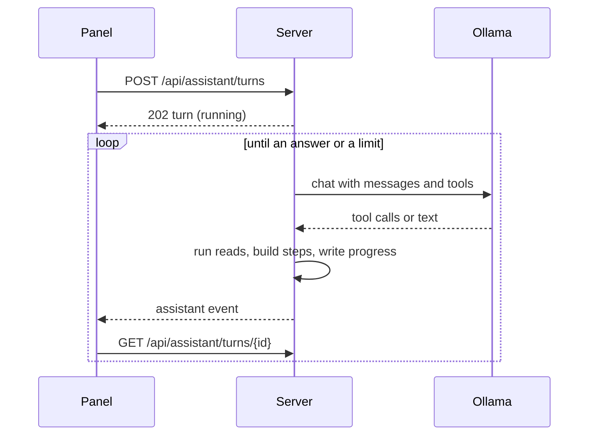

# Contract: screen API changes for the assistant

Source of truth: [api/openapi.yaml](../../../api/openapi.yaml). The
operations already on the feature branch keep their shape unless they are
listed here: the library filters (`minDurationMs`, `maxDurationMs`,
`addedFrom`, `addedTo`, `watchState`), the review runs
(`getAssistantReviewRun`, `adoptAssistantReviewCandidates`,
`rejectAssistantReviewCandidates`), `listAssistantProposals`, the payload-free
`assistant` event and `generationModel` on the Ollama settings. Every
`/api/assistant/*` operation stays owner-only.

## Ollama connection

### `GET /api/settings/ollama/models`

**Response**: `200` `{ items: [{ name, tools, vision }] }`, where `tools`
and `vision` come from `capabilities` of `POST /api/show` for each name, and
are `false` when Ollama reports no capabilities.

The connection check (`POST /api/settings/ollama/check`) also reports
`generation_model_without_tools` when the saved generation model lacks
`tools`.

## Readiness

### `GET /api/assistant/readiness`

**Response**: `200` `{ ready, reason?, vision }`, with `reason` one of
`ollama_not_saved`, `generation_model_unset` or
`generation_model_without_tools`. The capability is read from Ollama on the
first read for an endpoint and model pair, and kept after that. When Ollama
cannot be reached at that first read, readiness answers `ready: true` and the
turn reports the connection failure.

## Turns

The diagram shows a turn from the panel's side.

A turn is `{ id, status, request, startedAt, finishedAt?, progress, answer?,
judged?, directive?, clarify?, proposal?, stop? }`.

| Field | Meaning |
| --- | --- |
| `status` | `running`, `done`, `clarify`, `stopped`, `interrupted` |
| `progress` | `[{ tool, kind, labels: [{ kind, id?, name }], images?, n?, m?, error?, at }]`: one item per tool call, composed by the server from the tool and its arguments |
| `answer` | The model's final text, in the request's language, after the grounding check |
| `judged` | `true` when the answer used `clef` answers; the panel marks it as the judge's |
| `directive` | `{ kind: "filter", criteria }` or `{ kind: "navigate", destination }`, from the last `show_in_library` or `open_page` |
| `clarify` | `{ name, kind, candidates: [{ kind, id, name, count }] }`, with no proposal |
| `proposal` | The proposal the turn built ([Proposals](#proposals)) |
| `stop` | For `stopped`: `{ reason, excluded? }`, where `reason` is `step_limit`, `timeout`, `connection`, `model` or `ungrounded`, and `excluded` is `{ operation, reason, page }` when the model asked for an excluded operation and answered nothing else |

### `POST /api/assistant/turns`

| Field | In | Type | Required | Meaning |
| --- | --- | --- | --- | --- |
| `text` | body | string, 1 to 500 characters | Yes | The request |
| `context` | body | As shipped: route, selection, filter, `pinned` | Yes | The screen |
| `previousTurnId` | body | int64 | No | A follow-up; its request and proposal steps go into the system message, and its pending proposal is discarded when the new turn builds one |

**Response**: `202` with the turn in `running`.

| Status | `code` | When |
| --- | --- | --- |
| 400 | `invalid_request` | `text` empty or over 500 characters, over 20,000 selected videos |
| 409 | `assistant_not_ready` | Readiness is false; `reason` as readiness |
| 409 | `assistant_busy` | Another turn is `running`; the body carries its id |

### `GET /api/assistant/turns/{id}`

Reads one turn. `404 not_found` once it has expired (24 hours).

### `GET /api/assistant/turns`

`active=true` is required, and is the only filter. Lists the `running` turn
and the turns that finished within the last hour, newest first.

## Proposals

A proposal is `{ id, status, request, turnId?, steps, startedAt?,
finishedAt? }`. The shipped single `operation`, `targets`, `change`,
`created`, `impact` and `counts` fields move into each step.

| Step field | Meaning |
| --- | --- |
| `index` | Position in the card, from 0 |
| `operation`, `irreversible`, `targets`, `change`, `created`, `impact` | As the shipped proposal fields, for this step |
| `createdBy` | `[{ name, step }]`: names that an earlier step creates |
| `status` | `pending`, `skipped`, `running`, `done`, `partial`, `stale`, `failed`, `notRun` |
| `counts` | `{ total, applied, failed }` |
| `error` | `{ code, reason, message }` for `failed`, `partial` or `stale` |

The proposal's `status` stays `proposed`, `approved`, `running`, `done`,
`partial`, `stale`, `failed` or `discarded`. A finished proposal takes the
status of the last step that ran.

### `POST /api/assistant/proposals/{id}/execute`

| Field | In | Type | Required | Meaning |
| --- | --- | --- | --- | --- |
| `steps` | body | int[], at least one | Yes | The indexes the owner kept, in any order; they run in card order |

**Response**: `202` with the proposal in `approved`.

| Status | `code` | When |
| --- | --- | --- |
| 400 | `invalid_request` | An index out of range, or no index |
| 404 | `not_found` | No such proposal, or it was discarded or expired |
| 409 | `proposal_not_pending` | The status is not `proposed`; the body carries the proposal |
| 409 | `step_needs_skipped` | A kept step names a creation of a step that is not kept; `reason` is the kept step's index |

The review list's adopt operation keeps storing approved proposals. Each one
now has one step.
