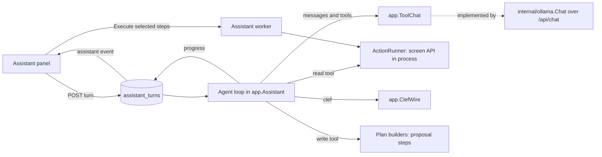
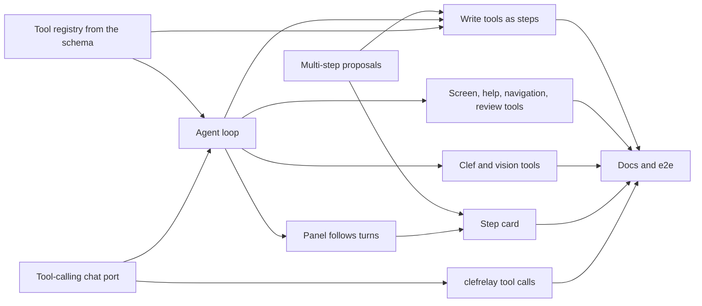

# Implementation Plan: In-app assistant as a server-side tool agent

**Branch**: `feature/067-assistant` | **Parent Issue**: #1654

**Input**: The parent Issue. It is this feature's specification. This is a
revision: the requirement was rewritten on 2026-10-30, and the one-shot
translator already on the feature branch is reworked in place.

## Summary

The owner types a request in the assistant panel. The server runs an agent
loop over the owner's Ollama chat model with Ollama's `tools`. The model
calls the app's own capabilities as tools until it answers or proposes:

- every owner read operation of the screen API;
- every owner write operation that is not excluded;
- the app's AI capabilities: Clef through its own request format, the ComfyUI
  thumbnail edit, and plugin search and fetch;
- for a model that can see images, `view_images`, which shows it the images
  that other tools refer to.

Read tools run at once and return real data. Each write tool call is resolved
by the server into one step of a single proposal. The confirmation card shows
the steps, the owner can untick any of them, and the existing execution worker
runs the approved steps in order and stops at the first failure.

The design rule is to offer general primitives and let the model combine them.
The acceptance criteria are samples of what the primitives allow, not the
feature list, so no tool is shaped for one use case.

The diagram shows one request.



## Technical Context

**Canonical definitions**: [ARCHITECTURE.md](../../ARCHITECTURE.md) for
layers, store roles and events after commit;
[assistant.md](../../docs/design-docs/assistant.md) for the shipped assistant
that this revision changes;
[ai-layer.md](../../docs/design-docs/ai-layer.md) for the classifier port, the
generation port, the Ollama provider and the image-edit provider;
[activity.md](../../docs/design-docs/activity.md) for activity entries;
[external-api.md](../../docs/how-to/external-api.md) for the in-process call
of an API mux that `/mcp` makes; [api/openapi.yaml](../../api/openapi.yaml)
for the screen API; [testing.md](../../docs/design-docs/testing.md) for test
levels; [running-vv.md](../../docs/how-to/running-vv.md#assistant) for the
owner's setup and `scripts/clefrelay`.

**Feature-specific context**:

| Item | Delta |
| --- | --- |
| Ollama API | The chat call sends `tools` and reads `message.tool_calls` instead of a JSON schema in `format`; the capability check reads `capabilities` from `POST /api/show` ([Model and tool calling](#model-and-tool-calling)) |
| Latency | A CPU host takes tens of seconds per model call, so a request is a server-side job that the panel follows through events, not an HTTP request held open ([Turns are server-side jobs](#turns-are-server-side-jobs)) |
| Tool count | The screen API has about 240 operations, so the model sees a fixed core set and loads the others by search during the request ([Tools](#tools)) |
| Images | Tools return image references, not bytes; the server substitutes the bytes for Clef, and for a model with `vision` it attaches them to the chat ([Images, Clef and vision](#images-clef-and-vision)) |

## Constitution Check

*GATE: Must pass before Phase 0 research. Re-check after Phase 1 design.*

| Rule | Source | Verdict |
| --- | --- | --- |
| Dependency direction | ARCHITECTURE.md | `app.Assistant` reaches the model through `app.ToolChat`, Clef through `app.Classifier`, the operations through `app.ActionRunner`, and rows through `AssistantStore`; `internal/httpapi` implements the runner and `cmd/mdm` wires it, as today |
| The domain decides, the store enforces | ARCHITECTURE.md | Tool classification, the limits, step selection and the grounding rule are in `internal/domain`; turn and proposal transitions are guarded `UPDATE`s |
| Events after commit | ARCHITECTURE.md | `AssistantChanged` is published after each committed turn progress row, as it is for proposals |
| Every read knows its viewer | ARCHITECTURE.md | Read tools go through the owner's screen API handlers in process, so each one keeps its own audience rules; `/api/assistant/*` stays owner-only |
| The server never sends a request to a URL from a request body | ai-layer.md | Image references are operation ids with parameters that the runner calls in process; no tool takes a URL to fetch |
| Generated files are not hand-edited | AGENTS.md | The tool registry is generated from `api/openapi.yaml` by `task generate` ([Tools](#tools)) |
| Complexity 25 and no copies | AGENTS.md | One generic read path and one generic schema-row path serve every operation; the hand-written route table is replaced by generated data, not copied |

No gate is at stake after Phase 1; `## Complexity Tracking` is left out.

## What is kept, replaced and removed

| Shipped part | Fate | Detail |
| --- | --- | --- |
| `domain.AssistantCatalog` and exclusions | Kept as the write half of the tool registry; the exclusions shrink | [Tools](#tools) |
| `assistantcheck` coverage test | Widened from owner writes to every owner operation | [Tools](#tools) |
| `httpapi.ActionRunner` | Kept; it also runs reads; its hand-written `assistantRoutes` method and path table is replaced by the generated registry | [Tools](#tools) |
| Plan builders, name resolution, clarification, pins, created names, merge impact (`assistant_plan*.go`, `assistant_names.go`, `assistant_target.go`) | Kept; each one builds one step from a write tool call | [Write tools become proposal steps](#write-tools-become-proposal-steps) |
| `AssistantProposal`, its store, the worker, batches, the stale check, the `assistant_run` entry | Kept; a proposal holds ordered steps | [Write tools become proposal steps](#write-tools-become-proposal-steps) |
| Review runs, their finders and the review list page | Kept; `start_review` starts one | [Tools](#tools) |
| Library duration, date and watch-state filters | Kept; `show_in_library` sets them | [Tools](#tools) |
| Panel, trigger, root store, confirmation card, `Recent runs` | Kept and changed: the thread follows turns, and the card lists steps | [The screens](#the-screens) |
| The outcome kinds and their schema (`assistant_outcome.go`), the prompt (`assistant_prompt.go`), the typed questions (`count`, `appearances`, `recent`, `list`), the `unreadable` outcome | Removed: the tool loop replaces them | [The agent loop](#the-agent-loop) |
| `app.StructuredGenerator` and `ollama.Generator` with `format` | Replaced by `app.ToolChat` and `ollama.Chat` | [Model and tool calling](#model-and-tool-calling) |
| Synchronous `POST /api/assistant/turns` | Replaced by a turn job and `GET /api/assistant/turns/{id}` | [contracts/assistant-api.md](contracts/assistant-api.md#turns) |
| The e2e stub that answers fixed outcomes | Replaced by a stub that scripts tool calls | [Testing the loop](#testing-the-loop) |

## Model and tool calling

| Decision | Rejected | Why |
| --- | --- | --- |
| A port `app.ToolChat` (`Chat(ctx, domain.ChatRequest) (domain.ChatReply, error)`) takes messages and tool definitions and returns either tool calls or text; `internal/ollama.Chat` implements it over `POST /api/chat` with `tools`, `stream: false` and `keep_alive` 10 minutes | Keeping `StructuredGenerator` and asking for the next tool call as JSON in `format` | Requirement 3 asks for a tool-calling model, and Ollama's own `tools` lets the model's template format the calls the way the model was trained |
| `options.num_ctx` is 16,384 on every call | Ollama's default context | The default is a few thousand tokens and silently cuts the oldest messages, which drops the tool results the answer must cite |
| Tool capability is read from `capabilities` in `POST /api/show`; a model without `tools`, or an Ollama that reports no capabilities, is not ready with `generation_model_without_tools` | Trying a call and reporting the failure | Requirement 3 and acceptance 16 show the reason before a request is sent |
| The same read records `vision`; a model with it is offered `view_images`, and one without it is not | Vision required, or never used | The maintainer asked that multimodal models see images directly, while text-only tool models stay supported |
| The capability is read when the settings are saved, by the connection check, and by readiness on its first read for an endpoint and model pair, then kept in memory for that pair | Calling `/api/show` on every readiness read | Readiness is read each time the panel opens |
| `listOllamaModels` items carry `tools` and `vision`, and the generation model picker marks the models that cannot call tools and those that can see images | Listing names only | The owner can pick a working model without trying one |
| Reasoning text (`thinking`) is not sent to the panel | Showing it | Requirement 11: the owner sees facts from tools and the answer, not the model's unchecked reasoning |

## Tools

The registry has three sources:

- `api/openapi.yaml`, through a generated file, for each operation's method,
  path, summary, description, parameter schemas, request body schema, and
  whether it answers an image;
- `internal/domain` for the classification of each operation (read, write,
  excluded) and, for write rows, the existing catalog fields;
- a few built-in tools that are not operations.

[contracts/assistant-tools.md](contracts/assistant-tools.md) lists the tools.

| Decision | Rejected | Why |
| --- | --- | --- |
| A generator run by `task generate` reads `api/openapi.yaml` with `kin-openapi` (already in `tools/go.mod`) and writes `internal/httpapi/gen/assistant_tools.gen.json`: per operation the method, path, summary, description, image response flag, and JSON Schemas of the path and query parameters and the JSON body with `$ref`s inlined, and each path and body id field's entity kind; `internal/httpapi` embeds it | `embedded-spec` in oapi-codegen | It links `kin-openapi` and a YAML parser into the shipped binary and parses the spec at startup |
| (same) | Hand-written tool schemas | About 240 operations would drift from the spec; the old route table already had to be held equal to it by a test |
| (same) | Schemas from the generated Go types with `jsonschema-go` | The generated types carry no descriptions, which are what the model reads |
| An id field's entity kind comes from its path parameter's `$ref` name (`PersonId` gives `person`) or from an `x-vv-entity` extension on its schema in `api/openapi.yaml`, which wins; the extension goes on every id the name does not type, such as `FaceAppearanceMoveRequest.targetId` (`person`), and a test fails for an id-like integer in a write tool's path or body without a kind the card can label ([contracts/assistant-tools.md, Write tools](contracts/assistant-tools.md#write-tools)) | Only `$ref` names | Body `$ref`s are inlined, and plain integers such as `targetId` have none, so the card could not name the person a move targets |
| (same) | A table of operations and fields in `internal/domain` | It drifts from the spec when a field is added; the annotation sits on the field it describes |
| (same) | Guessing the kind from the field name | `targetId` and `id` do not say what they name |
| Every owner operation is classified as a read tool, a write tool, or excluded with a reason and the page to use; a test fails for an operation in none or in two | Classifying writes only | Requirement 5 covers every function the screens use, reads included |
| A read tool is any owner `GET`, and any `POST` that writes nothing (`tagImpact`, `summarizeVideoTags`, `searchWorkInfo`, `fetchWorkInfo`, `searchPeopleWithPlugin`, `fetchPersonWithPlugin`, the connection checks); its arguments are the operation's path and query parameters or body as the spec defines them, and the runner calls the handler in process as the owner | Typed question kinds | Requirement 6 asks for real data; the handlers already enforce plugin approval and viewer rules |
| An operation that answers an image (`getVideoFrame`, `getVideoThumbnail`, `getPersonImage`, `getFaceAppearanceCrop`, covers, …) is an ordinary read tool whose result is an image reference, `{ "image": "<operationId>?<parameters>" }`, with its content type; an operation that answers a video stream or the event stream is excluded | Bytes in a tool result | A chat model holds text; the reference names an in-process call, so it holds no URL and needs no store |
| A read result goes to the model as JSON with arrays cut to 50 items and strings to 500 characters, each cut marked with the original length, and the whole result cut to 24 KB | Whole responses | The context is 16,384 tokens; `total` fields still give the counts |
| A write tool is a catalog row. Name-based rows keep their plan builders and target object. A new kind, the schema row, takes the operation's own body and path schema with ids, so operations without a name form (activity undo and retry, face appearance moves and splits, plugin fetch applies, `setVideoDetails`, `putVideoProgress`, `revertThumbnailImage`) are offered too | Name-based rows only | Requirement 5 and the general-primitives rule; an id the model passes comes from a read result, and the card shows what the id names |
| The ComfyUI thumbnail edit is one write row, `editVideoThumbnail`, whose approved step runs `startThumbnailEdit`, `runThumbnailEdit` and `applyThumbnailEdit` in order and is undone by `revertThumbnailImage` | Excluding thumbnail sessions | The general-primitives rule; the card marks it as replacing the thumbnail, and the owner approves before anything runs |
| The model always sees the core tools ([contracts/assistant-tools.md, Core tools](contracts/assistant-tools.md#core-tools)); `find_tools` searches every other tool by words over its id, summary and description and adds the matches, with their schemas, to the tools of the next model calls in the same turn | Sending every tool on every call | About 240 schemas need far more than the context holds |
| (same) | A generic `call_operation` with free arguments | Ollama validates nothing, but a listed tool lets the model's template format its arguments, and the server validates them against that tool's schema |
| Arguments are validated against the tool's schema before anything runs; an invalid call or an unknown tool is answered to the model as an error tool result and counts as a step | Running it and mapping the handler's `400` | The edge case asks for the error to go back to the model, and a write tool must not become a step from invalid input |
| An excluded operation has no tool; `app_help` and `find_tools` answer it as excluded, with the reason and the page to use | Hiding excluded operations | Requirement 20 and the edge case that the model tries one |
| `app_help` searches the registry's summaries and a table of the app's pages (route, title, what it is for) in `internal/domain`, and answers the pages and operations that match | A hand-written help text | Operation summaries already describe each function; the page table also gives each exclusion its page |
| `show_in_library` and `open_page` reuse the shipped filter resolution and navigation; the turn carries the last one as a directive that the panel applies without confirmation | A write step | Requirement 13 |
| `start_review` starts a review run of a kind, as the `organize` outcome did | A write step | Judging changes nothing; adopting from the list makes the proposals (requirement 15) |
| The exclusions are the Issue's out-of-scope list plus `deleteVideo`, `clearPeople`, file uploads (`uploadThumbnailImage`, `uploadPersonImage`), drag operations (`organize*`), `openVideoFile`, pairing and the peer's own calls, and `/api/assistant/*` | The shipped, longer list | The general-primitives rule; each remaining exclusion either has no input the server holds or is a trust or irreversible decision the Issue keeps on its page |

## Images, Clef and vision

The model sees images through two tools and chooses between them. `clef`
sends Clef's own request. `view_images`, offered to a model with `vision`,
shows the images to the model itself. Both take image references that other
read tools returned
([contracts/assistant-tools.md, clef](contracts/assistant-tools.md#clef),
[view_images](contracts/assistant-tools.md#view_images)).

| Decision | Rejected | Why |
| --- | --- | --- |
| `clef`'s arguments are the body the Ollama classifier sends to `/v1/systemone`, without `model` and `keep_alive`: `state` (facts), `images` (references) and `questions` (keyed `noul` questions with instructions). Its result is Clef's answer as the endpoint returns it. A port `app.ClefWire` takes that body, and `internal/ollama.Classifier` implements it beside `Classify` | A judging tool with its own subjects, questions and caps | The maintainer asked for Clef's native input with no constraints of the assistant's own |
| The server changes the body in one way only: it replaces each image reference with the bytes of its in-process read. Images over the endpoint's image limit are tiled into one grid, with the tiling moved from `scripts/clefrelay` into `internal/ollama` | Splitting the request | One request answers one set of images; splitting would change what Clef judges together |
| The judge is the decision model of the Ollama connection, which auto-tagging uses | A model chosen per call | Clef cannot chat or call tools, so it is never the chat model |
| `view_images` takes references and reads them. It downscales each image to at most 1,024 px on its long side and attaches the images to a `user` message, marked as data, after the tool result. The endpoint's own image limit is met by tiling, as for Clef | Images inside the tool message | Ollama reads images on chat messages, and not every model template carries them on a tool message |
| Neither tool has a limit of its own; the turn's step and time limits apply | Video or image caps | The maintainer asked for no invented constraints |
| A reference that cannot be read is the tool's error result, and nothing is sent | Sending the others | The model built the body and decides what to do without that image |
| Progress shows the tool and the number of images it sends | One generic row | Requirement 12; judging images takes minutes on a CPU |
| The thread marks a reply that used `clef` answers as the judge's, with the probabilities | Unmarked | Requirement 11; a probability is a model's opinion, not stored data |

## The agent loop

The loop is `app.Assistant.runTurn`. It sends the messages and the current
tools, runs the tool calls the model returns in order, appends each result as
a `tool` message, and repeats until the model answers with text and no tool
call, or until a limit stops it.

The diagram shows one round.

```mermaid
flowchart LR
  call[Model call] --> reply{Tool calls?}
  reply -->|no| ground[Grounding check]
  ground -->|pass| answer[Turn done: answer, proposal, directive]
  ground -->|fail once| call
  reply -->|yes| each[Validate each call]
  each -->|read| run[Run, record progress]
  each -->|write| step[Build a step]
  step -->|needs a choice| clarify[Turn done: clarify, no proposal]
  run --> limit{Limits left?}
  step --> limit
  limit -->|yes| call
  limit -->|no| stop[Turn stopped: limit, nothing proposed]
```

| Decision | Rejected | Why |
| --- | --- | --- |
| A turn allows at most 12 model calls and 40 tool calls, and at most 30 steps in a proposal | No limit; a limit per use case | Requirement 12 asks for limits. On a CPU host, 12 calls already fill the time budget, and 40 tool calls leave room for search, read and judge in one request |
| A turn's time budget is 10 minutes from its start, the same as a classifier call; each model call and each tool runs with the remaining budget as its deadline | A per-call timeout only | Requirement 12; one slow call cannot run a request for an hour |
| On a limit, a timeout, an unreachable Ollama or a model error, the turn ends with that reason and its steps are dropped | Proposing the steps gathered so far | The edge cases forbid it |
| A step that needs a clarification (several matches, or no match where the row does not create the name) ends the turn as `clarify` with the candidates and drops every step; the owner's choice is sent as a follow-up with the id pinned, as today | Returning the ambiguity to the model to pick | Requirement 17 and acceptance 13 ask the owner, not the model |
| The system message carries the rules, today's date, the screen as names and counts (the ids are given only through `screen_context`), and on a follow-up the previous request and the steps of its proposal. Text from tool results and the request is marked as data | The previous turn's whole transcript | Requirement 16 carries only the previous request and proposal, and a transcript would fill the context |
| A follow-up builds a new proposal; when the turn ends with one, the previous pending proposal is discarded | Editing the old proposal | Acceptance 12 replaces the card; one rule as shipped |
| The model answers in the request's language; the panel's own labels follow the app's language | Translating the answer | Requirement 1 |
| Grounding check: every number of two or more digits in the answer, and every tag, person or organization name of 3 or more characters found in it, must appear in this turn's tool results, the request, the screen context or today's date. One failure is returned to the model with the ungrounded items as a correction round; a second failure stops the turn with reason `ungrounded` and no answer text, but a built proposal stays | Trusting the model; a citation format the model must fill | Requirement 11; small models do not fill citation fields reliably, and the check needs only data the server already has |
| One running turn at a time; a second request answers `409 assistant_busy` | Queuing | One local model serves one request at a time, and two tabs would race on the previous proposal |

## Turns are server-side jobs

| Decision | Rejected | Why |
| --- | --- | --- |
| `POST /api/assistant/turns` stores an `assistant_turns` row and answers `202` with it; one goroutine runs the loop and writes each progress item, the status and the result to the row; `AssistantChanged` follows each commit, and the panel re-reads `GET /api/assistant/turns/{id}` | Holding the HTTP request open as today | Acceptance 11 and the edge case: closing the panel or leaving the page keeps the request running, and progress needs a channel |
| A progress item is composed by the server from the tool and its arguments (`kind`, `tool`, entity names, `n of m`), never from model text | Showing the model's explanation | Requirement 12 with facts only; text from titles cannot be put into progress |
| The transcript stays in memory for the turn; the row keeps the request, the context, the progress, the answer, the directive, the clarification, the proposal id and the stop reason | Storing the transcript | Tool results can be large, and nothing reads them after the turn |
| A turn that is `running` at startup becomes `interrupted`; turns older than 24 hours are deleted by the worker | Resuming | Resuming needs the transcript; the edge cases only ask that a result is visible |
| `GET /api/assistant/turns?active=true` lists the running turn and the turns of the last hour, so the panel rebuilds its thread after a reload | The thread in the root store only | Acceptance 11 with a reload as well as a closed panel |

## Write tools become proposal steps

| Decision | Rejected | Why |
| --- | --- | --- |
| A proposal holds ordered steps; each step is one shipped `AssistantPlan` (targets with labels, change, created names, call, impact, irreversible mark) plus its tool call's position | One proposal per write call | Requirement 9: one card for the request |
| A step may name an entity that an earlier step of the same proposal creates. The step resolves to that earlier step: the card says `created by step n`, and the worker takes the id from step n's response (`id`) before it calls | Clarifying because the name is not found yet | Acceptances 5 and 9 create something and then use it in the next step |
| `POST /api/assistant/proposals/{id}/execute` takes `steps`, the step indexes the owner kept; the unticked steps are `skipped`, and a step that names a skipped earlier step's creation is refused with `409 step_needs_skipped` | Approving all steps only | Requirement 9 and acceptance 6 |
| The worker runs the kept steps in order with the shipped batch rule. Before a step runs, it re-reads that step's labels, except those that an earlier kept step creates or changes. A stale step ends the run `stale` at that step, and a failed batch ends it `partial` or `failed` at that step. Later steps do not run | Checking every step before the first | The edge case says the changed step and the ones after it do not run; earlier steps changing what later steps name are expected |
| Each step stores its status (`pending`, `skipped`, `running`, `done`, `partial`, `stale`, `failed`, `notRun`), counts and error; the proposal's status is that of its last step that ran | One set of counts per proposal | Acceptance 14 shows the first step's result and the second's failure |
| The `assistant_run` activity entry stays one per executed proposal, and its detail lists each step's operation and counts | One entry per step | Requirement 19; the operations write their own entries |
| Proposed and finished proposal rows written by the one-shot build are deleted by migration `00089_assistant_steps.sql`, which adds the step columns; `00088_assistant.sql` is not edited | Editing `00088` in place | The maintainer's database already applied `00088` from this branch, and goose would not rerun it |

## Testing the loop

| Decision | Rejected | Why |
| --- | --- | --- |
| Application tests use a scripted fake `app.ToolChat`: each test lists the replies (tool calls, then text), and the fake checks the messages and tools it receives against the expected ones | Recording real model output | A real model's choices vary; the loop's contract is what it does with a given reply |
| The e2e stub Ollama answers `/api/show` with `tools` and, for each fixed request text, a scripted sequence of tool calls keyed by the last message, ending in text | A stub that answers one outcome | The loop, the turn job and the card are exercised end to end through the real server |
| A real model is checked by hand with [quickstart.md](quickstart.md). `scripts/clefrelay` relays `tools` and `tool_calls` to Workers AI function calling and message `images` to its vision models (such as `@cf/meta/llama-3.2-11b-vision-instruct`), and answers `/api/show` with `tools` and `vision` for the chat models it maps. A model whose Workers AI page lists no function calling is dropped from its map, and when no mapped model calls tools reliably the check runs on a local Ollama | A CI job with a real model | CI has no model; the relay keeps the check possible without a GPU |

## The screens

The design stage writes `ui-design.md` again after this plan, starting from
the shipped version in Git history (the parent of commit `35fb99a6`) and
the decisions below. The shipped file is not restored here, because it
describes the outcome kinds that this plan removes.

| Decision | Rejected | Why |
| --- | --- | --- |
| The thread shows each turn as request, a quieter list of progress items, then the answer, the clarification, the card, or the stop reason | A spinner only | Requirement 12 and the UI quality section |
| The card lists the steps in order, each with its operation, targets and count, change, created names, `created by step n` and the irreversible mark, with a checkbox per step; `Execute` stays the one primary button | One card per step | Requirement 9 and the UI quality section |
| The run shows each step's result in the card after approval, and stops visibly at the failed or stale step | A single result line | Requirement 10 and acceptance 14 |
| `clef` answers show as `judged by Clef` with the probabilities, apart from the answer text | Unmarked | Requirement 11 |
| The thread is rebuilt from the active turns and proposals when the panel opens | The root store only | Acceptance 11 |
| An excluded request shows the reason and a link to the page from the registry's page table | Text only | Requirement 20 |

## Project Structure

### Documentation (this feature)

```text
specs/067-assistant/
├── plan.md                        # This file
├── data-model.md                  # Turns, proposal steps, and the shipped rows they extend
├── quickstart.md                  # Real-model checks through Ollama or clefrelay
└── contracts/
    ├── assistant-api.md           # The screen API operations this feature adds or changes
    └── assistant-tools.md         # The tool registry, core tools, Clef and vision, exclusions
```

`ui-design.md` is written by the design stage, since the parent carries `ui`.

`contracts/assistant-actions.md` is deleted: its outcome schema is removed,
and its catalog and exclusions move to `contracts/assistant-tools.md`.
`research.md` is not created: the decisions above name their alternatives.

### Source Code

**Affected boundaries**:

| Boundary | Change |
| --- | --- |
| `tools/`, `scripts/generate` | The registry generator and its place in `task generate` |
| `api/openapi.yaml` | Turn operations, `steps` on execute, step fields on proposals, `tools` on models, the new readiness reason; `task generate` |
| `internal/domain` | Classification of every operation, schema rows, `editVideoThumbnail`, the page table, limits, chat messages and tool calls, proposal steps, turn state, the grounding rule; `assistant_outcome.go` removed |
| `internal/app` | `ToolChat` and `ClefWire` ports, the loop, the built-in tools, `clef` and `view_images`, the turn worker, step execution; the prompt and the typed questions removed |
| `internal/ollama` | `Chat` with `tools` and images, `/api/show` capabilities, the classifier's wire call, tiling; `Generator` removed |
| `internal/store` | `00089_assistant_steps.sql`, `00090_assistant_turns.sql`, turn rows, step columns |
| `internal/httpapi` | The embedded registry, read and image calls in the runner, turn handlers, the step selection |
| `scripts/clefrelay` | `tools`, `tool_calls`, message `images`, `/api/show` |
| `web/src/assistant`, `web/src/api`, `web/src/settings` | Turn following, progress, the step card, the model picker's tool mark |
| `docs/design-docs/assistant.md`, `ai-layer.md`, `activity.md`, `docs/how-to/running-vv.md` | Each child updates the sections its change makes stale |

**New paths**: `tools/assistanttools/` (the generator),
`internal/httpapi/gen/assistant_tools.gen.json`,
`internal/app/assistant_loop*.go`, `internal/app/assistant_tools*.go`,
`internal/app/assistant_images.go`, `internal/app/toolchat.go`,
`internal/ollama/chat.go`, `internal/store/assistant_turn*.go`,
`internal/store/migrations/00089_assistant_steps.sql`,
`internal/store/migrations/00090_assistant_turns.sql`.

**Structure decision**: the loop and the built-in tools live in
`internal/app` because they are the feature's rules and use only ports. The
registry's spec data is generated into `internal/httpapi/gen` and read only
by `internal/httpapi`, which hands `internal/app` tool definitions through
the runner (`ActionRunner.Tools()`). The domain therefore never reads the spec.

## Implementation Work

The diagram shows the units and what each one needs first.



The shipped sub-issues (#1672 to #1681) are closed and stay closed. The units
below supersede these parts of them:

| Shipped unit | Superseded part |
| --- | --- |
| #1672 | The generation port with `format` |
| #1674 | The hand-written route table, and the coverage test limited to writes |
| #1675 | One plan per proposal |
| #1676 | The whole unit |
| #1677 | The outcome rows and the synchronous turn |
| #1678 | The one-operation card |
| #1681 | The fixed-outcome e2e stub |

The design stage writes `ui-design.md` before `plan-to-issues` runs.

### Generate the assistant tool registry from the screen API schema

**Scope**: The generator in `tools/assistanttools/` and its step in
`scripts/generate`; `internal/httpapi/gen/assistant_tools.gen.json` embedded
by `internal/httpapi`. The runner's route table is replaced by the generated
method and path, and the runner also calls reads and image operations. The
classification of every owner operation (read, write, excluded with reason
and page) and the page table go in `internal/domain`. The `x-vv-entity`
annotations on the write tools' untyped ids go in `api/openapi.yaml`. The
coverage test covers every owner operation. Schema rows, `editVideoThumbnail` and the
shorter exclusions are part of this unit
([Tools](#tools), [contracts/assistant-tools.md](contracts/assistant-tools.md)).

**Dependencies**: None

**Acceptance**:

- `task generate` leaves no diff, and `task generate-check` fails after a
  summary is edited in `api/openapi.yaml` until generation runs again.
- `task check SCOPE=go` passes for `./internal/domain/... ./internal/httpapi/... ./scripts/generate/...`.
- Coverage test: an owner operation added to a copy of the spec in neither
  list fails, and one in two lists fails.
- Entity kind test: every id-like integer in a write tool's path parameters
  and body has a kind the card can label, from its `$ref` name or
  `x-vv-entity`; a copy of the spec with the annotation removed from
  `FaceAppearanceMoveRequest.targetId` fails, and the generated data gives
  `moveFaceAppearances` the kinds `person` (path `id`), `person`
  (`/targetId`) and `faceAppearance` (`/appearanceIds`).
- Runner tests with the real mux: a read tool's call (`listTags` with a
  query) answers the handler's body; an image operation answers bytes and
  its content type; an excluded operation is refused before any call; a
  schema row's body is validated against its schema before the call.
- `assistant.md` describes the registry in place of the catalog section.

### Tool-calling chat port and tool capability in the Ollama connection

**Scope**: `app.ToolChat` and the domain chat types; `internal/ollama.Chat`
with `tools`, `num_ctx`, message `images` and `tool_calls`; `/api/show`
capabilities (`tools`, `vision`) in the connection check, the save, readiness
(`generation_model_without_tools`) and `listOllamaModels`; the model picker's
marks in Settings;
`StructuredGenerator` and `ollama.Generator` removed once nothing calls them
([Model and tool calling](#model-and-tool-calling),
[contracts/assistant-api.md, Ollama connection](contracts/assistant-api.md#ollama-connection)).

**Dependencies**: None

**Acceptance**:

- `task generate` leaves no diff; `task check SCOPE=go` passes for
  `./internal/domain/... ./internal/app/... ./internal/ollama/... ./internal/httpapi/...`
  and `task check SCOPE=web` for `src/settings src/api`.
- Adapter tests with an `httptest` Ollama: the request carries `tools`,
  `num_ctx` 16384 and `stream: false`; a reply's `tool_calls` become calls
  with their arguments; a text reply becomes text; an `error` body, a
  non-Ollama answer and a timeout map to their causes; `/api/show` without
  `tools` makes readiness answer `generation_model_without_tools`, and one
  with `vision` records it; a message's images are sent base64.
- Settings page test: a model without tools is marked in the picker. The
  section changes, so the implementation owes a visual review.

### Relay tool calls through clefrelay

**Scope**: `scripts/clefrelay` relays `tools` to Workers AI function calling
and its tool calls back as Ollama `tool_calls`, and message `images` to the
vision models it maps. It answers `/api/show` with `tools` and `vision` for
the chat models that support them, and drops chat models without function
calling from its map. The relay section of `running-vv.md` is updated
([Testing the loop](#testing-the-loop)).

**Dependencies**: Tool-calling chat port and tool capability in the Ollama
connection

**Acceptance**:

- `task check SCOPE=go` passes for `./scripts/clefrelay/...`.
- Relay tests with an `httptest` Workers AI: a request with two tools sends
  both as functions; a Workers AI answer with a tool call comes back as one
  Ollama `tool_calls` item with its arguments as an object; a model without
  function calling answers `/api/show` without `tools`; a message with images
  sent to a vision model carries them.
- The PR reports one manual run through the relay with a tool-calling model
  answering a read request, or states that no mapped model supports tools
  and that the quickstart uses a local Ollama.

### Multi-step proposals with step selection and ordered execution

**Scope**: Migration `00089_assistant_steps.sql`; `AssistantProposal` with
ordered steps and per-step state; references to a creation of an earlier
step; `execute` with `steps`; the worker running kept steps in order, the
per-step stale check, stopping at a failure; the activity detail per step;
the proposal schema in `api/openapi.yaml`
([Write tools become proposal steps](#write-tools-become-proposal-steps),
[data-model.md](data-model.md),
[contracts/assistant-api.md, Proposals](contracts/assistant-api.md#proposals)).

**Dependencies**: None

**Acceptance**:

- `task generate` leaves no diff; `task check SCOPE=go` passes for
  `./internal/domain/... ./internal/app/... ./internal/store/... ./internal/httpapi/... ./cmd/mdm/...`;
  `task migrations-check` passes.
- Domain tests: the step state moves; a step that names step 1's creation
  refuses selection without step 1.
- Application tests with a fake runner: three kept steps run in order; the
  second failing leaves the first `done`, the second `failed` with its error
  and the third `notRun`; an unticked step is `skipped` and never called;
  step 2 receives the id from step 1's response; a label changed before
  step 2 ends the run `stale` at step 2 after step 1 ran.
- Store tests (SQLite): the migration deletes the old rows; the second
  approval answers not pending; the run entry's detail lists each step.
- HTTP test: `execute` with `steps` answers `202`; an index out of range
  answers `400`.

### Run assistant requests as a server-side tool loop

**Scope**: Migration `00090_assistant_turns.sql` and the turn store; the turn
worker, startup recovery and expiry; the loop with the core read tools,
`find_tools`, schema validation, the limits, the time budget, progress items,
the system message with the screen and the previous request and proposal,
the grounding check with one correction round, and `409 assistant_busy`;
`POST`, `GET` and the active list of `/api/assistant/turns`. The outcome kinds,
the prompt and the typed questions are removed
([The agent loop](#the-agent-loop),
[Turns are server-side jobs](#turns-are-server-side-jobs),
[contracts/assistant-api.md, Turns](contracts/assistant-api.md#turns)).

**Dependencies**: Generate the assistant tool registry from the screen API
schema; Tool-calling chat port and tool capability in the Ollama connection

**Acceptance**:

- `task generate` leaves no diff; `task check SCOPE=go` passes for
  `./internal/domain/... ./internal/app/... ./internal/store/... ./internal/httpapi/... ./cmd/mdm/...`.
- Application tests with a scripted fake chat:
  - `search_videos` then text answers with the read result in the
    transcript, and the turn ends `done` with progress items in order;
  - a tool loaded by `find_tools` is in the next call's tools;
  - an unknown tool and invalid arguments come back as error results;
  - a thirteenth model call is never made, and the turn stops with `step_limit`;
  - a budget passed during a tool stops the turn with `timeout`;
  - an answer with a number absent from every result gets one correction
    round, and the second failure stops it with `ungrounded` and no text;
  - a follow-up's system message carries the previous request and steps.
- Store and application tests: a `running` turn at startup becomes
  `interrupted`; `AssistantChanged` follows each progress commit.
- HTTP tests: `POST` answers `202` with the turn; a second `POST` while one
  runs answers `409 assistant_busy`; guests get `403` through the routing test.

### Turn assistant write tool calls into proposal steps

**Scope**: Write tools from catalog rows in the loop. Name rows go through
the shipped plan builders and schema rows through their schema and a
describer that labels the path and body ids by the kinds the generated
registry records. A clarification ends the turn with
candidates and no proposal. Names an earlier step creates resolve to that
step. The turn's steps become one proposal, and a follow-up replaces the
previous pending one. New builders cover `applyWorkInfoFetch`,
`applyPersonPluginFetch` and `editVideoThumbnail`
([Write tools become proposal steps](#write-tools-become-proposal-steps),
[contracts/assistant-tools.md, Write tools](contracts/assistant-tools.md#write-tools)).

**Dependencies**: Run assistant requests as a server-side tool loop;
Multi-step proposals with step selection and ordered execution

**Acceptance**:

- `task check SCOPE=go` passes for
  `./internal/domain/... ./internal/app/... ./internal/httpapi/...`.
- Application tests with a scripted fake chat and a fake vocabulary:
  - `createTag` then `updateVideoTags.add` on the selection make one
    proposal of two steps, the second marked `created by step 1`
    (acceptance 5);
  - a name matching two tags ends the turn `clarify` with both and no
    proposal (13);
  - a write call never reaches the runner before approval (3, 6);
  - a follow-up discards the previous pending proposal (12);
  - `mergeTag` steps carry the irreversible mark and `impact.videos` (7);
  - `fetchWorkInfo` as a read then `applyWorkInfoFetch` as a step lists
    the fields it sets (1);
  - a `moveFaceAppearances` step labels the person its path id names, the
    person its body `targetId` names and the count of `appearanceIds`.

### Assistant tools for the screen, help, navigation, review runs and exclusions

**Scope**: `screen_context`, `app_help` over the summaries and the page
table, `show_in_library` and `open_page` as directives on the turn,
`start_review`, and the excluded answer with reason and page
([Tools](#tools), [contracts/assistant-tools.md, Core tools](contracts/assistant-tools.md#core-tools)).

**Dependencies**: Run assistant requests as a server-side tool loop

**Acceptance**:

- `task check SCOPE=go` passes for `./internal/domain/... ./internal/app/...`.
- Application tests with a scripted fake chat:
  - `screen_context` answers the selected videos' ids and titles and the
    current filter;
  - `app_help` for `お気に入り` answers the favorite operations and the
    library page (8);
  - `show_in_library` with a duration, a date range and `unwatched` puts a
    directive with those criteria on the turn (9);
  - `start_review` with `tags` starts one run (15);
  - `find_tools` for `createApiToken` answers it excluded with the account
    page (18).
- Domain test: every exclusion names a page of the page table.

### Clef and vision tools for the assistant

**Scope**: `clef`, whose schema is Clef's request body and whose result is
Clef's answer, through the new port `app.ClefWire` implemented in
`internal/ollama`. Image references from the image read tools are replaced
by bytes before the call. Tiling over the endpoint's image limit moves into
`internal/ollama` from `scripts/clefrelay`. `view_images` is offered to a
model with `vision` and attaches the images to the next message. Progress
shows the image counts, and `ai-layer.md` is updated
([Images, Clef and vision](#images-clef-and-vision),
[contracts/assistant-tools.md, clef](contracts/assistant-tools.md#clef)).

**Dependencies**: Run assistant requests as a server-side tool loop

**Acceptance**:

- `task check SCOPE=go` passes for
  `./internal/domain/... ./internal/app/... ./internal/ollama/... ./internal/httpapi/... ./scripts/clefrelay/...`.
- Runner test: `getVideoFrame` as a read tool answers a reference, and the
  reference reads back the frame bytes.
- Application tests with a scripted fake chat and a fake wire:
  - a `clef` call with two references reaches the wire with both images as
    bytes and `state` and `questions` unchanged, and Clef's answer is the
    tool result;
  - an unreadable reference is an error result, and the wire is not called;
  - `view_images` is among the tools only for a `vision` model, and its
    images arrive on the next call's last message;
  - progress shows the image count.
- Adapter tests: images over the endpoint limit arrive as one tiled image;
  the wire call fills `model` and `keep_alive` from the settings.
- The quickstart covers these samples with a real model:
  - `猫が映ってる動画を探して`: search, read frames, then `clef` or
    `view_images`;
  - `この人物の顔候補が本人か確かめて`: face candidates, then the crops
    against the person image;
  - `この動画に合いそうなタグを付けて`: judge candidate tags, then propose.

### Assistant panel follows server-side turns and their progress

**Scope**: `web/src/api/assistant.ts` for the turn operations. The root
store follows a turn through the `assistant` event and rebuilds the thread
from the active turns when the panel opens. Progress items show quieter
than answers. The answer, the clarification, the directive (applied without
confirmation), the stop reasons, judged answers marked as the judge's, the
excluded answer with the page link, and the readiness guidance for a model
without tools are shown. The rows for the removed outcome kinds are
removed ([The screens](#the-screens)).

**Dependencies**: Run assistant requests as a server-side tool loop; Assistant
tools for the screen, help, navigation, review runs and exclusions

**Acceptance**:

- `task check SCOPE=web` passes for `src/assistant src/api src/shell src/player src/library`.
- Page tests with a fake server:
  - progress items appear in order as events arrive;
  - closing and reopening the panel during a turn shows the same turn, and
    a reload rebuilds it from the active list (11);
  - a directive changes the library URL;
  - a `limit` stop shows its reason;
  - `generation_model_without_tools` shows the guidance with the settings
    link (16);
  - a guest renders no trigger (17).
- The thread changes, so the implementation owes a visual review at 360 px,
  768 px and 1280 px.

### Confirmation card with selectable steps and per-step results

**Scope**: The card lists the proposal's steps with targets, counts,
changes, created names, `created by step n` and irreversible marks. Each
step has a checkbox, and `Execute` sends the kept indexes. The card shows
each step's result and where the run stopped
([The screens](#the-screens)).

**Dependencies**: Multi-step proposals with step selection and ordered
execution; Assistant panel follows server-side turns and their progress

**Acceptance**:

- `task check SCOPE=web` passes for `src/assistant src/api`.
- Component tests: two steps show in order with their counts; unticking
  step 1 marks step 2's `created by step 1` as blocked; an irreversible
  step is marked; `Execute` is the only primary button.
- Page tests with a fake server:
  - `Execute` with step 2 unticked sends `steps: [0]`;
  - a second press sends one request;
  - a run with step 2 `failed` shows step 1's counts and step 2's error (14);
  - a follow-up replaces the card.
- The card changes, so the implementation owes a visual review.

### Design document, quickstart and the end-to-end check with a scripted Ollama

**Scope**: `assistant.md` rewritten for the loop, tools, steps and judging,
with the outcome sections removed; the `activity.md` detail per step; the
`running-vv.md` assistant section (tool-capable model, relay). The
`web/e2e/assistant.e2e.ts` stub answers `/api/show` with `tools` and scripted
tool calls; the quickstart is run with a real model. Removal of
`specs/067-assistant` is left to the integration sweep.

**Dependencies**: Turn assistant write tool calls into proposal steps; Clef
and vision tools for the assistant; Confirmation card with selectable
steps and per-step results; Relay tool calls through clefrelay

**Acceptance**:

- `task check-docs` passes.
- `task test-e2e -- e2e/assistant.e2e.ts` passes locally, and the manual CI
  run's `Browser E2E` job passes:
  - a guest sees no trigger (17);
  - a model without tools shows the guidance (16);
  - progress items appear and the answer follows (11);
  - the two-step card for creating and attaching a tag runs both steps on
    `Execute` (5);
  - unticking a step leaves it unrun (6);
  - an excluded request shows the page link (18);
  - the run is one activity entry (19).
- The PR reports the [quickstart.md](quickstart.md) steps run against a
  tool-calling model, each with its observed result.
