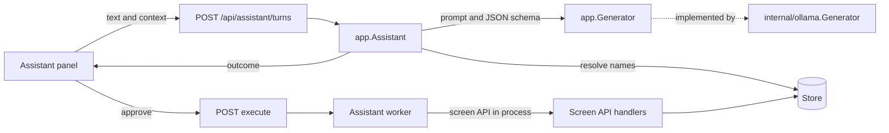
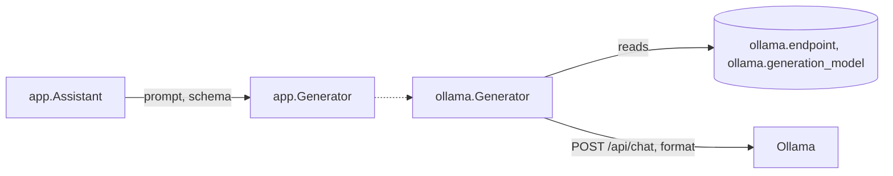
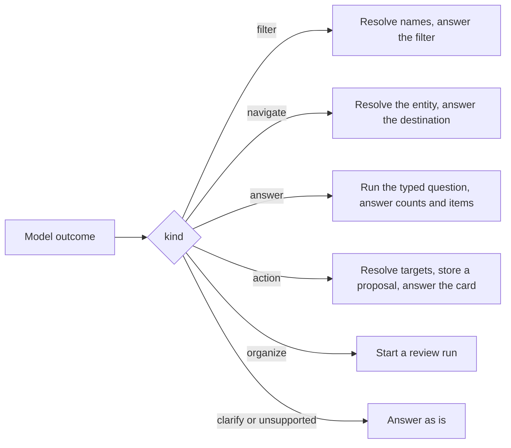
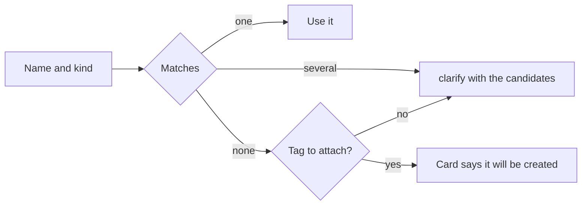
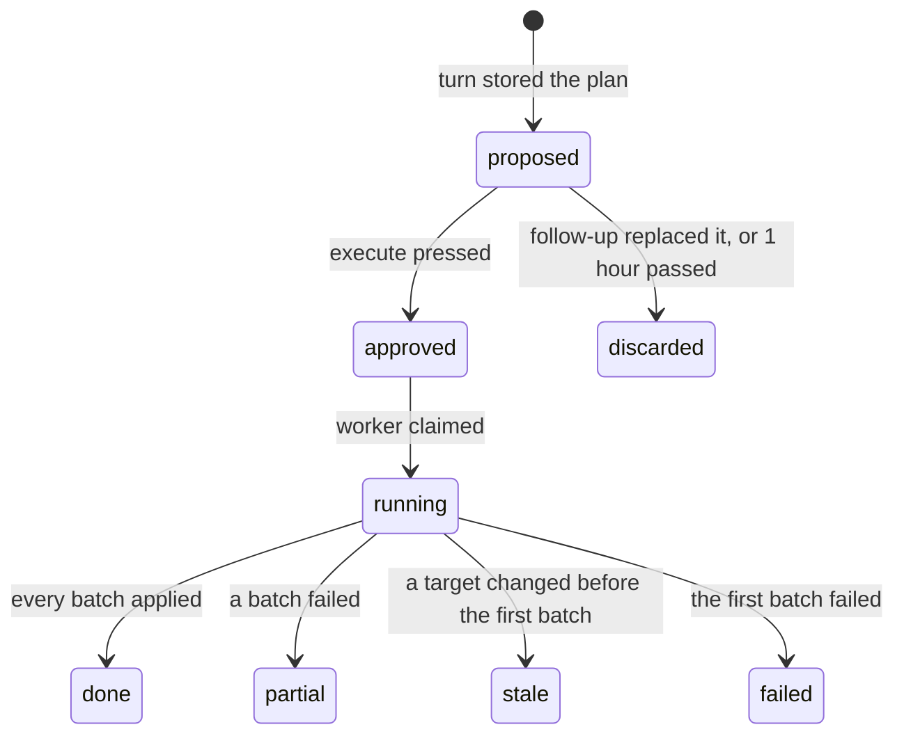
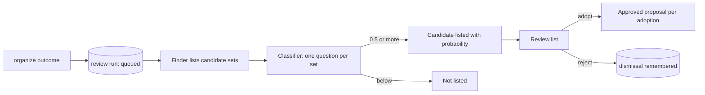
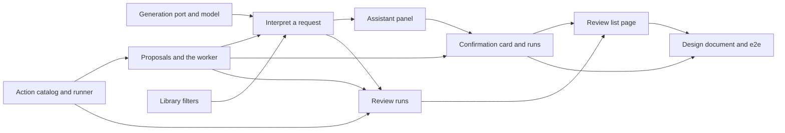

# Implementation Plan: In-app assistant over a local LLM

**Branch**: `feature/067-assistant` | **Parent Issue**: #1654

**Input**: The parent Issue. It is this feature's specification.

## Summary

The owner opens an assistant panel from any screen and types a request in
Japanese. The server sends the request, the screen's context and a fixed menu
of outcomes to the owner's own Ollama as one structured-output call, and the
model answers with one typed outcome: a library filter, a navigation, a
question the server answers from its own data, a write proposal, a review run,
a clarification, or "not supported". Names in the answer are resolved by the
server, never by the model. A filter and a navigation apply at once; a write
becomes a confirmation card whose approval executes exactly the stored plan
through the screen API's own operations, in batches, in a background worker; a
tidy-up request starts a review run whose candidates the owner adopts or
rejects from a list. Every executed proposal is one activity entry.

The diagram shows one request from the panel to its effect.



## Technical Context

**Canonical definitions**: [ARCHITECTURE.md](../../ARCHITECTURE.md) for
layers, store roles, viewer classification and events after commit;
[ai-layer.md](../../docs/design-docs/ai-layer.md) for the classifier port,
the Ollama provider and its connection settings;
[activity.md](../../docs/design-docs/activity.md) for activity entries;
[auto-tagging.md](../../docs/design-docs/auto-tagging.md) and
[duplicate-judging.md](../../docs/design-docs/duplicate-judging.md) for the
one-goroutine worker shape and the review of automatic decisions;
[bulk-editing.md](../../docs/design-docs/bulk-editing.md) and
[external-api.md](../../docs/how-to/external-api.md) for the operations over
a selection and the in-process call of the API mux that `/mcp` uses;
[catalog-organization.md](../../docs/design-docs/catalog-organization.md) for
search folding, smart folders and content keys;
[authentication.md](../../docs/design-docs/authentication.md) for the owner
and guest audiences; [api/openapi.yaml](../../api/openapi.yaml) for the
screen API; [design-system.md](../../docs/design-docs/design-system.md) for
the screens; [testing.md](../../docs/design-docs/testing.md) and
[web-testing.md](../../docs/design-docs/web-testing.md) for test levels.

**Feature-specific context**:

| Item | Delta |
| --- | --- |
| Second Ollama API | The feature calls Ollama's chat API with a JSON schema (`format`), which Ollama has offered since 0.5.0; the decision API stays for the classifier ([Generation port](#generation-port-and-model-setting)) |
| Latency budget | A turn waits for the model up to 10 minutes, as a classifier call does; the panel keeps the request alive while closed ([The screens](#the-screens)) |
| Screen context | A turn carries the route, the selected videos and the current filter, so `これ`, `選んだもの` and `ここ` resolve without the model seeing ids ([Names, context and clarification](#names-context-and-clarification)) |
| Catalog size | The screen API has 211 operations; the assistant offers 74 of them through a catalog checked against `api/openapi.yaml` ([contracts/assistant-actions.md](contracts/assistant-actions.md)) |
| New filters | `VideoQuery` and `SmartRule` gain duration, added-date and watch-state conditions, which no screen control sets today ([Library filters](#library-filters-the-assistant-can-set)) |

## Constitution Check

*GATE: Must pass before Phase 0 research. Re-check after Phase 1 design.*

| Rule | Source | Verdict |
| --- | --- | --- |
| Dependency direction | ARCHITECTURE.md | `app.Assistant` reaches the model through `app.Generator`, storage through `AssistantStore` and `AssistantVocabulary`, and the operations through `app.ActionRunner`; `internal/httpapi` implements the runner and `cmd/mdm` wires it ([Project Structure](#project-structure)) |
| The domain decides, the store enforces | ARCHITECTURE.md | The catalog, the outcome schema, the batch rule and the stale rule are in `internal/domain`; the proposal's status transitions are single `UPDATE`s guarded by the previous status ([Proposals and execution](#proposals-and-execution)) |
| Events after commit | ARCHITECTURE.md | `AssistantChanged` is published by the store after the transaction that changes a proposal or a review run |
| Every read knows its viewer | ARCHITECTURE.md | Every `/api/assistant/*` operation is owner-only in `api/openapi.yaml`, so the existing routing test keeps guests out; the runner calls operations as the owner ([Proposals and execution](#proposals-and-execution)) |
| User data survives a rebuild | ARCHITECTURE.md | Proposals and review rows name videos by user key and hold no foreign key to `videos`; the activity entry outlives the proposal row ([data-model.md](data-model.md)) |
| The server never sends a request to a URL from a request body | ai-layer.md | The generator reads the saved endpoint, and a proposal that saves the Ollama endpoint goes through the same settings operation and its check |
| Pages never call `fetch` | ARCHITECTURE.md, Web layer | `web/src/api/assistant.ts` is the only caller of the new operations |
| Complexity 25 and no copies | AGENTS.md | The runner is one table-driven call per catalog row; the three candidate finders share one judging loop |

No gate is at stake after Phase 1; `## Complexity Tracking` is left out.

## Generation port and model setting

A second task-agnostic port, `app.Generator`, takes a prompt and a JSON schema
and returns JSON that satisfies the schema; `internal/ollama.Generator`
implements it with `POST /api/chat`, `format` set to the schema and
`stream: false`, and reads the saved endpoint and a new generation model on
every call.

The diagram shows how a turn reaches the model.



| Decision | Rejected | Why |
| --- | --- | --- |
| A new port `app.Generator` (`Generate(ctx, domain.GenerationRequest) (json.RawMessage, error)`) beside `app.Classifier` | Extending the classifier port with a text answer | The classifier answers yes/no questions with probabilities; a plan is one structured value, and the two providers' limits and timeouts differ |
| Ollama's chat API with a JSON schema in `format`, one message, `stream: false`, `keep_alive` 10 minutes, a 10-minute timeout | Ollama tool calling (`tools`) | Tool calling depends on each model's template and leaves the model free to answer in prose; a schema in `format` is enforced by Ollama's grammar for any chat model |
| A separate setting `ollama.generation_model`, empty until the owner saves it, chosen in Settings, Connections, Ollama beside the decision model | Reusing `ollama.model` | The decision model (`clef-flash`) cannot chat, and a chat model cannot answer the decision API; requirement 2 asks for a model chosen for generation |
| `GET /api/settings/ollama/models` lists the model names at the saved endpoint for both pickers, and the field also accepts a typed name | A text field alone | Requirement 2 says the model is chosen; a typed name that is wrong is found only by the next request |
| The connection check also verifies the generation model when one is saved, with its own message | A separate check | The check already lists `/api/tags`; one more name to look for |
| `GET /api/assistant/readiness` answers whether a turn can run (`ollama_not_saved`, `generation_model_unset`), and the panel links to the Ollama section while it cannot | Trying a turn and reporting the failure | Acceptance 9 shows the guidance on opening the panel, before any request |
| A model that answers something the schema does not match is reported as `unreadable`, and the turn changes nothing | Retrying the call | A second call doubles a wait of minutes on a CPU host, and the Issue's edge case asks the owner to rephrase |

## Interpretation: one structured answer per turn

A turn is one generator call whose schema is the union of the outcome kinds
in [contracts/assistant-actions.md, Outcome schema](contracts/assistant-actions.md#outcome-schema);
the model emits one outcome with names and arguments, and the server turns it
into ids, counts and a card, so every number the owner sees comes from the
store.

The diagram shows what the server does with each outcome kind.



| Decision | Rejected | Why |
| --- | --- | --- |
| The model chooses from a catalog of operations with typed arguments, and anything else is the `unsupported` outcome | The model writes the HTTP request | A free request would reach the operations the Issue excludes; the catalog is the allow-list, and acceptance 11 needs an explicit refusal |
| The model emits no text the owner reads: the thread's sentences are composed by the screen from the typed outcome | The model phrases the reply | Requirement 6 forbids invented facts, and a phrased reply could restate a count wrongly; text from file names and work information can carry instructions, which then have no channel to the owner |
| A question (`answer`) is one of four typed queries, `count`, `appearances`, `recent` and `list`, each run by the server with the reads the screens use | A SQL or filter language for the model | The person page count and the library total come from `VideoQuery`, so acceptance 7 holds by construction |
| The prompt carries today's date, the context, the catalog with one line per operation, the previous outcome of the thread when the turn is a follow-up, and the request text marked as data | The vocabulary of the library in the prompt | A library has thousands of tags and people; on a CPU host each thousand names adds minutes to a turn |
| A follow-up turn sends the previous turn's outcome, and the model answers with a whole new outcome | A diff format | Requirement 11 replaces the previous proposal; the server re-resolves and re-stores it as a new proposal, and the old one is discarded |
| A turn's text is at most 500 characters | Unlimited | The same bound as a smart rule's query, and the prompt stays within small models' contexts |
| The schema is built once at startup from the catalog with `github.com/google/jsonschema-go`, already a dependency of `/mcp` | A hand-written schema file | Two copies of the catalog would drift |

## Names, context and clarification

The server resolves every name in an outcome with the existing folding
(width, case and kana), synonyms and aliases, and answers `clarify` with the
candidates when a name matches more than one entity or none, except a tag
name in an attach, which the card marks as "will be created".

The diagram shows the rule for one name.



| Decision | Rejected | Why |
| --- | --- | --- |
| A name carries the kind the model inferred (`person`, `organization`, `tag`, `tagKind`, `playlist`, `group`, `smartFolder`) or `any`; `any` tries person, organization and tag, and two kinds matching is a clarification | Always `any` | `出演作` names a person; the kind saves a clarification when the owner's wording already says it |
| `clarify` carries the candidates with ids, and the panel's choice is sent as a follow-up turn whose context pins the chosen id | Free-text answers to the clarification | The next turn would resolve the same name again |
| `これ` and `選んだもの` resolve to the selected videos of the list screen, or to the open video; `ここ` resolves to the current filter, group, smart folder, person or playlist; a target the context does not hold is a clarification | A target id guessed from the last turn | Requirement 5 names the current screen as the referent |
| The context is sent by the panel as the route kind and id, the selected video ids and the current filter, and the server adds the titles and names the prompt shows | The server reads the context from a session | The server does not know which tab asks |
| A target that expands to videos (a group, a smart folder, a filter) is counted on the server and the card shows the count; a selection over 20,000 videos is refused with `too_many_videos` as the bulk operations do | Sending the ids from the panel | The bulk operations already expand smart folders on the server, and the count on the card must be the server's |

## Library filters the assistant can set

`VideoQuery` and `SmartRule` gain `minDurationMs`, `maxDurationMs`,
`addedFrom`, `addedTo` and `watchState`, offered by `listVideos` and
`listLibrary`, shown in the library as removable chips and saved into a smart
folder by the existing save button
([contracts/assistant-api.md, Library filters](contracts/assistant-api.md#library-filters)).

| Decision | Rejected | Why |
| --- | --- | --- |
| Five new conditions, in `VideoQuery`, the library URL and `SmartRule` with the same names | Conditions the assistant keeps in memory | Acceptance 1 saves the filtered view as a smart folder, and a rule the folder cannot hold would be lost |
| Dates are calendar days (`YYYY-MM-DD`) compared against `added_at` in the server's local time zone | Timestamps from the browser | A smart folder rule is read on every machine the library is opened from, and the server's day is one value |
| `watchState` takes `unwatched`, `inProgress` or `watched`, derived from the playback position rows as the cards' `watchState` is | A separate watched flag | One rule for the chips, the cards and the filter |
| The new conditions count as filters for `ListsSmartFolders`, and `listFolderVideos` does not take them | Folder listings too | Folder listings take no tag or credit filter either |
| The library shows the new conditions as chips with a remove control and no picker; the assistant and the URL set them | Pickers for duration, dates and watch state | The Issue asks for natural-language filtering; the design stage draws the chips |
| The smart folder dialog shows the new conditions of a rule it edits as read-only chips with a remove control | Editing fields in the dialog | Same reason; the design stage draws them |

## Proposals and execution

A write outcome becomes a proposal row holding the resolved plan and the
labels the card showed; approval moves it to `approved` in one guarded
`UPDATE`, and the assistant worker executes it through the screen API's own
operations, in batches of 500 user keys, writing progress and the result to
the row and to one `assistant_run` activity entry
([data-model.md](data-model.md),
[contracts/assistant-api.md](contracts/assistant-api.md)).

The diagram shows a proposal's states.



| Decision | Rejected | Why |
| --- | --- | --- |
| Proposals live in SQLite (`assistant_proposals`), approved ones are executed by one goroutine, and the execute request returns at once with the row | Executing inside the execute request | Requirement 14 and the edge case: the run continues when the page is left, and a restart marks it interrupted like other workers |
| The worker executes each batch by calling the screen API handler of the catalog row in process, as the owner, through `app.ActionRunner` implemented in `internal/httpapi` | Store roles called from `internal/app` through one interface per operation | 74 operations with their validation, events and activity entries exist as handlers; `/mcp` already calls the API mux in process |
| `cmd/mdm` registers the runner on `app.Assistant` after building the HTTP server (`UseRunner`) | The runner passed to the constructor | The server is built with the assistant, so the runner exists only after it; `OllamaConnection.OnSaved` is the same shape |
| The row stores the resolved plan with the ids and the labels the card showed; the first batch re-reads them and ends the run `stale` when a video is gone or a named entity's label changed | Trusting the stored ids | The Issue's edge case: a rename or deletion between the card and the approval must not be executed as shown |
| `proposed` to `approved` is one `UPDATE ... WHERE status = 'proposed'`; a second press answers `409 proposal_not_pending` with the row | A lock in the panel | Two tabs can show the same card |
| A video-targeted operation runs in batches of 500 user keys, one operation call per batch; other operations are one call | One call of up to 20,000 ids | Requirement 14 asks for progress, and a batch that fails leaves the earlier ones applied with both counts shown |
| A batch that fails ends the run `partial` with the applied and failed counts; a video gone between batches counts as failed | Rolling back applied batches | The Issue's edge case keeps what succeeded, and the operations have no undo |
| A proposal not approved within 1 hour is deleted by the worker, and `proposed` rows are deleted at startup | Keeping them | Nothing can approve a proposal whose thread is gone |
| Every write of the catalog needs the card; `navigate`, `filter` and `answer` never write | A fast path for small writes | Requirement 8 |
| The card's irreversible mark comes from the catalog row (merges, deletions, dissolving, rejecting a tag, clearing the kind of tags) | The model marks it | The catalog knows; the model does not |

## Review runs

An `organize` outcome starts a review run of one kind, `tags`, `people` or
`works`; a finder lists candidate sets from the store, the run judges each set
through `app.Classifier` with one yes/no question, and the review list shows
the sets at or above 0.5 for the owner to adopt or reject together
([data-model.md, `assistant_review_runs`](data-model.md#assistant_review_runs),
[contracts/assistant-api.md, Review runs](contracts/assistant-api.md#review-runs)).

The diagram shows one run.



| Kind | Candidate set | Question to the classifier | Adoption |
| --- | --- | --- | --- |
| `tags` | Two tags whose folded names or synonyms are equal, or at distance 1 for names of 4 or more characters, among the 2,000 most used tags | Whether the two names, with their synonyms and 3 video titles each, name one concept | `mergeTag`, the more used tag as the destination |
| `people` | Two people with an equal folded name or alias, or one external id on the same site | Whether the two are one person, from names, aliases and 3 work titles each | `mergePeople`, the person with more credits as the destination |
| `works` | Ungrouped videos sharing a work code, or whose folded titles differ only in a trailing number or part marker | Whether the titles and folders are parts of one work | `createGroup` with the set, named by the common title |

| Decision | Rejected | Why |
| --- | --- | --- |
| Judging goes through `app.Classifier`, one question per set, with facts only | The generation model judges the pairs | A yes/no with a probability is what the classifier port and its batches already do, and the threshold is shown in the list |
| Sets at or above 0.5 are listed with their probability, most probable first; a set below is dropped and never adopted automatically | Adopting at or above 0.8 without the list | Requirement 13 puts every adoption in the owner's hands |
| A rejected set is remembered in `assistant_review_dismissals` by its members' ids and kind, and a later run of the kind skips it | Forgetting rejections | The next `タグを整理して` would list the same pair |
| A set whose member was deleted or merged after judging is left out when the list is read | Deleting the candidate row when the entity changes | The entities have no foreign key to the candidate, and a read-time check needs no trigger |
| One run of a kind at a time; a second `organize` of the same kind while one runs answers the running run | Queuing a second | Its candidates would repeat the first's |
| Adoption stores one approved proposal per request with the chosen sets, executed by the assistant worker like any other | Merging inside the adopt request | One path writes activity entries and progress |
| The runs and the review candidates are owner data in SQLite, and the panel shows the progress from `assistant` events | Progress in memory | The owner may leave and return (the Issue's edge case) |

## Activity and events

Every executed proposal is one `assistant_run` activity entry under a new
feature `assistant`, written by `AssistantStore` in the transactions that
change the proposal, with the request text as its label and the applied and
failed counts in its detail; the operations it calls write their own per-video
entries as today, decided by `owner`.

| Decision | Rejected | Why |
| --- | --- | --- |
| One entry per executed proposal, status `running` while the worker runs it and `done` with `completed`, `partial`, `stale` or `failed` | A new decider `assistant` on every per-video entry | The owner approved the write, so the decider is `owner`; favorites, playlists and visibility write no per-video entry, so the run entry is the record requirement 15 asks for |
| `AssistantChanged` is one more payload-free event, `assistant` on `/api/events`, for owner streams only | A payload with the proposal | Every other notification is re-read state |
| A review run writes no activity entry; its adoptions do | An entry per run | A run writes nothing until the owner adopts |

## The screens

The design stage (`ui-design.md`) draws the panel, the thread, the card,
the chips and the review list; the decisions below fix what they hold.

| Decision | Rejected | Why |
| --- | --- | --- |
| The panel is mounted at the app root, above the routes, so it opens on the shell screens and on the playback screen from a button in the top bar and in the playback header band, for the owner only | A panel inside `AppShell` | Requirement 1 says any screen, and the playback screen has no shell |
| The thread and the in-flight turn live in a root store (`web/src/assistant/`), so closing the panel or changing the route loses nothing; a reload loses the thread | The thread in SQLite | The Issue allows unapproved proposals to be discarded, and the runs that matter are in the store |
| The panel reads `GET /api/assistant/proposals?active=true` when it opens and shows the running and recently finished runs above the thread | Progress in the thread only | A reload keeps the running runs visible |
| A `filter` outcome navigates to the library URL with the conditions; a `navigate` outcome navigates to the route; both without confirmation | Showing the filter as a card | Requirement 7 |
| The confirmation card shows the operation, the targets with their count, the change, the "will be created" names and the irreversible mark, with one primary `Execute`; a follow-up replaces the card | Several buttons | The Issue's UI quality section |
| The review list is a page, `/assistant/reviews/:id`, with the progress, the sets with their two sides and probability, selection, `Adopt selected` and `Reject selected` | A list inside the panel | Up to thousands of sets need the width of a page |

## Project Structure

### Documentation (this feature)

```text
specs/067-assistant/
├── plan.md                        # This file
├── data-model.md                  # Proposals, review runs, candidates, dismissals, the setting and the new rule fields
├── quickstart.md                  # Checks with a real Ollama that the stub cannot prove
└── contracts/
    ├── assistant-api.md           # The screen API operations, the event and the filters this feature adds
    └── assistant-actions.md       # The outcome schema and the catalog of operations the assistant offers
```

`research.md` is not created: the decisions above name their alternatives.
`ui-design.md` is written by the design stage, since the parent carries `ui`.

### Source Code

**Affected boundaries**:

| Boundary | Change |
| --- | --- |
| `api/openapi.yaml` | `/api/assistant/*`, `/api/settings/ollama/models`, `generationModel` on `OllamaSettings`, the five filter parameters and rule fields, the `assistant` event, the `assistant` activity feature; `task generate` |
| `internal/domain` | `GenerationRequest`, the outcome types and schema, the action catalog, the proposal and its state rule, the batch and stale rules, the review kinds and finders' rules, the new `VideoQuery` and `SmartRule` fields, `ActivityAssistantRun` |
| `internal/app` | `Generator` port; `Assistant`: interpretation, name resolution, proposals, the worker, review runs; `OllamaConnection` reads and saves the generation model and lists models |
| `internal/ollama` | `Generator` over `POST /api/chat`; the model list and the generation model in `Check` |
| `internal/store` | `AssistantStore` role, migration `00081_assistant.sql`, the vocabulary lookups, the new filters in the video listing SQL, `AssistantChanged` after commit |
| `internal/httpapi` | `/api/assistant/*` handlers, the runner that calls handlers in process as the owner, the `assistant` event, the filter parameters |
| `cmd/mdm` | Wiring of the generator, the assistant, the runner and the worker; stop order with the other workers |
| `web/src/api` | `assistant.ts`, the `assistant` event, the filter criteria |
| `web/src/assistant` (new) | The root store, the panel, the thread, the card, the review page |
| `web/src/library`, `web/src/smartFolders`, `web/src/settings` | The chips for the new conditions, the rule fields, the generation model picker |
| `web/src/shell`, `web/src/player` | The panel's trigger |
| `docs/design-docs/assistant.md` (new), `ai-layer.md`, `activity.md`, `ARCHITECTURE.md`, `docs/how-to/running-vv.md` | The lasting decisions, the second port, the entry kind, the subsystem row and the owner's setup |

**New paths**: `internal/domain/assistant*.go`, `internal/app/assistant*.go`,
`internal/app/generator.go`, `internal/ollama/generator.go`,
`internal/store/assistant*.go`, `internal/store/migrations/00081_assistant.sql`,
`internal/httpapi/assistant*.go`, `web/src/api/assistant.ts`,
`web/src/assistant/`, `web/e2e/assistant.e2e.ts`,
`docs/design-docs/assistant.md`.

**Structure decision**: interpretation, proposals and the worker are one
use case in `internal/app` because they are the rules of the feature and
depend on no transport, while the runner is in `internal/httpapi` because the
operations it calls are handlers; the two meet through `app.ActionRunner`,
registered by `cmd/mdm`. `internal/ollama` gains a second type rather than a
new package because both read the same connection settings.

## Implementation Work

The diagram shows the units and what each one needs first.



### Generation port and the generation model in the Ollama connection

**Scope**: `app.Generator` and `domain.GenerationRequest`;
`internal/ollama.Generator` over `POST /api/chat` with `format`;
`ollama.generation_model` read and saved by `OllamaConnection`,
`generationModel` on `/api/settings/ollama`, the generation model in the
connection check, `GET /api/settings/ollama/models`,
`GET /api/assistant/readiness`; the model pickers in the Ollama section
([Generation port and model setting](#generation-port-and-model-setting),
[contracts/assistant-api.md, Ollama connection](contracts/assistant-api.md#ollama-connection)).

**Dependencies**: None

**Acceptance**:

- `task generate` leaves no diff; `task check SCOPE=go` passes for
  `./internal/domain/... ./internal/app/... ./internal/ollama/... ./internal/store/... ./internal/httpapi/...`
  and `task check SCOPE=web` for `src/settings`.
- Adapter tests with an `httptest` Ollama: the chat request carries the
  schema in `format` and `stream: false`; a reply whose content is not JSON,
  an `error` body and a timeout each map to their own error; the check names
  a missing generation model.
- Application tests with fakes: saving an empty generation model keeps the
  connection saved and readiness answers `generation_model_unset`; an
  unsaved connection answers `ollama_not_saved`.
- Settings page test: the Ollama section shows the two pickers with the
  listed names, keeps a typed name, and saves `generationModel`. The
  section changes, so the implementation owes a visual review.

### Duration, added date and watch state filters for the library and smart folders

**Scope**: The five conditions in `VideoQuery`, `SmartRule`, the listing SQL,
`listVideos`, `listLibrary`, the smart rule schema, the library URL and
criteria, the chips in the library, the rule fields in the save button and
the smart folder dialog
([Library filters](#library-filters-the-assistant-can-set),
[contracts/assistant-api.md, Library filters](contracts/assistant-api.md#library-filters)).

**Dependencies**: None

**Acceptance**:

- `task generate` leaves no diff; `task check SCOPE=go` passes for
  `./internal/domain/... ./internal/store/... ./internal/httpapi/...` and
  `task check SCOPE=web` for `src/library src/smartFolders src/api`.
- Domain tests: `ParseSmartRule` accepts the fields and rejects a negative
  duration, a day that does not parse, `addedTo` before `addedFrom` and an
  unknown watch state; `ListsSmartFolders` is false with any of them.
- Store tests (SQLite): one video per boundary for the duration and the day
  limits, and the three watch states from position rows; a smart folder's
  rule with the fields lists the same videos.
- Library page test: a URL with the conditions shows a chip per condition,
  removing one updates the URL, and the save button sends them in the rule.
  The library and the dialog change, so the implementation owes a visual
  review.

### Assistant action catalog and the in-process runner

**Scope**: `domain.AssistantCatalog` with the rows of
[contracts/assistant-actions.md, Catalog](contracts/assistant-actions.md#catalog),
each with its operation, arguments, target kind, batching and irreversible
mark; the exclusion list; a Go test that every owner write operation of
`api/openapi.yaml` is in one of the two lists; `app.ActionRunner` and its
implementation in `internal/httpapi`, which calls the operation's handler in
process as the owner and maps the response to a result or a typed failure
([Proposals and execution](#proposals-and-execution)).

**Dependencies**: None

**Acceptance**:

- `task check SCOPE=go` passes for `./internal/domain/... ./internal/httpapi/...`.
- Domain test: the coverage test fails when an operation is added to the
  table, shown by a temporary row removal reported in the PR.
- Adapter tests: a catalog row's call reaches its handler with the built
  body and the owner audience; a `404` and a `400` from the handler become
  typed failures carrying `code` and `reason`; a row whose operation is not
  in the catalog is refused before any call.

### Proposals: store, approval and the execution worker

**Scope**: Migration `00081_assistant.sql` for `assistant_proposals`;
`AssistantStore` with the guarded transitions and the `assistant_run` entry;
`domain.AssistantProposal`, the batch rule and the stale rule;
`app.Assistant.Propose`, `Approve`, the worker, the expiry and the startup
recovery; `AssistantChanged` and the `assistant` event;
`POST /api/assistant/proposals/{id}/execute`,
`GET /api/assistant/proposals/{id}`, `GET /api/assistant/proposals`
([Proposals and execution](#proposals-and-execution),
[Activity and events](#activity-and-events), [data-model.md](data-model.md),
[contracts/assistant-api.md, Proposals](contracts/assistant-api.md#proposals)).

**Dependencies**: Assistant action catalog and the in-process runner

**Acceptance**:

- `task generate` leaves no diff; `task check SCOPE=go` passes for
  `./internal/domain/... ./internal/app/... ./internal/store/... ./internal/httpapi/... ./cmd/mdm/...`.
- Domain tests: 1,200 user keys make batches of 500, 500 and 200; a changed
  label or a missing video makes the plan stale; the irreversible mark
  follows the catalog.
- Store tests (SQLite): the second `approved` transition answers not
  pending; the run entry is `running` after the claim and `done`/`partial`
  with both counts after a failed batch; a `proposed` row older than an hour
  is deleted; `AssistantChanged` is published after commit.
- Application tests with a fake runner: a run of three batches reports
  progress after each, stops at the first failed batch with the counts, and
  ends `stale` with zero calls when the first re-read differs.
- HTTP test: `execute` answers `202` with the row and the second press
  `409 proposal_not_pending`; guests get `403` through the routing test.

### Interpret a request into a typed outcome

**Scope**: The outcome types and the schema built from the catalog; the
prompt with the date, the context, the catalog and the previous outcome;
name resolution through `AssistantVocabulary` with folding, synonyms and
aliases; the context rules for `これ`, `選んだもの` and `ここ`; the typed
questions; `POST /api/assistant/turns` answering every outcome kind, storing
a proposal for `action` and discarding the previous one on a follow-up;
`organize` answers `unsupported` until the review unit lands
([Interpretation](#interpretation-one-structured-answer-per-turn),
[Names, context and clarification](#names-context-and-clarification),
[contracts/assistant-actions.md](contracts/assistant-actions.md),
[contracts/assistant-api.md, Turns](contracts/assistant-api.md#turns)).

**Dependencies**: Generation port and the generation model in the Ollama
connection; Proposals: store, approval and the execution worker; Duration,
added date and watch state filters for the library and smart folders

**Acceptance**:

- `task check SCOPE=go` passes for
  `./internal/domain/... ./internal/app/... ./internal/store/... ./internal/httpapi/...`.
- Domain tests: the schema accepts each outcome kind's example and rejects
  an operation outside the catalog; an outcome is rejected when it carries
  text fields the schema does not define.
- Application tests with a fake generator and a fake vocabulary: one tag
  match resolves; two matches answer `clarify` with both; no match on an
  attach marks the name as created and on a remove answers `clarify`; a
  `selection` target with nothing selected answers `clarify`; the `count`
  question answers the fake's total; a follow-up discards the previous
  proposal; a generator timeout answers `assistant_unavailable` with
  `timeout` and stores nothing; unreadable JSON answers `unreadable`.
- Store tests (SQLite): the vocabulary lookup folds width, case and kana and
  finds a tag by synonym and a person by alias.
- HTTP test: a turn answers the outcome shapes of the contract; a text over
  500 characters answers `400`.

### Assistant panel: input, thread and the outcomes that need no approval

**Scope**: `web/src/api/assistant.ts`; the root store with the thread and
the in-flight turn; the panel, its triggers in the top bar and the playback
header band, owner-only; the readiness guidance with the link to the Ollama
section; the thread rows for `filter` (navigates to the library URL),
`navigate`, `answer`, `clarify` (choices that send a follow-up), `unsupported`,
`unreadable` and the unavailable reasons; the follow-up that carries the
previous outcome; the context sent from the current route, selection and
filter ([The screens](#the-screens)).

**Dependencies**: Interpret a request into a typed outcome

**Acceptance**:

- `task check SCOPE=web` passes for `src/assistant src/shell src/player src/api src/library`.
- Page tests with a fake server: a guest session renders no trigger; an
  unready server shows the guidance with the settings link; a `filter`
  outcome changes the URL to the conditions; a `navigate` outcome changes
  the route; a `clarify` choice sends a second turn with the pinned id; a
  `count` answer shows the number and a link; closing the panel during a
  turn and reopening shows the answer; the context of a selection reaches
  the request body.
- The panel is a new screen part, so the implementation owes a visual
  review at 360 px, 768 px and 1280 px.

### Confirmation card, approval and run progress in the thread

**Scope**: The card from a `proposal` outcome with its targets, counts,
change, created names and irreversible mark; `Execute` calling the execute
operation, the not-pending and stale answers; the progress and result rows
from the `assistant` event and the proposal read; the active runs shown when
the panel opens ([Proposals and execution](#proposals-and-execution),
[The screens](#the-screens)).

**Dependencies**: Proposals: store, approval and the execution worker;
Assistant panel: input, thread and the outcomes that need no approval

**Acceptance**:

- `task check SCOPE=web` passes for `src/assistant src/api`.
- Component tests: the card shows the count, the change and the irreversible
  mark from the proposal; `Execute` is the only primary button; a created
  name is marked.
- Page tests with a fake server: pressing `Execute` twice sends one request
  and the second state comes from the `409` body; a follow-up replaces the
  card; an `assistant` event re-reads the proposal and the row shows the
  counts; a `stale` result shows the ask-again line; the active runs list
  renders on open.
- The card changes the panel, so the implementation owes a visual review.

### Review runs: candidate finders and the judging worker

**Scope**: `assistant_review_runs`, `assistant_review_candidates` and
`assistant_review_dismissals` in `00081_assistant.sql`; the three finders in
`AssistantStore` with their rules in `internal/domain`; the judging loop over
`app.Classifier` with the three questions; the `organize` outcome starting a
run; `GET /api/assistant/review-runs/{id}`, the adopt and reject operations
storing an approved proposal per adoption ([Review runs](#review-runs),
[contracts/assistant-api.md, Review runs](contracts/assistant-api.md#review-runs)).

**Dependencies**: Assistant action catalog and the in-process runner;
Proposals: store, approval and the execution worker; Interpret a request
into a typed outcome

**Acceptance**:

- `task generate` leaves no diff; `task check SCOPE=go` passes for
  `./internal/domain/... ./internal/app/... ./internal/store/... ./internal/httpapi/...`.
- Domain tests: the name distance rule lists `selfie`/`selfy` and not
  `cat`/`car`; a trailing part marker folds `title 1` and `title part 2` to
  one work key; the destination choice for tags and people.
- Store tests (SQLite): each finder's one positive and one negative pair; a
  dismissed pair is skipped by the next run; a candidate whose tag was
  merged is left out of the list.
- Application tests with a fake classifier: a run judges every set, lists
  0.5 and drops 0.49, counts progress per set, and answers the running run
  to a second `organize` of the kind; the adopt request stores one approved
  proposal with the chosen sets.

### Review list page

**Scope**: `/assistant/reviews/:id` with the progress, the sets, selection,
`Adopt selected` and `Reject selected`; the thread row for an `organize`
outcome with the progress and the link ([The screens](#the-screens)).

**Dependencies**: Confirmation card, approval and run progress in the
thread; Review runs: candidate finders and the judging worker

**Acceptance**:

- `task check SCOPE=web` passes for `src/assistant src/app src/api`.
- Page tests with a fake server: the progress line follows the `assistant`
  event; adopting two sets sends their ids and the row shows the resulting
  run; rejecting removes the sets from the list; the thread row links to the
  page.
- The page is new, so the implementation owes a visual review at 360 px,
  768 px and 1280 px.

### Design document, how-to and the end-to-end check with a stub Ollama

**Scope**: `docs/design-docs/assistant.md` with the lasting decisions of
this plan, the second port in `ai-layer.md`, the `assistant_run` kind in
`activity.md`, the subsystem row in `ARCHITECTURE.md`, the owner's setup in
`running-vv.md`; `web/e2e/assistant.e2e.ts` with a stub Ollama server the
test starts, saved as the connection through the API, answering fixed
outcomes for fixed texts; removal of `specs/067-assistant` is left to the
integration sweep.

**Dependencies**: Confirmation card, approval and run progress in the
thread; Review list page

**Acceptance**:

- `task check-docs` passes; `task check SCOPE=web` passes for `src/assistant`.
- `task test-e2e -- e2e/assistant.e2e.ts` passes locally and the manual CI
  run's `Browser E2E` job passes: a guest sees no trigger (acceptance 10),
  the unset model shows the guidance (9), the filter text narrows the
  library and the save button creates a smart folder (1), the attach text
  shows the card and no tag is attached until `Execute` (2, 3), the merge
  text shows the irreversible mark with the count (4).
