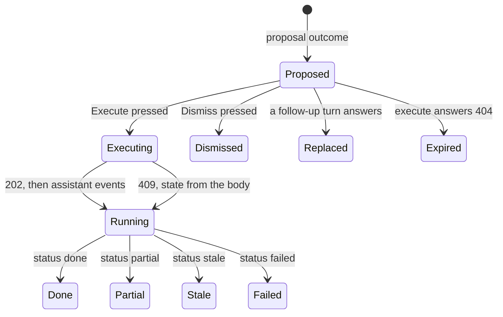
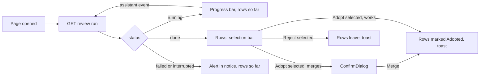

# UI design: In-app assistant over a local LLM

**Feature**: [parent Issue #1654](https://github.com/syudead/vv/issues/1654) ·
[plan.md](plan.md) ·
[plan.md, The screens](plan.md#the-screens) ·
[plan.md, Proposals and execution](plan.md#proposals-and-execution) ·
[contracts/assistant-api.md](contracts/assistant-api.md) ·
[contracts/assistant-actions.md](contracts/assistant-actions.md)

Sources that already decide things, linked rather than repeated here:

| Topic | Source |
| --- | --- |
| Tokens, closed scales, library density | [design-system.md, Foundations](../../docs/design-docs/design-system.md#foundations); the values in `@theme` of [`web/src/ui/tokens.css`](../../web/src/ui/tokens.css), named here and never copied |
| `Button`, `Textarea`, `Badge`, `Alert`, `Progress`, `Spinner`, `Skeleton`, `Tooltip`, `Combobox`, `Checkbox`, `Sonner`; disabled is `opacity-50` everywhere; one `default` button per area | [components.md](../../web/registry/rules/components.md), [patterns.md, Shared rules](../../web/registry/rules/patterns.md#shared-rules) |
| `AdminTablePage`, `DataTable`, `SelectionBar`, `ConfirmDialog`, `FormDialog`, the state blocks | [patterns.md](../../web/registry/rules/patterns.md) |
| The shell: the top bar, the rail from `sm`, the drawer below it, the bottom-right scan indicator; the window owns scrolling | [library-ui.md, Shell and toolbar](../../docs/design-docs/library-ui.md#shell-and-toolbar), [Scan entry and progress](../../docs/design-docs/library-ui.md#scan-entry-and-progress), [`AppShell.tsx`](../../web/src/shell/AppShell.tsx), [`TopBar.tsx`](../../web/src/shell/TopBar.tsx) |
| The video page's header band, outside the shell | [`VideoHeader.tsx`](../../web/src/player/VideoHeader.tsx), [patterns.md, Detail page](../../web/registry/rules/patterns.md#detail-page) |
| The library's `Filtering by` chips, the filter popover's count, `Save as smart folder` in the results header | [library-ui.md, Shell and toolbar](../../docs/design-docs/library-ui.md#shell-and-toolbar), [`ActiveTagFilters.tsx`](../../web/src/library/ActiveTagFilters.tsx), [`SaveSmartFolderButton.tsx`](../../web/src/smartFolders/SaveSmartFolderButton.tsx) |
| The smart folder dialog's `Conditions` fieldset and the condition chips on a smart folder page | [`ConditionsFields.tsx`](../../web/src/smartFolders/ConditionsFields.tsx), [`ConditionLines.tsx`](../../web/src/smartFolders/ConditionLines.tsx) |
| The Ollama section of Settings, Connections, and the locked-page notice | [`OllamaSection.tsx`](../../web/src/settings/OllamaSection.tsx), [`OllamaLockNotice.tsx`](../../web/src/settings/OllamaLockNotice.tsx), [patterns.md, Page notice](../../web/registry/rules/patterns.md#page-notice) |
| The duplicates review page: a list of machine judgements with their probability | [`DuplicatesPage.tsx`](../../web/src/versions/DuplicatesPage.tsx), [duplicate-judging.md](../../docs/design-docs/duplicate-judging.md) |
| Activity entries and the feature filter | [activity.md](../../docs/design-docs/activity.md), [`ActivityToolbar.tsx`](../../web/src/activity/ActivityToolbar.tsx) |
| Screen text | [`web/src/i18n/en.ts`](../../web/src/i18n/en.ts); this feature adds the words below |

This feature adds five things to the screen: the **assistant panel** with its
trigger, thread and composer (requirements 1, 2, 5 to 7, 11, 12); the
**confirmation card** and the run rows in the thread (requirements 8 to 10,
14); the **review list page** (requirement 13); the **chips for the five new
library conditions** in the library, the smart folder dialog and the smart
folder page (requirement 3); and the **generation model picker** in the
Ollama section (requirement 2). Activity gains one feature filter and one
entry kind (requirement 15). Lists, cards, the player and the admin pages
otherwise look and work as today.

## Why this shape

The panel is a column docked at the right edge of the viewport, under the
top bar, from `lg`; the page keeps every control and shrinks to the width
left. Below `lg` it is a layer over the right edge with no scrim, and below
`sm` it fills the width. A column that pushes the page is what comparable
products converged on for an assistant that acts on the screen beside it
(the Gemini side panel in Gmail and Docs, Copilot in VS Code, Notion AI): the
owner reads the card and the library it describes side by side (`UI品質`,
visual hierarchy). A floating window at the bottom right was rejected: it
covers the cards it talks about and competes with the scan indicator in the
same corner. A modal dialog was rejected: requirement 5 reads the screen the
owner is on, and a modal hides it. The panel is not a `Sheet`: the drawer's
scrim and its rule (the sidebar only) do not fit a non-modal column, so a
`SidePanel` pattern is added to the design system first
([Changes to the design system](#changes-to-the-design-system)).

The thread is a column of exchanges, each a request and its reply, with the
owner's text on a quiet fill at the right and the reply at the left on the
panel's surface. Bubbles on both sides were rejected: the replies are cards,
chips and links, not sentences, and a second fill around them would double
the frames. The exchange gap is wider than the gap inside one, so a reply is
read with its request (`UI品質`, information density).

The confirmation card puts the impact first: the count of what changes is the
largest text in the card, the change under it, and the targets as chips the
owner can check against the selection. `Execute` is the card's only filled
button; `Dismiss` is `ghost`. An irreversible card carries a `warning` line
that says it cannot be undone and its `Execute` is the `destructive` variant,
so colour and words agree and the card reads as "this one is different"
before the sentence is read (`UI品質`, confirmation card). A `ConfirmDialog`
on top of the card was rejected: the card is the confirmation, and a second
confirmation would train the owner to press through both.

A filter and a navigation apply at once (requirement 7), so the thread does
not draw them as cards: one line says what happened, with the conditions as
the same chips the library shows above the list, and a link back when the
owner has moved on. Below `lg` the panel closes itself after one of these two
outcomes, because the layer would cover the screen the outcome just changed;
the thread is kept and the trigger reopens it.

Questions answer with the number as the prominent text and a link to the
screen the number came from, so the owner can check it in one press
(requirement 6, acceptance criterion 7). Clarifications draw the candidates
as buttons, each with its count, because the next turn is a choice, not a
sentence; typing stays open for the owner who wants to rephrase instead.

Review candidates are a page, not panel rows: a run lists up to thousands of
sets with two sides and a probability, which needs a table's width and a
selection bar for bulk adoption. It is an `AdminTablePage` like the tags
admin, with the checkbox column and the selection bar's actions, so the
owner already knows how to select and act in bulk. Adopting tag or people
merges cannot be undone and the list has no card to say so, so `Adopt
selected` for those kinds opens the `ConfirmDialog` the admin merges open;
adopting works (a new group) runs at once.

The five new conditions are chips, not pickers: the assistant and the URL set
them, and the library's filter popover does not grow. In the smart folder
dialog the same chips appear read-only with a remove control inside the
`Conditions` fieldset, so a rule the assistant wrote can be edited by hand
except for those values, and saving keeps them.

The generation model is chosen in the same Ollama section as the decision
model, as a second `FormRow` under it, because requirement 2 says it is part
of the Ollama connection. Both rows become a `Combobox` that lists the models
at the saved endpoint and keeps a typed name, so a model Ollama has not
pulled yet can still be named.

## Words

`{n}` is a count, `{name}` an entity's name, `{title}` a video's title,
`{model}` a model name, `{reason}` a reason from `errors.reason`. Texts live
under `assistant`, `settings.ollama`, `library.activeTags`,
`smartFolders.condition` and `activity`.

### Panel, trigger and composer

| Place | Text | Notes |
| --- | --- | --- |
| Trigger, top bar and video header band | Assistant | `aria-label` and tooltip of the `ghost` `icon-sm` `Button`; `BotMessageSquare` icon |
| Trigger, while something runs and the panel is closed | Assistant · working | The tooltip; a `primary` dot at the icon's top-right corner as `SidebarMenuCount` draws one |
| Panel title | Assistant | `h2` `text-sm font-semibold` |
| Clear thread | Clear thread | `ghost` `icon-sm`, `Eraser`; tooltip and `aria-label`; absent while the thread is empty |
| Close | Close | `common.close`, `ghost` `icon-sm`, `X` |
| Composer field | Ask or tell the assistant… | `Textarea` placeholder; `aria-label` "Request" |
| Composer hint | Enter sends · Shift+Enter for a new line | `text-xs text-muted-foreground`, under the field, hidden below `sm` |
| Send | Send | `default` `icon-sm`, `SendHorizontal`; tooltip and `aria-label` |
| Context line, selection | Talking about {n} selected videos | `text-xs text-muted-foreground` above the field; `1 selected video` |
| Context line, a selection with collections | Talking about {n} selected items | Videos, groups and smart folders together |
| Context line, filtered library | Talking about the filtered library | |
| Context line, open video | Talking about “{title}” | |
| Context line, a collection or person page | Talking about {name} | Group, smart folder, playlist, person, organization, tag |
| Context line, elsewhere | Talking about this screen | Library without a filter, folders, settings, admin pages |
| Empty thread | Ask in Japanese: filter the library, open a page, change tags, or tidy up. Writes are shown for approval first. | `text-sm text-muted-foreground`, centred in the thread column; the three example lines under it are `outline` `sm` buttons that put their text into the field: `去年追加した30分以上の未視聴`, `〇〇の出演作は何本？`, `タグを整理して` |
| Recent runs heading | Recent runs | `text-xs font-medium text-muted-foreground` above the run rows the panel reads when it opens |
| Readiness, `ollama_not_saved` | The assistant needs Ollama / Save the Ollama URL in Settings, Connections, then choose a generation model. | `Alert` title / description, default variant, `Bot` icon |
| Readiness, `generation_model_unset` | Choose a model for the assistant / Pick a generation model in Settings, Connections. The decision model used for tagging can’t chat. | `Alert` title / description |
| Readiness action | Open Connections | `outline` `sm` `Button` as a link to `/settings/connections`, in `AlertAction` |
| Readiness read failed | Couldn’t check the assistant: {reason} | `destructive` `Alert` with `Retry` |

### Thread rows

| Place | Text | Notes |
| --- | --- | --- |
| Waiting | Asking the model… Loading it can take a few minutes. | `Spinner` before the text, `text-sm text-muted-foreground`, `role="status"` |
| Waiting, over one minute | Still waiting for the model. The request keeps running if you close the panel. | Replaces the line above after 60 seconds |
| `filter` | Filtered the library | Then the condition chips; `Show` (`link`) when the owner has left that URL |
| `filter`, save | Save as smart folder… | `link` `Button` after the chips; opens the smart folder dialog with the criteria |
| `navigate` | Opened {name} | `{name}` is the page's title; `Open` (`link`) when the owner has left it |
| `navigate`, `resume` | Resumed “{title}” | |
| `answer`, `count` | {n} videos | `text-lg font-semibold tabular-nums`; `1 video`; under it `Show in the library` (`link`) |
| `answer`, `appearances` | {n} videos with {name} | Same form; `Open {name}` (`link`) to the person or organization page |
| `answer`, `recent` | Recently watched | `text-xs font-medium text-muted-foreground`, then the titles as links, newest first |
| `answer`, `list` | {n} videos · showing the first {shown} | Then the titles as links; `Show in the library` (`link`) |
| `answer`, zero | No videos match | In place of the number |
| `review`, running | Looking for {kind}… Judged {judged} of {total} | `Spinner`, `Progress` with `max={total}`; `{kind}` is `duplicate tags`, `duplicate people` or `parts of one work` |
| `review`, done | {listed} candidates to review | `1 candidate`; `0`: `Nothing looked like a duplicate` |
| `review`, failed or interrupted | The review stopped: {reason} | `text-warning` with `TriangleAlert` |
| `review`, link | Open the review list | `outline` `sm` `Button` as a link to `/assistant/reviews/{id}` |
| `review`, already running | A review of {kind} is already running | Then the same progress and link |
| `clarify`, `about` `operation` | What should the assistant do? Say the action and what it applies to. | `text-sm` |
| `clarify`, `about` `target` | Which videos or items? Select them, open their page, or name them. | |
| `clarify`, `about` `value` | Which value? Say the name, tag or date to use. | |
| `clarify`, several matches | Which {kind} did you mean? | `{kind}`: `tag`, `person`, `organization`, `tag kind`, `playlist`, `group`, `smart folder`; then one `outline` `sm` `Button` per candidate: the name and its count in `text-muted-foreground tabular-nums` |
| `clarify`, no match | Couldn’t find “{name}”. Check the name, or say “new tag {name}” to create it. | The second sentence only for a tag |
| `clarify`, nothing selected | Nothing is selected. Select videos, or open the video or page you mean. | |
| `unsupported` | The assistant can’t do that. | `text-sm` |
| `unsupported`, known exclusion | The assistant can’t do that. {operation} is done on its own page. | `{operation}` from `assistant.excluded`: `Creating API tokens`, `Deleting a media folder`, `Deleting watch history`, `Changing the account`, `Changing plugins`, `Changing network settings`, `Downloading the face runtime`, `Onboarding` |
| `unreadable` | Couldn’t turn that into something to do. Try saying it another way. | |
| `assistant_unavailable`, `connection` | Couldn’t reach Ollama. Check the URL in Settings, Connections. | `destructive` `Alert`, `Open Connections` in `AlertAction` |
| `assistant_unavailable`, `model` | The generation model didn’t answer. Check that Ollama has “{model}”. | Same |
| `assistant_unavailable`, `timeout` | The model took too long. Try a shorter request, or a smaller model. | Same, without the action |
| `assistant_not_ready` | The composer is replaced by the readiness `Alert` of the table above | |
| `too_many_videos` | That is more than 20,000 videos. Narrow the selection or the filter. | `text-warning` |
| Request failed otherwise | Couldn’t ask the assistant: {reason} | `destructive` `Alert` |
| Replaced card | Replaced by the next request | `text-xs text-muted-foreground`, in place of the card |
| Dismissed card | Dismissed · nothing changed | Same |

### Confirmation card and runs

| Place | Text | Notes |
| --- | --- | --- |
| Title | {Operation sentence} | `text-sm font-medium`, from `assistant.operation`, one per catalog row id: `Add tags`, `Remove tags`, `Set work information`, `Make public`, `Make private`, `Add to favorites`, `Remove from favorites`, `Add to playlist “{name}”`, `Create group “{name}”`, `Merge tags into “{name}”`, `Merge people into “{name}”`, `Delete tag “{name}”`, `Rename tag to “{name}”`, `Create smart folder “{name}”`, `Change setting`, `Start a scan`, and the rest in the same form |
| Impact, videos | {n} videos | `text-lg font-semibold tabular-nums`; `1 video` |
| Impact, other targets | {n} tags · {n} people · {n} groups · {n} smart folders · 1 playlist | Same form, by `targets.kind` |
| Impact, no target | This setting | For settings and scan rows |
| Targets | The first 10 labels as `secondary` `Badge`s, then `+{n} more` in `text-xs text-muted-foreground` | Faces for people (`PersonFace` `chip`) |
| Change | {Argument}: {values} | `text-sm`; values as `secondary` `Badge`s, dates and numbers as text; one line per argument |
| Will be created | New | `outline` `Badge` with `Plus` before the name, inside the change line; `aria-label` `New tag {name}` |
| Irreversible | Can’t be undone | `warning` line: `TriangleAlert` `size-4` and `text-sm font-medium text-warning`, above the buttons |
| Irreversible detail, merges | {n} videos move to “{name}” | Under the line, `text-sm text-muted-foreground`; `{n}` is the proposal's `impact.videos`, not `targets.count`, which counts the one destination; `1 video moves` |
| Execute | Execute | `default` `sm` `Button`; `destructive` on an irreversible card; `Executing…` with a `Spinner` while the request runs |
| Dismiss | Dismiss | `ghost` `sm` |
| `approved`, `running` | Running · {applied} of {total} | `Spinner`, `Progress` with `max={total}`; for an unbatched operation `Running…` |
| `done` | Done · {applied} videos changed | `CircleCheck` `text-success`; `Done` alone for an unbatched operation |
| `partial` | {applied} changed · {failed} failed: {reason} | `warning` |
| `stale` | Something changed since this was proposed, so nothing was done. Ask again. | `warning` |
| `failed` | Failed: {reason} · nothing changed | `destructive` |
| `failed`, `interrupted` | Stopped by a restart. {applied} changed · ask again for the rest. | `warning` |
| Expired (`404` on execute) | This proposal expired. Ask again. | `warning`, buttons gone |
| Not pending (`409`) | The card takes the state of the proposal in the body | |
| Run row in `Recent runs` | The title and the state line of the card, one line each, without targets and change | |
| Activity link | Open in Activity | `link` `Button` at the end of a finished card, to `/activity/{activityId}` |

### Review list page

| Place | Text | Notes |
| --- | --- | --- |
| Document title and `h1` | Review: duplicate tags / Review: duplicate people / Review: parts of one work | By `run.kind` |
| Back | Assistant | `PageHeader` `leading`: a `link` that opens the panel |
| Request | “{request}” | `PageHeader` description, the owner's text that started the run |
| Progress, running | Judged {judged} of {total} · {listed} listed | `Progress` under the description, `tabular-nums` |
| Progress, done | {listed} of {total} candidates listed · {adopted} adopted · {rejected} rejected | `text-sm text-muted-foreground`; the last two only while non-zero |
| Failed | The review stopped: {reason} | `destructive` `Alert` in `notice`, with `Ask again` as a `link` that opens the panel |
| Interrupted | The review was stopped by a restart. Ask again to run it. | `warning` `Alert` in `notice` |
| Column, set | Candidates | `th`; for `tags` and `people`: `{name A}` ↔ `{name B}` with each count in `text-muted-foreground tabular-nums`; for `works`: the common title, then the member titles under it in `text-xs text-muted-foreground`, truncated |
| Column, probability | Confidence | `th`; `activity.percent`, `tabular-nums` |
| Column, state | | `success` `Badge` `Adopted`, `secondary` `Badge` `Rejected`; empty while `listed` |
| Column, result | | The adopted set's proposal state as the card's state line (`Running · 3 of 12`, `Done`, `Failed: …`) |
| Select all | Select all listed | The header `Checkbox`'s `aria-label` |
| Row check | Select {name A} and {name B} | `aria-label` |
| Selection bar | {n} selected · Clear selection · Adopt selected · Reject selected | `SelectionBar`; `Adopt selected` and `Reject selected` `ghost` `sm` |
| Adopt dialog, `tags` | Merge {n} tag pairs? / Each pair’s less used tag is merged into the more used one, and the videos move with it. This can’t be undone. / Merge / Cancel | `ConfirmDialog`; `1 tag pair` |
| Adopt dialog, `people` | Merge {n} people pairs? / Each pair’s person with fewer credits is merged into the other. This can’t be undone. / Merge / Cancel | |
| Adopted, `works` | Creating {n} groups | Toast, 2.8 seconds; no dialog |
| Adopted, merges | Merging {n} pairs | Toast after the dialog closes |
| Rejected | Rejected {n} candidates. They won’t be listed again. | Toast |
| Adopt or reject failed | Couldn’t adopt: {reason} / Couldn’t reject: {reason} | `destructive` `Alert` in the dialog, or an `ErrorState` row under the selection bar for `works` and rejects |
| Skipped | {n} candidates were skipped because a tag or person changed | Toast after a partial answer |
| Empty, done | No candidates / Nothing looked like a duplicate. Candidates you rejected before aren’t listed. | `EmptyState`, `ListChecks` icon |
| Empty, running | Looking for candidates… | `LoadingState` `table` rows with the progress above |
| Not found | This review isn’t here any more. | `ErrorState` without `Retry`, with `Assistant` as a `link` |

### Library conditions

| Place | Text | Notes |
| --- | --- | --- |
| Duration chip, both bounds | {min}–{max} | `Clock`; durations as `formatDuration` rounded to minutes: `10 min–30 min`, `1 h–2 h 30 min` |
| Duration chip, lower bound | {min} or longer | `30 min or longer` |
| Duration chip, upper bound | Up to {max} | |
| Added chip, both | Added {from}–{to} | `CalendarPlus`; days as `formatDate` |
| Added chip, from | Added since {from} | |
| Added chip, to | Added until {to} | |
| Watch chip | Unwatched / In progress / Watched | `Eye`, `CircleDotDashed`, `EyeOff`; `In progress` and `Watched` reuse `list.filter.watchOptions` |
| Remove | Remove the duration filter / Remove the added-date filter / Remove the watch filter | `aria-label` and `title` of each chip |
| Dialog chips row legend | Set by the assistant | `FieldLabel` above the read-only chips in `Conditions`; description "Remove a chip to drop that condition. The assistant can set it again." |
| Dialog invalid | A duration or date here is out of order | `FieldError`, for `invalid_smart_rule` on these fields |
| Smart folder page condition lines | The same chip texts as `NamedChip`s | |

### Settings and activity

| Place | Text | Notes |
| --- | --- | --- |
| Ollama section description | Where VVMDM reaches Ollama and which models it uses. The decision model answers auto-tagging and duplicate judging; the generation model answers the assistant. | Replaces the current description |
| Decision model row | Decision model / clef-flash is fast; clef is larger and more accurate. | Renames `Model`; a `Combobox` listing the models at the URL, with the typed name kept |
| Generation model row | Generation model / A chat model the assistant uses to read your requests, such as a Japanese-capable instruct model. Leave empty to turn the assistant off. | `Combobox`, same list; empty allowed |
| Model list loading | Loading the models… | The `Command` list's first row while the request runs |
| Model list unavailable | Couldn’t list the models: {reason}. Type the name. | The list's one row; `errors.reason.ollama_unreachable` |
| Picker, typed name | Use “{name}” | The create row of the `Command`, when the typed text is not listed |
| Check, generation model missing | Ollama is running but doesn’t have the generation model “{model}”. | `check.failed` message for `generation_model_missing` |
| Check ok, both | Ollama is running and has both models. | Replaces `checkOk` when a generation model is saved |
| Activity feature filter | Assistant | `activity.feature.assistant`, after the existing features |
| Activity entry kind | Assistant run | `activity.kind.assistant_run`; the label is the request text, the detail the operation sentence and `{applied} changed · {failed} failed` |

## Changes to the design system

Added by the "Assistant panel: input, thread and the outcomes that need no
approval" unit before the panel uses it; the other units need nothing new.

| Change | What it is |
| --- | --- |
| `SidePanel` | A page pattern, item `side-panel`: a column at the viewport's right edge under the top bar, the named step `assistant-panel` wide, on `card` with a `border-l`, holding a `header` row (title and `ghost` `icon-sm` actions, `h-navbar` high with a `border-b`), a scrolling `body`, and a `footer` that stays at the bottom. From `lg` it is in the page's flow and the page shrinks by its width; the window keeps scrolling the page and only the panel's `body` scrolls itself. Below `lg` it is `fixed` over the page's right edge with `shadow-elevated` and `z-30` (under the top bar and the sidebar drawer, above the selection bar), with no scrim, and the page behind it stays scrollable and pressable; below `sm` it is `inset-x-0`. It opens with `animate-slide-up` below `lg` and without motion from `lg`. `Esc` with the focus inside closes it. Documented in [patterns.md](../../web/registry/rules/patterns.md) with its example block `side-panel-example` |
| `assistant-panel` | A named step in `tokens.css`: the panel's width, chosen so that at 1280px the library beside it keeps three `card-0` columns, and so that a card's `Execute` and `Dismiss` fit one line with its impact text at `text-lg` |
| `AppShell` and `DetailPage` `panel` slot | The shell's content row and the detail page's row take one `SidePanel` after their content, so the panel sits beside the shell pages and beside the video page the same way |

No colour token is added and nothing is added to `pairs` in
`web/src/theme/tokens.test.ts`: the card uses `card`, `secondary`,
`warning`, `destructive` and `success` through the components that already
pair them. The icons are lucide `BotMessageSquare`, `SendHorizontal`,
`Eraser`, `Bot`, `TriangleAlert`, `CircleCheck`, `Plus`, `ListChecks`,
`Clock`, `CalendarPlus`, `Eye`, `EyeOff` and `CircleDotDashed`.

## Assistant panel

The trigger is a `ghost` `icon-sm` `Button` at the right end of the top bar,
after the library tools slot, and in the video page's header band before
`Close`, for the owner only; a guest's top bar and band do not draw it
(acceptance criterion 10). Pressing it toggles the panel; the panel keeps
its open state across routes, including from a shell page to the video page
and back, and the thread lives in the root store, so closing the panel or
changing the route loses nothing ([plan.md, The screens](plan.md#the-screens)).

The panel is one `SidePanel`: the header with `Assistant`, `Clear thread`
and `Close`; the body with `Recent runs`, then the thread; the footer with
the context line, the `Textarea` and `Send`, or the readiness `Alert` in
their place.

The diagram shows the panel's states and what moves between them.

```mermaid
stateDiagram-v2
  [*] --> Closed
  Closed --> Checking: trigger pressed
  Checking --> NotReady: readiness false
  Checking --> Ready: readiness true
  NotReady --> Ready: readiness true after a settings event
  Ready --> Waiting: Send
  Waiting --> Ready: outcome or error row added
  Ready --> Closed: Close, Esc, or a filter or navigate outcome below lg
  Waiting --> Closed: Close or Esc; the turn keeps running
  Closed --> Ready: trigger pressed, thread kept
```

| State | What the panel shows |
| --- | --- |
| Checking | The header; the body with `Skeleton` rows for two exchanges; the footer's field `aria-disabled` |
| Not ready | The thread as it is (empty on first open) and the readiness `Alert` in the footer with `Open Connections`; no field |
| Ready, empty thread | The empty-thread text and its three example buttons centred in the body; the field focused when the panel opened by a press |
| Ready, with exchanges | The exchanges, newest at the bottom, scrolled to the end when a row is added; the field focused |
| Waiting | The request row, then the waiting row with its `Spinner`; `Send` `aria-disabled`, the field editable; after 60 seconds the second waiting text |
| Waiting, panel closed | The trigger's dot and `Assistant · working` tooltip; on reopening, the reply is there when it has come (plan, acceptance of the panel unit) |
| Recent runs | Above the thread while `GET /api/assistant/proposals?active=true` holds rows: the heading and one compact run row per proposal, newest first, each updating on the `assistant` event; the block leaves when the last run is older than an hour |
| Readiness read failed | The `destructive` `Alert` with `Retry` in the footer |

### Thread

An exchange is the request row and the reply rows under it, `gap-2` apart,
and exchanges are `gap-4` apart, so the pair reads as one (`UI品質`,
information density). The request row is the owner's text in `text-sm` on
`secondary` with `rounded-lg` and `px-3 py-2`, at the right, at most `max-w-5/6` of the
column, wrapping in full. Reply rows sit at the left on the panel's surface
with no fill, except the card.

| Reply | Row |
| --- | --- |
| `filter` | `Filtered the library`, then the condition chips in the `Filtering by` row's form (`Toggle` `outline` `sm` pressed, without the `×`), then `Save as smart folder…`; when the owner has left that URL, `Show` after the text |
| `navigate` | `Opened {name}`; `Open` when the owner has left the page |
| `answer` | The number line in `text-lg font-semibold`, the link under it; `recent` and `list` as a column of title links `text-sm` truncated at the column width, at most 20 |
| `proposal` | The [confirmation card](#confirmation-card) |
| `review` | The progress row, then `Open the review list` |
| `clarify` | The question, then the candidate buttons wrapped `gap-2`; pressing one sends a follow-up turn with the id pinned and shows it as the next request row (`{name}` as the owner's text) |
| `unsupported`, `unreadable`, `too_many_videos`, the `503`s | The one line, or the `Alert`, from [Words](#words) |

A follow-up replaces the previous reply's card: the old card's row shrinks
to `Replaced by the next request` and the new card appears under the new
request (requirement 11, acceptance criterion 5). A reply other than a card
stays as it was. `Clear thread` empties the thread and keeps `Recent runs`.

The composer's `Textarea` grows with its text up to four lines, then scrolls.
`Enter` sends unless an IME composition is being confirmed, as the library
search field treats it; `Shift+Enter` adds a line. `Send` is `aria-disabled`
while the field is empty, over 500 characters (the hint turns
`text-destructive` with `{n} / 500`), or a turn is in flight. The context
line names what `これ`, `選んだもの` and `ここ` will mean, from the current
route, selection and filter, and changes as they change, so the owner sees
what the request is about before sending it (requirement 5).

## Confirmation card

The card is a `card` surface with a `border` and `rounded-lg`, `p-3`, in the
reply column, as wide as the column. Its rows, top to bottom, `gap-2` apart:

| Row | Content |
| --- | --- |
| Title | The operation sentence, `text-sm font-medium` |
| Impact | The count in `text-lg font-semibold tabular-nums`; the largest text in the panel |
| Targets | The labels as `secondary` `Badge`s wrapping `gap-1`, people with their face, then `+{n} more`; absent for a settings row |
| Change | One line per argument: the argument's name in `text-muted-foreground`, then the values as `secondary` `Badge`s; a name to create carries the `New` mark before it |
| Irreversible | The `warning` line, only on an irreversible row; merges add the moving count under it |
| Actions | `Execute`, then `Dismiss`, in one line at the right; while `proposed` only |
| State | The run's state line in place of the actions from `approved` on; `Open in Activity` after a finished state |

The diagram shows what the card does.

| State | What the card shows |
| --- | --- |
| `proposed` | Every row; `Execute` live; a second press during the request does nothing, because the button is `aria-disabled` with `Executing…` |
| `approved`, `running` | The actions replaced by `Running · {applied} of {total}` with the `Progress`; the rows above unchanged, so the owner still sees what runs |
| `done` | `Done · {applied} videos changed` in `text-success`; `Open in Activity` |
| `partial` | The `warning` line with both counts and the reason; `Open in Activity` |
| `stale` | The `warning` sentence; the targets row keeps the labels the card showed, so the owner can see what was named |
| `failed` | The `destructive` line with the reason |
| Dismissed | The card collapses to `Dismissed · nothing changed`; nothing is sent (acceptance criterion 3) |
| Replaced | `Replaced by the next request` |
| Expired | The `warning` sentence; the rows above kept |

A card for a `batchTags`, `deleteCollections` or `named` target with several
names lists each name as a label, so acceptance criterion 4's merge card
shows `Can’t be undone`, the source and destination tags as labels and the
moving count. A card for an attach with a name that resolved to nothing
shows the tag with `New` (requirement 12).

## Review list page

`/assistant/reviews/:id` is an `AdminTablePage` inside the shell: the
header with the title, `Assistant` as its leading link and the request as
its description; the progress line or `Progress` under the header; the
`DataTable` with the checkbox column, `Candidates`, `Confidence`, the state
and the result; and the `SelectionBar` in place of the header while rows are
selected. Rows are most probable first, 100 per page, loading more at the
end as the tags admin does.

The diagram shows a run on the page.

| State | What the page shows |
| --- | --- |
| Running | The `Progress` under the header counting `judged` of `total`; the rows listed so far, selectable; a `Spinner` row at the end of the table while `judged < total` |
| Done, with candidates | The count line; the rows; the header checkbox selects every `listed` row on the page |
| Done, none | The `EmptyState` in the body |
| Failed, interrupted | The `Alert` in `notice`; the rows judged so far stay usable |
| Adopting | The dialog `pending`; afterwards the chosen rows show `Adopted` and their result column follows the proposals on `assistant` events |
| Rejecting | The rows leave the table on the answer; the count line's `rejected` grows |
| Skipped by the answer | The toast; the skipped rows leave on the next read |
| Not found | The `ErrorState` in the body |
| Guest | The route answers `403`, so the page is not reachable; the sidebar never links it |

A row's main cell for `tags` and `people` holds the two names in `text-sm`
with `↔` between them in `text-muted-foreground`, each followed by its count
in `text-xs tabular-nums text-muted-foreground`; the more used side, the
destination of the merge, is `font-medium`, so the owner reads which name
survives without a legend. A `works` row holds the common title in `text-sm`
and the member titles joined by ` · ` under it in `text-xs
text-muted-foreground`, truncated at the cell. Candidates whose member was
deleted or merged are not sent by the server, so a row never names an
entity that is gone.

## Library conditions as chips

The five conditions appear in the library's `Filtering by` row after the
tag, kind, person and organization chips, in the order duration, added date,
watch state, in the same `Toggle` form with their icon and `×`; removing one
updates the URL as removing a tag does. The filter button's count counts each
of them as one applied condition and `Clear filters` clears them with the
rest. The filter popover does not show them. While any applies, the results
header shows `Save as smart folder` as it does for a tag, and the dialog it
opens shows them in the `Conditions` fieldset.

| Place | Chips |
| --- | --- |
| Library `Filtering by` row | `Toggle` `outline` `sm` pressed with the icon, the text and `×` |
| Thread `filter` row | The same, without `×` |
| Smart folder dialog, `Conditions` | Under the person and organization fields: the `Set by the assistant` label, then `outline` `Badge`s with the text and a `ghost` `icon-sm` `×` inside, as the tag chips in the tag field; removing one drops the field from the rule; the row is absent while the rule has none of the five |
| Smart folder page condition lines, smart folder card | The texts as `NamedChip`s after the existing chips |

A duration is shown in minutes and hours as `formatDuration` draws it; a
day as `formatDate`. A rule the server rejects for these fields shows the
`FieldError` under the row and keeps the dialog open.

## Settings: generation model

The Ollama section keeps its `Ollama URL` row and gains the second model row
under the first; both model rows are a `Combobox` `sm:w-3xs lg:w-sm` whose
list is read from `GET /api/settings/ollama/models` when the popover opens,
with `Use “{name}”` as the create row for a typed name. `Save` and `Save and
test connection` keep their places; the check's result line names the
missing generation model when that is what failed.

| State | What the section shows |
| --- | --- |
| No generation model | The row's trigger shows the placeholder `None` in `text-muted-foreground` |
| List loading | The `Command` list's one row `Loading the models…` with a `Spinner` |
| List unavailable | The one row `Couldn’t list the models: {reason}. Type the name.`; the typed name still saves |
| Check, generation model missing | The `CircleAlert` line with the message |
| Check ok | `Ollama is running and has both models.` when both are saved |

## Entry points

| Entry | Goes to | What the owner sees on arrival |
| --- | --- | --- |
| Trigger in the top bar or the video header band | The panel | The thread as left, or the empty thread; the readiness `Alert` when not ready |
| Readiness `Open Connections`, the `503` `Open Connections` | `/settings/connections` | The Ollama section with the generation model row |
| Thread `review` row, `Open the review list` | `/assistant/reviews/{id}` | The page with the progress or the rows |
| Activity entry of kind `assistant_run` | `/activity/{id}` | The record page with the request as its title |
| Card, `Open in Activity` | `/activity/{id}` | Same |
| Review page, `Assistant` leading link | The panel opens on the page | The thread, with the `review` row |

## Responsive behaviour

Breakpoints are Tailwind's defaults only, applied in CSS
([library-ui.md, Width breakpoints](../../docs/design-docs/library-ui.md#width-breakpoints-in-css-and-the-sidebar-exception));
`sm` is 640px, `md` 768px, `lg` 1024px. The widths judged are 360px, 768px
and 1280px.

| Width | Layout |
| --- | --- |
| 1280px | Panel: docked at the right, the library beside it keeps three `card-0` columns and its toolbar in the top bar unchanged; the card's `Execute` and `Dismiss` on one line with the impact above. Review page: the `max-w-4xl` column with all four columns on one line; the selection bar in the header's place. Dialog: the chips row under the credit fields inside `max-w-lg` |
| 768px | Panel: a layer over the right edge, `assistant-panel` wide, the page visible and pressable to its left; a `filter` or `navigate` outcome closes it; the card as at 1280px. Review page: the result column folds under the state in the same cell. Library: the chips wrap to a second line with the tag chips |
| 360px | Panel: fills the width under the top bar; the composer hint hidden; the candidate buttons and the condition chips wrap; the card's `Execute` and `Dismiss` stay on one line at the right. Review page: the `Confidence` column stays, the result folds under the state; the selection bar wraps its actions to a second line. Dialog: the chips wrap; each `×` keeps its `icon-sm` hit area |

## Review criteria

Judged by looking at the real screens with a real Ollama
([quickstart.md](quickstart.md)) and with the stub of the e2e test
([library-ui.md, Layout verified by people, not machines](../../docs/design-docs/library-ui.md#layout-verified-by-people-not-machines)),
at the widths above, as the owner and as a guest. "It exists" alone does not
satisfy a criterion (Q-4).

1. **Visual hierarchy, panel**: with the panel open on the library at
   1280px, the library's cards and toolbar are unchanged in size and the
   panel reads as a side column, not a window: one `border-l`, no shadow, no
   title larger than `text-sm`. Nothing in the panel is `text-lg` but the
   number of an answer and the impact of a card (`UI品質`, visual
   hierarchy).
2. **Confirmation card**: on the card for `これに〇〇タグを付けて` over three
   selected videos, the eye lands on `3 videos` first, then `Add tags` and
   the tag chip, then `Execute`; `Execute` is the only filled button in the
   panel and `Dismiss` is `ghost`. No tag is attached until `Execute`
   (acceptance criterion 2) and `Dismiss` leaves `Dismissed · nothing
   changed` (3).
3. **Irreversible card**: the card for a tag merge shows `Can’t be undone`
   in `warning` with its icon above the buttons, the moving count under it,
   and `Execute` in `destructive`; at arm's length it is told from an attach
   card by colour alone (acceptance criterion 4; `UI品質`, confirmation
   card).
4. **Information density, thread**: after three exchanges, each request is
   told from the next by the wider gap and the right-aligned fill; a reply's
   chips, links and card sit under their request and never under the next;
   the thread scrolls inside the panel and the composer stays at the bottom
   (`UI品質`, information density).
5. **Spacing rhythm and typography**: the panel's header is `h-navbar` high
   and lines up with the top bar's bottom edge; rows inside a card are
   `gap-2`, exchanges `gap-4`, chips `gap-1`; the composer's `Textarea` and
   `Send` share the library's `h-8` density; every text is `text-xs`,
   `text-sm` or `text-lg`, and the only `font-semibold` is a number
   (`UI品質`, typography and spacing).
6. **Follow-up**: after an attach card over ten videos, `長いのは除いて`
   replaces it: the old card shrinks to one muted line, the new card under
   the new request shows a lower count, and only one `Execute` is on screen
   (acceptance criterion 5).
7. **Clarification**: with two tags near the same name, the reply is the
   question and two buttons with the names and counts, nothing is executed,
   and pressing one shows the card (acceptance criterion 6). A name with no
   match says so and, for a tag, how to create it.
8. **Answers**: `〇〇の出演作は何本？` shows the number in `text-lg` with
   `Open {name}` under it, and the person page's count is the same number
   (acceptance criterion 7).
9. **Filter and smart folder**: `去年追加した30分以上の未視聴` changes the
   library's URL, the `Filtering by` row shows `Added {from}–{to}`, `30 min
   or longer` and `Unwatched` as chips beside any tag chips, `Save as smart
   folder` stands in the results header, and the dialog it opens lists the
   three under `Set by the assistant`; saving creates the folder (acceptance
   criterion 1). Removing a chip in the row updates the URL.
10. **Waiting**: pressing `Send` shows the request and the waiting row with
    the `Spinner` at once; after a minute the second sentence; closing the
    panel shows the dot on the trigger and reopening after the reply shows
    it in place (`UI品質`, waiting).
11. **Review run**: `タグを整理して` shows the progress row counting up and
    `Open the review list`; the page lists the pairs most probable first
    with the surviving name in `font-medium`; selecting two and `Adopt
    selected` opens the merge dialog, `Merge` marks them `Adopted` and their
    result column reaches `Done`; `Reject selected` removes rows with a toast
    (acceptance criterion 8).
12. **Readiness and guests**: with no generation model saved, opening the
    panel shows the `Alert` with `Open Connections` in the composer's place
    and no field (acceptance criterion 9); its link lands on the Ollama
    section where the `Generation model` row's trigger reads `None`. Signed
    in as a guest, neither the top bar nor the video header band has the
    trigger (10).
13. **Unsupported**: `APIトークンを作って` answers `The assistant can’t do
    that. Creating API tokens is done on its own page.` with nothing
    executed (acceptance criterion 11).
14. **Runs and activity**: after `Execute` over 1,200 videos, the card shows
    `Running · 500 of 1,200`, then `1,000`, then `Done · 1,200 videos
    changed`; reloading the page and opening the panel shows the run under
    `Recent runs`; `Open in Activity` lands on an entry filtered under
    `Assistant` (acceptance criterion 12; requirement 14).
15. **Narrow width**: at 360px the panel fills the width under the top bar,
    the card's buttons stay at `h-8`, the candidate buttons wrap without
    truncating names shorter than the column, and the review page's rows
    show both names and the confidence on one line each; at 768px the panel
    layer leaves the library pressable beside it and closes after a filter.
16. **Examples that do not meet the requirement** (`UI品質`): a floating
    chat window at the bottom right; a modal dialog for the thread; replies
    in bubbles; a card whose title is larger than its count; two filled
    buttons on a card; an irreversible card told only by a sentence; a
    `ConfirmDialog` on top of a card; a count in the thread that the panel
    computed itself; a filter outcome drawn as a card to approve; duration
    and date pickers added to the filter popover; the review list inside the
    panel.

## Accessibility

The parent Issue does not ask for screen-reader or contrast design, so only
names and roles are decided.

- The panel is a `complementary` region named `Assistant`; its trigger is
  `aria-expanded` with `aria-controls` on the panel; opening by a press moves
  the focus to the field, and closing returns it to the trigger.
- The thread is a `log` region with `aria-live="polite"`, so a reply read
  aloud does not interrupt typing; the waiting row is `role="status"`.
- The card's `Execute` is named `Execute {operation sentence}` through
  `aria-describedby` on the impact line, so the count is read with the
  button; the irreversible line is part of that description.
- The review page's `DataTable` keeps the tags admin's row names and its
  header checkbox's `aria-label`; the probability cell carries `Confidence
  {percent}` as its text.
- A condition chip's `×` keeps the `Filtering by` row's `aria-label` form,
  and the dialog's read-only chips are named by their text with the `×`
  named `Remove {text}`.
