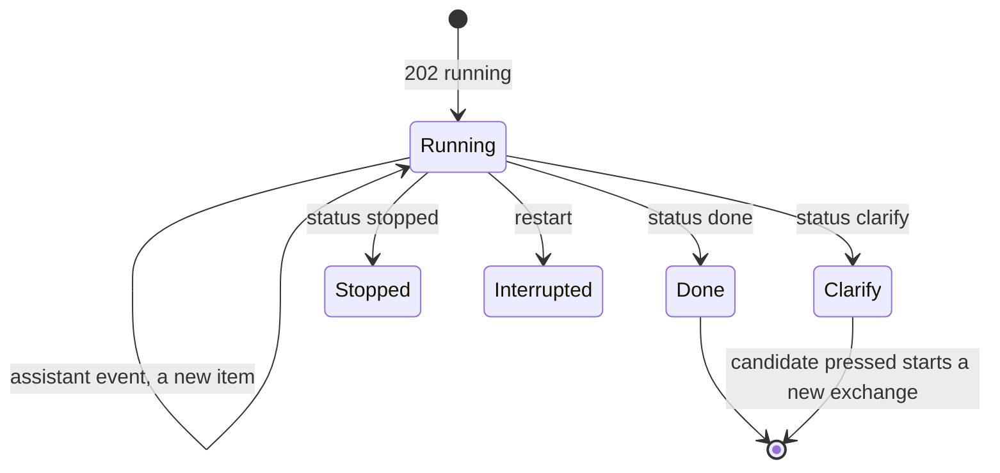
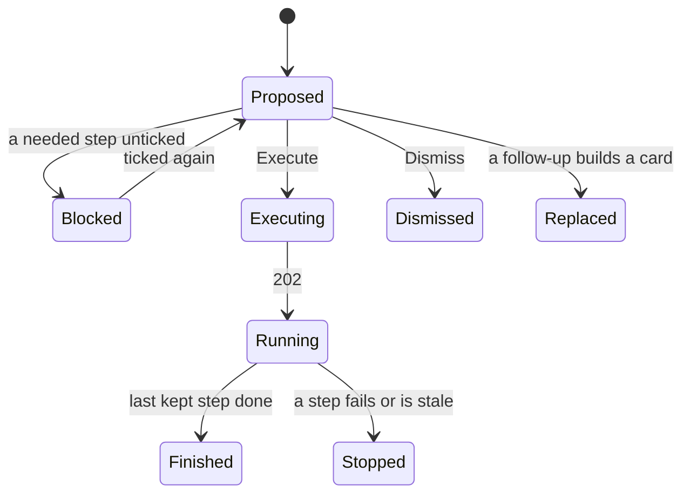

# UI design: In-app assistant as a server-side tool agent

**Feature**: [parent Issue #1654](https://github.com/syudead/vv/issues/1654) ·
[plan.md, The screens](plan.md#the-screens) ·
[plan.md, Turns are server-side jobs](plan.md#turns-are-server-side-jobs) ·
[plan.md, Write tools become proposal steps](plan.md#write-tools-become-proposal-steps) ·
[contracts/assistant-api.md](contracts/assistant-api.md) ·
[contracts/assistant-tools.md](contracts/assistant-tools.md)

Sources that already decide things, linked rather than repeated here:

| Topic | Source |
| --- | --- |
| Tokens, closed scales, colour roles, type steps | [foundations.md](../../web/registry/rules/foundations.md); the values in `@theme` of [`web/src/ui/tokens.css`](../../web/src/ui/tokens.css), named here and never copied |
| `Button`, `Checkbox`, `Collapsible`, `Badge`, `Alert`, `Progress`, `Spinner`, `Skeleton`, `Combobox`, `Tooltip`, `PersonFace`; one `default` button per area; `aria-disabled` draws `opacity-50` | [components.md](../../web/registry/rules/components.md) |
| `SidePanel`, its `panel` slot in `AppShell` and `DetailPage`, the `assistant-panel` and `assistant-composer` steps | [patterns.md, Side panel](../../web/registry/rules/patterns.md#side-panel) |
| The shell, the top bar, the window owning scrolling, the width breakpoints | [library-ui.md, Shell and toolbar](../../docs/design-docs/library-ui.md#shell-and-toolbar), [Width breakpoints](../../docs/design-docs/library-ui.md#width-breakpoints-in-css-and-the-sidebar-exception) |
| The shipped panel on this branch: trigger, composer, context line, request rows, filter and navigate rows, clarification buttons, the one-step card, `Recent runs` | [`web/src/assistant`](../../web/src/assistant) (`AssistantPanel.tsx`, `Composer.tsx`, `ReplyView.tsx`, `FilterReply.tsx`, `ProposalCard.tsx`) |
| The review list page, the library's duration, added-date and watch chips, the smart folder dialog's `Set by the assistant` row, the `Assistant` activity filter | Shipped on this branch and unchanged: [`ReviewPage.tsx`](../../web/src/assistant/ReviewPage.tsx), [`ActiveTagFilters.tsx`](../../web/src/library/ActiveTagFilters.tsx), [`ConditionsFields.tsx`](../../web/src/smartFolders/ConditionsFields.tsx) |
| The Ollama section of Settings, Connections, and its model `Combobox` | [`OllamaSection.tsx`](../../web/src/settings/OllamaSection.tsx) |
| Screen text | [`web/src/i18n/en.ts`](../../web/src/i18n/en.ts), under `assistant` and `settings.ollama`; this feature changes the words below |

The revision changes four things on screen. The **thread** follows a
server-side turn: request, a quiet list of tool calls, then the answer, the
clarification, the card, or the stop reason (requirements 4, 11, 12). The
**confirmation card** lists the steps of one proposal with a checkbox each
and shows each step's result after `Execute` (requirements 8 to 10, 14, 17).
The **readiness** and the **generation model picker** say when a model cannot
call tools, and the thread says when it cannot see images (requirements 3,
23). The **panel survives** a close, a route change and a reload, rebuilt from
the server (acceptance 11). The panel's frame, the review list page and the
library chips stay as shipped.

## Why this shape

The thread keeps the shipped column of exchanges and adds one quiet block
between the request and the reply: the tool calls, one `text-xs` line each in
`muted-foreground`. While the turn runs the block is open, so the owner sees
which tool is called and on what (requirement 12); when the turn ends it
folds into one `Collapsible` line, so finished exchanges read as request and
answer (`UI品質`, information density). This is the form comparable assistants
converged on for agent work (ChatGPT's and Claude's folded tool and search
steps, GitHub Copilot's "Used n references"). A spinner alone was rejected by
the plan; showing the model's own reasoning was rejected because the owner
should see facts from tools, not unchecked text
([plan.md, Model and tool calling](plan.md#model-and-tool-calling)).

The card stays one card per request, with the steps as rows inside it, each
with its checkbox at the left edge and its impact count as the largest text
in the row. One card per step was rejected by the plan: `Execute` would no
longer be the single primary button, and approving step 2 without step 1
would break `created by step n`. An irreversible step carries a `warning`
line and a `warning` left edge, and `Execute` turns `destructive` while any
ticked step is irreversible, so the mark is seen before it is read and the
button agrees with it (`UI品質`, confirmation card). After `Execute` the
checkboxes give way to each step's state icon in the same column, so the
owner reads the run against the same rows they approved and sees where it
stopped (requirement 10, acceptance 14).

A directive (`show_in_library`, `open_page`) applies without confirmation
(requirement 13), but a turn can now take minutes, and the owner may have
moved on. It therefore applies only when the turn ends in the tab that sent
it and that tab is still on the route it was sent from; otherwise the reply
row shows the shipped `Show` or `Open` link instead of moving the owner.

## Words

`{n}`, `{m}` are counts, `{name}` an entity's name, `{tool}` a tool's name
as the turn's progress item carries it (an `operationId` such as
`getVideo`), `{sentence}` a step's operation sentence from
`assistant.operation`, `{model}` a model name, `{reason}` the text of
`errors.reason`, `{page}` a page title from the shipped
`useDestinationName`, `{time}` an elapsed `m:ss`.

### Panel and composer

| Place | Text | Notes |
| --- | --- | --- |
| Empty thread | Ask about your library, how something works, or for a change. Changes are shown for approval first. | Replaces the shipped `empty`; Japanese and English requests both work (requirement 1) |
| Empty thread examples | `カラオケ関連の動画` · `お気に入りの使い方を教えて` · `タグを整理して` | `outline` `sm` buttons as shipped; they replace the three shipped examples |
| Empty thread, model without vision | This model can’t see images, so the assistant asks Clef to judge them. | `text-xs text-muted-foreground` under the examples, while readiness has `vision: false` |
| Trigger, a turn waits on the owner while the panel is closed | Assistant · waiting for you | Tooltip; the shipped `primary` dot stays until the panel opens; a card or a clarification ended the turn |
| Composer hint, a turn is running | The assistant is working on the request above | Replaces the hint; `Send` `aria-disabled` |
| `409 assistant_busy` | Another request is still running. It shows above when it finishes. | `text-sm text-warning`; the running turn is read from the body's id and added to the thread |
| Readiness, `generation_model_without_tools` | The model can’t use tools / “{model}” can’t call tools, which the assistant needs. Choose another generation model in Settings, Connections. | `Alert` title / description, `Open Connections` as shipped |

### Tool calls

One line per progress item. The text is chosen by the item's `tool`: the
built-in tools have their own words, every operation uses its `{tool}`
name. The names from the item's `labels` follow after ` · `, at most three,
then `+{n}`.

| Tool | Text | Icon |
| --- | --- | --- |
| `screen_context` | Checking the screen | `ScanEye` |
| `find_tools` | Looking for tools | `Wrench` |
| `app_help` | Looking up how the app works | `CircleHelp` |
| A read operation | Reading {tool} | `FileSearch` |
| A read operation that answers an image | Reading an image with {tool} | `Image` |
| `clef` | Asking Clef about {images} images | `Scale`; `1 image`; `{n} of {m}` after it when the item has `n` and `m` |
| `view_images` | Looking at {images} images | `Eye` |
| A write tool | Proposing: {sentence} | `ListPlus` |
| `show_in_library` | Filtering the library | `ListFilter` |
| `open_page` | Opening {page} | `ArrowUpRight` |
| `start_review` | Starting a review of {kind} | `ListChecks`; `{kind}` as the shipped review words |
| An excluded operation | Can’t use {tool}: it is done on its own page | `Ban` |
| An item with `error` | The line above, then ` · didn’t work` | Same icon; the model may recover, so no `warning` colour |
| Running line | Working · {time} | `Spinner`; the last line while the turn is `running` |
| Running line, after one minute | Working · {time} · it keeps going if you close the panel | |
| Folded block | Show {n} tool calls / Hide tool calls | The `Collapsible` trigger; `1 tool call` |

### Replies

| Place | Text | Notes |
| --- | --- | --- |
| Judged answer | Judged by Clef · its probabilities are estimates | `text-xs text-muted-foreground` with `Scale`, above the answer text, when `judged` |
| Mentioned entities | Mentioned | `text-xs font-medium text-muted-foreground` before the links under an answer |
| Show in the library | Show in the library | `link` `sm`, under an answer whose turn has a `filter` directive that did not apply |
| Clarification, several | Which {kind} did you mean by “{name}”? | `{kind}` from the shipped `clarify.kinds`; the candidate buttons as shipped |
| Clarification, none | Couldn’t find “{name}”. Check the name. | The shipped `clarify.notFound` |
| Excluded | The assistant can’t do this. {operation} is done on its own page. | `text-sm`; `{operation}` from `assistant.excluded`, extended to every excluded operation in [contracts/assistant-tools.md, Excluded operations](contracts/assistant-tools.md#excluded-operations) |
| Excluded, link | Open {page} | `outline` `sm` `Button` as a link to `stop.excluded.page` |
| Stop, `step_limit` | Stopped: the request needed more steps than one request may take. Nothing was changed. Try a narrower request. | `warning` line with `TriangleAlert` |
| Stop, `timeout` | Stopped: the request took longer than the time limit. Nothing was changed. Try a narrower request, or a faster model. | Same |
| Stop, `ungrounded` | The answer named facts the assistant hadn’t checked, so it isn’t shown. | Same; a built card still shows under it |
| Stop, `connection` | Couldn’t reach Ollama. Check the URL in Settings, Connections. | The shipped `destructive` `Alert` with `Open Connections` |
| Stop, `model` | The generation model didn’t answer. Check that Ollama has “{model}”. | Same |
| `interrupted` | Stopped by a restart before it finished. Nothing was changed. Ask again. | `warning` line |
| Turn expired (`404`) | This request is no longer kept. | `text-xs text-muted-foreground`, replaces the reply |

### Confirmation card

| Place | Text | Notes |
| --- | --- | --- |
| Card heading, two or more steps | {n} steps · {k} selected | `text-xs text-muted-foreground tabular-nums`; absent on a one-step card |
| Step number | {n} | `text-xs text-muted-foreground tabular-nums`, before the step's sentence |
| Step checkbox | Include step {n} | `aria-label` of the `Checkbox`; absent on a one-step card |
| Created by an earlier step | Created by step {n} | `text-xs text-muted-foreground` after the `New` badge |
| Created by an unticked step | Needs step {n} | `text-xs text-destructive` in its place |
| Blocked selection | Step {m} needs step {n}. Tick step {n}, or untick step {m}. | `text-sm text-destructive` above the actions; `Execute` `aria-disabled` |
| Nothing selected | Tick at least one step. | Same place and effect |
| Unticked step | Won’t run | `text-xs text-muted-foreground` under the step's sentence |
| Irreversible | Can’t be undone | As shipped, per step |
| Execute, two or more ticked | Execute {k} steps | `Execute` alone for one; `destructive` while a ticked step is irreversible |
| Step state, `skipped` | Skipped | `text-xs text-muted-foreground`, `CircleMinus` |
| Step state, `pending` | Waiting | Same, `Circle` |
| Step state, `running` | Running · {applied} of {total} | `Spinner` and `Progress`, as the shipped run line; `Running…` without a total |
| Step state, `done` | Done · {applied} changed | `text-success`, `CircleCheck`; `Done` without a total |
| Step state, `partial` | {applied} changed · {failed} failed: {reason} | `text-warning`, `TriangleAlert` |
| Step state, `stale` | Changed since it was proposed, so it didn’t run. Ask again. | `text-warning`, `TriangleAlert` |
| Step state, `failed` | Failed: {reason} | `text-destructive`, `CircleX` |
| Step state, `notRun` | Not run: an earlier step stopped | `text-xs text-muted-foreground`, `CircleMinus` |
| Card result, all ran | Done · {k} steps | `text-success`, `CircleCheck`; replaces the actions; `Open in Activity` after it as shipped |
| Card result, stopped | Stopped at step {n} | `text-warning` or `text-destructive` as that step's state; `Open in Activity` |

New sentences in `assistant.operation` for the rows the revision adds
([contracts/assistant-tools.md, Write tools](contracts/assistant-tools.md#write-tools)):

| Row | Sentence |
| --- | --- |
| `applyWorkInfoFetch` | Apply fetched work information |
| `applyPersonPluginFetch` | Apply fetched person details |
| `editVideoThumbnail` | Edit the thumbnail with ComfyUI |
| `revertThumbnailImage` | Restore the original thumbnail |
| `setVideoDetails` | Edit the video details |
| `putVideoProgress` | Set the watch position |
| `undoActivity` | Undo “{name}” |
| `retryActivity` | Retry “{name}” |
| `moveFaceAppearances` | Move faces to “{name}” |
| `splitFaceAppearances`, `splitFaceAppearance` | Split faces into a new person |

### Settings

| Place | Text | Notes |
| --- | --- | --- |
| Generation model option, no tools | {model} · can’t call tools | The option's `label` in the generation model `Combobox` only |
| Generation model option, vision | {model} · sees images | Same; a model with neither mark calls tools and is text only |
| Under the generation model row, saved model without tools | “{model}” can’t call tools, so the assistant won’t take requests. | `CircleAlert` line in `text-warning`, as the check's result line is drawn |
| Check, `generation_model_without_tools` | Ollama has “{model}”, but it can’t call tools. The assistant needs a model that can. | The check's failure message |

### Removed words

The shipped `assistant.answer` group, `examples.filter`, `examples.count`,
`unreadable`, `unsupported`, `unsupportedKnown`, `waiting`, `stillWaiting`,
`unavailable.timeout` and `card.stale` are removed with the outcome kinds
([plan.md, What is kept, replaced and removed](plan.md#what-is-kept-replaced-and-removed)).
`tooManyVideos`, `failed`, the `clarify` kinds, `card.dismissed`,
`card.replaced`, `card.expired` and `card.openInActivity` stay.

## Assistant panel

The trigger, the `SidePanel` frame, the header, the context line and the
composer stay as shipped. The panel's state now comes from the server: on
opening it reads readiness, `GET /api/assistant/turns?active=true` and
`GET /api/assistant/proposals?active=true`, and builds the thread from the
turns, oldest first. A close, a route change or a reload therefore loses
nothing that is less than an hour old.

The diagram shows the panel's states.

```mermaid
stateDiagram-v2
  [*] --> Closed
  Closed --> Loading: trigger pressed
  Loading --> NotReady: readiness false
  Loading --> Idle: no running turn
  Loading --> Working: a turn is running
  Idle --> Working: Send
  Working --> Idle: the turn finishes
  Working --> Closed: Close; the turn goes on
  Idle --> Closed: Close or Esc
  Closed --> Loading: trigger pressed
```

| State | What the panel shows |
| --- | --- |
| Loading | The header; `Skeleton` rows for two exchanges in the body; the field `aria-disabled` |
| Not ready | The thread as rebuilt, and the readiness `Alert` in the footer with `Open Connections`; no field |
| Idle, empty | The empty-thread text and examples centred in the body, and the vision line when the model has no `vision` |
| Idle | The exchanges, newest at the bottom, scrolled to the end; the field focused when opened by a press |
| Working | The running exchange at the bottom, with its tool calls open and the running line; the field editable, `Send` `aria-disabled`, the busy hint |
| Closed while working | The trigger's dot and `Assistant · working`, as shipped |
| Closed after a card or a clarification | The trigger's dot and `Assistant · waiting for you`, until the panel opens |

`Recent runs` stays above the thread for active proposals that no turn in
the thread holds, which are those adopted from a review list and those of a
cleared thread. `Clear thread` stores the time it was pressed on the device
([library-ui.md, Per-device preferences](../../docs/design-docs/library-ui.md#per-device-preferences-with-defaults));
turns started before it are not rebuilt.

## Thread

An exchange is the request row, the tool-call block and the reply, `gap-2`
apart; exchanges are `gap-4` apart, as shipped. The request row stays the
owner's text on `secondary` at the right. Everything under it sits at the
left on the panel's surface.

The diagram shows how one exchange changes while its turn runs and after.

| Turn status | Tool-call block | Reply |
| --- | --- | --- |
| `running` | Open: one line per item in order, then the running line with the `Spinner` | Nothing yet |
| `done` | Folded to `Show {n} tool calls`; absent with no items | The judged line, the answer, the mentioned entities, the directive's row, the review row, then the card, each when the turn has it |
| `clarify` | Folded | The question and the candidate buttons, as shipped |
| `stopped` | Open, so the owner sees what was tried | The stop line or `Alert`; for `ungrounded`, the card when one was built; for an excluded request, the excluded sentence and `Open {page}` |
| `interrupted` | Open | The `interrupted` line |

### Tool-call block

Each line is `text-xs text-muted-foreground`, with its icon `size-3` before
the text, wrapping in full under the icon's column; lines are `gap-1` apart.
Names from the labels are in `text-foreground`, so "what it is checking"
stands out within the quiet line. The block reads as metadata beside the
`text-sm` answer: no frame, no fill, no `font-medium`.

When an item has `n` and `m`, the line ends with `{n} of {m}` in
`tabular-nums`, and while it is the running item a `Progress` with `max={m}`
sits under it. The running line is the block's last line and ticks the time
since `startedAt` once a second. A turn's items are never trimmed: at the
limit of 40 tool calls the open block is 40 lines, which scroll inside the
panel's body.

### Answers

The answer is the model's text in `text-sm`, at the full width of the
column. Line breaks are kept; lines starting with `- ` or `1. ` are drawn as
a list with `gap-1`; `**` marks are dropped. No other Markdown is drawn, and
nothing in the text is a link, since it is the model's text.

Under the answer, `Mentioned` lists the entities the answer names, as
links: each label with an id from this turn's progress items whose name
occurs in the answer, in the answer's order, at most 20. Videos are title
links in a column, `text-sm`, truncated at the column's width, to the video
page; tags, people, organizations, playlists, groups and smart folders are
`link` `sm` buttons wrapped `gap-x-2`, to their pages, people with their
`PersonFace` `chip`. The panel draws no count of its own: every number on
screen is in the model's answer, which the grounding check already compared
with the tool results (requirement 11).

A `judged` turn puts the judged line above the answer, so a probability is
read as Clef's estimate before it is read as a fact.

A `filter` directive that applied shows the shipped `Filtered the library`
row with its chips and `Save as smart folder…` under the answer; one that did
not apply shows `Show in the library` instead. A `navigate` directive shows
the shipped `Opened {name}` row, with `Open` when it did not apply. Below
`lg`, a directive that applies closes the panel, as shipped.

A `start_review` item adds the shipped review row (progress and `Open the
review list`) for the run it names, under the answer (requirement 15).

## Confirmation card

The card keeps the shipped surface: `card` with a `border`, `rounded-lg`,
`p-3`, as wide as the column. A one-step card is the shipped card with no
heading and no checkbox. A card with two or more steps is:

| Row | Content |
| --- | --- |
| Heading | `{n} steps · {k} selected` |
| Steps | One block per step, in order, separated by a `Separator`, `py-3` each |
| Message | The blocked or nothing-selected line, when one applies |
| Actions | `Execute {k} steps`, then `Dismiss` (`ghost`), at the right, while `proposed` |
| Result | The card result line in place of the actions from `approved` on; `Open in Activity` when finished |

A step block is a two-column grid: a fixed column with the `Checkbox`
(while `proposed`) or the step-state icon (afterwards), and the step's
content:

| Row | Content |
| --- | --- |
| Sentence | The step number, then the operation sentence in `text-sm font-medium` |
| Impact | The count in `text-lg font-semibold tabular-nums`, as shipped; the largest text in the step |
| Irreversible | `Can’t be undone` in `warning`, with the shipped moving count for merges; only on an irreversible step |
| Targets | The labels as `secondary` `Badge`s, then `+{n} more`, as shipped; a face appearance shows its crop as a `PersonFace` `chip` |
| Change | One line per argument, as shipped; a created name carries `New` and, when an earlier step creates it, `Created by step {n}` |
| State | The step's state line, from `approved` on |

An irreversible step's block has a `border-l-2` in `warning` and `pl-3`, so
the steps that cannot be undone are found by scanning the left edge
(acceptance 7). An unticked step keeps its rows but sets its impact count in
`text-muted-foreground` with `line-through` and shows `Won’t run` under the
sentence, so the owner sees what they took out before pressing `Execute`
(acceptance 6).

### Step content by row kind

| Step | Change rows |
| --- | --- |
| Name-based rows | As shipped |
| `applyWorkInfoFetch`, `applyPersonPluginFetch` | One line per field to apply: the field's name as the work-information or person editor names it, then the fetched value; a list value as `secondary` `Badge`s, a long text cut at two lines with `line-clamp-2`, an image field as `New image` (requirement 6, acceptance 1) |
| `editVideoThumbnail` | `Frame` with the time as `formatDuration`, `Instruction` with the text; under them `Restore the original thumbnail undoes it` in `text-xs text-muted-foreground` |
| Schema rows | One line per labelled id in the path and body, the argument's name, then the entity's label; an id array shows the count (`12 faces`) and the first labels |
| `confirmFaceCandidate`, `dismissFaceCandidate` per candidate | The face crop and the person as targets, so a run of these steps reads as a column of faces with their decisions (acceptance 21) |

The diagram shows what the card does.

| State | What the card shows |
| --- | --- |
| `proposed` | Every step ticked; `Execute` live |
| Blocked | The dependent step's `Needs step {n}`, the blocked line, `Execute` `aria-disabled` |
| Nothing selected | Every step `Won’t run`, the line, `Execute` `aria-disabled` |
| Executing | `Executing…` with the `Spinner`; a second press does nothing |
| `running` | Checkboxes replaced by state icons: unticked steps `Skipped`, the current step `Running` with its `Progress`, later ones `Waiting` |
| Finished | Each step `Done` (or `Skipped`); the card result `Done · {k} steps`; `Open in Activity` |
| Stopped | Steps before it `Done`, the stopping step `partial`, `stale` or `failed` with its reason, later steps `Not run`; the card result `Stopped at step {n}` (acceptance 14) |
| Dismissed, Replaced, Expired | As shipped |

## Settings: generation model

The generation model `Combobox` keeps its place and list; each option's label
carries the mark from [Words, Settings](#settings), read from the `tools` and
`vision` of `GET /api/settings/ollama/models`. The decision model's picker
shows plain names. While the saved generation model lacks `tools`, the
warning line stands under the row, and the check reports
`generation_model_without_tools` with its message (requirement 3,
acceptance 16).

## Entry points

| Entry | Goes to | What the owner sees on arrival |
| --- | --- | --- |
| Trigger in the top bar or the video header band | The panel | The thread rebuilt from the active turns; the readiness `Alert` when not ready |
| Readiness and stop `Open Connections` | `/settings/connections` | The Ollama section with the generation model row and its marks |
| Excluded reply, `Open {page}` | The page from `stop.excluded.page` | The page where the owner does it themselves (acceptance 18) |
| `Mentioned` link | The video, tag, person, organization, playlist, group or smart folder page | The entity the answer named |
| Review row, `Open the review list` | `/assistant/reviews/{id}` | The shipped review page |
| Card, `Open in Activity` | `/activity/{id}` | The `assistant_run` entry, with its steps |

## Responsive behaviour

Breakpoints are Tailwind's defaults, applied in CSS: `sm` is 640px, `md`
768px, `lg` 1024px. The panel's frame follows
[patterns.md, Side panel](../../web/registry/rules/patterns.md#side-panel).

| Width | Layout |
| --- | --- |
| 1280px | The panel docked at the right, the library beside it with three `card-0` columns. Tool-call lines fit one line for operation names; labels wrap under the icon column. A step's impact, sentence and badges sit right of the checkbox column; `Execute {k} steps` and `Dismiss` on one line at the right |
| 768px | The panel a layer over the right edge, the page pressable to its left; a directive that applies closes it. The card as at 1280px |
| 360px | The panel at full width under the top bar; the composer hint hidden; tool-call lines wrap; the checkbox column keeps its width and the step content wraps beside it; `Execute {k} steps` and `Dismiss` stay on one line at the right; `Mentioned` buttons wrap |

## Review criteria

Judged by looking at the real screens with a tool-calling model
([quickstart.md](quickstart.md)) and with the e2e stub, at 360px, 768px and
1280px, as the owner and as a guest
([library-ui.md, Layout verified by people, not machines](../../docs/design-docs/library-ui.md#layout-verified-by-people-not-machines)).
"It exists" alone does not satisfy a criterion (Q-4).

1. **Progress while working**: after `Send`, a tool-call line appears
   within the time of one tool call, each new item adds a line under the
   last, and the running line's time counts up. The names in a line are
   brighter than the line's words, and no line is larger than `text-xs`
   (requirement 12, acceptance 11).
2. **Progress is quieter than the answer**: in a finished exchange the
   tool calls are one muted `Show {n} tool calls` line; the answer in
   `text-sm` `foreground` is the first thing the eye lands on under the
   request (`UI品質`, information density).
3. **Exchanges are told apart**: after three exchanges, each request is told
   from the next by the wider gap and the right-aligned fill, and a reply's
   tool calls, answer and card sit under their request (`UI品質`).
4. **Close and reopen**: closing the panel during a turn shows the dot and
   `Assistant · working`; reopening shows the same exchange with the lines
   added meanwhile; a reload shows it again (acceptance 11).
5. **Grounded answer with links**: `選択した動画の共通点は？` over three
   videos answers with names, and every name under `Mentioned` opens a page
   that the three videos' details show (acceptance 4).
6. **Judged answer**: `猫が映ってる動画を探して` shows `Asking Clef about
   {n} images` or `Looking at {n} images` among the lines, the judged line
   above the answer, and the found videos as title links (acceptance 20).
7. **Two-step card**: `ライブ録画タグを作って選択中の動画に付けて` over five
   videos shows one card with `2 steps · 2 selected`; step 2's `5 videos`
   is the largest text in it, its tag badge has `New` and `Created by step
   1`; `Execute 2 steps` is the only filled button in the panel
   (acceptance 5; `UI品質`, confirmation card).
8. **Unticking**: unticking step 1 strikes its count, shows `Won’t run`,
   turns step 2's mark into `Needs step 1`, and disables `Execute` with the
   blocked line; unticking step 2 instead runs only step 1, and step 2 reads
   `Skipped` (acceptance 6).
9. **Irreversible steps**: in the card for `重複してるタグをまとめて`, each
   merge step has the `warning` left edge and `Can’t be undone` with its
   moving count; with any merge ticked `Execute` is `destructive`, and with
   all merges unticked it is `default` (acceptance 7).
10. **Per-step results**: when step 2 of two fails, step 1 reads `Done ·
    {n} changed`, step 2 reads `Failed:` with the reason, later steps read
    `Not run`, and the card result reads `Stopped at step 2` (acceptance 14).
11. **Fetch preview**: `この動画の情報を取得して` on a video shows the plugin
    search and fetch among the tool calls and a card that lists each field
    with its fetched value; the video page is unchanged until `Execute`
    (acceptance 1).
12. **Excluded**: `APIトークンを作って` answers the excluded sentence and
    `Open Settings, Account` (the page's title), which lands on that page;
    nothing is proposed (acceptance 18).
13. **Stops**: a turn stopped by the step limit or the time limit shows the
    `warning` line, keeps its tool calls open, and shows no card; a stopped
    Ollama shows the `destructive` `Alert` with `Open Connections`.
14. **Model without tools**: with such a model saved, the panel shows the
    readiness `Alert` in the footer and no field; the settings picker lists
    the model with `· can’t call tools` and the warning line stands under
    the row (acceptance 16). As a guest, no trigger (acceptance 17).
15. **Directive after moving on**: sending `カラオケ関連の動画を表示して` and
    opening Settings before it finishes leaves the owner on Settings, and
    the reply offers `Show in the library`.
16. **Narrow width**: at 360px a two-step card keeps its checkboxes in one
    column, step content wraps beside them, and `Execute 2 steps` and
    `Dismiss` stay on one line at `h-8`.
17. **Examples that do not meet the requirement** (`UI品質`): tool calls
    drawn in `text-sm` or framed as cards; the model's reasoning shown; a
    finished exchange with its tool calls open; one card per step; two
    filled buttons on a card; an irreversible step told only by its
    sentence; a count under `Mentioned` that the panel computed; a directive
    that moves the owner off a page they opened after sending.
