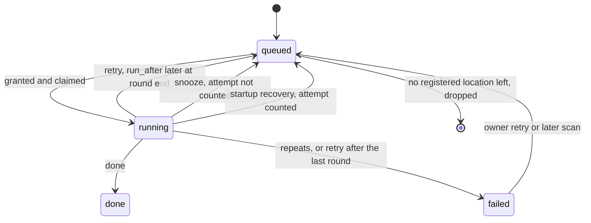

# Data model: one scheduler for every file read

The rest of the model is unchanged: [`internal/store/migrations`](../../internal/store/migrations).
Disk keys, read capacities and unavailable roots live in the scheduler's
memory only ([R-5](research.md#r-5-read-slots-per-disk-follow-the-disk-type),
[R-8](research.md#r-8-an-unavailable-root-parks-its-jobs)). A remount or a
replaced disk would make a stored value wrong.

## Migration

The units in [plan.md](plan.md#implementation-work) add two kinds of
migration:

- **One rebuild of `jobs`**, in the unit that adds priority classes. It writes
  the end state below in full: every column, every kind, the subject `check`
  and both indexes. SQLite cannot change a `check` constraint or a `not null`
  in place, and one rebuild keeps the later units from rewriting the same
  table.
- **A data migration per later unit**, moving its own rows into `jobs` and
  the result tables.

Existing `jobs` rows keep their state, attempts, errors, activity and force
flags. They take the import class, and `run_after` is set to `created_at`.
Rows are carried over as follows:

| From | To `jobs` | Kept in the domain table |
| --- | --- | --- |
| `auto_tag_queue` rows `queued` or `running` | `auto_tag` jobs, `queued`, with the row's `activity_id` and class 1 | Nothing; the row is deleted |
| `auto_tag_queue` rows `done` or `failed` | None | The row, in `auto_tag_results` |
| `face_queue` rows | As for `auto_tag_queue`, kind `face` | `done` and `failed` rows, in `face_results` |
| None | One `queue_face_images` job, so people stale at upgrade are embedded | Nothing |
| `video_version_candidates` with `judgement` null or `running` | `version_judge` jobs, `queued`, with the pair's activity and class 1 | `judgement` reset to null |
| `video_version_candidates` with `judgement = 'no_connection'` | None; saving the connection enqueues them, as today | The row |
| `video_version_candidates` with `judgement = 'failed'` and a `retry_at` | `version_judge` jobs with `attempts` carried over and `run_after = retry_at` | `judgement` and `judgement_error` |

Each down migration restores the previous tables from these rows. It drops
`jobs` rows of the kinds it does not know.

## `jobs`

| Field | Type | Null | Meaning |
| --- | --- | --- | --- |
| `kind` | text | No | Drops the unused `metadata` (its rows were deleted in migration 00053). Adds `keyframes`, `media_info`, `queue_keyframes`, `queue_media_info`, `virtual_thumbnails` ([R-13](research.md#r-13-startup-work-becomes-jobs-queued-by-queue-all-jobs)), and `auto_tag`, `face`, `face_image`, `face_cast`, `queue_face_images`, `version_judge` ([R-12](research.md#r-12-all-queued-work-lives-in-jobs-results-stay-in-the-domain-tables)) |
| `video_id` | integer | Yes | Now nullable. Set for the five import kinds, `keyframes`, `media_info` and `face_cast`; still deleted with its video |
| `subject_key` | text | Yes | The content key of an `auto_tag` or `face` job, the person id of a `face_image` job, and the first key of a `version_judge` pair |
| `subject_key_b` | text | Yes | The second key of a `version_judge` pair, greater than `subject_key`; named as in `activity_entries` |
| `priority` | integer | No | `0` owner request, `1` import, `2` backfill; lower is served first ([R-4](research.md#r-4-priority-classes-are-strict)) |
| `run_after` | integer | No | Unix seconds before which the job is not claimed; written as the insert time when not delayed ([R-7](research.md#r-7-handlers-return-one-of-four-outcomes)) |

A `check` ties the subject columns to the kind:

| Kinds | `video_id` | `subject_key` | `subject_key_b` |
| --- | --- | --- | --- |
| Import kinds, `keyframes`, `media_info`, `face_cast` | Set | Null | Null |
| `auto_tag`, `face`, `face_image` | Null | Set | Null |
| `version_judge` | Null | Set | Set |
| `queue_keyframes`, `queue_media_info`, `queue_face_images`, `virtual_thumbnails` | Null | Null | Null |

The claim index becomes `(state, priority, run_after, id)`, the order River
and Oban claim in. The unique index of unfinished jobs covers
`(kind, video_id, subject_key, subject_key_b)`, with nulls coalesced, so a singleton
kind has at most one unfinished row.

`attempts` keeps its meaning for location kinds: one round over the
registered locations. For the other kinds, each claim is one attempt.

`location_id`, `location_version` and `location_path` are set at claim for
every kind that reads a source: the import kinds, `keyframes`, `media_info`
and `face`. A `face` job takes the first available location in path order of
any video with its content key.

## `auto_tag_results` and `face_results`

These are the former `auto_tag_queue` and `face_queue` without the work
columns.

| Field | Type | Null | Meaning |
| --- | --- | --- | --- |
| `content_key` | text | No | Primary key |
| `state` | text | No | `done` or `failed` |
| `error` / `reason` | text | Yes | The failure detail, as before |
| `recognizer` | text | Yes | `face_results` only, as before |
| `updated_at` | integer | No | As before |

The dropped columns are `queued_at`, `activity_id`, and the `queued` and
`running` states. The job row now holds them. "Tag videos not yet tagged" and
the Settings counts read `done` and `failed` here, and `queued` and `running`
from `jobs`.

## `video_version_candidates`

Drops `attempts` and `retry_at`; the pair's `version_judge` job holds them.
The Activity list, the candidate list and the API's `retryAt` read the job's
`run_after` for a queued job with attempts, so the API is unchanged.
`judgement`, `judgement_error`, `probability` and `rejudge_of` stay.

## Rules

| Rule | Enforced in |
| --- | --- |
| A claim takes the lowest class, then the earliest `run_after`, then the oldest row. It considers only jobs whose demand fits ([R-1](research.md#capacities)) and whose chosen location is on the disk being visited and under an available root | `internal/store` claim statement, given the class, the disk's roots and the unavailable roots |
| A job whose video or content key has no registered location left is dropped at claim. One whose locations are all under unavailable roots stays queued | `internal/store` claim |
| A `version_judge` job whose pair is not judgeable now (held, unbundled, unregistered) stays queued and is skipped; it is deleted with its candidate row | `internal/store` claim and candidate deletion |
| A paused kind is not claimed ([Paused kinds](research.md#paused-kinds)) | `internal/store` claim, given the paused set that `internal/app` computes |
| A kind may override the delay and the attempt limit; `version_judge` waits 10 min, 1 h, 6 h, then daily, without limit | `internal/domain` delay rule |
| A failure that ends a round sets `run_after` from the delay rule. One that leaves locations in the round requeues at once. A snooze requeues at once and leaves `attempts` unchanged | `internal/domain` delay rule, written by `internal/store` |
| A repeating failure (`ErrFailureRepeats`) fails the job when its round ends | `internal/domain` `AttemptsAfterFailure`, as today |
| An owner request on a queued job raises it to class `0` and sets `run_after` to now | `internal/store` enqueue, force and retry paths |
| A content job is inserted in the transaction that decides it: the end of the seek stage, an owner request, or a candidate being created or reset | `internal/store`, as the content queues do today |
| Only the five import kinds join import activity, scan settling and `HasUnfinishedJobs` | `internal/store` claim and finish paths |

## State transitions

The diagram shows a job's states and the outcome that moves it.

## What does not change

- `media_folders` gains no column, because the disk key is resolved when the
  scheduler first needs it ([R-5](research.md#r-5-read-slots-per-disk-follow-the-disk-type)).
- The scan's content key and its read window stay
  ([R-9](research.md#r-9-the-scan-keeps-content-keys-inline-and-reads-within-the-limits)).
