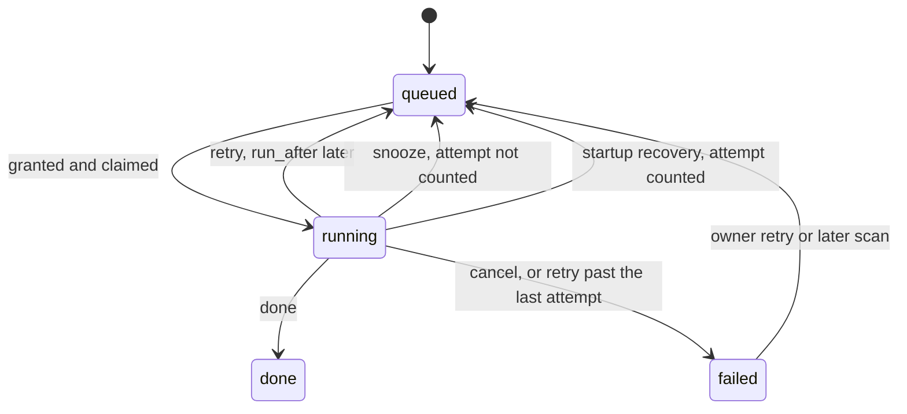

# Data model: one scheduler for every file read

The rest of the model is unchanged: [`internal/store/migrations`](../../internal/store/migrations).
Disk keys and read capacities are computed at startup and on media folder
registration and live in memory only ([R-5](research.md#r-5-read-slots-per-disk-follow-the-disk-type)):
a remount or a replaced disk would make a stored value wrong.

## Migration

One migration rebuilds `jobs`, because SQLite cannot change a `check`
constraint in place, and adds columns to the two content queues. Existing rows
keep their state, attempts and errors; every existing row gets the import
class and no run-after time. The down migration restores the previous table
and drops rows of the new kinds.

## `jobs`

| Field | Type | Null | Meaning |
| --- | --- | --- | --- |
| `kind` | text | No | Adds `keyframes`, `media_info` and `virtual_thumbnail` ([R-13](research.md#r-13-startup-work-becomes-jobs)) |
| `priority` | integer | No | `0` owner request, `1` import, `2` backfill; lower is served first ([R-4](research.md#r-4-priority-classes-are-strict)) |
| `run_after` | integer | Yes | Unix seconds before which the job is not claimed; null means now ([R-7](research.md#r-7-handlers-return-one-of-four-outcomes)) |

The claim index becomes `(state, priority, run_after, id)`; the unique index
of unfinished jobs per kind and video is unchanged.

## `auto_tag_queue` and `face_queue`

| Field | Type | Null | Meaning |
| --- | --- | --- | --- |
| `priority` | integer | No | Same classes as `jobs`; an owner's queue or retry writes `0` |
| `attempts` | integer | No | Retry attempts, as for `jobs` |
| `run_after` | integer | Yes | As for `jobs` |

Duplicate judging keeps its own retry schedule (10 min, 1 h, 6 h for an
unanswered classifier, [duplicate-judging.md](../../docs/design-docs/duplicate-judging.md));
it joins the scheduler's limits and classes only.

## Rules

| Rule | Enforced in |
| --- | --- |
| Claims order by priority, then run-after, then age, among jobs whose disk has a free slot | `internal/store` claim statement, with the free disks passed in |
| A retry sets `run_after` from the attempt count; a snooze sets it without counting an attempt | `internal/domain` delay rule, written by `internal/store` |
| A cancel ends the job as `failed` with its error, whatever the attempt count | `internal/store` |
| An owner request on a queued or waiting job raises it to class `0` and clears `run_after` | `internal/store` enqueue and force paths |

## State transitions

The diagram shows a job's states and the outcome that moves it.

## What does not change

`media_folders` gains no column: the disk key is recomputed whenever the
server starts or a folder is registered. The scan's content key and its read
window stay ([R-9](research.md#r-9-the-scan-keeps-content-keys-inline-and-reads-within-the-limits)).
