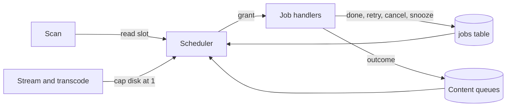
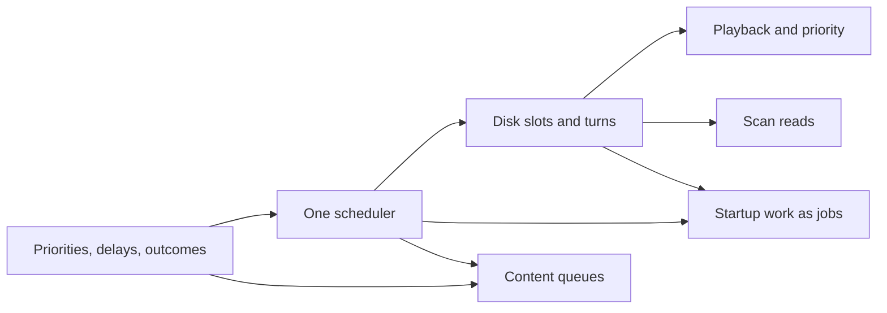

# Implementation Plan: one scheduler for every file read

**Branch**: `feature/068-media-scheduler` | **Parent Issue**: #1732

**Input**: The parent Issue. It is this feature's specification.

## Summary

Every job that reads a source file or uses the CPU or the classifier, and the
scan's content-key reads, are granted by one scheduler from declared demands:
read slots per disk (1 for a rotational or unknown disk, 4 otherwise), CPU
slots and classifier slots. Jobs that do not fit are skipped, disks take turns
within strict priority classes, failures end in one of four outcomes with
backoff, an unreadable folder parks its jobs, playback holds its disk to one
background read, and startup work becomes jobs. The decisions and the survey
behind them are in [research.md](research.md).

The diagram shows what the scheduler grants and who asks.



## Technical Context

**Canonical definitions**: [ARCHITECTURE.md](../../ARCHITECTURE.md) (layers,
[Queue workers](../../ARCHITECTURE.md#queue-workers)),
[import-pipeline.md](../../docs/design-docs/import-pipeline.md),
[process-lifecycle.md](../../docs/design-docs/process-lifecycle.md),
[catalog-organization.md](../../docs/design-docs/catalog-organization.md),
[testing.md](../../docs/design-docs/testing.md), checks in
[development.md](../../docs/how-to/development.md#validate-changes).

**Feature-specific context**:

| Item | Delta |
| --- | --- |
| Schema | `jobs` rebuilt with three kinds, `priority` and `run_after`; content queues gain `priority`, `attempts` and `run_after` ([data-model.md](data-model.md)) |
| Platform | Disk identity and type read from Linux sysfs and Windows storage IOCTLs; anything else is an unknown disk with 1 slot ([R-5](research.md#r-5-read-slots-per-disk-follow-the-disk-type)) |
| Child processes | Job ffmpeg and ffprobe run at lowered CPU and I/O priority ([R-11](research.md#r-11-background-processes-run-at-low-priority)) |
| Hidden parallelism | The seek-sprite job's fixed 4 processes and 8 reads become its granted slot count ([R-6](research.md#r-6-a-splittable-job-takes-the-free-slots-on-start)) |
| Dependencies | None added; `golang.org/x/sys` already provides the Linux and Windows calls |

## Constitution Check

| Rule | Verdict |
| --- | --- |
| Dependency direction ([ARCHITECTURE.md](../../ARCHITECTURE.md#intended-dependency-direction)): adapters do not import each other or `internal/app` | Pass. The scheduler stays in `internal/jobs`, which imports `internal/domain` only. `internal/scanner` and `internal/httpapi` declare the read-slot and playback interfaces they call, `internal/app` components expose claim and run steps against domain types, and `cmd/mdm` wires them |
| The domain decides, the store enforces | Pass. Priority classes, demands per kind, the retry delay and outcome classification are domain rules; the store's claim statement applies them |
| Complexity 25 and no copied code ([complexity-and-duplication.md](../../docs/design-docs/complexity-and-duplication.md)) | Pass by design: one grant loop replaces five workers and four loops |
| Testing ([testing.md](../../docs/design-docs/testing.md)) | Pass. The scheduler is tested with virtual time (`testing/synctest`) and fake sources; the claim order and outcomes with SQLite store tests; real disks only in [quickstart.md](quickstart.md) |
| Documentation with the change | Pass. Units update `import-pipeline.md`, `ARCHITECTURE.md` and `process-lifecycle.md`, and add `docs/design-docs/job-scheduling.md` |

## Project Structure

### Documentation (this feature)

```text
specs/068-media-scheduler/
├── plan.md
├── research.md      # R-1..R-13 and the survey they cite
├── data-model.md    # jobs and content-queue columns, job states
└── quickstart.md    # real-disk and playback scenarios, HDD timing
```

There is no `contracts/`: no HTTP or external API changes, and no setting is
added (requirement 5 of the parent Issue).

### Source Code

**Affected boundaries**:

| Boundary | What changes |
| --- | --- |
| `internal/domain` | Priority classes, demand per job kind, retry delay, outcome errors |
| `internal/store` | Migration, claim by class and free disks, outcome recording, priority on owner requests |
| `internal/jobs` | `Scheduler` replaces `Worker`; `Loop` stays for the wait between grant rounds |
| `internal/mediafs` | Disk key and type of a media folder root |
| `internal/media` | Child-process priority for job processes; seek-sprite parallelism from its grant |
| `internal/httpapi` | Stream and live-transcode readers report their disk |
| `internal/scanner` | Content-key reads hold a read slot |
| `internal/app` | Backfills and virtual thumbnails as job handlers; content queues as sources |
| `cmd/mdm` | Wiring; startup keeps only recovery and key rebuilds |

**New paths**: `internal/jobs/scheduler.go`, `internal/mediafs/disk_linux.go`,
`internal/mediafs/disk_windows.go`, `internal/mediafs/disk_other.go`, one
migration in `internal/store/migrations`, `docs/design-docs/job-scheduling.md`.

**Structure decision**: disk identity lives in `internal/mediafs`, which
already owns what a media path may open; a separate package was rejected
because it would hold two functions per platform and repeat `mediafs`'s root
handling.

## Implementation Work

The units land in this order; the arrows are dependencies.



### Add priority classes, retry delays and failure outcomes to the ingest job queue

**Scope**: The migration and `jobs` columns in [data-model.md](data-model.md);
claim order by class, run-after and age; the four outcomes and the delay rule
([R-4](research.md#r-4-priority-classes-are-strict),
[R-7](research.md#r-7-handlers-return-one-of-four-outcomes)); force rescans and
activity retries enqueue at class 0; the existing workers wait until the next
run-after time. Classify undecodable and unsupported probe errors as cancel.

**Dependencies**: None

**Acceptance**: Store tests show a class-0 job claimed before older class-1
jobs, a retried job not claimed before its run-after time and claimed after
it, delays of 30 s, 2 min and 8 min within ±10%, a cancel failing at the first
attempt, a snooze leaving the attempt count unchanged and startup recovery
counting one. The migration test round-trips the existing rows down and up.

### Run every ingest stage on one resource scheduler

**Scope**: `jobs.Scheduler` with demands per kind, capacities for CPU and read
slots (one shared disk until the next unit), skipping jobs that do not fit and
strict classes ([R-1](research.md#r-1-one-scheduler-grants-declared-demands),
[R-2](research.md#r-2-a-job-that-does-not-fit-is-skipped)); it replaces the five
`Worker`s; grants and releases logged at debug level. Add
`docs/design-docs/job-scheduling.md` and update the Queue workers section of
`ARCHITECTURE.md` and `import-pipeline.md`.

**Dependencies**: Add priority classes, retry delays and failure outcomes to
the ingest job queue

**Acceptance**: Virtual-time scheduler tests with a fake store show a CPU-only
job granted while read slots are full, a job that does not fit skipped in
favour of one that does, a class-0 job granted first when a slot frees, and no
more grants than capacity. Existing ingest tests in `cmd/mdm` pass unchanged.

### Give each disk its own read slots and serve disks in turn

**Scope**: Disk key and type per media folder root on Linux and Windows with
the unknown fallback ([R-5](research.md#r-5-read-slots-per-disk-follow-the-disk-type));
round robin over disks within a class ([R-3](research.md#r-3-disks-take-turns-within-a-priority-class));
the seek-sprite job's elastic grant ([R-6](research.md#r-6-a-splittable-job-takes-the-free-slots-on-start));
zero capacity for an unreadable root and the snooze on a vanished source
([R-8](research.md#r-8-an-unavailable-folder-parks-its-jobs)).

**Dependencies**: Run every ingest stage on one resource scheduler

**Acceptance**: Scheduler tests show two disks granted at once, a disk with
1,000 queued jobs alternating with a disk of 3, an HDD never above 1 slot, a
seek-sprite job granted 1 slot on an HDD and up to 4 on an SSD, and an
unreadable root's jobs left queued with unchanged attempts until it is
readable. A Linux test resolves a loop or tmpfs path to a key, and a Windows
CI build compiles the IOCTL path. The quickstart's HDD timing is recorded in
the PR.

### Hold background reads to one per disk during playback and lower job process priority

**Scope**: Stream and live-transcode readers report their disk while open, and
the scheduler caps that disk's background slots at 1
([R-10](research.md#r-10-playback-holds-background-reads-to-one-slot)); job ffmpeg
and ffprobe start at lowered priority, live transcoding does not
([R-11](research.md#r-11-background-processes-run-at-low-priority)).

**Dependencies**: Give each disk its own read slots and serve disks in turn

**Acceptance**: A scheduler test opens a playback reader on a 4-slot disk and
sees grants stop at 1 and resume up to 4 after it closes, with 1 job still
granted throughout. An HTTP test shows the stream handler reporting and
releasing its disk. A Linux test reads the nice value and I/O class of a
started job process.

### Read scan content keys within the disk read limits

**Scope**: The scan holds a read slot of the file's disk for each content-key
read, granted ahead of every job class
([R-9](research.md#r-9-the-scan-keeps-content-keys-inline-and-reads-within-the-limits)).

**Dependencies**: Give each disk its own read slots and serve disks in turn

**Acceptance**: A scanner test with a fake slot provider shows one acquire and
one release per new or changed file and none for an unchanged file; a
scheduler test shows a scan request granted before queued class-0 jobs.

### Queue backfills and virtual thumbnail republishing as scheduled jobs

**Scope**: Startup queues `keyframes`, `media_info` and `virtual_thumbnail`
jobs at class 2 for the videos that need them; the backfill loop and the
startup goroutine go; `process-lifecycle.md` lists the remaining synchronous
steps ([R-13](research.md#r-13-startup-work-becomes-jobs)).

**Dependencies**: Run every ingest stage on one resource scheduler; Give each
disk its own read slots and serve disks in turn

**Acceptance**: A store test shows startup queuing one job per video missing
keyframes or media information and none for the rest. A `cmd/mdm` test shows
the listener opening before any backfill job runs. No code polls for backfill
work.

### Schedule auto-tagging, face analysis and duplicate judging on the shared scheduler

**Scope**: The three content queues become scheduler sources with classifier
and CPU demands; auto-tagging and face analysis gain class, attempts and
run-after ([data-model.md](data-model.md), [R-12](research.md#r-12-content-queues-join-as-sources));
their own loops go.

**Dependencies**: Add priority classes, retry delays and failure outcomes to
the ingest job queue; Run every ingest stage on one resource scheduler

**Acceptance**: Scheduler tests show a classifier job granted while every read
slot is busy and at most one classifier job at a time; app tests show an
auto-tagging failure retried after its delay and an owner's retry claimed
before queued after-import tagging. Existing auto-tagging, face and judging
tests pass.
