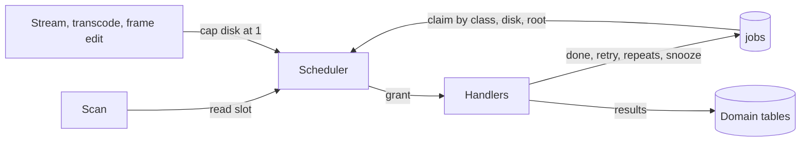
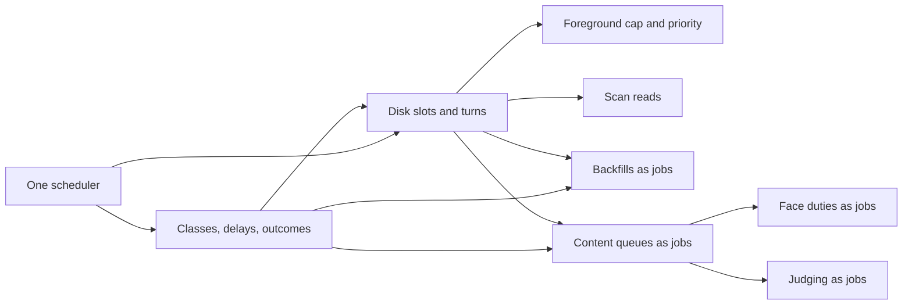

# Implementation Plan: one scheduler for every file read

**Branch**: `feature/068-media-scheduler` | **Parent Issue**: #1732

**Input**: The parent Issue. It is this feature's specification.

## Summary

One scheduler grants every job that reads a source file, uses the CPU, the
classifier or the face runtime, and every scan content-key read. It grants
them from the demand declared per kind, with these limits:

- read slots per disk: 1 for a rotational or unknown disk, 4 otherwise;
- CPU slots: `NumCPU / 4 + 1`;
- one classifier slot and one face lane slot.

How the scheduler behaves:

- **Granting**: a job that does not fit is skipped. Disks take turns within
  strict priority classes.
- **Failures**: a failure ends as a retry with backoff, a repeat that fails at
  once, or a snooze.
- **Unavailable folders**: a folder that cannot be read parks its jobs.
- **Foreground readers**: playback and thumbnail editing hold their disk to
  one background read.
- **One job table**: all queued work lives in `jobs`, including auto-tagging,
  face analysis, face-image embedding, the cast rule, duplicate judging and
  the backfills. Results stay in the domain tables, and a kind whose feature
  is off is paused.

The decisions and the survey behind them are in [research.md](research.md).

The diagram shows what the scheduler grants and who asks.



## Technical Context

**Canonical definitions**: [ARCHITECTURE.md](../../ARCHITECTURE.md) (layers,
[Queue workers](../../ARCHITECTURE.md#queue-workers)),
[import-pipeline.md](../../docs/design-docs/import-pipeline.md),
[process-lifecycle.md](../../docs/design-docs/process-lifecycle.md),
[auto-tagging.md](../../docs/design-docs/auto-tagging.md),
[face-recognition.md](../../docs/design-docs/face-recognition.md),
[duplicate-judging.md](../../docs/design-docs/duplicate-judging.md),
[testing.md](../../docs/design-docs/testing.md), checks in
[development.md](../../docs/how-to/development.md#validate-changes).

**Feature-specific context**:

| Item | Delta |
| --- | --- |
| Schema | `jobs` gains priority, run-after, subject keys and eleven kinds in one rebuild; the content queues become result tables; candidates lose their retry columns ([data-model.md](data-model.md)) |
| Platform | Disk identity and type come from Linux sysfs and Windows storage IOCTLs. Anything else is an unknown disk with 1 slot ([R-5](research.md#r-5-read-slots-per-disk-follow-the-disk-type)) |
| Child processes | Job ffmpeg, ffprobe and the face helper run at lowered CPU and I/O priority, set right after start ([R-11](research.md#r-11-background-processes-run-at-low-priority)) |
| Hidden parallelism | The seek-sprite job's fixed 4 processes and 8 reads become slots taken and returned per extraction ([R-6](research.md#r-6-a-splittable-job-takes-and-returns-slots-per-extraction)) |
| Dependencies | None added; `golang.org/x/sys` already provides the Linux and Windows calls |

## Constitution Check

| Rule | Verdict |
| --- | --- |
| Dependency direction ([ARCHITECTURE.md](../../ARCHITECTURE.md#intended-dependency-direction)): adapters do not import each other or `internal/app` | Pass. The scheduler stays in `internal/jobs`, which imports `internal/domain` only. `internal/scanner` and `internal/httpapi` declare the read-slot and foreground-reader interfaces they call. `internal/app` handlers run against domain types, and `cmd/mdm` wires them |
| The domain decides, the store enforces | Pass. Classes, the demand per kind, the delay rule and outcome classification are domain rules; the store's claim statement applies them |
| Complexity 25 and no copied code ([complexity-and-duplication.md](../../docs/design-docs/complexity-and-duplication.md)) | Pass by design. One grant loop replaces five stage workers, five loops and one startup goroutine. One claim, backoff and recovery replace the three queue implementations ([R-12](research.md#r-12-all-queued-work-lives-in-jobs-results-stay-in-the-domain-tables)) |
| Testing ([testing.md](../../docs/design-docs/testing.md)) | Pass. The scheduler is tested with virtual time (`testing/synctest`) and a fake store. Claim order and outcomes are tested against SQLite. Disk detection reads a fake sysfs directory. Real disks appear only in [quickstart.md](quickstart.md) |
| Documentation with the change | Pass. Unit 1 adds `docs/design-docs/job-scheduling.md`. Each unit updates the design documents of what it moves: `import-pipeline.md`, `ARCHITECTURE.md`, `process-lifecycle.md`, `auto-tagging.md`, `face-recognition.md`, `duplicate-judging.md` |

## Project Structure

### Documentation (this feature)

```text
specs/068-media-scheduler/
├── plan.md
├── research.md      # R-1..R-13, capacities, demand per kind, survey
├── data-model.md    # jobs columns, result tables, rules, job states
└── quickstart.md    # real-disk, playback and timing scenarios
```

There is no `contracts/`: the HTTP and external APIs do not change, and no
setting is added (requirement 5 of the parent Issue). The Settings counts keep
their shape and read their numbers from the new tables.

### Source Code

**Affected boundaries**:

| Boundary | What changes |
| --- | --- |
| `internal/domain` | Classes, demand per kind, delay rule, snooze error, new job kinds |
| `internal/store` | Migrations; claim by class, disk and root; outcomes; content and judging work as `jobs` rows; result tables |
| `internal/jobs` | `Scheduler` replaces `Worker`; `Loop` stays for the wait between grant rounds |
| `internal/mediafs` | Disk key and type of a root, with the sysfs root injectable for tests |
| `internal/media` | `command` takes a priority; seek-sprite and keyframe reads ask per extraction; ffprobe exit errors repeat |
| `internal/httpapi` | Stream, live-transcode and frame-edit readers report their disk |
| `internal/scanner` | Content-key reads hold a read slot |
| `internal/app` | Handlers for every kind; backfills as queue-all jobs; auto-tagging, face analysis and judging enqueue jobs |
| `cmd/mdm` | Wiring; startup keeps only recovery and key rebuilds |

**New paths**: `internal/jobs/scheduler.go`, `internal/mediafs/disk_linux.go`,
`internal/mediafs/disk_windows.go`, `internal/mediafs/disk_other.go`, one
migration per unit in `internal/store/migrations`,
`docs/design-docs/job-scheduling.md`.

**Structure decision**: Disk identity lives in `internal/mediafs`, which
already owns what a media path may open. A separate package was rejected,
because it would hold two functions per platform and repeat `mediafs`'s root
handling.

## Implementation Work

The units land in this order; the arrows are dependencies.



### Run every ingest stage on one resource scheduler

**Scope**: `jobs.Scheduler` replaces the five stage `Worker`s. It grants the
demand per kind ([Demand per kind](research.md#demand-per-kind)) from CPU slots
and one shared pool of 4 read slots, until per-disk slots arrive.
It skips a job that does not fit
([R-1](research.md#r-1-one-scheduler-grants-declared-demands),
[R-2](research.md#r-2-a-job-that-does-not-fit-is-skipped)), and logs grants
and releases at debug level. The unit adds `docs/design-docs/job-scheduling.md`
and updates the Queue workers section of `ARCHITECTURE.md` and
`import-pipeline.md`.

**Dependencies**: None

**Acceptance**: Virtual-time scheduler tests with a fake store, each with at
most three jobs, show:

- a CPU-only job granted while the read pool is full;
- a job that does not fit skipped in favour of one that does;
- no more grants than capacity.

Existing ingest tests in `cmd/mdm` pass unchanged.

### Add priority classes, retry delays and failure outcomes to the job queue

**Scope**: One migration rebuilds `jobs` to its end state
([data-model.md](data-model.md#jobs)). It adds every column, every kind, the
subject `check` and the claim index; the later units only move their rows in. The claim order becomes class,
run-after, then age. The four outcomes and the delay rule follow
[R-4](research.md#r-4-priority-classes-are-strict) and
[R-7](research.md#r-7-handlers-return-one-of-four-outcomes), with the per-kind
override of the delay and the attempt limit. FFmpeg's invalid-data error and
`invalid_metadata` wrap `ErrFailureRepeats`. Force rescans and
activity retries enqueue at class 0, and the scheduler waits until the next
run-after time.

**Dependencies**: Run every ingest stage on one resource scheduler

**Acceptance**: Store tests show:

- a class-0 job claimed before an older class-1 job;
- a job not claimed before its run-after time and claimed after it;
- delays of 30 s, 2 min and 8 min within ±10% at round ends, and an immediate
  requeue mid-round;
- an invalid-data error failing at the end of its first round, while a probe
  timeout and an `EIO` exit requeue;
- a kind's overridden delay and unlimited attempts applied in place of the
  default;
- startup recovery counting one attempt.

A scheduler test shows the wait ending at the next run-after time. The
migration test round-trips existing rows down and up.

### Give each disk its own read slots and serve disks in turn

**Scope**: This unit adds the following:

- Disk key and type per root on Linux and Windows, with the unknown fallback.
  They are resolved on first use and on recheck
  ([R-5](research.md#r-5-read-slots-per-disk-follow-the-disk-type)).
- Round robin over disks within a class, by the location the claim picks
  ([R-3](research.md#r-3-disks-take-turns-within-a-priority-class)).
- Slots taken and returned per extraction in the seek-sprite and keyframe
  reads ([R-6](research.md#r-6-a-splittable-job-takes-and-returns-slots-per-extraction)).
- Unavailable roots, the snooze, and the recheck on events and every minute
  while a root is unavailable
  ([R-8](research.md#r-8-an-unavailable-root-parks-its-jobs)).

**Dependencies**: Run every ingest stage on one resource scheduler; Add
priority classes, retry delays and failure outcomes to the job queue

**Acceptance**: Scheduler tests show:

- two disks granted at once;
- a disk with 4 queued jobs alternating with a disk of 2 while both have work,
  then continuing alone once the other is empty;
- a 1-slot disk never above 1 grant;
- a seek-sprite job running 1 extraction on a 1-slot disk and up to 4 on a
  4-slot disk.

Store tests show:

- an unavailable root's job left queued with unchanged attempts, while a job
  under another root on the same disk is claimed;
- a video with a second, readable location claimed there;
- the parked job claimed after a recheck finds the root readable.

A Linux test resolves the key and type from a fake sysfs directory, and the
Windows CI build compiles the IOCTL path. The quickstart's HDD and
unknown-disk timings are recorded in the PR.

### Hold background reads to one per disk during playback and lower job process priority

**Scope**: These readers report their disk while open, and the scheduler caps
that disk's background slots at 1
([R-10](research.md#r-10-foreground-readers-hold-background-reads-to-one-slot)):

- stream readers;
- live transcoding and its ffprobe;
- thumbnail-editing frame reads.

`media.command` takes a priority. Job processes and the face helper start
low, and the foreground processes stay normal
([R-11](research.md#r-11-background-processes-run-at-low-priority)).

**Dependencies**: Give each disk its own read slots and serve disks in turn

**Acceptance**: A scheduler test opens a foreground reader on a 4-slot disk.
It sees seek-sprite extractions and new grants stop until the total is 1,
with a running preview kept and 1 still granted throughout. After the reader
closes, grants resume up to 4. An HTTP test
shows the stream handler reporting and releasing its disk. A Linux test reads
the nice value and the I/O class of a started job process and of a live
transcode process.

### Read scan content keys within the disk read limits

**Scope**: The scan holds a read slot of the file's disk for each content-key
read. It is granted the next free slot ahead of every job class and never
preempts
([R-9](research.md#r-9-the-scan-keeps-content-keys-inline-and-reads-within-the-limits)).

**Dependencies**: Give each disk its own read slots and serve disks in turn

**Acceptance**: A scanner test with a fake slot provider shows one acquire and
one release per new or changed file, and none for an unchanged file. A
scheduler test shows a waiting scan read granted before queued class-0 jobs
when a slot frees, and jobs holding the other three slots of a 4-slot disk
during a scan.

### Queue backfills and virtual thumbnail republishing as scheduled jobs

**Scope**: Startup inserts the `queue_keyframes`, `queue_media_info` and `virtual_thumbnails`
jobs at class 2 ([R-13](research.md#r-13-startup-work-becomes-jobs-queued-by-queue-all-jobs)).
These kinds stay out of import activity, scan settling and
`HasUnfinishedJobs`. The backfill loop and the startup goroutine go, and
`process-lifecycle.md` lists the remaining synchronous startup steps.

**Dependencies**: Add priority classes, retry delays and failure outcomes to
the job queue; Give each disk its own read slots and serve disks in turn

**Acceptance**:

- **Fan-out**: a store test shows `queue_keyframes` inserting one `keyframes`
  job per H.264 video whose stored spacing is missing, old or for a different
  size or modification time, and none for the rest. A store test shows
  `queue_media_info` skipping a video with a recorded failure for the same
  file and version.
- **Stays out of import tracking**: a store test shows a running backfill job
  opening no activity entry, leaving scan settling alone, and
  `HasUnfinishedJobs` false.
- **Startup does not wait**: a `cmd/mdm` test shows the listener opening
  before any backfill job runs.
- **No polling**: no code polls for backfill work.

### Move the auto-tagging and face-analysis queues into the job table

**Scope**: `auto_tag` and `face` jobs keyed by `subject_key`, and the
`auto_tag_queue` and `face_queue` rows carried over into `jobs` and the result
tables ([data-model.md](data-model.md#auto_tag_results-and-face_results),
[R-12](research.md#r-12-all-queued-work-lives-in-jobs-results-stay-in-the-domain-tables)).

- **Activity**: the activity rules of `content_queue.go` move to the enqueue,
  claim and finish paths of these kinds.
- **State checks**: every check of a content state in `auto_tags.go`,
  `faces.go`, `face_clear.go`, `face_settings.go` and
  `video_face_appearances.go` reads the result row and the unfinished job
  together.
- **Paused kinds**: the scheduler gains them
  ([Paused kinds](research.md#paused-kinds)), and `auto_tag` and `face` use
  them.
- **Demands**: `auto_tag` uses the classifier; `face` uses read, CPU and the
  face lane, and its claim fills `location_*`.
- **Loops**: the auto-tagging loop goes, and the face loop stops claiming
  analyses.
- **Documents**: `auto-tagging.md` describes the queue as jobs.

**Dependencies**: Add priority classes, retry delays and failure outcomes to
the job queue; Give each disk its own read slots and serve disks in turn

**Acceptance**:

- **Migration**: a test carries queued, running, done and failed rows of both
  tables to the end state and back.
- **Retry**: an app test shows an auto-tagging failure retried after its
  delay. Today a failure stays failed until the owner queues it again.
- **Owner first**: an owner's retry is claimed before queued after-import
  tagging.
- **Paused**: with auto-tagging off, a queued `auto_tag` job is not claimed
  and keeps its attempts. Turning auto-tagging on gets it claimed.
- **Slots**: a scheduler test shows an `auto_tag` job granted while every read
  slot is busy, and at most one classifier job and one face-lane job at a
  time.
- **Existing behaviour**: existing auto-tagging and face tests pass, with
  their queue assertions reading `jobs`.

### Run face-image embedding and the cast rule as face-lane jobs

**Scope**: The face loop's remaining duties become jobs on the face lane
([R-1](research.md#r-1-one-scheduler-grants-declared-demands)):

- `face_image` jobs, enqueued on an image upload or change, and
  `queue_face_images` after a recognizer change;
- `face_cast` jobs, enqueued when a video's work information changes;
- the helper closing when the face lane has no queued job.

The face loop goes, and `face-recognition.md` describes the lane.

**Dependencies**: Move the auto-tagging and face-analysis queues into the job
table

**Acceptance**: App tests show the following:

- an uploaded image embedded through a `face_image` job;
- a recognizer change queuing one job per stale image;
- a cast change applied through `face_cast` and never at the same time as a
  `face` job;
- the helper closed after the last face-lane job and started again by the
  next.

Existing face tests pass.

### Move duplicate-judging work into the job table

**Scope**: `version_judge` jobs keyed by the content-key pair
([R-12](research.md#r-12-all-queued-work-lives-in-jobs-results-stay-in-the-domain-tables)).

- **Enqueue**: a job is enqueued where a candidate is created, reset or
  rejudged, and where a saved connection resets `no_connection` pairs.
- **Claim**: the claim skips a pair that is not judgeable now and keeps its
  job. The job goes with its candidate row.
- **Delays**: today's delays (10 min, 1 h, 6 h, then daily, no limit) come
  through the per-kind override
  ([R-7](research.md#r-7-handlers-return-one-of-four-outcomes)).
- **Pause**: `version_judge` is paused while judging is off.
- **Retry time**: the Activity list, the candidate list, the activity retry
  and the API's `retryAt` use the job's `run_after`.
- **Removed**: the candidate's `attempts` and `retry_at`, the judging loop and
  `NextJudgementRetry` go.
- **Documents**: `duplicate-judging.md` describes the queue as jobs.

**Dependencies**: Move the auto-tagging and face-analysis queues into the job
table

**Acceptance**:

- **Migration**: a test carries waiting, running and failed-with-retry
  candidates to `jobs` and back.
- **Delays**: an app test shows an unanswered classifier retried after 10 min,
  1 h, 6 h, then daily past the third failure.
- **Held pair**: a held pair's job stays queued and is claimed once the hold
  is lifted.
- **API**: an HTTP test shows `retryAt` unchanged for a pair waiting to retry.
- **Connection saved**: saving the connection settings makes waiting pairs
  claimable at once.
- **Existing behaviour**: existing judging tests pass, with their retry
  assertions reading `jobs`.
