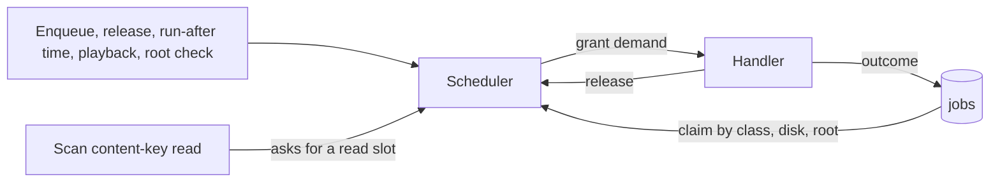

# Research: one scheduler for every file read

Inherited decisions: [ARCHITECTURE.md](../../ARCHITECTURE.md) (dependency
direction, [Queue workers](../../ARCHITECTURE.md#queue-workers)),
[import-pipeline.md](../../docs/design-docs/import-pipeline.md),
[process-lifecycle.md](../../docs/design-docs/process-lifecycle.md),
[catalog-organization.md](../../docs/design-docs/catalog-organization.md)
(content keys identify files), [auto-tagging.md](../../docs/design-docs/auto-tagging.md),
[face-recognition.md](../../docs/design-docs/face-recognition.md) and
[duplicate-judging.md](../../docs/design-docs/duplicate-judging.md). This file
records only the decisions this feature adds, and the survey they rest on.

Terms used below:

- A **read slot** is the right to read one source file on one **disk**.
- A **demand** is what one job needs from each resource.
- A **root** is a registered media folder.
- The **scheduler** is the single component that grants demands from free
  capacity.

The diagram shows the model the decisions below build.

## R-1: One scheduler grants declared demands

**Decision**: One scheduler in `internal/jobs` grants each job the demand its
kind declares, from free capacity. It replaces these:

- the five stage `Worker`s;
- the keyframe and media-information backfill loops;
- the virtual-thumbnail startup goroutine;
- the auto-tagging, duplicate-judging and face-analysis loops.

The face loop does more than analyse videos. Its other duties are distributed
as follows:

- Embedding people's face images becomes the `face_image` kind.
- Applying the cast rule to changed videos becomes the `face_cast` kind.
- Requeueing stranded rows becomes the shared startup recovery.
- Closing the helper becomes a hook the face handlers run when the face lane
  has no queued job left.

`ThumbnailEdits.Run` stays, because it only expires editing sessions and reads
no file.

| Option | Head-of-line blocking across disks | Shared limit on one disk | Verdict |
| --- | --- | --- | --- |
| **Single scheduler, demand per job** (Bazel `ResourceSet`, Kubernetes requests, Slurm licenses) | None: a job that does not fit is skipped (R-2) | Yes | Chosen |
| Worker per stage plus a shared weighted semaphore | Yes: `semaphore.Weighted` serves waiters strictly in order | Yes | Rejected: a busy disk stalls every stage behind it |
| Worker pool per disk | None | Yes | Rejected: CPU-only and classifier work have no disk, so a second mechanism is still needed |

**Rationale**: Every surveyed scheduler that matches work to several resource
kinds declares a demand per job. It filters jobs by free capacity before
ranking them ([Survey](#survey), resource scheduling). With one component, every
limit lives in one place, so the scan, playback and background work see the
same counts.

### Capacities

| Resource | Capacity | Source |
| --- | --- | --- |
| Read slots of one disk | 1 for a rotational or unknown disk, 4 otherwise (R-5) | Requirement 5 of the parent Issue |
| CPU slots | `NumCPU / 4 + 1` | stash `GetParallelTasksWithAutoDetection`; ffmpeg already spreads one decode or encode over several threads |
| Classifier slots | 1 | The configured classifier serves one request at a time; Immich runs its heavy queues at 1 to 3 |
| Face lane slots | 1 | The face runtime is one helper process that answers one request at a time, and the cast rule must not interleave with an analysis, as the single face loop guarantees today |

### Demand per kind

Each job kind declares one fixed demand. "Read" means one read slot on the
disk of the location the claim picks (R-3).

| Kind | Read | CPU | Classifier | Face lane | Why |
| --- | --- | --- | --- | --- | --- |
| `probe` | 1 | 0 | 0 | 0 | ffprobe reads the container header |
| `thumbnail` | 1 | 1 | 0 | 0 | ffmpeg decodes frames |
| `seek_thumbnail` | 1, plus one per extra extraction (R-6) | 1, plus one per extra extraction | 0 | 0 | One ffmpeg per frame |
| `preview` | 1 | 1 | 0 | 0 | ffmpeg decodes and encodes |
| `fingerprint` | 0 | 1 | 0 | 0 | Reads sprite frames from the data directory |
| `keyframes` | 1 | 0 | 0 | 0 | ffprobe reads the packet index of the whole file |
| `media_info` | 1 | 0 | 0 | 0 | ffprobe reads the container |
| `virtual_thumbnails` | 0 | 0 | 0 | 0 | Copies stored image bytes into thumbnail files |
| `auto_tag` | 0 | 0 | 1 | 0 | Sends generated thumbnails and seek frames, never the source |
| `face` | 1 | 1 | 0 | 1 | ffmpeg decodes source frames for the helper |
| `face_image` | 0 | 0 | 0 | 1 | Sends one stored face image to the helper |
| `face_cast` | 0 | 0 | 0 | 1 | Merges people in the database, serialized with analysis |
| `queue_face_images` | 0 | 0 | 0 | 0 | Inserts one `face_image` job per image without a current vector |
| `version_judge` | 0 | 0 | 1 | 0 | Compares stored fingerprints and sends generated seek frames |

A kind with an empty demand always fits and still waits for its priority class.

### Paused kinds

A kind can be paused. A paused kind's jobs stay queued and are not claimed,
and resuming it wakes the scheduler. River and Oban pause a queue the same way,
and so does Sidekiq's queue `pause`.

| Kinds | Paused while | Today |
| --- | --- | --- |
| `auto_tag` | Auto-tagging is off | The loop claims nothing while off |
| `version_judge` | Duplicate judging is off | The loop claims nothing while off |
| `face`, `face_image`, `face_cast` | Face recognition is off or its runtime is not ready | The loop idles in both cases |

Pausing at claim, rather than claiming and failing, keeps attempts intact while
a feature is off, which is what the loops do today.

### Readers outside the job table

| Reader | Treatment | Reason |
| --- | --- | --- |
| Scan content-key reads | Asks the scheduler for a read slot (R-9) | Requirement 8 of the parent Issue |
| Stream, live transcode and its ffprobe | Foreground: caps the disk's background reads (R-10) | The owner is waiting on it |
| Thumbnail-editing frame reads (`ThumbnailEdits.frameAt`) | Foreground, as playback | The owner is waiting on it on the editing screen |
| Sidecar subtitle reads | Not counted | Kilobyte-sized text read once per request; holding a slot would make it wait behind a minutes-long encode |
| Startup encoder check | Not counted, normal priority | It encodes 8 synthetic `testsrc2` frames and reads no source file |

## R-2: A job that does not fit is skipped

**Decision**: When the best-ranked job's demand does not fit, the scheduler
skips it and grants the next job that fits.

| Option | Behaviour when the head does not fit | Verdict |
| --- | --- | --- |
| **Skip to a job that fits** (Bazel `processWaitingRequests`) | Others proceed | Chosen |
| Stop and wait (Go `semaphore.Weighted`, Ninja within a pool, Slurm main scheduler) | Everything behind waits | Rejected: defeats per-disk parallelism |
| Skip with reservations (Slurm backfill) | Others proceed unless they would delay the head | Rejected: needs runtime estimates the jobs do not have |

**Rationale**: Skipping can starve a large demand. Here every demand needs at
most one read slot, one CPU slot and one slot of each other kind to start
(R-6), so no job is skipped forever while its resources have capacity.

## R-3: Disks take turns within a priority class

**Decision**: Within one priority class, the scheduler visits disks round
robin and claims the oldest eligible job of each. Jobs with no read demand
form one more group in the rotation.

A job belongs to the disk of the location its claim would pick. The existing
location rule decides that location: the next registered location in path
order after the previous attempt's
([`ClaimJob`](../../internal/store/jobs.go)). An `auto_tag`, `face` or
`version_judge` job has no previous location; a `face` job takes the first
location in path order of any video with its content key. A location under an
unavailable root is passed over (R-8).

| Option | Fairness | Cost | Verdict |
| --- | --- | --- | --- |
| **Round robin over disk keys** (BullMQ Pro Groups, DRR with equal quanta) | Equal turns per disk | One claim per disk visited | Chosen |
| Global FIFO | A disk with 10,000 queued jobs delays the others | None | Rejected: requirement 4 of the parent Issue |
| Weighted fair queuing / SFQ | Proportional to weights | Virtual-time tags per job | Rejected: no weights to express; equal turns suffice |
| Dominant resource fairness | Fair across resource kinds | Per-user shares | Rejected: one owner, no users to share between |

**Rationale**: The parent Issue's edge cases count a video stored on several
disks against the disk its job reads. Keeping the location rotation leaves
attempt counting per round unchanged.

## R-4: Priority classes are strict

**Decision**: Classes are served strictly in this order:

| Class | Value | Work |
| --- | --- | --- |
| Owner request | 0 | A force rescan, a retry from the Activity screen, one video queued from its page |
| Import | 1 | Everything an import, a scan or an after-import rule queues; Settings' "tag or analyse all" requests |
| Backfill | 2 | `keyframes`, `media_info`, `virtual_thumbnails` |

A scan's content-key read goes before every class (R-9).

| Option | Behaviour | Verdict |
| --- | --- | --- |
| **Strict classes** (River and Oban priority ordering, BFQ classes) | Lower classes wait while higher work exists | Chosen |
| Weighted queues (asynq 6:3:1, Sidekiq weighted) | Every class progresses | Rejected: an owner's force rescan should not share time with bulk import |

**Rationale**: Owner requests touch one video or one activity entry, so they
cannot starve import. Settings' library-wide requests are bulk work, so they
take the import class. Backfill waits during an import, as the parent Issue's
edge cases allow. Jellyfin (user refresh is High) and GoonHub (manual retry
priority 1) give user-triggered work the same lead.

## R-5: Read slots per disk follow the disk type

**Decision**: A disk has 1 read slot when it is rotational or its type is
unknown, and 4 when it is not rotational. There is no setting and no runtime
adaptation. The scheduler resolves a root's disk the first time it needs it
and again on every root check (R-8), not during startup.

| Option | Signal | Risk | Verdict |
| --- | --- | --- | --- |
| **Fixed by disk type** (fclones device pools from sysfs `rotational`) | One read of the disk's type | SSD capacity not fully used | Chosen |
| Adaptive limit (Netflix Gradient2 / Vegas, Envoy, senpai on PSI) | Disk latency or stall time against a baseline | Oscillation, baseline bias, slow recovery, different signals on Linux and Windows | Rejected: the parent Issue leaves it until a measurement shows the need |
| User setting | Owner input | A setting most owners cannot judge | Rejected: requirement 5 of the parent Issue |

**Rationale**: fclones keeps a thread pool per device and sizes it from the
sysfs `rotational` flag: 1 thread for an HDD, 4 × CPUs for an SSD. For an
unknown device it uses 1 thread for sequential reads, because parallel
sequential reads hurt a rotational disk badly. Every job here reads a video
sequentially, so the unknown case follows fclones's sequential rule. Four
matches the seek-sprite job's current parallelism, so SSD throughput does not
fall.

Several common setups have no whole-disk sysfs entry and therefore fall back
to 1 slot: Btrfs, ZFS, network shares and Docker Desktop's shared folders.
[quickstart.md](quickstart.md#unknown-disk-import-time) measures this
regression. Windows reports no seek penalty for some virtual disks, so a
virtual disk can count as an SSD.

| Platform | Disk key | Type |
| --- | --- | --- |
| Linux | `st_dev` of the root, mapped through `/sys/dev/block/<maj>:<min>` to its whole disk | `queue/rotational` of that disk |
| Windows | Physical device number of the root's volume (`IOCTL_STORAGE_GET_DEVICE_NUMBER`) | `IOCTL_STORAGE_QUERY_PROPERTY` with `StorageDeviceSeekPenaltyProperty` |
| Either, when a lookup fails | `st_dev` or the volume alone | Unknown: 1 slot |

## R-6: A splittable job takes and returns slots per extraction

**Decision**: The seek-sprite job needs one read slot and one CPU slot to
start. For each further extraction it asks the scheduler for one more pair on
the same disk without waiting. It runs that extraction in parallel when the
pair is granted, and returns the pair when the extraction ends. At most 4
extractions run at once. The fixed `seekSpriteParallel` and
`seekSpriteReadParallel` semaphores go.

| Option | Behaviour | Verdict |
| --- | --- | --- |
| **Per-extraction tokens** (GNU make jobserver: one implicit token, one more taken and returned per sub-job) | Uses idle slots and gives them back at once | Chosen |
| Extra slots taken at start and held to the end | Playback that starts later cannot bring the disk down to 1 (R-10) | Rejected |
| Fixed demand of 4 or 8 slots | Never fits an HDD's single slot; skipped forever under R-2 | Rejected |
| Fixed demand of 1, internal parallelism unchanged | Reads 8 streams while counted as 1 | Rejected: breaks the per-disk limit |

The keyframe read path ([`readKeyframes`](../../internal/media/seek_thumbnail.go))
reads the same way, one read slot per concurrent read.

## R-7: Handlers return one of four outcomes

**Decision**: A job ends with one of these outcomes:

| Outcome | Returned for | Effect |
| --- | --- | --- |
| Done | Success | The job is done |
| Retry | Any other error | Same location rule as today. A failure that leaves later locations in the round requeues at once. A failure that ends a round waits 30 s × 4^(round − 1) ± 10% before the next round. The job fails after the third round |
| Repeats | `domain.ErrFailureRepeats`: an extraction slower than its timeout, as today. This feature adds two cases. ffmpeg or ffprobe exiting with FFmpeg's invalid-data error (`AVERROR_INVALIDDATA`, "Invalid data found when processing input"), and probe output that cannot be parsed (`invalid_metadata`) | The job fails once the round ends, without the remaining rounds |
| Snooze | The source cannot be opened and its root cannot be read | Requeued with no attempt counted; the root becomes unavailable (R-8) |

A kind can override the delay and the attempt limit, as a River or Oban
worker can. `version_judge` uses this to keep today's schedule
([`VersionJudgeRetryAt`](../../internal/domain/version_judgement.go)): 10 min,
1 h, 6 h, then daily, with no attempt limit. A missing connection stays a
judgement result (`no_connection`), not a job failure. Saving the connection
enqueues those pairs again, as `ResetNoConnectionJudgements` does today.

| Option | Verdict |
| --- | --- |
| **Four outcomes, reusing `ErrFailureRepeats` as the cancel** (River `JobCancel`/`JobSnooze`, Oban `{:cancel}`/`{:snooze}`, asynq `SkipRetry`, BullMQ `UnrecoverableError`) | Chosen |
| A new cancel error beside `ErrFailureRepeats` | Rejected: two mechanisms for one outcome |
| Cancelling every `probe_failed` | Rejected: [`ProbeErrorProbeFailed`](../../internal/domain/failure.go) also covers timeouts, so a slow disk would fail a good file |
| Cancelling every ffprobe exit error | Rejected: ffprobe also exits with an error on `EIO`, `EACCES` or a file removed mid-read, which are transient |
| Retry everything with backoff (GoonHub) | Rejected: a file whose extraction always times out is retried for nothing |
| No retry, rely on the next scan (stash, Immich `attempts: 1`, Jellyfin) | Rejected: a transient read error leaves a video unprepared until a manual rescan |

**Rationale**: River (`attempt^4` s, 25 attempts) and Oban (`15 + 2^attempt`
s, 20 attempts) spread many attempts over hours. With three rounds, the delays
must still cover a disk spinning up or a share reconnecting, and 30 s, 2 min
and 8 min do. River and Oban both let a worker override the backoff, which is
how `version_judge` keeps its schedule. Acceptance criterion 7 of the parent
Issue (a broken file fails at once) holds for every stage. FFmpeg reports a
container or stream it cannot decode as invalid data whichever stage reads it,
and that result is the same every time. A timeout or an I/O error still
retries.

## R-8: An unavailable root parks its jobs

**Decision**:

- **Marking**: a root becomes unavailable when a snooze reports it (R-7), or
  when the scheduler cannot stat it while resolving its disk.
- **Claiming**: the claim passes over locations under an unavailable root. A
  job whose locations are all unavailable stays queued with its attempts
  unchanged. The existing rule that drops a job with no *registered* location
  stays.
- **Rechecking**: the scheduler keeps the unavailable roots in memory. It
  stats them again on these events: a folder is registered, a scan starts, or
  the folder watcher reports a change or `folder_unreachable`. While at least
  one root is unavailable, it also rechecks once a minute.
- **Recovery**: a root that is readable again has its disk resolved again
  (R-5), and its jobs become claimable.

| Option | Verdict |
| --- | --- |
| **Skip the unavailable root's locations, recheck on events and every minute** (kube-scheduler moves unschedulable pods back on cluster events and flushes them after at most `podMaxInUnschedulablePodsDuration`, 5 min) | Chosen |
| Zero read slots for the root's disk | Rejected: two registered roots can share a disk, and one unreadable root would stop the other |
| A snooze with a fixed delay (River `JobSnooze`, Oban `{:snooze, s}`) and no root state | Rejected: every job of an unplugged disk would wake and fail to open its file each delay |
| Fail each job (current behaviour) | Rejected: requirement 13 of the parent Issue |
| A `parked` job state | Rejected: duplicates what skipping at claim already expresses |
| Recheck only on events | Rejected: the watcher is off unless automatic import is on, so a remounted disk would wait for the next scan |

**Rationale**: The recheck timer runs only while a root is unavailable, so a
healthy library has no polling. A file that is missing while its root is
readable was deleted; that is a retry, so it cannot snooze forever. Immich,
Jellyfin and PhotoPrism likewise skip an inaccessible library root instead of
deleting or failing its items.

## R-9: The scan keeps content keys inline and reads within the limits

**Decision**: The scan still computes content keys inline for new and changed
files. It holds a read slot on the file's disk for each read, and gets the
next free slot ahead of every job class. It never preempts a running job, so
on a 1-slot disk the first read waits at most for the running job.

The scanner reads one file at a time, so it holds at most one slot. On a
4-slot disk, jobs keep the other three. On a 1-slot disk, jobs on that disk
wait while the scan reads new and changed files. Each read is two 1 MiB reads,
so 1,000 new files take about a minute on an HDD. Unchanged files are not
read.

| Option | Verdict |
| --- | --- |
| **Inline key, read slot from the scheduler, scan first** | Chosen |
| Defer identification to a job | Rejected: stash and PhotoPrism compute content identity inline; projects that defer it (Immich external libraries, Jellyfin) do not detect moves at all |
| Inline key outside the scheduler (current behaviour) | Rejected: requirement 8 and acceptance criterion 3 of the parent Issue |
| Preempt a running job for the scan | Rejected: an interrupted encode restarts from the beginning |
| Scan reads take turns with jobs | Rejected: on a 1-slot disk each scan read would wait for a whole job, so a scan of 1,000 new files would wait for 1,000 jobs, and those jobs need the scan's output |

**Rationale**: The scan produces the work every job consumes, so it goes
first. The key's read window (two 1 MiB reads) stays, because changing it
would change every existing content key.

## R-10: Foreground readers hold background reads to one slot

**Decision**: While a stream, live transcode or thumbnail-editing frame read
has a disk open, that disk's capacity for background reads is 1, never 0. It
returns to its type value (R-5) when the last foreground reader closes. A
grant made before the cap is not revoked. A seek-sprite job reaches the cap
within one extraction, because it asks per extraction (R-6). A thumbnail,
preview or face job finishes its current run first. So background reads fall
to 1 within the longest running job, and then stay there.

| Option | Verdict |
| --- | --- |
| **Cap at one slot** | Chosen |
| Revoke running grants: kill and requeue, or suspend the process | Rejected: a killed encode restarts from the beginning, and Windows has no documented call to suspend another process |
| Pause background reads | Rejected: requirement 9 of the parent Issue asks for throttling, not stopping; BFQ keeps a thin share for its idle class and mq-deadline dispatches requests older than 10 s for the same reason |
| OS priority alone | Rejected: Linux ioprio works only under bfq or mq-deadline, and the container cannot choose the host's I/O scheduler |

**Rationale**: No surveyed media server reacts to playback (Plex and Jellyfin
schedule heavy work for maintenance hours instead), so this rule is this
repository's own.

## R-11: Background processes run at low priority

**Decision**: [`media.command`](../../internal/media/command.go) takes a
priority. Job processes start at low priority:

- **Linux**: after `Start`, the process gets `setpriority(PRIO_PROCESS, pid, 10)`
  and `ioprio_set(IOPRIO_WHO_PROCESS, pid, best-effort level 7)`.
- **Windows**: the process is created with `BELOW_NORMAL_PRIORITY_CLASS` in its
  creation flags.

Live transcoding, its ffprobe, thumbnail-editing frames and the encoder check
keep normal priority. The face helper starts at low priority.

| Option | Verdict |
| --- | --- |
| **Set the child's priority right after start** (Jellyfin sets `Process.PriorityClass` right after `StartProcess` in `MediaEncoder.ExtractVideoImagesOnIntervalAccelerated`, and `BelowNormal` for other extractions) | Chosen |
| `nice` and `ionice` wrapper commands | Rejected: depends on binaries the Alpine image and Windows do not guarantee |
| I/O idle class | Rejected: idle-class requests may wait until the disk is quiet, which could stall import while anything else reads |
| Lowering the server's own priority (Syncthing `lowprio`) | Rejected: it would also slow streaming |
| Windows `PROCESS_MODE_BACKGROUND_BEGIN` | Rejected: it applies only to the calling process, not a child |

**Rationale**: Go cannot change priority between fork and exec on Linux. The
first milliseconds at normal priority cost nothing measurable for processes
that run seconds to minutes.

## R-12: All queued work lives in `jobs`; results stay in the domain tables

**Decision**: Auto-tagging, face analysis, face-image embedding, the cast rule
and duplicate judging queue their work as `jobs` rows. Their kinds are
`auto_tag`, `face`, `face_image`, `face_cast` and `version_judge`. Each row is
enqueued in the same transaction that changes the domain rows. The claim, the
priority, the attempts, the run-after time and startup recovery exist only
for `jobs`.

The domain tables keep only results:

- `auto_tag_queue` becomes `auto_tag_results`, and `face_queue` becomes
  `face_results`. Each holds `done` and `failed` per content key with the
  failure reason.
- `video_version_candidates` keeps its `judgement` and drops `attempts` and
  `retry_at`. The Activity list, the candidate list and the API's `retryAt`
  read the pair's job `run_after` instead, so the API does not change.

A `version_judge` job stays queued while its pair is temporarily not judgeable
(held, unbundled or unregistered); the claim skips it. It is dropped only when
the candidate row is deleted. A job created only on the transitions would miss
a hold being lifted or an unbundle being undone, and today's claim checks
`judgeablePairs` on every claim.

| Option | Verdict |
| --- | --- |
| **One job table, results in domain tables** (River's transactional enqueue beside domain rows; Immich runs every kind through one job system and records per-asset completion in `asset_job_status`; Immich's `*QueueAll` jobs queue one job per asset) | Chosen |
| Keep the three queue tables as scheduler sources | Rejected: claim order, backoff, run-after waiting and recovery would exist three times, and the scheduler would rank across four tables every round |
| Move the results into `jobs` too | Rejected: results must outlive the work. A `done` row is what "tag videos not yet tagged" and the Settings counts read, after the job and even the video are gone |

**Rationale**:

- `jobs.video_id` cannot hold these subjects: auto-tagging and face analysis
  are keyed by content key, judging by a pair of content keys, and face images
  by image id. `subject_key` and `subject_key_b` hold those keys, the same
  names `activity_entries` uses.
- The claim fills `location_*` for a `face` job, as it does for import jobs,
  so the handler no longer resolves a path itself.
- Like a job whose video lost its last registered location, a job whose
  content key no longer has a registered video is dropped at claim.
- [`content_queue.go`](../../internal/store/content_queue.go) already shares
  the activity rules of the two content queues. They move to the content
  kinds' enqueue, claim and finish paths unchanged.
- Every test of a content state ("no row", `queued`, `done`, `failed`) becomes
  a test of the result row and the unfinished job together. Those tests are in
  `auto_tags.go`, `faces.go`, `face_clear.go`, `face_settings.go` and
  `video_face_appearances.go`.

## R-13: Startup work becomes jobs, queued by queue-all jobs

**Decision**: Startup inserts at most three singleton jobs of the backfill
class, after database recovery and key rebuilds:

- `queue_keyframes` and `queue_media_info` each insert one `keyframes` or
  `media_info` job per video that the current backfill condition selects, and
  then finish. The conditions stay as they are in `NextKeyframeProbe` and
  `NextMediaInfoProbe`: H.264 only for keyframes, a size or modification time
  that differs from the stored result, and no recorded failure for the same
  file and version.
- `virtual_thumbnails` runs the existing `RepublishVirtualThumbnails`.

None of these kinds joins import activity, scan settling or the busy probe
(`HasUnfinishedJobs`). The 1-minute backfill polling loop goes.

Two asynchronous startup tasks stay outside the scheduler: the hardware
encoder check and the face runtime's `Resume`. Neither reads a media file. The
encoder check encodes 8 synthetic frames, and live transcoding needs its
answer. `Resume` downloads missing model files over the network. Requirement
15 of the parent Issue limits the *synchronous* startup work, and both tasks
already run beside it.

| Option | Verdict |
| --- | --- |
| **Singleton queue-all jobs that fan out** (Immich `AssetGenerateThumbnailsQueueAll` and other `*QueueAll` jobs) | Chosen |
| Insert every per-video job during startup | Rejected: requirement 15 of the parent Issue keeps startup to recovery and key rebuilds |
| Keep the goroutines | Rejected: their reads bypass the per-disk limit (acceptance criterion 3) |
| Count backfill jobs as import work | Rejected: a version bump would open import activity entries and keep the desktop app busy, and the busy probe already leaves watcher scans out for the same reason |
| Republish virtual thumbnails on demand when a request misses the file | Rejected: requirement 15 of the parent Issue names a job, and the singleton job leaves the HTTP path unchanged |

## Survey

The decisions above cite these sources. Each was read from source or its
in-repository documentation on 2026-10-27; claims marked unverified were seen
only in search summaries.

| Area | Sources and revisions | Finding used here |
| --- | --- | --- |
| Media servers' processing | stash `9e9ad97` (`pkg/job`, `internal/manager/task_generate.go`, `internal/manager/config/config.go`), GoonHub `20ff985` (`internal/core/processing`), Immich `2400de9` (`services/media.service.ts`, `schema/tables/asset-job-status.table.ts`), Jellyfin `02c2951` (`TrickplayManager.cs`, `MediaEncoder.cs`, `LimitedConcurrencyLibraryScheduler.cs`), PhotoPrism `16f5c23` (`config_index.go`) | Limits per work kind with heavy video work at 1 to 3; parallel tasks `NumCPU / 4 + 1`; queue-all jobs fanning out; completion recorded beside the asset; process priority set after start; retries rare; no disk awareness; priority only for user-triggered work |
| Job queue libraries | River `fc6c1d5` (SQLite driver, `retry_policy.go`, `error.go`), Oban `eb7e888` (`engines/lite.ex`, `backoff.ex`), goqite `71a9359`, asynq `83e0966`, BullMQ `4b3eba2` (Groups, limiter), Sidekiq `0aaab7f` | One table with priority and a non-null scheduled time; single-statement claim on SQLite; enqueue in the domain transaction; backoff with jitter, overridable per worker; cancel and snooze outcomes; strict priority within a queue |
| Resource scheduling | Bazel `ResourceManager.java`, Ninja pools, GNU make jobserver, Kubernetes scheduling framework and scheduling queue, Nomad, HTCondor, Slurm backfill and licenses, `x/sync/semaphore`, DRR, SFQ, DRF | Demand vectors filtered by free capacity then ranked; the four choices when the head does not fit (R-2); tokens taken and returned per sub-job; unschedulable work parked until an event or a bounded flush |
| Disk-aware I/O | fclones `a74f90d` (`fclones/src/device.rs`) | A pool per device sized from sysfs `rotational`; unknown devices read sequentially with 1 thread |
| Adaptive concurrency and yielding | Netflix concurrency-limits, Envoy adaptive concurrency, Linux PSI and `ioprio.rst`, BFQ, mq-deadline, Windows priority docs, Jellyfin, Syncthing `lowprio_*.go`; Plex, Backblaze and Time Machine unverified | Latency against a baseline, additive increase and multiplicative decrease, and their failure modes; OS priority slows rather than stops |
| Scan identity | stash `pkg/file/scan.go` (oshash inline, moves by fingerprint), PhotoPrism `index_mediafile.go` (SHA1 inline), GoonHub `scan_service.go`, Immich `library.service.ts`, Jellyfin `LibraryManager.cs` | Content identity is computed inline or not at all; unchanged files are skipped by path and modification time |
| Windows disk type | [DEVICE_SEEK_PENALTY_DESCRIPTOR](https://learn.microsoft.com/en-us/windows-hardware/drivers/ddi/ntddstor/ns-ntddstor-_device_seek_penalty_descriptor), [The Old New Thing 2020-10-23](https://devblogs.microsoft.com/oldnewthing/20201023-00/?p=104395), [Chromium `drive_info_win.cc`](https://chromium.googlesource.com/chromium/src.git/+/lkgr/base/files/drive_info_win.cc) | A volume handle answers the seek-penalty query; virtual disks may report no penalty |
