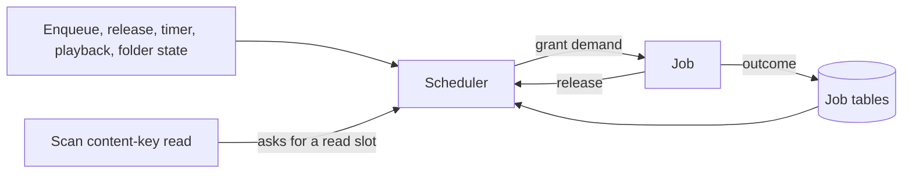

# Research: one scheduler for every file read

Inherited decisions: [ARCHITECTURE.md](../../ARCHITECTURE.md) (dependency
direction, [Queue workers](../../ARCHITECTURE.md#queue-workers)),
[import-pipeline.md](../../docs/design-docs/import-pipeline.md),
[process-lifecycle.md](../../docs/design-docs/process-lifecycle.md) and
[catalog-organization.md](../../docs/design-docs/catalog-organization.md)
(content keys identify files). This file records only the decisions this
feature adds, and the survey they rest on.

Terms used below: a **read slot** is the right to read one source file on one
**disk**; a **demand** is what one job needs from each resource; the
**scheduler** is the single component that grants demands from free capacity.

The diagram shows the model the decisions below build.

## R-1: One scheduler grants declared demands

**Decision**: One scheduler in `internal/jobs` grants each job its declared
demand (read slots on its disk, CPU slots, classifier slots) from free
capacity; it replaces the worker per stage and the separate loops.

| Option | Head-of-line blocking across disks | Shared limit on one disk | Verdict |
| --- | --- | --- | --- |
| **Single scheduler, demand per job** (Bazel `ResourceSet`, Kubernetes requests, Slurm licenses) | None: a job that does not fit is skipped | Yes | Chosen |
| Worker per stage plus a shared weighted semaphore | Yes: `semaphore.Weighted` serves waiters strictly in order | Yes | Rejected: a busy disk stalls every stage behind it |
| Worker pool per disk | None | Yes | Rejected: CPU-only and classifier work have no disk, so a second mechanism is still needed |

**Rationale**: Every surveyed scheduler that matches work to several resource
kinds declares a demand per job and filters by free capacity before ranking
(R-13). One component keeps every limit in one place, so the scan, playback
and background work can see the same counts.

## R-2: A job that does not fit is skipped

**Decision**: When the best-ranked job's demand does not fit, the scheduler
skips it and grants the next job that fits.

| Option | Behaviour when the head does not fit | Verdict |
| --- | --- | --- |
| **Skip to a job that fits** (Bazel `processWaitingRequests`) | Others proceed | Chosen |
| Stop and wait (Go `semaphore.Weighted`, Ninja within a pool, Slurm main scheduler) | Everything behind waits | Rejected: defeats per-disk parallelism |
| Skip with reservations (Slurm backfill) | Others proceed unless they would delay the head | Rejected: needs runtime estimates the jobs do not have |

**Rationale**: Skipping starves large demands; here every demand needs at most
one read slot to start (R-6), so no job can be skipped forever while its disk
has capacity.

## R-3: Disks take turns within a priority class

**Decision**: Within one priority class the scheduler visits disks round robin
and takes the oldest eligible job of each; CPU-only and classifier jobs form
their own groups in the rotation.

| Option | Fairness | Cost | Verdict |
| --- | --- | --- | --- |
| **Round robin over disk keys** (BullMQ Pro Groups, DRR with equal quanta) | Equal turns per disk | One claim per disk visited | Chosen |
| Global FIFO | A disk with 10,000 queued jobs delays the others | None | Rejected: requirement 4 of the parent Issue |
| Weighted fair queuing / SFQ | Proportional to weights | Virtual-time tags per job | Rejected: no weights to express; equal turns suffice |
| Dominant resource fairness | Fair across resource kinds | Per-user shares | Rejected: one owner, no users to share between |

## R-4: Priority classes are strict

**Decision**: Classes are served strictly in this order: owner requests, then
import, then backfill; a scan's content-key read is granted before any class
(R-9).

| Option | Behaviour | Verdict |
| --- | --- | --- |
| **Strict classes** (River and Oban priority ordering, BFQ classes) | Lower classes wait while higher work exists | Chosen |
| Weighted queues (asynq 6:3:1, Sidekiq weighted) | Every class progresses | Rejected: an owner's force rescan should not share time with bulk import |

**Rationale**: Owner requests are few, so they cannot starve import; backfill
waiting during an import is accepted by the parent Issue's edge cases.
Jellyfin (user refresh is High) and GoonHub (manual retry priority 1) give
user-triggered work the same lead.

## R-5: Read slots per disk follow the disk type

**Decision**: A disk has 1 read slot when it is rotational or its type is
unknown, and 4 when it is not rotational; there is no settings screen and no
runtime adaptation.

| Option | Signal | Risk | Verdict |
| --- | --- | --- | --- |
| **Fixed by disk type** | One read of the disk's type at startup or registration | SSD capacity not fully used | Chosen |
| Adaptive limit (Netflix Gradient2 / Vegas, Envoy, senpai on PSI) | Disk latency or stall time against a baseline | Oscillation, baseline bias, slow recovery, different signals on Linux and Windows | Rejected for this feature; the parent Issue moves it out of scope |
| User setting | Owner input | A setting most owners cannot judge | Rejected: requirement 5 of the parent Issue |

**Rationale**: No surveyed media server or job library adapts concurrency to
disk load; Immich, Jellyfin and stash all use fixed counts. Four matches the
seek-sprite job's current internal parallelism, so SSD throughput does not
fall. The value is a hint: Windows reports no seek penalty for some virtual
disks.

| Platform | Disk key | Type |
| --- | --- | --- |
| Linux | `st_dev` of the media folder root, mapped through `/sys/dev/block/<maj>:<min>` to its whole disk | `queue/rotational` of that disk |
| Windows | Physical device number of the folder's volume (`IOCTL_STORAGE_GET_DEVICE_NUMBER`) | `IOCTL_STORAGE_QUERY_PROPERTY` with `StorageDeviceSeekPenaltyProperty` |
| Either, when a lookup fails (network share, overlay) | `st_dev` or the volume alone | Unknown: 1 slot |

## R-6: A splittable job takes the free slots on start

**Decision**: The seek-sprite job needs one read slot to start and takes up to
three more free slots on the same disk at grant time, running that many
extractions in parallel.

| Option | Behaviour | Verdict |
| --- | --- | --- |
| **Elastic grant at start** (GNU make jobserver: one implicit slot, extra tokens on demand) | Starts with 1, uses idle slots | Chosen |
| Fixed demand of 4 or 8 slots | Never fits an HDD's single slot; skipped forever under R-2 | Rejected |
| Fixed demand of 1, internal parallelism unchanged | Reads 8 streams while counted as 1 | Rejected: breaks the per-disk limit |

## R-7: Handlers return one of four outcomes

**Decision**: A job ends as done, retry, cancel or snooze; retry waits
30 s × 4^(attempt − 1) with ±10% jitter up to the existing three attempts,
cancel fails it at once, and snooze requeues it without counting an attempt.

| Option | Verdict |
| --- | --- |
| **Four outcomes** (River `JobCancel`/`JobSnooze`, Oban `{:cancel}`/`{:snooze}`, asynq `SkipRetry`, BullMQ `UnrecoverableError`) | Chosen |
| Retry everything with backoff (GoonHub) | Rejected: a corrupt file is retried for nothing |
| No retry, rely on the next scan (stash, Immich `attempts: 1`, Jellyfin) | Rejected: a transient read error leaves a video unprepared until a manual rescan |

**Rationale**: River (`attempt^4` s, 25 attempts) and Oban (`15 + 2^attempt`
s, 20 attempts) spread many attempts over hours; with three attempts the
delays must still cover a disk spinning up or a share reconnecting, which
30 s, 2 min and 8 min do. A probe error the domain already classifies as
undecodable or unsupported is a cancel.

## R-8: An unavailable folder parks its jobs

**Decision**: When a media folder root cannot be read, its disk has zero read
slots until the root is readable again, so its jobs stay queued without
attempts; a job that finds its source gone mid-run snoozes and marks the root
for a check.

| Option | Verdict |
| --- | --- |
| **Zero capacity until readable** (Kubernetes parks unschedulable pods until a relevant event) | Chosen: no state is added to the job row |
| Fail each job (current behaviour) | Rejected: requirement 13 of the parent Issue |
| A `parked` job state | Rejected: duplicates what zero capacity already expresses |

Immich, Jellyfin and PhotoPrism likewise skip an inaccessible library root
instead of deleting or failing its items.

## R-9: The scan keeps content keys inline and reads within the limits

**Decision**: The scan still computes content keys inline for new and changed
files, but holds a read slot on the file's disk for each read, granted ahead
of every job class.

| Option | Verdict |
| --- | --- |
| **Inline key, read slot from the scheduler** | Chosen |
| Defer identification to a job | Rejected: stash and PhotoPrism compute content identity inline; projects that defer it (Immich external libraries, Jellyfin) do not detect moves at all |
| Inline key outside the scheduler (current behaviour) | Rejected: acceptance criterion 3 of the parent Issue |

**Rationale**: The scan produces the work every job consumes, so it goes
first. The key's read window (two 1 MiB reads) stays: changing it changes
every existing content key.

## R-10: Playback holds background reads to one slot

**Decision**: While a stream or live transcode reads a disk, that disk's read
capacity for background work is 1, never 0, and returns to its type value when
the last reader closes.

| Option | Verdict |
| --- | --- |
| **Cap at one slot** | Chosen |
| Pause background reads | Rejected: the owner asked for throttling, not stopping; BFQ keeps a thin share for its idle class and mq-deadline dispatches requests older than 10 s for the same reason |
| OS priority alone | Rejected: Linux ioprio works only under bfq or mq-deadline, and the container cannot choose the host's I/O scheduler |

**Rationale**: No surveyed media server reacts to playback (Plex and Jellyfin
schedule heavy work for maintenance hours instead), so this rule is this
repository's own.

## R-11: Background processes run at low priority

**Decision**: Every ffmpeg or ffprobe a job starts runs at nice 10 with the
best-effort I/O class at level 7 on Linux, and `BELOW_NORMAL_PRIORITY_CLASS`
on Windows; live transcoding keeps normal priority.

| Option | Verdict |
| --- | --- |
| **Lower CPU and I/O priority per child process** (Jellyfin `ProcessPriorityClass.BelowNormal`, Syncthing nice 9 and Windows below normal) | Chosen |
| I/O idle class | Rejected: idle-class requests may wait until the disk is quiet, which could stall import while anything else reads |
| Windows `PROCESS_MODE_BACKGROUND_BEGIN` | Rejected: it applies only to the calling process, not a child |

## R-12: Content queues join as sources

**Decision**: The scheduler draws from the jobs table and from the
auto-tagging, face-analysis and duplicate-judging tables through one source
interface; the tables stay.

| Option | Verdict |
| --- | --- |
| **Sources over existing tables** | Chosen |
| Move every queue into the jobs table | Rejected: each table carries its own activity and recovery rules ([auto-tagging.md](../../docs/design-docs/auto-tagging.md), [face-recognition.md](../../docs/design-docs/face-recognition.md), [duplicate-judging.md](../../docs/design-docs/duplicate-judging.md)); rewriting them is outside this feature |

## R-13: Startup work becomes jobs

**Decision**: Keyframe and media-information backfills and republishing
virtual-video thumbnails are queued as jobs of the backfill class at startup;
startup itself keeps only database recovery and key rebuilds.

| Option | Verdict |
| --- | --- |
| **Queue as jobs** | Chosen: they share the read and CPU limits and the 1-minute polling loop goes |
| Keep the goroutines | Rejected: their reads bypass the per-disk limit (acceptance criterion 3) |

## Survey

The decisions above cite these sources. Each was read from source or its
in-repository documentation on 2026-10-27; claims marked unverified were seen
only in search summaries.

| Area | Sources and revisions | Finding used here |
| --- | --- | --- |
| Media servers' processing | stash `9e9ad97` (`pkg/job`, `internal/manager/task_generate.go`), GoonHub `20ff985` (`internal/core/processing`), Immich `df50249` (`services/job.service.ts`, `dtos/config.dto.ts`), Jellyfin `02c2951` (`TrickplayManager.cs`, `LimitedConcurrencyLibraryScheduler.cs`), PhotoPrism `16f5c23` (`config_index.go`) | Limits per work kind with heavy video work at 1; skip existing outputs; chaining by "on done"; retries rare; no disk awareness; priority only for user-triggered work |
| Job queue libraries | River `fc6c1d5` (SQLite driver, `retry_policy.go`, `error.go`), Oban `eb7e888` (`engines/lite.ex`, `backoff.ex`), goqite `71a9359`, asynq `83e0966`, BullMQ `4b3eba2` (Groups, limiter), Sidekiq `0aaab7f` | One table with priority and run-after; single-statement claim on SQLite; backoff with jitter; cancel and snooze outcomes; per-queue limits; strict priority within a queue |
| Resource scheduling | Bazel `ResourceManager.java`, Ninja pools, GNU make jobserver, Kubernetes scheduling framework, Nomad, HTCondor, Slurm backfill and licenses, `x/sync/semaphore`, DRR, SFQ, DRF | Demand vectors filtered by free capacity then ranked; the four choices when the head does not fit (R-2); a group key per resource with round robin |
| Adaptive concurrency and yielding | Netflix concurrency-limits, Envoy adaptive concurrency, Linux PSI and `ioprio.rst`, BFQ, mq-deadline, Windows priority docs, Jellyfin, Syncthing `lowprio_*.go`; Plex, Backblaze and Time Machine unverified | Latency against a baseline, additive increase and multiplicative decrease, and their failure modes; OS priority slows rather than stops |
| Scan identity | stash `pkg/file/scan.go` (oshash inline, moves by fingerprint), PhotoPrism `index_mediafile.go` (SHA1 inline), GoonHub `scan_service.go`, Immich `library.service.ts`, Jellyfin `LibraryManager.cs` | Content identity is computed inline or not at all; unchanged files are skipped by path and modification time |
| Windows disk type | [DEVICE_SEEK_PENALTY_DESCRIPTOR](https://learn.microsoft.com/en-us/windows-hardware/drivers/ddi/ntddstor/ns-ntddstor-_device_seek_penalty_descriptor), [The Old New Thing 2020-10-23](https://devblogs.microsoft.com/oldnewthing/20201023-00/?p=104395), [Chromium `drive_info_win.cc`](https://chromium.googlesource.com/chromium/src.git/+/lkgr/base/files/drive_info_win.cc) | A volume handle answers the seek-penalty query; virtual disks may report no penalty |
