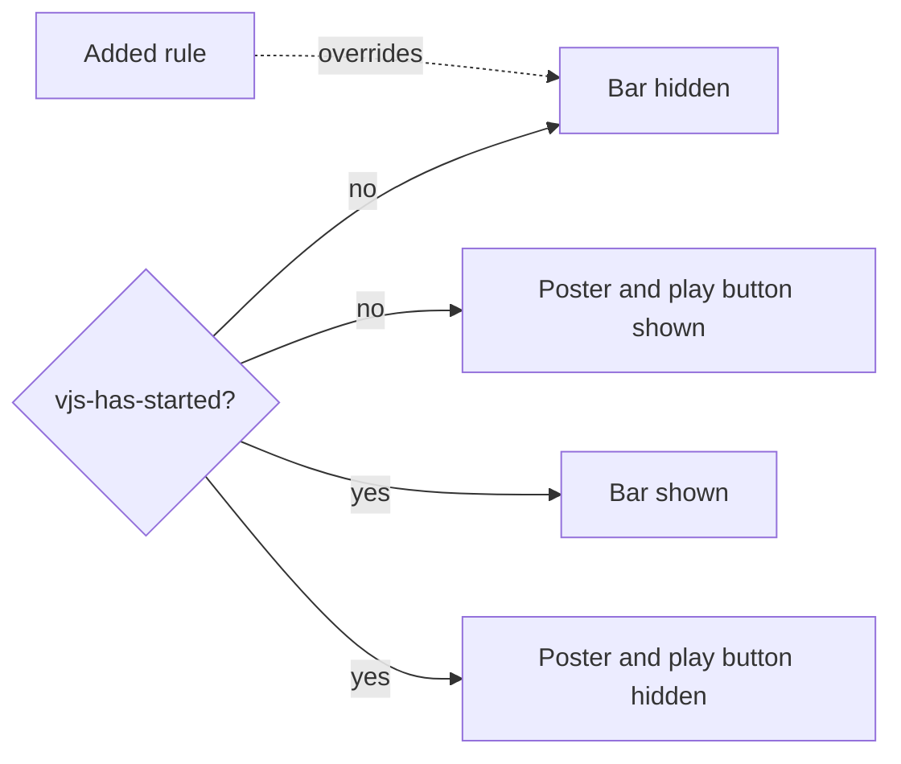

# Research: Control bar before playback

Inherited decisions:
[Control bar](../../docs/design-docs/library-ui.md#control-bar) (which parts
are video.js components and how the bar behaves),
[Player states](../../docs/design-docs/library-ui.md#player-states) and
[Playback quality](../../docs/design-docs/playback-quality.md) (the `data-loading`
hide and the quality switch that replaces the source in place).
This file records only the decision this feature adds.

## R-1: A stylesheet rule shows the bar before `vjs-has-started`

**Decision**: [`web/src/index.css`](../../web/src/index.css) shows
`.vjs-control-bar` on a `.video-js` that has no `vjs-has-started` class, with
the same `display`, `visibility` and `opacity` the video.js stylesheet gives it
after the first play; the player code does not change how it starts.

video.js ties three things to one class. The diagram shows what `vjs-has-started`
decides in its stylesheet, and which rule this feature adds.

| Option | Poster and central play button | Bar while paused before play | Survives a source replacement | Verdict |
| --- | --- | --- | --- | --- |
| **Stylesheet rule for the not-started player** | Unchanged | Shown; video.js fades the bar only with `vjs-playing` | Yes: the rule reads the class, whatever its value | Chosen |
| `player.hasStarted(true)` at `ready` | Hidden: the same class hides `.vjs-poster` and `.vjs-big-play-button` | Shown | No: video.js clears the class on `loadstart` while paused, which a quality change or a seek on the transcode route triggers | Rejected: requirement 5 keeps the central play button, and the bar would vanish again after a quality change |
| A React control bar before play, replaced by the video.js bar on play | Unchanged | Shown | Yes | Rejected: the quality, subtitle, speed and chapter menus are video.js components, and a second bar would have to be kept in step with them |

**Rationale**: The hide before the first play is a stylesheet rule in video.js,
so a stylesheet rule is the smallest change that removes it, and the rule
leaves the poster, the central play button and the `data-loading` hide (which
the parent Issue keeps) as they are. `player.hasStarted(true)` stays where
[`VideoPlayer.tsx`](../../web/src/player/VideoPlayer.tsx) already calls it, on
failure and during reconnects, because there it also hides the poster under
the failure overlay.

The added rule yields to the hides that video.js and this repository keep:
`vjs-controls-disabled`, `vjs-error`, and `.vv-video-player[data-loading]`,
which hides the bar until the first `loadedmetadata`. For a video opened
without autoplay, metadata arrives before the viewer presses play (the player
preloads it), so the bar and the duration appear while the poster shows.
