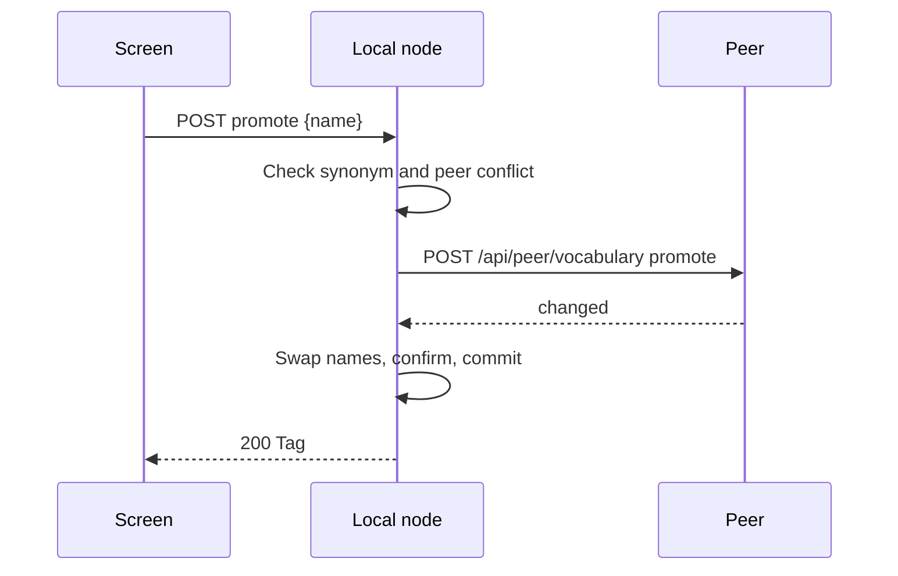

# Contract: Tag synonym operations

Source of truth: [api/openapi.yaml](../../../api/openapi.yaml), new operations
`promoteTagSynonym`, `moveTagSynonym` and `detachTagSynonym`, and the changed
`applyPeerVocabulary`. All three new operations are owner-only and change
nothing on an error.

The table shows the errors the three operations share.

| Status | `code` | `reason` | When |
| --- | --- | --- | --- |
| 400 | `invalid_request` | `tag_name_empty`, `tag_name_control_characters`, `tag_name_too_long` | `name` breaks the tag-name rule |
| 404 | `tag_not_found` | | The tag `id` is missing or a remote id (at or above `2^40`) |
| 409 | `tag_synonym_not_found` | | `name` is not a synonym of `id` now, including when it is `id`'s canonical name |
| 409 | `peer_unreachable` | | `promote` only: the node is paired and the peer is not `connected` |

## `POST /api/tags/{id}/synonyms/promote`

Makes the synonym `name` the canonical name of tag `id`; the old canonical
name becomes a synonym, and the tag becomes confirmed.

| Field | In | Type | Required | Meaning |
| --- | --- | --- | --- | --- |
| `id` | path | int64 | yes | The tag |
| `name` | body | string | yes | The synonym to make canonical, normalized like a tag name |

**Response**: `200` with the updated `Tag`.

The sequence shows a promote on a paired node.

A peer conflict answers the peer's `409 tag_name_taken` with `tagName`, as a
rename does.

## `POST /api/tags/{id}/synonyms/move`

Moves the synonym `name` from tag `id` to tag `targetId` as a synonym; the
target becomes confirmed. Explicit attachments stay on `id`.

| Field | In | Type | Required | Meaning |
| --- | --- | --- | --- | --- |
| `id` | path | int64 | yes | The source tag |
| `name` | body | string | yes | The synonym to move |
| `targetId` | body | int64 | yes | The tag that receives it |

**Response**: `200` with `{source: Tag, target: Tag}`.

| Status | `code` | `reason` | When |
| --- | --- | --- | --- |
| 400 | `invalid_request` | `move_same_tag` | `targetId` equals `id` |
| 404 | `tag_not_found` | | `targetId` is missing or remote |

## `POST /api/tags/{id}/synonyms/detach`

Removes the synonym `name` from tag `id` and creates a confirmed tag with it
as the canonical name, no kind and no explicit attachments.

| Field | In | Type | Required | Meaning |
| --- | --- | --- | --- | --- |
| `id` | path | int64 | yes | The source tag |
| `name` | body | string | yes | The synonym to detach |

**Response**: `201` with `{source: Tag, created: Tag}`.

## `POST /api/peer/vocabulary` (changed)

`PeerVocabularyRequest.action` gains `promote` for `kind: tag`, with `name`
(the current canonical name) and `newName`. When the tag named `name` holds
`newName` as a synonym, the two are swapped; otherwise the tag is renamed to
`newName`. A missing `name` answers `changed: false`; a `newName` held by
another tag answers `409 tag_name_taken`.

## Client use

`web/src/api/tags.ts` gains `promoteTagSynonym`, `moveTagSynonym` and
`detachTagSynonym`, which refresh the shared tag cache after success like
`mergeTag`, and add `tag_synonym_not_found` to the codes that refresh it on a
stale answer.
