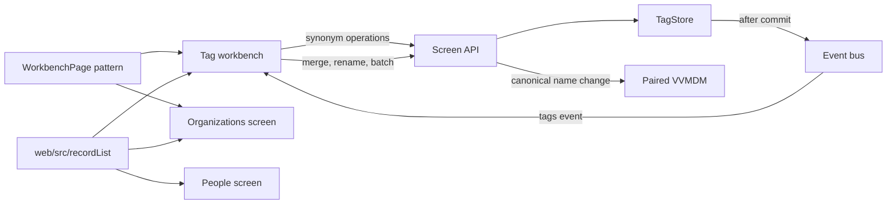
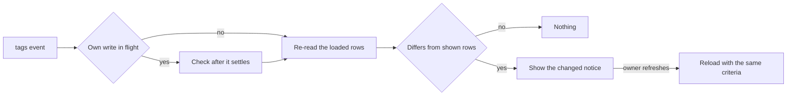
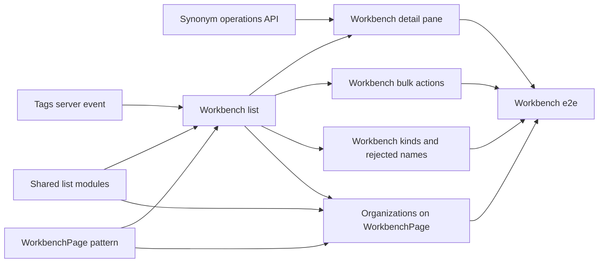

# Implementation Plan: Tag workbench

**Branch**: `feature/070-tag-workbench` | **Parent Issue**: #1480

**Input**: The parent Issue. It is this feature's specification.

## Summary

The tags screen becomes a workbench for organizing tags: a dense list of tags
beside the selected tag's details, where the synonym operations the Issue asks
for are the first controls. The screen API gains three synonym operations
(make a synonym the canonical name, move a synonym to another tag, detach a
synonym into a new tag), and a `tags` server event lets an open screen say the
list changed without moving it. The design system replaces `AdminTablePage`
with a `WorkbenchPage` pattern, the organizations screen moves onto it, and the
list pieces other screens borrow from `web/src/tags/` move to shared homes.

The diagram shows the parts this feature adds or changes.



## Technical Context

**Canonical definitions**: [ARCHITECTURE.md](../../ARCHITECTURE.md) for
layers, store roles, events after commit and the web layer;
[catalog-organization.md](../../docs/design-docs/catalog-organization.md) for
tags, tag kinds, search keys and folder-derived tags;
[peer-library.md, Vocabulary by name](../../docs/design-docs/peer-library.md#vocabulary-by-name)
for writes on a paired node; [library-ui.md](../../docs/design-docs/library-ui.md)
for the current tags and organizations screens, virtualization and URL
criteria; [design-system.md](../../docs/design-docs/design-system.md) and
[web/registry/rules/patterns.md](../../web/registry/rules/patterns.md) for the
page patterns; [api/openapi.yaml](../../api/openapi.yaml) for the screen API;
[testing.md](../../docs/design-docs/testing.md) and
[web-testing.md](../../docs/design-docs/web-testing.md) for test levels.

**Feature-specific context**:

| Item | Delta |
| --- | --- |
| Synonym storage | A synonym is a `tag_names` row with `canonical = 0`; names are unique across canonical names and synonyms. The new operations rewrite rows and add no table or migration |
| Scale | The workbench stays responsive with 5,000 tags: server pages of 100 rows and a virtualized list, as today ([Tag workbench screen](#tag-workbench-screen)) |
| Bulk limit | `MaxTagBatch` (20,000) stays the limit for bulk actions and merges |
| Change notice | There is no tag event today; the screen reloads only after its own writes and on `peerItems` ([Change notice](#change-notice)) |
| External API and MCP | Unchanged; the new operations are screen API only ([Synonym operations](#synonym-operations)) |

## Constitution Check

*GATE: Must pass before Phase 0 research. Re-check after Phase 1 design.*

| Rule | Source | Verdict |
| --- | --- | --- |
| The domain decides, the store enforces | ARCHITECTURE.md | The rules for each synonym operation (which names may move, what becomes confirmed) are in `internal/domain`; `TagStore` re-reads the source, the name and the target in the operation's transaction |
| Store roles | ARCHITECTURE.md | The three operations are `TagStore` methods; no other role gains tag writes |
| Events after commit | ARCHITECTURE.md | `domain.TagsChanged` is published only after a committed tag or attachment write |
| Every read knows its viewer | ARCHITECTURE.md | The new operations are owner-only in `api/openapi.yaml`, so the routing test covers them; the `tags` event goes to owners only |
| Remote ids carry an offset | ARCHITECTURE.md | The synonym operations answer 404 for a remote id, as synonym edits do today; canonical-name changes reach the peer by name ([Synonym operations](#synonym-operations)) |
| Pages never call `fetch` | ARCHITECTURE.md, Web layer | `web/src/api/tags.ts` is the only caller of the new operations |
| Generated files are not hand-edited | AGENTS.md | `api/openapi.yaml` changes, then `task generate` |
| Complexity 25 and no copies | AGENTS.md | The pieces credits and settings borrow from `web/src/tags/` are moved, not copied ([Shared list modules](#shared-list-modules)) |
| Design system first | AGENTS.md, design-system.md | `WorkbenchPage` is added to the registry before a screen uses it, and `AdminTablePage` is removed with its last caller |

No gate is at stake after Phase 1; `## Complexity Tracking` is left out.

## Synonym operations

Three owner-only operations under `/api/tags/{id}/synonyms/` change one
synonym of a tag in one transaction each
([contracts/tag-synonym-operations.md](contracts/tag-synonym-operations.md)).
"Make this tag a synonym of another tag" is the existing merge with the other
tag as the target; the workbench offers it under that name (requirement 6).

The table shows what each operation changes.

| Operation | Names | Explicit attachments | Tentative state |
| --- | --- | --- | --- |
| Make canonical (`promote`) | The synonym becomes the canonical name; the old canonical name becomes a synonym | Unchanged | The tag is confirmed |
| Move (`move`) | The synonym leaves the source and becomes a synonym of the target | Stay on the source | The target is confirmed; the source is unchanged |
| Detach (`detach`) | The synonym leaves the source and becomes the canonical name of a new tag | The new tag has none | The new tag is confirmed; the source is unchanged |

| Decision | Rejected | Why |
| --- | --- | --- |
| Three explicit operations, each naming the synonym and, for a move, the target id | `PATCH /api/tags/{id}` renaming to the tag's own synonym swaps the names | A rename of a canonical name is also the peer's by-name write and the external API's `rename_tag`; giving an existing call a second meaning changes them all |
| Same | Replacing a tag's whole synonym list in one request | A list written from a stale screen silently undoes changes made elsewhere; one named synonym fails cleanly when it is gone |
| A synonym that is no longer the tag's answers `409 tag_synonym_not_found`, a missing source or target `404 tag_not_found`, and nothing changes | Applying what still applies | The Issue's edge case asks for no change and a reason when the other side moved |
| Moving to the source itself answers `400 invalid_request` with reason `move_same_tag` | Treating it as a no-op | The screen never offers it, so a request that asks for it is a client error, like `merge_same_tag` |
| Explicit attachments stay with the tag id; videos whose folder name equals the moved or detached name follow the name, as folder-derived tags always do | Moving attachments with the name | `video_tags` does not record which name attached a video (the Issue's edge case for detach) |
| Every operation publishes the smart-folder notice and the `tags` event after commit, as merge does | Only the `tags` event | Moving a name changes folder-derived matches, which smart folders read |
| On a paired node, `promote` writes the peer first by canonical name with the new action `promote`, then the local node; `move` and `detach` stay local | All three stay local | Tags join across nodes by canonical name, so a local-only promote splits one shown tag into two; synonyms and creation are per node already ([peer-library.md](../../docs/design-docs/peer-library.md#vocabulary-by-name)) |
| The peer's `promote` swaps when the peer's tag holds the new name as a synonym, and otherwise renames | Plain rename on the peer | A rename to the peer's own synonym is a conflict, and the two nodes may hold different synonyms |
| No external API or MCP change | Adding the operations to `/api/v1/tags/synonyms` | The Issue is about the screen; an external contract change is its own versioned decision |

## Change notice

A new owner-only server event `tags` (an empty object) is sent after a
committed change to the tag list's rows: tag names, synonyms, kinds, tentative
state, creation, deletion, merges and video attachments, including automatic
tagging ([contracts/tags-event.md](contracts/tags-event.md)).

The diagram shows what the open workbench does with the event.



| Decision | Rejected | Why |
| --- | --- | --- |
| A dedicated `tags` event, coalesced per subscriber like `candidates` | Reusing the all-folders `smartFolder` event | That event also fires for people, favorites and watch state, and reaches guests |
| The workbench re-reads the rows it has loaded, with its criteria, in pages of 200 (`MaxTagPageLimit`), and compares them and the totals with what it shows, and shows a notice to refresh | Reloading on the event | The Issue's edge case forbids moving the list on its own |
| Same | Re-reading the first page only | A synonym added elsewhere to a loaded tag past the first page changes neither the first page nor the totals, so the notice and the selected tag's pane would stay stale |
| Same | A vocabulary revision returned by every write and carried by the event | Every write path, including scans that change folder-derived counts, would have to bump it in its transaction; comparing the loaded rows needs no new state, and 5,000 loaded rows are 25 reads after an event |
| The check waits for the workbench's own writes to settle | Ignoring events for a fixed time after a write | Own writes are applied to the shown rows first, so a later check matches them; a timer either hides other writes or shows a notice for its own |
| Folder-derived count changes from a scan send no `tags` event | Sending it on every video change | A scan changes thousands of videos; the existing continuation check (`totalAll`) still catches a list that changed under paging |

## Tag workbench screen

`/tags` becomes a `WorkbenchPage`: the list of tags with its search, filters
and sort beside one pane that shows the selected tag, or the bulk actions when
several are checked. Kinds and rejected names stay views of the same screen
(`tab` in the URL). The layout, states and widths are decided in
`ui-design.md`.

| Decision | Rejected | Why |
| --- | --- | --- |
| List beside a detail pane; on a narrow width the pane opens over the list as a sheet | Rows with icon buttons and nested dialogs, as today | Requirement 1 and the Issue's UI quality: operations are found in one place, not per row |
| Same | A page per tag (`/tags/:id`) | Organizing moves between many tags; each round trip loses the list position and the selection |
| Same | Rows that expand in place | Variable row heights move the rows below while the virtualized list scrolls, against "positions do not jump" |
| The pane's first controls are merge, make a synonym of another tag, and the per-synonym operations; delete and reject sit behind a secondary menu | Equal-weight buttons | The Issue's UI quality asks for this order |
| The selected tag is not in the URL; search, filters, sort and the view stay as today (`q`, `tentative`, `unused`, `kind`, `sort`, `tab`) | Adding `tag=<id>` | Requirement 8 covers the criteria only, and an id kept in history goes stale after a merge or delete |
| The list keeps server pages of 100 rows and the `@tanstack/react-virtual` virtualizer, scrolling inside its own region so the pane stays visible | Loading every tag at once | A list request without a limit returns every tag with its synonyms; paging keeps the first paint independent of the library size |
| Bulk selection covers loaded rows and stops at 20,000 before running, as today | Selecting across unloaded pages | Requirement 2 keeps today's behaviour; the Issue's edge case keeps the limit check |
| A stale target (`tag_not_found`, `tag_synonym_not_found`) shows the reason and reloads the list | Retrying | The Issue's edge case |

## Design-system pattern

`WorkbenchPage` (item `workbench-page`, example `workbench-page-example`)
replaces `AdminTablePage` in the skeleton table of
[patterns.md](../../web/registry/rules/patterns.md#choosing-the-skeleton) as
"Organizes a large set of records: a list beside the selected record's details
and operations". It composes the existing `Toolbar`, `DataTable`,
`SelectionBar`, `EmptyState` and shadcn `Sheet`; tokens and shadcn components
do not change.

| Decision | Rejected | Why |
| --- | --- | --- |
| Remove `AdminTablePage`, its example and its rules, in the change that moves its last caller | Keeping it for other admin tables | Requirement 9; only the tags and organizations screens use it |
| Organizations move onto `WorkbenchPage`, with the details dialog's fields (aliases, external ids, parent) in the pane | Keeping organizations on a plain table | Requirement 10; the details are what the pane is for |
| The people screen keeps `ListPage` with face cards and only stops importing from `web/src/tags/` | Moving people onto `WorkbenchPage` | People are browsed by face ([people.md](../../docs/design-docs/people.md)); rename, merge and delete live on the person page, which acceptance 6 already covers |

## Shared list modules

The pieces other screens import from `web/src/tags/` move before the screen is
rebuilt, so the rebuild deletes the old files without breaking callers.

| Piece | New home |
| --- | --- |
| `usePagedRows`, `useSearchQuery`, `useUrlCriteria`, the generic row helpers and types of `tagPageRows.ts`, the virtual rows and their focus handling, `useAdminTableBand`, `AdminListToolbar`, list notices | `web/src/recordList/` |
| `DialogError`, `RowMoreMenu`, `RowIconButton`, `RowNameInput`, `MergeTargetField`, `MergeSummary` | `web/src/ui/` as registry components |
| `TagListSort` and its guard, used by preferences | `web/src/api/tags.ts` |

| Decision | Rejected | Why |
| --- | --- | --- |
| A new `web/src/recordList/` for list data hooks, beside `videoList/` | `web/src/lib/` | `lib/` holds helpers without screen state; these hooks page through the API |
| Move first, in its own unit | Moving during the rebuild | A pure move is reviewable by diff, and the rebuild unit then only deletes |

## Project Structure

### Documentation (this feature)

```text
specs/070-tag-workbench/
├── plan.md
├── quickstart.md                          # Checks a person makes: 5,000 tags, the change notice
└── contracts/
    ├── tag-synonym-operations.md          # promote, move, detach, peer promote
    └── tags-event.md                      # the tags server event
```

No `research.md`: every decision and its rejected alternatives fit in this
plan's tables. No `data-model.md`: no table or entity is added.
`ui-design.md` is written by the `design` stage.

### Source Code

**Affected boundaries**: `internal/domain` (synonym rules, `TagsChanged`),
`internal/store` (`TagStore` operations, publishing), `internal/httpapi`
(handlers, peer promote, `tags` event), `api/openapi.yaml`, `web/src/api/`,
`web/src/tags/`, `web/src/credits/`, `web/src/settings/`,
`web/src/history/`, `web/src/preferences/`, `web/src/ui/`, `web/registry*`,
`web/e2e/tags.e2e.ts`.

**New paths**: `web/src/recordList/`, `web/src/ui/patterns/workbench-page.tsx`,
`web/src/designSystem/blocks/workbench-page-example.tsx`,
`docs/design-docs/tag-organizing.md`.

**Structure decision**: Follows the existing layout
([ARCHITECTURE.md, Web layer](../../ARCHITECTURE.md#web-layer)), plus
`recordList/` as decided in [Shared list modules](#shared-list-modules).

## Implementation Work

The graph shows the units and what each waits for.



### Make a synonym canonical, move it or detach it through the screen API

**Scope**: The three operations and the peer `promote` action in
[contracts/tag-synonym-operations.md](contracts/tag-synonym-operations.md):
domain rules, `TagStore` methods, handlers, `api/openapi.yaml` and
`task generate`, and their wrappers in `web/src/api/tags.ts`. Adds
`docs/design-docs/tag-organizing.md` with the operations table and decisions
of [Synonym operations](#synonym-operations), linked from the index.

**Dependencies**: None

**Acceptance**: Store tests show, per operation, the names and tentative state
after it, attachments unchanged for promote and move, none on a detached tag,
and no change with `tag_synonym_not_found` or `tag_not_found` when the synonym
or target is gone. A video-list test filters by a promoted, moved and detached
name and gets the tag named in the table. Handler tests cover `move_same_tag`,
a remote id answering 404, and on a paired pair of test servers that `promote`
changes the canonical name on both and `move` only locally. `web/src/api`
tests assert each wrapper's request.

### Send a tags server event when the tag list changes

**Scope**: `domain.TagsChanged`, its publication after commit from every tag,
kind and attachment write, and the owner-only `tags` SSE event in
[contracts/tags-event.md](contracts/tags-event.md); the event type in
`web/src/api/serverEvents.ts`. Adds the event to
`docs/design-docs/tag-organizing.md` or creates the file if the synonym
operations unit has not landed.

**Dependencies**: None

**Acceptance**: A store test shows one event after a committed rename,
attachment and kind change, and none after a rolled-back write. An HTTP test
reads `event: tags` for the owner after a write and nothing for a guest.

### Move the list pieces other screens use out of web/src/tags

**Scope**: The moves in [Shared list modules](#shared-list-modules), with
their tests, and every importer in `web/src/credits/`, `web/src/settings/`,
`web/src/history/`, `web/src/preferences/` and `web/src/testing/`. Moved
`web/src/ui` pieces become registry items. No behaviour changes.

**Dependencies**: None

**Acceptance**: No file outside `web/src/tags/` imports from it
(`grep -r "tags/" web/src --include=*.ts*` outside `src/tags` finds only
`api/tags`), `task check SCOPE=web` passes with the existing credits, people,
settings and history tests unchanged apart from import paths, and
`task generate-check` passes.

### Add the WorkbenchPage pattern to the design system

**Scope**: `web/src/ui/patterns/workbench-page.tsx`, its example block, the
registry entries, its row in the skeleton table and a `WorkbenchPage` section
in `patterns.md`, and its showcase entry, following
[Design-system pattern](#design-system-pattern) and `ui-design.md`.
`AdminTablePage` stays until the organizations unit.

**Dependencies**: None

**Acceptance**: `task generate-check` passes with `workbench-page.json`
built; the showcase renders the example at the widths `ui-design.md` names,
reviewed visually (list beside pane, sheet on a narrow width, selection
state).

### Rebuild the tags screen as a workbench list with search, filters and sort

**Scope**: The new `/tags` screen on `WorkbenchPage`: list, search,
filters, sort and their URL, create, empty states for no tags and no matches,
selection of one tag (pane shows its name, count, kind, tentative state and
synonyms read-only), the change notice of [Change notice](#change-notice), and
deletion of the old screen's files and tests, including
`web/src/testing/tagsPage.tsx`. Updates the tags part of
[library-ui.md](../../docs/design-docs/library-ui.md).

**Dependencies**: Send a tags server event when the tag list changes; Move the
list pieces other screens use out of web/src/tags; Add the WorkbenchPage
pattern to the design system

**Acceptance**: Component tests: criteria round-trip through the URL and are
restored on reload and Back (acceptance 5); an event whose re-read differs in
a loaded row past the first page shows the notice and leaves the rows in
place, one whose re-read matches shows nothing, and one during an own write is
checked after it; the two empty
states. A visual review at the `ui-design.md` widths.

### Organize a tag from the workbench detail pane

**Scope**: In the pane: rename, kind, add and remove synonyms, make a synonym
canonical, move a synonym to another tag, detach a synonym, make this tag a
synonym of another tag, merge, confirm, reject and delete, with stale-target
handling.

**Dependencies**: Make a synonym canonical, move it or detach it through the
screen API; Rebuild the tags screen as a workbench list with search, filters
and sort

**Acceptance**: Component tests with a fake API assert each control's request
and the row after it: promote shows the new name with the old one as a
synonym; move removes the synonym from the row; detach adds the new tag;
make-a-synonym-of removes this tag and shows its names under the target; a
`tag_synonym_not_found` or `tag_not_found` answer shows the reason and reloads.
A visual review of the pane's states.

### Act on the selected tags from the workbench

**Scope**: Bulk confirm, reject, delete, set kind and merge for checked tags,
the select-all and over-limit rules, and the impact counts before reject,
delete and merge.

**Dependencies**: Rebuild the tags screen as a workbench list with search,
filters and sort

**Acceptance**: Component tests assert each bulk request, the rows after it,
`notFoundIds` handled as stale, and that a selection over 20,000 is stopped
before any request. A visual review of the pane with several tags checked.

### Manage tag kinds and rejected names in the workbench

**Scope**: The kinds view (create, rename, delete, card-first, link to the
kind's tags) and the rejected names view (list, forget) on the workbench.

**Dependencies**: Rebuild the tags screen as a workbench list with search,
filters and sort

**Acceptance**: Component tests: deleting a kind leaves its tags with no kind
in the list; forgetting a rejected name removes it from the view. A visual
review of both views.

### Move the organizations screen onto WorkbenchPage and remove AdminTablePage

**Scope**: The organizations screen on `WorkbenchPage` with list, search,
create, rename, merge, delete and the details in the pane; removal of
`admin-table-page`, its example, its rules and the references in
`design-system.md`, `library-ui.md` and `people.md`.

**Dependencies**: Move the list pieces other screens use out of
web/src/tags; Add the WorkbenchPage pattern to the design system; Rebuild the
tags screen as a workbench list with search, filters and sort

**Acceptance**: The organizations component tests cover list, search,
create, rename, merge and delete (acceptance 6); `grep -r AdminTablePage
web docs` finds nothing (acceptance 8); `task generate-check` passes. A visual
review of the organizations screen.

### Cover the tag workbench end to end

**Scope**: Rewrite the tag-screen tests of `web/e2e/tags.e2e.ts` for the
workbench (the card overflow test there stays), and run
[quickstart.md](quickstart.md).

**Dependencies**: Organize a tag from the workbench detail pane; Act on the
selected tags from the workbench; Manage tag kinds and rejected names in the
workbench; Move the organizations screen onto WorkbenchPage and remove
AdminTablePage

**Acceptance**: The e2e spec, run through `workflow_dispatch` of `ci.yml`,
shows that after promote the library card shows the new name and a search for
the old name finds the same videos (acceptance 1), after move tagging a video
by the moved name attaches the target (acceptance 2), and after detach the new
tag is listed (acceptance 3). The quickstart's 5,000-tag check is recorded in
the PR (acceptance 4).
