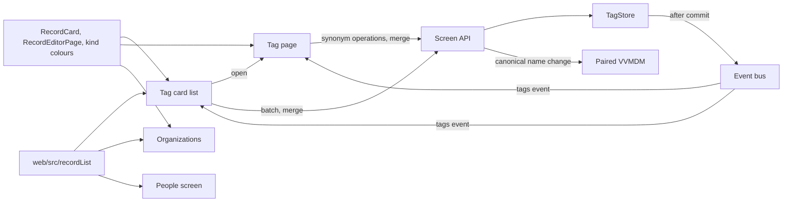
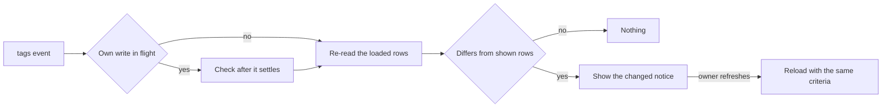
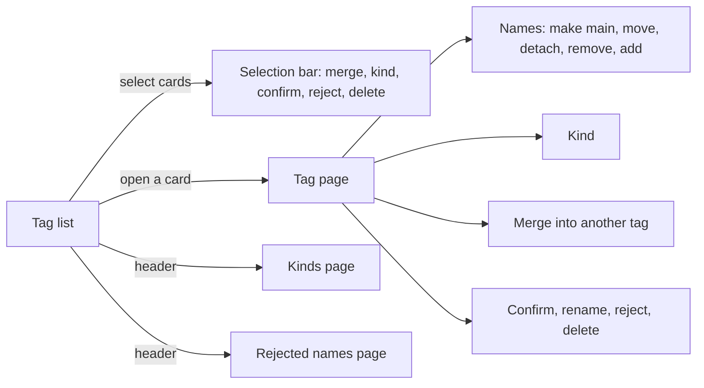
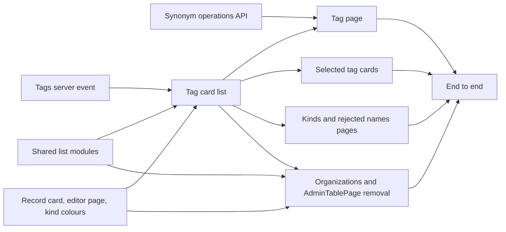

# Implementation Plan: Tag cards and tag pages

**Branch**: `feature/070-tag-workbench` | **Parent Issue**: #1480

**Input**: The parent Issue. It is this feature's specification.

## Summary

The tags screen becomes a grid of tag cards with the kind filter beside the
title and a strip of what is left to tidy (tentative, no kind, unused), and
each tag gets a page of its own (`/tags/:id`) where its names, kind and merge
are organized. The screen API gains three synonym operations (make a synonym
the canonical name, move a synonym to another tag, detach a synonym into a new
tag), and a `tags` server event lets an open screen say the list changed
without moving it. The design system replaces `AdminTablePage` with a record
card, a record editor skeleton and kind colours; the organizations screen moves
onto the same pieces, and the list pieces other screens borrow from
`web/src/tags/` move to shared homes.

The diagram shows the parts this feature adds or changes.



## Technical Context

**Canonical definitions**: [ARCHITECTURE.md](../../ARCHITECTURE.md) for
layers, store roles, events after commit and the web layer;
[catalog-organization.md](../../docs/design-docs/catalog-organization.md) for
tags, tag kinds, search keys and folder-derived tags;
[peer-library.md, Vocabulary by name](../../docs/design-docs/peer-library.md#vocabulary-by-name)
for writes on a paired node; [library-ui.md](../../docs/design-docs/library-ui.md)
for the current tags and organizations screens, virtualization and URL
criteria; [design-system.md](../../docs/design-docs/design-system.md) and
[web/registry/rules/patterns.md](../../web/registry/rules/patterns.md) for the
page patterns; [api/openapi.yaml](../../api/openapi.yaml) for the screen API;
[testing.md](../../docs/design-docs/testing.md) and
[web-testing.md](../../docs/design-docs/web-testing.md) for test levels.

**Feature-specific context**:

| Item | Delta |
| --- | --- |
| Synonym storage | A synonym is a `tag_names` row with `canonical = 0`; names are unique across canonical names and synonyms. The new operations rewrite rows and add no table or migration |
| Scale | The tag list stays responsive with 5,000 tags: server pages of 100 and a row-virtualized card grid ([Tag list and tag page](#tag-list-and-tag-page)) |
| Bulk limit | `MaxTagBatch` (20,000) stays the limit for bulk actions and merges |
| Change notice | There is no tag event today; the screen reloads only after its own writes and on `peerItems` ([Change notice](#change-notice)) |
| External API and MCP | Unchanged; the new operations are screen API only ([Synonym operations](#synonym-operations)) |

## Constitution Check

*GATE: Must pass before Phase 0 research. Re-check after Phase 1 design.*

| Rule | Source | Verdict |
| --- | --- | --- |
| The domain decides, the store enforces | ARCHITECTURE.md | The rules for each synonym operation (which names may move, what becomes confirmed) are in `internal/domain`; `TagStore` re-reads the source, the name and the target in the operation's transaction |
| Store roles | ARCHITECTURE.md | The three operations are `TagStore` methods; no other role gains tag writes |
| Events after commit | ARCHITECTURE.md | `domain.TagsChanged` is published only after a committed tag or attachment write |
| Every read knows its viewer | ARCHITECTURE.md | The new operations are owner-only in `api/openapi.yaml`, so the routing test covers them; the `tags` event goes to owners only |
| Remote ids carry an offset | ARCHITECTURE.md | The synonym operations answer 404 for a remote id, as synonym edits do today; canonical-name changes reach the peer by name ([Synonym operations](#synonym-operations)) |
| Pages never call `fetch` | ARCHITECTURE.md, Web layer | `web/src/api/tags.ts` is the only caller of the new operations |
| Generated files are not hand-edited | AGENTS.md | `api/openapi.yaml` changes, then `task generate` |
| Complexity 25 and no copies | AGENTS.md | The pieces credits and settings borrow from `web/src/tags/` are moved, not copied ([Shared list modules](#shared-list-modules)) |
| Design system first | AGENTS.md, design-system.md | `RecordCard`, `RecordEditorPage` and the kind colours are added to the registry before a screen uses them, and `AdminTablePage` is removed with its last caller |

No gate is at stake after Phase 1; `## Complexity Tracking` is left out.

## Synonym operations

Three owner-only operations under `/api/tags/{id}/synonyms/` change one
synonym of a tag in one transaction each
([contracts/tag-synonym-operations.md](contracts/tag-synonym-operations.md)).
"Make this tag a synonym of another tag" is the existing merge with the other
tag as the target; the tag page offers it as merge into another tag, and the
list's selection bar as merge into one tag (requirement 6).

The table shows what each operation changes.

| Operation | Names | Explicit attachments | Tentative state |
| --- | --- | --- | --- |
| Make canonical (`promote`) | The synonym becomes the canonical name; the old canonical name becomes a synonym | Unchanged | The tag is confirmed |
| Move (`move`) | The synonym leaves the source and becomes a synonym of the target | Stay on the source | The target is confirmed; the source is unchanged |
| Detach (`detach`) | The synonym leaves the source and becomes the canonical name of a new tag | The new tag has none | The new tag is confirmed; the source is unchanged |

| Decision | Rejected | Why |
| --- | --- | --- |
| Three explicit operations, each naming the synonym and, for a move, the target id | `PATCH /api/tags/{id}` renaming to the tag's own synonym swaps the names | A rename of a canonical name is also the peer's by-name write and the external API's `rename_tag`; giving an existing call a second meaning changes them all |
| Same | Replacing a tag's whole synonym list in one request | A list written from a stale screen silently undoes changes made elsewhere; one named synonym fails cleanly when it is gone |
| A synonym that is no longer the tag's answers `409 tag_synonym_not_found`, a missing source or target `404 tag_not_found`, and nothing changes | Applying what still applies | The Issue's edge case asks for no change and a reason when the other side moved |
| Moving to the source itself answers `400 invalid_request` with reason `move_same_tag` | Treating it as a no-op | The screen never offers it, so a request that asks for it is a client error, like `merge_same_tag` |
| Explicit attachments stay with the tag id; videos whose folder name equals the moved or detached name follow the name, as folder-derived tags always do | Moving attachments with the name | `video_tags` does not record which name attached a video (the Issue's edge case for detach) |
| Every operation publishes the smart-folder notice and the `tags` event after commit, as merge does | Only the `tags` event | Moving a name changes folder-derived matches, which smart folders read |
| On a paired node, `promote` writes the peer first by canonical name with the new action `promote`, then the local node; `move` and `detach` stay local | All three stay local | Tags join across nodes by canonical name, so a local-only promote splits one shown tag into two; synonyms and creation are per node already ([peer-library.md](../../docs/design-docs/peer-library.md#vocabulary-by-name)) |
| The peer's `promote` swaps when the peer's tag holds the new name as a synonym, and otherwise renames | Plain rename on the peer | A rename to the peer's own synonym is a conflict, and the two nodes may hold different synonyms |
| No external API or MCP change | Adding the operations to `/api/v1/tags/synonyms` | The Issue is about the screen; an external contract change is its own versioned decision |

## Change notice

A new owner-only server event `tags` (an empty object) is sent after a
committed change to the tag list's rows: tag names, synonyms, kinds, tentative
state, creation, deletion, merges and video attachments, including automatic
tagging ([contracts/tags-event.md](contracts/tags-event.md)).

The diagram shows what the open tag list does with the event.



| Decision | Rejected | Why |
| --- | --- | --- |
| A dedicated `tags` event, coalesced per subscriber like `candidates` | Reusing the all-folders `smartFolder` event | That event also fires for people, favorites and watch state, and reaches guests |
| The list re-reads the cards it has loaded, with its criteria, in pages of 200 (`MaxTagPageLimit`), and compares them and the totals with what it shows, and shows a notice to refresh | Reloading on the event | The Issue's edge case forbids moving the list on its own |
| Same | Re-reading the first page only | A synonym added elsewhere to a loaded tag past the first page changes neither the first page nor the totals, so the notice would not appear |
| Same | A vocabulary revision returned by every write and carried by the event | Every write path, including scans that change folder-derived counts, would have to bump it in its transaction; comparing the loaded rows needs no new state, and 5,000 loaded rows are 25 reads after an event |
| The check waits for the list's own writes to settle | Ignoring events for a fixed time after a write | Own writes are applied to the shown rows first, so a later check matches them; a timer either hides other writes or shows a notice for its own |
| Folder-derived count changes from a scan send no `tags` event | Sending it on every video change | A scan changes thousands of videos; the existing continuation check (`totalAll`) still catches a list that changed under paging |

## Tag list and tag page

`/tags` is a `ListPage` whose body is a grid of tag cards; a card opens the
tag's page `/tags/:id`, where every operation on one tag lives. Operations on
several tags stay on the list through the selection bar. Kinds and rejected
names move to pages of their own (`/tags/kinds`, `/tags/rejected`), reached
from the list's header. The layout, states and widths are decided in
`ui-design.md`.

The diagram shows where each operation lives.



| Decision | Rejected | Why |
| --- | --- | --- |
| Tags are cards: name, video count, kind colour, synonyms; a card is one fixed height | Table rows, as today | The maintainer's review: rows read as old and plain; cards of one fixed height still show about 24 tags at 1280×820 and keep virtualization simple |
| Same | A list beside a detail pane (the first design) | Reviewed as an extension of today's screen; the pane crowds both the list and the tag's work |
| One tag's work is a page of its own, `/tags/:id`, using the whole width | A side panel over the list | The list's own operations (selection bar, filters) cover the many-tag work; one tag's names, kind and merge need the room, and the page has a URL to return to |
| Returning from the tag page restores the list's criteria from the URL and its scroll position, as returning from a video does in the library | Keeping the list mounted behind the page | Restoring the list from the URL already works for the library and needs no second screen state |
| The kind filter sits beside the title as one segmented control with counts; tentative, no kind and unused show as a strip of three counts that each apply their filter | The filter popover of today | The counts are what the owner checks first ("how many are left"), and the review asked for the filters next to the header |
| Search, the filters and sort stay in the URL as today (`q`, `tentative`, `unused`, `kind`, `sort`); `tab` is dropped because kinds and rejected names are pages | Keeping `tab` | Requirement 8 covers the criteria; separate pages have their own URLs |
| The card grid keeps server pages of 100 and is virtualized by rows (`@tanstack/react-virtual`), with the column count taken from the grid's width | A wrapping grid that keeps every loaded card | The tag list froze with thousands of rows before it was virtualized ([library-ui.md](../../docs/design-docs/library-ui.md)); a fixed card height makes a row the unit |
| Selecting cards follows the library's selection (check on hover, Shift for a range, the bottom selection bar); bulk selection stops at 20,000 before running, as today | A separate selection mode | One selection model across the app; requirement 2 keeps today's limit |
| The tag page re-reads its tag on the `tags` event when no own write is in flight, and shows the gone state when the tag no longer exists | A notice to refresh, as on the list | One tag's page has no positions to keep, so updating in place moves nothing |
| A stale target (`tag_not_found`, `tag_synonym_not_found`) shows the reason, and the page or list reloads | Retrying | The Issue's edge case |

## Design-system pieces

The design system gains a record card, a record editor skeleton and kind
colours, and loses `AdminTablePage`; tokens other than the kind colours and
the shadcn components do not change.

| Piece | Item | What it is |
| --- | --- | --- |
| `RecordCard` | `record-card` | A fixed-height card for one named record: name, count, a kind colour mark, a line of secondary names, a selection check |
| `CardGrid size="record"` | `card-grid` | The grid of record cards, at least `card-record` wide |
| `RecordEditorPage` | `record-editor-page` | A new skeleton for organizing one record: a back link, the title with its figures and a row of actions, a two-column body of its parts, then a `Shelf` of the items it is on |
| Kind colours | `vv-theme` | Eight colour tokens `kind-1` … `kind-8`, each with a `-soft` fill, for the kind mark, the kind filter and the kind picker |

| Decision | Rejected | Why |
| --- | --- | --- |
| A new skeleton, `RecordEditorPage` | Widening `RecordPage` | `RecordPage` is for reading one record and rules out operations on it in its actions; the activity entry depends on that |
| Same | `ProfilePage` | It puts viewing first and sends work on the subject to another page ([patterns.md, Profile page](../../web/registry/rules/patterns.md#profile-page)); here the work is the point |
| A kind takes `kind-N` from its id, N = (id − 1) mod 8 + 1, so a kind keeps its colour when others are created or deleted | A colour the owner picks | A picker is a new setting and API field; the Issue asks for none |
| Same | Its position among the kinds ordered by id | Deleting a kind with a lower id shifts every later kind to another colour |
| Same | One colour for all kinds | The review chose cards with a kind colour; telling kinds apart at a glance is the reason |
| Remove `AdminTablePage`, its example and its rules, in the change that moves its last caller | Keeping it for other admin tables | Requirement 9; only the tags and organizations screens use it |
| Organizations move onto the same pieces: a card list at `/organizations` and an organization page `/organizations/:id` holding today's details (names, external ids, parent) with merge and delete | Keeping organizations on a table with a details dialog | Requirement 10 |
| The people screen keeps `ListPage` with face cards and only stops importing from `web/src/tags/` | Moving people onto record cards | People are browsed by face ([people.md](../../docs/design-docs/people.md)); acceptance 6 is covered by the person page |

## Shared list modules

The pieces other screens import from `web/src/tags/` move before the screen is
rebuilt, so the rebuild deletes the old files without breaking callers.

| Piece | New home |
| --- | --- |
| `usePagedRows`, `useSearchQuery`, `useUrlCriteria`, the generic row helpers and types of `tagPageRows.ts`, the virtual rows and their focus handling, `useAdminTableBand`, `AdminListToolbar`, list notices | `web/src/recordList/` |
| `DialogError`, `RowMoreMenu`, `RowIconButton`, `RowNameInput`, `MergeTargetField`, `MergeSummary` | `web/src/ui/` as registry components |
| `TagListSort` and its guard, used by preferences | `web/src/api/tags.ts` |

| Decision | Rejected | Why |
| --- | --- | --- |
| A new `web/src/recordList/` for list data hooks, beside `videoList/` | `web/src/lib/` | `lib/` holds helpers without screen state; these hooks page through the API |
| Move first, in its own unit | Moving during the rebuild | A pure move is reviewable by diff, and the rebuild unit then only deletes |

## Project Structure

### Documentation (this feature)

```text
specs/070-tag-workbench/
├── plan.md
├── quickstart.md                          # Checks a person makes: 5,000 tags, the change notice
└── contracts/
    ├── tag-synonym-operations.md          # promote, move, detach, peer promote
    └── tags-event.md                      # the tags server event
```

No `research.md`: every decision and its rejected alternatives fit in this
plan's tables. No `data-model.md`: no table or entity is added.
`ui-design.md` is written by the `design` stage.

### Source Code

**Affected boundaries**: `internal/domain` (synonym rules, `TagsChanged`),
`internal/store` (`TagStore` operations, publishing), `internal/httpapi`
(handlers, peer promote, `tags` event), `api/openapi.yaml`, `web/src/api/`,
`web/src/tags/`, `web/src/credits/`, `web/src/settings/`,
`web/src/history/`, `web/src/preferences/`, `web/src/ui/`, `web/registry*`,
`web/e2e/tags.e2e.ts`.

**New paths**: `web/src/recordList/`, `web/src/ui/RecordCard.tsx`,
`web/src/ui/patterns/record-editor-page.tsx`, their example blocks under
`web/src/designSystem/blocks/`, `docs/design-docs/tag-organizing.md`.

**Structure decision**: Follows the existing layout
([ARCHITECTURE.md, Web layer](../../ARCHITECTURE.md#web-layer)), plus
`recordList/` as decided in [Shared list modules](#shared-list-modules).

## Implementation Work

The graph shows the units and what each waits for.



### Make a synonym canonical, move it or detach it through the screen API

**Scope**: The three operations and the peer `promote` action in
[contracts/tag-synonym-operations.md](contracts/tag-synonym-operations.md):
domain rules, `TagStore` methods, handlers, `api/openapi.yaml` and
`task generate`, and their wrappers in `web/src/api/tags.ts`. Adds
`docs/design-docs/tag-organizing.md` with the operations table and decisions
of [Synonym operations](#synonym-operations), linked from the index.

**Dependencies**: None

**Acceptance**: Store tests show, per operation, the names and tentative state
after it, attachments unchanged for promote and move, none on a detached tag,
and no change with `tag_synonym_not_found` or `tag_not_found` when the synonym
or target is gone. A video-list test filters by a promoted, moved and detached
name and gets the tag named in the table. Handler tests cover `move_same_tag`,
a remote id answering 404, and on a paired pair of test servers that `promote`
changes the canonical name on both and `move` only locally. `web/src/api`
tests assert each wrapper's request.

### Send a tags server event when the tag list changes

**Scope**: `domain.TagsChanged`, its publication after commit from every tag,
kind and attachment write, and the owner-only `tags` SSE event in
[contracts/tags-event.md](contracts/tags-event.md); the event type in
`web/src/api/serverEvents.ts`. Adds the event to
`docs/design-docs/tag-organizing.md` or creates the file if the synonym
operations unit has not landed.

**Dependencies**: None

**Acceptance**: A store test shows one event after a committed rename,
attachment and kind change, and none after a rolled-back write. An HTTP test
reads `event: tags` for the owner after a write and nothing for a guest.

### Move the list pieces other screens use out of web/src/tags

**Scope**: The moves in [Shared list modules](#shared-list-modules), with
their tests, and every importer in `web/src/credits/`, `web/src/settings/`,
`web/src/history/`, `web/src/preferences/` and `web/src/testing/`. Moved
`web/src/ui` pieces become registry items. No behaviour changes.

**Dependencies**: None

**Acceptance**: No file outside `web/src/tags/` imports from it
(`grep -r "tags/" web/src --include=*.ts*` outside `src/tags` finds only
`api/tags`), `task check SCOPE=web` passes with the existing credits, people,
settings and history tests unchanged apart from import paths, and
`task generate-check` passes.

### Add the record card, the record editor page and kind colours to the design system

**Scope**: `RecordCard` and `CardGrid size="record"` with the `card-record`
step, the `RecordEditorPage` skeleton, and the `kind-1` … `kind-8` tokens with
their `-soft` fills, following [Design-system pieces](#design-system-pieces)
and `ui-design.md`: components, example blocks, registry entries, the rows in
`patterns.md`, `components.md` and `foundations.md`, the contrast pairs in
`web/src/theme/tokens.test.ts`, and their showcase entries. `AdminTablePage`
stays until the organizations unit.

**Dependencies**: None

**Acceptance**: `task generate-check` passes with `record-card.json` and
`record-editor-page.json` built; `tokens.test.ts` checks each kind colour
against `card`; the showcase renders both examples at the widths
`ui-design.md` names, reviewed visually (card states, the editor page's two
columns and their narrow stack).

### Rebuild the tags list as kind-filtered tag cards

**Scope**: `/tags` as a `ListPage` of tag cards: the kind filter with counts
beside the title, the tidy-up strip (tentative, no kind, unused), search and
sort in the top bar, their URL, create, the row-virtualized card grid, empty
states, the change notice of [Change notice](#change-notice), links to the
kinds and rejected names pages, and deletion of the old screen's files and
tests, including `web/src/testing/tagsPage.tsx`. Updates the tags part of
[library-ui.md](../../docs/design-docs/library-ui.md).

**Dependencies**: Send a tags server event when the tag list changes; Move the
list pieces other screens use out of web/src/tags; Add the record card, the
record editor page and kind colours to the design system

**Acceptance**: Component tests: criteria round-trip through the URL and are
restored on reload and Back (acceptance 5); a tidy-up count applies its
filter; an event whose re-read differs in a loaded card past the first page
shows the notice and leaves the cards in place, one whose re-read matches
shows nothing, and one during an own write is checked after it; the two empty
states. A visual review at the `ui-design.md` widths.

### Act on selected tag cards

**Scope**: Card selection (check, Shift range, select all loaded and all
matching), the selection bar with merge into one tag, kind, confirm, reject
and delete, the over-limit stop, and the impact counts before reject, delete
and merge.

**Dependencies**: Rebuild the tags list as kind-filtered tag cards

**Acceptance**: Component tests assert each bulk request, the cards after it,
`notFoundIds` handled as stale, and that a selection over 20,000 is stopped
before any request. A visual review of the selection states.

### Add the tag page with its names, kind and merge

**Scope**: `/tags/:id` on `RecordEditorPage`: the title with rename, the
actions (confirm, reject, delete), the names with make main, move, detach,
remove and add, the kind picker, merge into another tag, the row of the tag's
videos with the link to the library, the gone state, in-place refresh on the
`tags` event, and stale-target handling.

**Dependencies**: Make a synonym canonical, move it or detach it through the
screen API; Rebuild the tags list as kind-filtered tag cards

**Acceptance**: Component tests with a fake API assert each control's request
and the page after it: make main shows the new name with the old one among the
names; move removes the name; detach links to the new tag; merge returns to the
list without the tag; a `tag_synonym_not_found` or `tag_not_found` answer
shows the reason and reloads; an event re-reads the tag. A visual review of
the page's states.

### Give tag kinds and rejected names pages of their own

**Scope**: `/tags/kinds` (create, rename, delete, card-first, each kind's
colour and its link to the filtered list) and `/tags/rejected` (list,
forget), reached from the tags list's header.

**Dependencies**: Rebuild the tags list as kind-filtered tag cards

**Acceptance**: Component tests: deleting a kind leaves its tags with no kind
in the list; forgetting a rejected name removes it from the page. A visual
review of both pages.

### Move organizations onto record cards and an organization page and remove AdminTablePage

**Scope**: `/organizations` as a list of record cards with search, sort,
create, selection-free open; `/organizations/:id` on `RecordEditorPage` with
rename, names, external ids, parent, merge and delete, replacing the details
dialog; removal of `admin-table-page`, its example, its rules and the
references in `design-system.md`, `library-ui.md` and `people.md`.

**Dependencies**: Move the list pieces other screens use out of
web/src/tags; Add the record card, the record editor page and kind colours to
the design system; Rebuild the tags list as kind-filtered tag cards

**Acceptance**: The organizations component tests cover list, search,
create, rename, merge and delete (acceptance 6); `grep -r AdminTablePage
web docs` finds nothing (acceptance 8); `task generate-check` passes. A visual
review of both organization screens.

### Cover the tag screens end to end

**Scope**: Rewrite the tag-screen tests of `web/e2e/tags.e2e.ts` for the
card list and the tag page (the card overflow test there stays), and run
[quickstart.md](quickstart.md).

**Dependencies**: Act on selected tag cards; Add the tag page with its names,
kind and merge; Give tag kinds and rejected names pages of their own; Move
organizations onto record cards and an organization page and remove
AdminTablePage

**Acceptance**: The e2e spec, run through `workflow_dispatch` of `ci.yml`,
shows that after make main on the tag page the library card shows the new
name and a search for the old name finds the same videos (acceptance 1),
after move tagging a video by the moved name attaches the target
(acceptance 2), and after detach the new tag is in the list (acceptance 3).
The quickstart's 5,000-tag check is recorded in the PR (acceptance 4).
