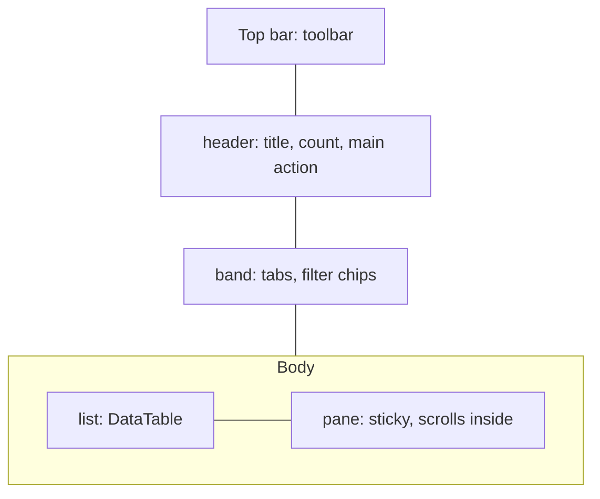
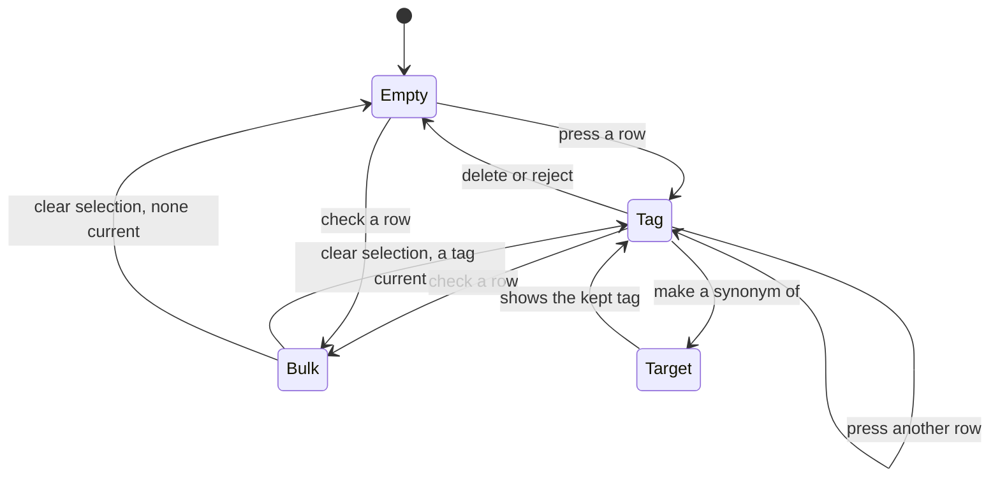

# UI design: Tag workbench

Sources: [plan.md](plan.md);
[design-system.md](../../docs/design-docs/design-system.md) and its rules
([patterns.md](../../web/registry/rules/patterns.md),
[components.md](../../web/registry/rules/components.md),
[foundations.md](../../web/registry/rules/foundations.md));
[library-ui.md](../../docs/design-docs/library-ui.md) for the top-bar toolbar,
window scrolling and the tag rows' virtualization; the current screens in
`web/src/tags/` and `web/src/credits/CreditsPage.tsx`; the screen text in
[web/src/i18n/en.ts](../../web/src/i18n/en.ts) (`tags`).

## Why this shape

Every organizing operation of a tag lives in one pane beside the list, so the
owner reads a tag's names and counts in the list, picks it, and finds merge,
make-a-synonym-of and the per-synonym operations in the same place every time.
The list rows carry no buttons: today's row of icons and the nested synonyms
dialog are what the Issue asks to remove, and a row without controls stays
dense enough to scan thousands. Rejected: a per-row menu that opens dialogs, as
today, because the owner has to open each tag's menu and then a dialog to see
its synonyms.

This design narrows the plan in two places:

| Plan said | This design | Why |
| --- | --- | --- |
| The list scrolls inside its own region | The window keeps scrolling, and the pane sticks under the top bar | [library-ui.md, The window owns scrolling](../../docs/design-docs/library-ui.md#the-window-owns-scrolling); the existing window virtualizer and its focus handling stay |
| On a narrow width the pane opens as a sheet | Below `lg` the pane opens in a `Dialog` | [components.md, Sheet](../../web/registry/rules/components.md#sheet) keeps `Sheet` for the sidebar and sends details to `Dialog` |

## WorkbenchPage pattern

`WorkbenchPage` (item `workbench-page`) replaces `AdminTablePage` in
[patterns.md, Choosing the skeleton](../../web/registry/rules/patterns.md#choosing-the-skeleton)
with the row "Organizes many records: a list beside the selected record's
details and operations". It is library density. The diagram shows its parts
from `lg`.

| Slot | Put in it | Never |
| --- | --- | --- |
| `toolbar` | A `Toolbar` with `placement="topBar"` in the shell's `TopBarPortal` | The main action |
| `header` | `PageHeader` with the title, the count, at most one `default` action, and the change notice's `Refresh` | Bulk actions |
| `band` | A `TabsList` for the screen's views, then the active filter chips | Actions on a record |
| children | The list: a `DataTable`, or one state block | Row action buttons or menus |
| `pane` | The selected record's details and operations, or the bulk actions, or the pane's empty state | A second list |
| `paneTitle` | The pane's heading text, used as the `Dialog`'s title below `lg` | |
| `selectionBar` | A bottom `SelectionBar`, drawn below `lg` only | Actions that need no selection |

- The column is at most `max-w-6xl`, centred, `p-3` (`p-4` from `sm`), `gap-3`.
- From `lg` the body is two columns (`grid-cols-workbench`): the list fills
  the rest and the pane is `workbench-pane` wide, `gap-4` apart. Both are new
  named steps in `tokens.css`; `workbench-pane` is wide enough for a
  `TagCommand` input and its `Add` button on one row.
- The pane is a `card` surface with a `border` edge and `rounded-md`, `p-3`,
  stuck under the top bar (`top-navbar`), at most the viewport's height under
  it, scrolling inside itself. It keeps its place and width in every state of
  the list and of itself.
- The header and the band scroll with the page; the `DataTable`'s column
  header sticks under the top bar.
- Without `pane` (the Kinds and Rejected names views), the list takes the
  whole width of the column.
- Below `lg` the pane is not drawn in the page; choosing a record opens its
  content in a `Dialog` titled `paneTitle`, and a checked selection shows the
  bottom `SelectionBar`.

The example block `workbench-page-example` shows a list of sample records, one
selected, with a pane of facts, a section of names with row controls and the
`More` menu.

## Words

New and changed text in `t.tags` and `t.organizations`. Unchanged text (tabs,
filters, sort, empty states, kinds and rejected names, delete and reject
dialogs, bulk results) stays as `en.ts` holds it.

| Place | Text | Notes |
| --- | --- | --- |
| List row, synonyms | `Also: {names}` | Comma-separated, one line, truncated; the full list in `title` |
| List column | `Kind` | Beside `Name` and `Videos` |
| Pane, nothing selected | `Select a tag` / `Its names, kind and videos show here, with merge and synonym actions.` | `EmptyState` without action |
| Pane, meta line | `{videos} · Kind: {name}` / `{videos} · No kind` | `videos` is the existing plural helper |
| Pane, link | `Show in library` | Opens `/?tag=<id>` |
| Pane, rename | `Rename` | `icon-sm` ghost button with `Pencil`, tooltip and label |
| Pane, tentative line | `Tentative` and `Confirm` | `TentativeMark` `row` before the word; `Confirm` is an `outline` `sm` button |
| Pane, kind | `Kind` / `No kind` | `Select` `sm` |
| Pane, section | `Synonyms` | `text-sm font-medium` heading |
| Pane, no synonyms | `No synonyms. A synonym finds this tag by another name.` | `text-xs` muted |
| Synonym row, button | `Make main name` | `icon-sm` ghost with `ArrowUpToLine`; tooltip and label `Make "{name}" the main name` |
| Synonym row, menu | `Move to another tag…`, `Make a separate tag`, `Remove synonym` | `DropdownMenu` behind an `icon-sm` ghost `Ellipsis` labelled `More for "{name}"` |
| Pane, add | `Add synonym` placeholder, `Add` button | Existing `synonymsDialog.add` / `submit` move here |
| Pane, organize | `Make a synonym of another tag…` | `outline` `sm`, the first button of the pane |
| Pane, more | `More` menu: `Reject…` (tentative only), `Delete…` | `ghost` `sm` with `Ellipsis` at the pane header's right |
| Make-a-synonym-of dialog | Title `Make "{name}" a synonym of another tag`; field `Tag to keep`; submit `Make synonym` | The existing merge warning text explains what moves |
| Move dialog | Title `Move "{synonym}" to another tag`; field `Move to`; text `"{synonym}" becomes a synonym of "{target}". Videos tagged "{name}" keep that tag.`; submit `Move` | `FormDialog` with `TagCommand` `inline` |
| Toast | `"{synonym}" is now the main name` | Promote |
| Toast | `Moved "{synonym}" to "{target}"` | Move |
| Toast | `"{synonym}" is now a separate tag` | Detach |
| Toast | `Removed the synonym "{synonym}"` | Remove |
| Error | `"{synonym}" is no longer a synonym of this tag, so the list was reloaded` | `tag_synonym_not_found`, `Alert` in the pane |
| Error | `A tag can't receive its own synonym.` | `move_same_tag`, in `t.errors` |
| Header, change notice | `The list changed elsewhere` and `Refresh` | `text-xs` `warning` text with an icon, then a `ghost` `sm` `Refresh` with `RefreshCw`, before `New tag` |
| Bulk pane | `{n} tags selected`; `Merge into one tag…`; `Confirm`; `Kind`; `More`: `Reject…`, `Delete…`; `Clear selection` | Existing `selection.*` text moves here |
| Organizations pane, nothing selected | `Select an organization` / `Its names, links and parent show here, with merge and delete.` | |

`Main name` is the screen's word for a tag's canonical name (W-8).

## Tags view

### List

| Column | Content | Type |
| --- | --- | --- |
| Check | `Checkbox` | |
| Name | The main name, then `TentativeMark` `row` when tentative; under it nothing, beside it `Also: …` when the tag has synonyms | Main name `text-sm font-medium`; synonyms `text-xs` `muted-foreground`, one line |
| Kind | The kind's name, empty without one | `text-xs` `muted-foreground` |
| Videos | The count | `text-sm` `tabular-nums`, right-aligned |

- Every row is one line high (`p-3` table row), whatever the synonyms' length;
  the name and synonyms truncate.
- Pressing a row (outside its checkbox) or Enter on a focused row makes it the
  current tag: its fill turns `primary-soft` and the pane shows it. Up and
  Down move the focus between rows; the current tag changes only on press or
  Enter, so scanning with the keyboard does not reload the pane.
- A checked row carries `data-state="selected"` (the table's own selected
  fill). The current fill wins over it.
- After promote, rename or kind changes, the row stays where it is until the
  list reloads, as a rename does today.

### Pane, one tag

Top to bottom:

1. Pane header: the main name `text-lg font-semibold`, wrapping in full,
   `Rename` beside it, `More` at the right.
2. Meta line `text-xs` `muted-foreground`: videos and kind, then
   `Show in library`.
3. When tentative: `TentativeMark`, `Tentative`, `Confirm`.
4. `Make a synonym of another tag…`, full width of the pane.
5. `Kind` select.
6. `Synonyms`: one row per synonym (`text-sm font-normal`), each ending with
   `Make main name` and its menu, then the add field and `Add`.

The pane's sections are `gap-4` apart and a `Separator` sits above
`Synonyms`. The main name is the heaviest text in the pane; the synonyms are
normal weight at the same size as the list, so the two read apart by weight
alone.

`Rename` turns the heading into an `Input` with the name selected; Enter
saves, Esc cancels, as the row rename does today.

### Pane, several tags checked

The pane header reads `{n} tags selected` with `Clear selection` at the right,
then `Merge into one tag…` full width, `Confirm` when any checked tag is
tentative, the `Kind` select, and `More` with `Reject…` and `Delete…`. Over
20,000 checked, an `Alert` (`warning`) with the existing `overLimit` text sits
under the header and every action is `aria-disabled`.

### States

| State | List | Pane |
| --- | --- | --- |
| Loading | `LoadingState` rows | Empty state |
| No tags | `EmptyState` `No tags yet` with `New tag` | Not drawn |
| No matches | The existing no-match state for the search and filters, with `Show all tags` | Empty state |
| Nothing selected | Rows | `Select a tag` |
| One tag current | Current row `primary-soft` | The tag |
| Several checked | Checked rows | Bulk actions |
| Operation running | Rows | The pressed control shows `Spinner` and is `disabled`; the rest of the pane stays |
| Target gone (`tag_not_found`, `tag_synonym_not_found`) | Reloads in place | `Alert` `destructive` with the reason at the top; after reload the pane shows the tag again, or the empty state when it is gone |
| Changed elsewhere | Rows unchanged | Unchanged; the header shows the change notice |
| Current tag merged away | The tag leaves the list | The tag it merged into |
| Synonym detached | The new tag appears at its sorted place | The source tag, without the synonym |

The diagram shows how the pane moves between its states.

### Organizing in a dialog

`Make a synonym of another tag…` and `Move to another tag…` open a
`FormDialog` with `TagCommand` `layout="inline"` for the other tag, as the
merge dialog does today, and the summary of what moves before the submit
button. `Make main name`, `Make a separate tag` and `Remove synonym` act at
once and report with a toast; they change no videos. Typing another tag's main
name in `Add synonym` keeps today's merge confirmation.

## Change notice

The notice sits in the header row, before `New tag`, so it takes no row of its
own and nothing below it moves. `Refresh` reloads the list with the same
criteria, keeps the current tag when it is still listed, and removes the
notice. A later change brings it back.

## Organizations view

The organizations screen is the same pattern without the check column, the
bulk pane and the tabs. Its pane holds the name with `Rename`, the aliases with
remove and an add field, the external ids, the parent, then
`Merge into another organization…` and `More` with `Delete…`, which today sit
in the details dialog and the row menu. The details dialog is removed.

## Responsive behaviour

| Width | Layout |
| --- | --- |
| 360px | One column; the toolbar in the top bar as today; rows show name and count, kind hidden; pressing a row opens the pane in a `Dialog`; checking rows shows the bottom `SelectionBar` with `Merge into one tag…` and `More` |
| 768px | One column with the kind column; the pane in a `Dialog`; the bottom `SelectionBar` |
| 1024px | Two columns: list and pane side by side, the pane sticky; bulk actions in the pane |
| 1280px | Two columns, the page at `max-w-6xl` centred |

## Review criteria

1. At 1280px with 5,000 tags, the eye goes first to the tag names in the list
   and the pane's main name; no control in the list rows competes with them.
2. A main name and its synonyms are told apart by weight alone, in the list
   (`font-medium` against muted `text-xs`) and in the pane (`text-lg
   font-semibold` against `text-sm` normal).
3. The video counts form a right-aligned column whose digits line up.
4. From a selected tag, `Make a synonym of another tag…`, `Make main name` and
   the synonym menu are reached without opening a menu first; `Delete…` and
   `Reject…` are only in `More`.
5. Pressing another row, checking rows, a running operation and the change
   notice leave the pane at the same place and width, and the list rows do not
   move.
6. A tag with twelve synonyms shows them one per row in the pane without
   cropping, while its list row stays one line high.
7. At 360px a pressed row opens the pane in a dialog with the same order of
   controls as the pane at 1280px.
8. The organizations screen at 1280px has the same column, list and pane
   positions as the tags screen.
