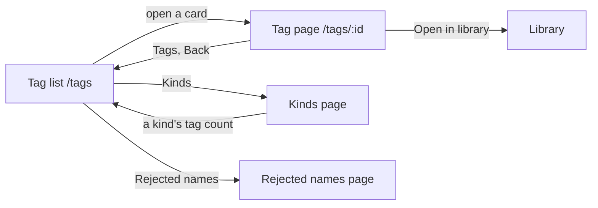
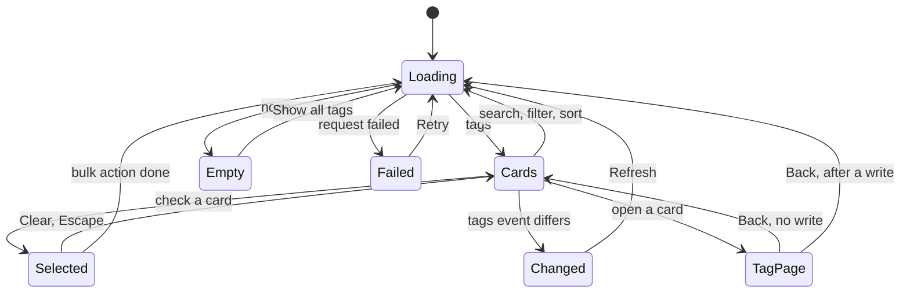
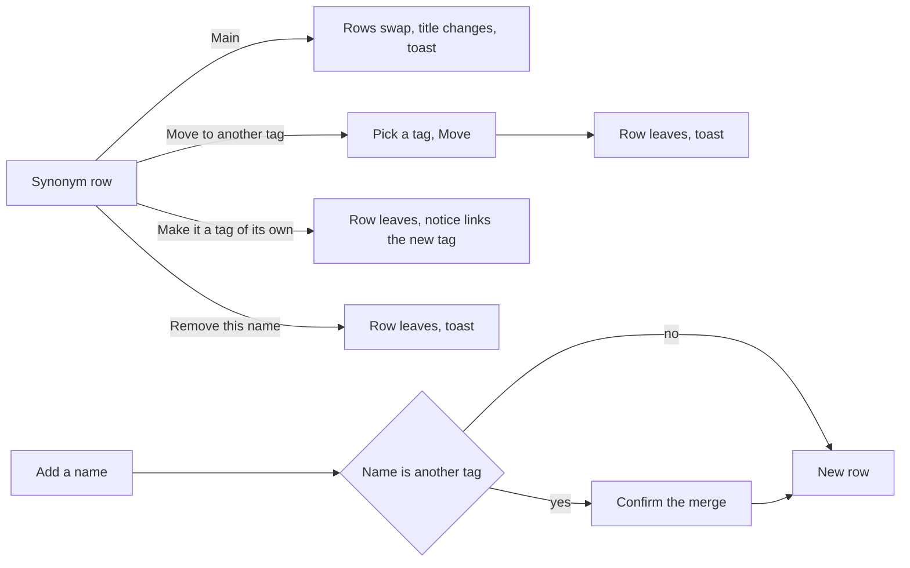

# UI design: Tag cards and tag pages

Sources: [plan.md](plan.md);
[design-system.md](../../docs/design-docs/design-system.md) and its rules
([patterns.md](../../web/registry/rules/patterns.md),
[components.md](../../web/registry/rules/components.md),
[foundations.md](../../web/registry/rules/foundations.md));
[library-ui.md](../../docs/design-docs/library-ui.md) for the top-bar toolbar,
window scrolling, card selection and the selection bar; the current screens in
`web/src/tags/`; the screen text in
[web/src/i18n/en.ts](../../web/src/i18n/en.ts) (`tags`).

The diagram shows the screens this design covers and how the owner moves
between them.

## Why this shape

The list answers "what is left to tidy" and the tag page answers "how is this
one tag organized", so neither crowds the other: cards carry no buttons, and
every operation on one tag has a fixed place on that tag's page. The two
boards the maintainer approved (the tag card list and the tag page) are the
intent; this document translates them into the design system. Their colours,
pill shapes and sizes are not values.

The table shows where the translation departs from the boards.

| Board | This design | Why |
| --- | --- | --- |
| A page title and tally counts larger than `text-xl` | The title is `text-xl`; a tally count is `text-lg` | [foundations.md, Type](../../web/registry/rules/foundations.md#type) has no larger step, and the Issue keeps the tokens |
| A cyan fill on the `Tentative` tally at rest | Tallies rest on `card`; only a pressed one is `primary-soft` | Cyan marks actions and selection only ([foundations.md, Colour roles](../../web/registry/rules/foundations.md#colour-roles)) |
| A gear button for kinds and rejected names | Two named links, `Kinds` and `Rejected names` | A `DropdownMenu` is not navigation ([components.md, DropdownMenu](../../web/registry/rules/components.md#dropdownmenu)), and a gear does not say what is behind it |
| `Confirm`, `Rename`, `Reject` and `Delete` together | `Confirm` and `Reject…` on a tentative tag, `Delete…` on a confirmed one | Reject applies to tentative tags only and delete to confirmed ones, as today |
| A cyan `Merge into one…` and a plain `Reject` in the selection bar | `ghost` actions with merge first; `Reject…` and `Delete…` in `More` | [patterns.md, Sections](../../web/registry/rules/patterns.md#sections) for `SelectionBar`; the Issue puts delete and reject one step back |
| A round icon-only back button | A `ghost` `sm` button with `ArrowLeft` and the list's title | The back link of `RecordPage` and `SettingsPage` |
| Six thumbnails that fill the row | `Shelf layout="row"`: thumbnails `card-0` wide, the body's edge cutting the last | The existing row shelf; five show in full at 1280px |

## Design-system changes

These pieces are added to the design system before a screen uses them, in the
plan's design-system unit. `RecordCard`, `CardGrid size="record"`,
`RecordEditorPage` and the kind colours are the plan's; the rest are what the
approved list needs that `ListPage` lacks.

| Piece | Item | What it is |
| --- | --- | --- |
| `ListPage` `filter` slot | `list-page` | One `ToggleGroup type="single"` for the list's main dimension, a count after each choice. From `lg` it sits on the header's row after the title, taking the width left before the header's actions and scrolling sideways inside it; below `lg` it is one line under the header that scrolls sideways |
| `ListPage` `summary` slot | `list-page` | One `TallyStrip`, between the header and the body |
| `ListPage` `notice` slot | `list-page` | One `FloatingNotice` |
| `TallyStrip` | `tally-strip` | Up to three tallies in equal columns, `gap-3` apart. A tally is a `Toggle` on `card` with a `border` line and `rounded-md`: the count (`text-lg font-semibold tabular-nums`), its label (`text-sm font-medium`) over a hint (`text-xs`, muted, from `md`), and from `lg` a trailing word in `primary`. Pressed, it is `primary-soft` and the trailing word is `Clear` |
| `FloatingNotice` | `floating-notice` | One line and one `ghost` `sm` action on `popover` with `rounded-full` and `shadow-elevated`, stuck under the top bar at the body's centre, over the content, with `animate-fade-in`. It is for a condition that lasts until the viewer acts and whose message must not move the list |
| `KindMark` | `kind-mark` | The mark of a tag kind in its `kind-N` colour: `bar` (the start edge of a `RecordCard`) or `dot` (before a kind's name). It never stands without the kind's name on the same card, row or control |
| `KindToggleGroup` | `kind-toggle-group` | A `ToggleGroup type="single"` of `pill` `sm` items, one per kind with its `dot`, plus the plain choices the caller passes. A pressed kind is its `kind-N-soft` fill with a `kind-N` edge and `foreground` text; a pressed plain choice is the standard `primary-soft` |

The eight `kind-N` colours are told apart from each other and from `primary`,
`destructive` and `favorite` on `card`, and each `kind-N-soft` keeps
`foreground` text readable.

### RecordCard

A `RecordCard` is one link on `card` with a `border` line and `rounded-md`,
`record-card` high (a new named step) at every width, so a row of the grid is
the unit that is virtualized. `CardGrid size="record"` puts two columns at
360px and six at 1280px (`card-record`, a new named step), `gap-3` apart.

| Line | Content | Type |
| --- | --- | --- |
| First | The name, truncated, the full name in `title`; `TentativeMark` after it; the count at the line's end | Name `text-sm font-medium`; count `text-sm font-semibold tabular-nums` |
| Second | The `detail`: one short phrase | `text-xs`, muted, truncated |
| Third | The secondary names as `secondary` `Badge`s on one line; the card's edge cuts what does not fit | `text-xs`, normal weight |

- The `KindMark` `bar` runs along the start edge; a record without a kind
  draws none and keeps the same inset.
- `tentative` draws the edge dashed in `input`.
- The selection mark is a `Checkbox` at the bottom end corner, outside the
  link, shown as the library's card check is
  ([library-ui.md, List view and selection](../../docs/design-docs/library-ui.md#list-view-and-selection)).
  A selected card is `primary-soft` with a `primary` edge.
- Hover is `shadow-card-hover`. A card with no third line keeps its height.
- Its loading form is `LoadingState layout="grid" size="record"`.

### RecordEditorPage

`RecordEditorPage` (item `record-editor-page`) joins
[patterns.md, Choosing the skeleton](../../web/registry/rules/patterns.md#choosing-the-skeleton)
with the row "Organizes one record: its names, its properties and the
operations on it". It is a shell page at library density, one column at most
`max-w-6xl`, centred, `p-3` (`p-4` from `sm`), its parts `gap-6` apart.

| Slot | Put in it | Never |
| --- | --- | --- |
| `back` | A `ghost` `sm` `Button` around a router link, with `ArrowLeft` and the list's title | A second navigation link |
| `title` | The record's name as the `h1` (`text-xl font-semibold`, wrapping in full), or the field that renames it | A status |
| `figures` | One or two figures after the title: the number in `foreground` `font-semibold tabular-nums`, its unit in `text-sm` muted | A sentence |
| `actions` | `sm` `pill` buttons with an icon and a name: at most one `default`, the rest `secondary`, then at most one `ghost-destructive` after a `Separator`. They wrap under the title when they do not fit | An action on one part of the record |
| `notice` | One `Alert` under the header: the reason of a failed or stale operation, or the result of one that made another record, with a link to it | Field errors |
| `main` | `PageSection`s for the record's lists, such as its names | Cards; a table |
| `side` | `PageSection`s for single properties and for operations that take another record, such as merge | Lists longer than the main column |
| children | One `Shelf` of the items the record is on | A second list of records |
| `status` | One state block in place of everything under `back` | Loading; draw `Skeleton`s in the slots |

From `lg`, `main` and `side` are two columns in the ratio 8:5 (the named
utility `grid-cols-record-editor`), `gap-6` apart; below `lg` they stack,
`main` first. A row of a section holds its text first and its controls at the
end: at most one named `outline` `sm` `pill` button, then a `ghost` `icon-sm`
`More` menu.

## Words

"Main name" is the screen's word for a tag's canonical name; the other names
are its synonyms. Text not listed here is today's.

| Place | Text | Notes |
| --- | --- | --- |
| Kind filter | `All`, each kind's name, `No kind` | A count follows each |
| Tallies | `Tentative` / `Created by automatic tagging` / `Review`; `No kind` / `Give them a kind` / `Sort`; `Unused` / `Not on any video` / `Clean up` | Label, hint, trailing word |
| Pressed tally | `Clear` | Replaces the trailing word |
| Tag list header | `Kinds`, `Rejected names`, `New tag` | |
| Filtered empty state | `Show all tags` | Clears the search and every filter |
| Change notice | `Tags changed elsewhere` · `Refresh` | |
| Tag card, second line | `No kind`; `Tentative · {kind}` | |
| Selection bar | `Select all`, `Merge into one tag…`, `Set kind…`, `Confirm`, `More` (`Reject…`, `Delete…`) | |
| `Select all` menu | `All {n} loaded tags`, `All {n} matching tags` | |
| Tag page back link | `Tags` | |
| Tag page actions | `Confirm`, `Rename`, `Reject…`, `Delete…` | |
| Names section | `Names`, `Main name`, `Main`, `Add a name` | `Main` is named `Make "{name}" the main name` for screen readers |
| Name menu | `Move to another tag…`, `Make it a tag of its own`, `Remove this name` | |
| Move dialog | `Move "{name}" to another tag`, `Tag to move it to`, `Move` | |
| Toasts | `"{name}" is now the main name`, `Moved "{name}" to "{tag}"`, `Removed the name "{name}"`, `Created "{name}"` | |
| Detach notice | `"{name}" is now a tag of its own.` · `Open "{name}"` | In `notice` |
| Kind section | `Kind`, `None` | |
| Merge section | `Merge into another tag`, `Makes "{name}" and its synonyms synonyms of the tag you choose. Its videos get that tag.`, `Tag to keep`, `Merge…` | |
| Videos shelf | `Videos`, `Open in library` | |
| Gone state | `This tag no longer exists`, `Back to tags` | |
| Kinds page | `Kinds`, `{n} tags`, `First on cards`, `Rename`, `Delete…`, `New kind` | |
| Rejected names page | `Rejected names`, `Allow again` | |

## Tag list

`/tags` is a `ListPage`. Search and sort stay in the top bar as today.

| Slot | Content |
| --- | --- |
| `toolbar` | The top-bar `Toolbar`: search, then the sort as a view control |
| `header` | `PageHeader` with `Tags`; actions `Kinds` and `Rejected names` (`ghost` `sm` links), then `New tag` (`default` `sm`) |
| `filter` | A `KindToggleGroup`: `All`, the kinds in natural name order, `No kind` |
| `summary` | A `TallyStrip`: `Tentative`, `No kind`, `Unused` |
| `notice` | The change notice, while it applies |
| children | `CardGrid size="record"` of tag cards, then `LoadMoreRow`; or one state block |
| `selectionBar` | The `SelectionBar`, while cards are selected |

- **Counts**: every count in the filter and the strip is of the whole
  vocabulary, not of the current search, so it reads as "how many are left".
  They are read with the list and after the owner's own writes. While they
  load, a `Skeleton` stands for each number; a tally at zero is muted, has no
  trailing word and is not pressable unless it is pressed.
- **Filters**: the kind filter sets `kind`; `Tentative` and `Unused` toggle
  `tentative` and `unused`; the `No kind` tally sets `kind=none`, so it and the
  filter's `No kind` are pressed together. All apply together with the search.
  No chip band repeats them. A `kind` that no longer exists falls back to
  `All` with today's toast.
- **Tag card**: a `RecordCard` with the tag's kind as its `bar`, the video
  count, the kind's name as the `detail` (`No kind` without one, `Tentative ·`
  before it on a tentative tag) and the synonyms as the secondary names. The
  count's `title` reads `{n} videos`. Pressing the card opens the tag page.
- **Tag only the paired VVMDM holds**: the list joins every node's tags by
  name, so a tag with no entry here carries a remote id, which the tag page
  cannot read. Its card shows `ItemRemoteMark` (`On {name}`) after the name,
  and pressing it opens the library filtered by the tag, as today's row count
  does, instead of the tag page. It keeps its check and the selection bar's
  actions, which reach the link by name today.
- **Selection**: checks, Shift ranges, a press on a card while anything is
  selected, and Escape work as on the library. Drawn boxes are left out: the
  cards fill the grid, so there is no empty area to start a drag from.
- **Selection bar**: the count and `Clear selection`, `Select all` (a menu of
  its two choices), then `Merge into one tag…`, `Set kind…` and `Confirm`, and
  `More` with `Reject…` and `Delete…`. The dialogs, impact counts, the
  disabled reasons and the 20,000 limit message are today's. `Set kind…` lists
  each kind with its `dot`. While `All {n} matching tags` loads the rest, its
  button shows a `Spinner` and the other actions are disabled.
- **New tag**: a `FormDialog` with the name field and `Create`. On success it
  closes and the new tag's page opens, because a tag sorted by count would
  land out of view and its names and kind are the next step.
- **Change notice**: a `FloatingNotice`. `Refresh` reloads the list with the
  same criteria from the top and keeps the selected tags that still exist. The
  end-of-list notice for a list that changed under paging stays as today.

### States

| State | What the screen shows |
| --- | --- |
| Loading | The header, filter and strip in place with `Skeleton` counts; `LoadingState layout="grid" size="record"` |
| No tags | `EmptyState`: `No tags yet`, today's description, `New tag` |
| No matches | `EmptyState` titled by the criteria with today's texts (`No tags match "{q}"`, `No tentative tags`, `No unused tags`, `No tags of the kind "{name}"`), and `Show all tags` |
| Load failed | `ErrorState` with `Retry` |
| Cards | The grid; more cards load at the end with `LoadMoreRow` |
| Selected | Checks on every card, selected cards `primary-soft`, the `SelectionBar` at the bottom |
| Bulk action in flight | The bar's actions and `Clear selection` disabled, a `Spinner` on the pressed one |
| Over the limit | The bar's actions disabled with today's limit message in the bar |
| Changed elsewhere | The cards, scroll position and selection as they were, and the notice over the first row |
| Stale target | Today's toast (`Some of the tags no longer existed, so the list was reloaded`) and a reloaded list |

The diagram shows the list's states and what moves between them.

## Tag page

`/tags/:id` is a `RecordEditorPage`. Every control acts at once; nothing on
the page waits for a save.

| Slot | Content |
| --- | --- |
| `back` | `Tags`. It returns to the list the owner came from, or opens `/tags` |
| `title` | The main name, with `TentativeMark` after it on a tentative tag |
| `figures` | `{n} videos` |
| `actions` | Tentative: `Confirm` (`default`, `Check`), `Rename` (`secondary`, `Pencil`), `Reject…` (`ghost-destructive`, `Ban`). Confirmed: `Rename`, `Delete…` (`ghost-destructive`, `Trash2`) |
| `main` | `Names` |
| `side` | `Kind`, then `Merge into another tag` |
| children | `Shelf layout="row"` titled `Videos` |

- **Rename**: the title becomes today's name field in place; Enter saves, Esc
  cancels, and a name error shows under the field.
- **Names**: a `PageSection`. The first row is the main name in
  `text-sm font-semibold` on `primary-soft`, a filled `Star` in `primary`
  before it and `Main name` (`text-xs`, `primary`) at its end. Each synonym is
  a row in `text-sm` at normal weight with `Main` (`outline` `sm` `pill`,
  `Star`) and a `More` menu: `Move to another tag…`, `Make it a tag of its
  own`, a separator, `Remove this name` (destructive). The last row is the
  `Add a name` field; Enter adds. Names wrap in full instead of truncating.
- **Kind**: a `KindToggleGroup` that wraps: the kinds in natural name order,
  then `None`.
- **Merge into another tag**: the description, a tag `Combobox` labelled `Tag
  to keep` and `Merge…` (`default` `sm`), disabled until a tag is chosen.
  `Merge…` opens a `ConfirmDialog` with today's merge warning.
- **Videos**: up to six of the tag's videos in the library's order, each a
  `VideoThumbnail` that links to its video and carries the title as its name
  and `title`. `Open in library` (`ghost` `sm`) in the shelf's `actions` opens
  the library filtered by the tag. A tag on no video shows the one line `Not on
  any video` in place of the row.

The diagram shows what each operation on a name leaves on the screen.

`Move to another tag…` is a `FormDialog` with today's merge-target field.
Its candidates leave out tags only the paired VVMDM holds, because a move
names this node's tag as its target and answers 404 for a remote id.
`Make it a tag of its own` and `Remove this name` run at once: each can be put
back from this page or the other tag's. Adding a name that is another tag asks
with a `ConfirmDialog` carrying today's synonym merge warning.

### States

| State | What the screen shows |
| --- | --- |
| Loading | `back`, then `Skeleton`s in the title, the sections and the shelf |
| Tentative | `TentativeMark` after the title; `Confirm` and `Reject…` |
| Confirmed | `Delete…` in place of `Confirm` and `Reject…`; a tentative tag becomes this after `Confirm`, `Main`, a merge into it or a name moved to it |
| Operation in flight | The pressed control shows a `Spinner`; the other controls of the page are `aria-disabled` |
| Operation failed | A `destructive` `Alert` in `notice` with the reason, such as the paired VVMDM not being reachable; the page as it was |
| Stale target | The reason in `notice` (`This tag no longer exists`, or that the name is no longer this tag's) and the page re-read |
| Changed elsewhere | The page re-reads its tag in place; text being typed in a field is kept |
| Merged, rejected or deleted here | The tag list, reloaded with its criteria, and today's toast |
| Gone | `status`: `EmptyState` `This tag no longer exists` with `Back to tags` |

## Kinds page

`/tags/kinds` is a `SettingsPage` without `nav`: the back link `Tags` in the
header's `leading`, the title `Kinds`, today's description, and one
`PageSection` with a row per kind in natural name order.

| Part of a row | Content |
| --- | --- |
| Start | `KindMark` `dot`, the name (`text-sm font-medium`), then `{n} tags` as a `link` button to `/tags?kind=<id>` (`text-xs`) |
| End | A `Switch` labelled `First on cards`, then a `More` menu: `Rename`, a separator, `Delete…` |
| Last row of the section | The `New kind` field; Enter creates |

`Rename` edits the name in place. `Delete…` opens today's `ConfirmDialog`.
Below `sm` the switch and the menu move to a second line of the row. With no
kinds, the section holds an `EmptyState` (`No kinds yet`) above the `New kind`
row. More than eight kinds share colours, so the name stays beside every mark.

## Rejected names page

`/tags/rejected` is a `SettingsPage` without `nav`: the back link `Tags`, the
title `Rejected names`, today's description, and one `PageSection` with a row
per name: the name, then `Allow again` (`outline` `sm`). The rows load in
pages with `LoadMoreRow`. `Allow again` removes the row at once; a failure
shows today's message as an `Alert` row in the section. With no names the
section holds `EmptyState` `No rejected names`.

## Responsive behaviour

The sidebar is the rail from 640px and a drawer below it.

| Width | Tag list | Tag page | Kinds and rejected names |
| --- | --- | --- | --- |
| 360px | Two columns of cards. The header's actions wrap under the title; the filter is one line that scrolls sideways; three tallies with count and label only; the selection bar wraps onto more lines | One column: `main`, `side`, the shelf. The actions wrap under the title; a name wraps and keeps `Main` and `More` at the row's end; the shelf shows one thumbnail and part of the next | One column; a kind row's switch and menu on a second line |
| 768px | Three columns. The header's actions on the title's row; the filter on its own line; tallies with hints | One column; the actions on the title's row | One column, `max-w-3xl` |
| 1024px | Five columns. The filter on the title's row; tallies with trailing words | Two columns, 8:5 | The same |
| 1280px | Six columns; at 1280×820 with nothing selected, four full rows show under the strip | Two columns; five thumbnails in full and the edge of the sixth | The same |

## Review criteria

1. On the tag list at 1280px, the first things read are tag names and their
   counts; the header's links, the tallies' trailing words and the checks are
   quieter than any card's first line.
2. A card's name, count, kind and synonyms are told apart by weight and
   position without colour: the name and count in medium and semibold, the
   kind line and synonym chips smaller and at normal weight. Counts align at
   the cards' end edges in tabular figures.
3. Every card is the same height with or without synonyms, a kind or the
   tentative state, and the gaps between cards, the strip and the header are
   equal, so the grid reads as one block.
4. Applying a filter, selecting cards, the change notice and a bulk action in
   flight move neither the header, the filter, the strip nor any card.
5. A tentative card is told from a confirmed one at a glance by its dashed
   edge and mark, and a card's kind by its colour bar together with the kind's
   name.
6. On the tag page, the main name is the heaviest text of `Names`, synonyms
   are lighter, and a synonym row's `Main` is found without opening anything.
7. On the tag page, `Main` and the merge section's `Merge…` are in view
   without scrolling at 1280×820 for a tag with five names, and `Reject…` or
   `Delete…` is the quietest and last of the header's actions.
8. The tag page's sections have room: one name per row, kinds as separate
   pills, and `gap-6` between sections, wider than the gaps inside one.
9. At 360px no screen scrolls sideways as a whole, no action loses its name,
   and a 40-character tag name reads in full on the tag page.
