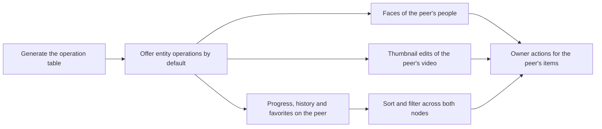

# Implementation Plan: Peer parity by default

**Branch**: `feature/071-peer-parity` | **Parent Issue**: #1814

**Input**: The parent Issue. It is this feature's specification.

## Summary

The owner uses every screen and operation of a local video, person, group,
tag or organization on the paired VVMDM's items too, by default, and a remote
video's playback position, history and favorite are stored on the node holding
the video. The remote-id boundary stops listing what it offers: a generated
table of the screen API's operations drives forwarding, answers are rewritten
by response type, one Go table names the local-only operations with their
reasons, and a test fails for an entity operation that is neither. Favorites,
history and progress for remote items are forwarded and merged, so the
`played*`/`favorited*` sorts and `favorite` filters reach the peer as they are.

## Technical Context

**Canonical definitions**:
[ARCHITECTURE.md](../../ARCHITECTURE.md) (dependency direction, remote ids,
every read knows its viewer),
[peer-library.md](../../docs/design-docs/peer-library.md) (pairing, remote
ids, merged lists, vocabulary by name, forwarded edits),
[authentication.md](../../docs/design-docs/authentication.md#paired-vvmdm)
(the peer credential), [api/openapi.yaml](../../api/openapi.yaml) and
[scripts/generate](../../scripts/generate) (`task generate`),
[testing.md](../../docs/design-docs/testing.md) and
[web-testing.md](../../docs/design-docs/web-testing.md).

**Feature-specific context**:

| Delta | Where decided |
| --- | --- |
| The remote boundary and the credential's allow-list are built from a generated operation table, not hand-written lists | [research.md, R-1](research.md#r-1-entity-operations-are-offered-for-remote-ids-unless-named-local-only), [R-2](research.md#r-2-the-operation-table-is-generated-from-openapiyaml) |
| Rewriters are keyed by response schema, translators by request schema and path parameter, both checked by a test | [R-3](research.md#r-3-answers-are-rewritten-by-response-type-and-requests-translated-by-declared-ids) |
| A remote video's progress, history and favorite live on the peer; the peer is written first | [R-4](research.md#r-4-a-remote-videos-progress-history-and-favorite-live-on-the-peer), [contracts/peer-parity.md](contracts/peer-parity.md) |
| Thumbnail edits of a remote video run here and are applied through the forwarded upload | [R-5](research.md#r-5-thumbnail-edits-of-a-remote-video-run-on-the-reading-node) |
| Face edits of a remote person name people by name | [R-6](research.md#r-6-face-edits-of-a-remote-person-name-people-by-name) |
| A peer on an older release answers an unknown operation with its own `404`, which passes through; nothing new | [peer-library.md, Mixed versions](../../docs/design-docs/peer-library.md#mixed-versions) |

No `data-model.md`: the feature adds no entity and changes no table; a remote
entity is still never stored. No `quickstart.md`: every acceptance criterion
is observed by the two-node browser e2e spec and the Go tests the units name.

## Constitution Check

| Rule | Verdict |
| --- | --- |
| Dependency direction ([ARCHITECTURE.md](../../ARCHITECTURE.md#intended-dependency-direction)): `internal/httpapi` reads the generated table from `internal/httpapi/gen`; `internal/domain` gains only pure rules (merge of history pages, id translation); `scripts/generate` imports nothing under `internal/` | Passes |
| The peer credential reaches an allow-list, never a deny-list ([peer-library.md](../../docs/design-docs/peer-library.md#pairing-and-the-peer-credential)) | Passes: the list is derived, and the test asserts media folders, scans, settings, the account, tokens, playlists and activity are outside it |
| Generated files are not hand-edited ([AGENTS.md](../../AGENTS.md)) | Passes: the table is emitted by `task generate` and checked by `generate-check` |
| Important constraints are testable ([core-beliefs.md](../../docs/design-docs/core-beliefs.md)) | Passes: acceptance 7 is the test of [R-3](research.md#r-3-answers-are-rewritten-by-response-type-and-requests-translated-by-declared-ids) |
| Every read knows its viewer | Passes: forwarded requests keep the viewer's audience; progress, favorites and history stay owner-only on both nodes |
| Function complexity 25 or less ([complexity-and-duplication.md](../../docs/design-docs/complexity-and-duplication.md)) | At stake in the boundary that replaces `remoteCollections` and `forwardRemoteGroup`; the unit splits translation, forwarding and rewriting as today |

Re-checked after Phase 1: no violation.

## Project Structure

### Documentation (this feature)

```text
specs/071-peer-parity/
├── plan.md
├── research.md              # R-1..R-6
└── contracts/peer-parity.md # the screen API deltas
```

### Source Code

**Affected boundaries**:

| Boundary | What changes in it |
| --- | --- |
| `scripts/generate` | Emits the operation table from `api/openapi.yaml` |
| `internal/httpapi/gen` | Gains the generated table (`operations.gen.go`) |
| `internal/httpapi/peer*.go`, `peer_operations.go` | The boundary built from the table; rewriters and translators by type; local-only table; favorites, progress and history forwarding and merging |
| `internal/httpapi/thumbnail_edits.go`, `internal/app/thumbnail_edits.go` | A session started from an image read from the peer and applied by an upload |
| `internal/domain` | Merge of history pages, `PeerSort` removed, id translation rules |
| `web/src/player`, `web/src/videoList`, `web/src/credits/person`, `web/src/lib/remoteId.ts` | Remote gates removed except open-in-app, rescan, auto-tag, playlist and activity |
| `web/e2e/peer-library.e2e.ts` | Two-node cases for faces, thumbnails, progress, favorites and sorting |
| `docs/design-docs/peer-library.md`, `ARCHITECTURE.md` | The default-offered form replaces the lists of offered operations |

**New paths**: `internal/httpapi/gen/operations.gen.go` (generated).

**Structure decision**: Follows the existing layout; the generator joins the
existing `scripts/generate` command rather than a second tool
([R-2](research.md#r-2-the-operation-table-is-generated-from-openapiyaml)).

## Implementation Work

The graph shows the units and what has to land first.



### Generate the screen API's operation table from openapi.yaml

**Scope**: `scripts/generate` emits `internal/httpapi/gen/operations.gen.go`:
for every operation, the method and path pattern, the `$ref` of its JSON
success response or that it streams bytes, the `$ref` of its JSON request
body, its path parameters other than the first, and the integer `*Id`/`*Ids`
fields of that body ([R-2](research.md#r-2-the-operation-table-is-generated-from-openapiyaml)).
`generate-check` covers the new file.

**Dependencies**: None

**Acceptance**: `task generate` writes the table and `task generate-check`
passes on the committed result. A unit test of the generator on a small
fixture document asserts the four derived columns for one JSON operation, one
media operation and one operation with a second path parameter (new case; the
generator's existing tests in `scripts/generate` are the level).

### Offer every entity operation for remote ids unless named local-only

**Scope**: The remote boundary is built from the generated table: an operation
under an entity collection is forwarded for a remote id unless the local-only
table names it ([R-1](research.md#r-1-entity-operations-are-offered-for-remote-ids-unless-named-local-only));
rewriters are registered by response schema and translators by request schema
or path parameter ([R-3](research.md#r-3-answers-are-rewritten-by-response-type-and-requests-translated-by-declared-ids));
`peerOperations` is derived from the same table; `forwardRemoteGroup` and
`remoteCollections` fold into it, and `/api/tag-kinds/{id}` and
`/api/virtual-videos/{id}` join the collections. This alone offers
`DELETE /api/videos/{id}`, `DELETE .../thumbnail-image`,
`make-representative`, `unbundle`, tag synonyms, confirm and reject, tag-kind
edits, `DELETE /api/people/{id}/image` and a virtual video's merge for remote
ids. `peer-library.md`'s Remote ids section takes the default-offered form.

**Dependencies**: Generate the screen API's operation table from openapi.yaml

**Acceptance**: A Go test over the generated table fails when an entity
operation is neither forwarded, answered nor local-only, when a forwarded JSON
response has no rewriter, when a body's id field or an extra path parameter has
no translator, or when the credential's list reaches a media-folder, scan,
settings, account, token, playlist or activity operation (acceptance 7; this
replaces `TestPeerOperationsAreOpenAPIOperations`). Two-node handler tests in
`internal/httpapi` (the level of `peer_forward_test.go`) show
`POST /api/videos/{remoteId}/make-representative` returning `VideoVersions`
in offset ids, `DELETE /api/videos/{remoteId}` deleting on the peer, and
`POST /api/videos/{remoteId}/open` answering `404 not_found`; the existing
forwarding and rewrite tests pass unchanged.

### Show and edit the faces of the peer's people

**Scope**: Translators for `appearances/move`, `appearances/split`,
`appearances/{appearanceId}/split`, `face-candidates/{otherId}/*` and
`similar-people` ([R-6](research.md#r-6-face-edits-of-a-remote-person-name-people-by-name),
[contracts](contracts/peer-parity.md#post-apipeopleidappearancesmove-movefaceappearances));
`/api/face-appearances/{id}/crop` forwarded as media and `hasCrop` kept for a
remote video's appearances.

**Dependencies**: Offer every entity operation for remote ids unless named
local-only

**Acceptance**: Two-node handler tests show a remote person's
`face-candidates` answered with people joined by name, a move with a local
`targetId` creating or finding that name on the peer and the peer's
`appearances` of that person changed, and `face-appearances/{remoteId}/crop`
streaming the peer's JPEG. An e2e case on the two-node spec opens a remote
video's people tab, sees the appearances and starts playback from one
(acceptance 1), and moves a face on a remote person's page, then reads the peer
directly to see it moved (acceptance 2).

### Run thumbnail edits of the peer's video here and apply them to the peer

**Scope**: `POST /api/videos/{id}/thumbnail-edits` and `.../image` for a
remote id start the session from the frame or thumbnail read from the peer and
the apply uploads through `POST /api/videos/{peerId}/thumbnail-image`
([R-5](research.md#r-5-thumbnail-edits-of-a-remote-video-run-on-the-reading-node));
`internal/app` gains the seam that starts a session from image bytes and
returns the applied image instead of writing it.

**Dependencies**: Offer every entity operation for remote ids unless named
local-only

**Acceptance**: An `internal/app` unit test with a fake frame source shows a
session started from given bytes and `Apply` handing back the result without
touching the local thumbnail store. A two-node handler test shows the remote
session's `frameUrl` served here and the apply arriving on the peer as a
thumbnail upload (acceptance 3's thumbnail part; the representative switch and
unbundle are covered by the previous unit's forwarding and one e2e case that
performs all three on a remote video and reads the peer).

### Store a remote video's progress, history and favorites on the peer

**Scope**: `PUT /api/videos/{id}/progress` forwarded; a remote `Video`,
smart folder card and group card keep `progress`, `favorite` and watch
values; `PUT /api/favorites` splits by node and writes the peer first;
`GET /api/watch-history` merges both nodes with per-item cursors;
`/dates`, clear and entry deletion reach the peer
([R-4](research.md#r-4-a-remote-videos-progress-history-and-favorite-live-on-the-peer),
[contracts](contracts/peer-parity.md#get-apiwatch-history-listwatchhistory)).
The credential's list gains these operations through the table.

**Dependencies**: Offer every entity operation for remote ids unless named
local-only

**Acceptance**: A domain unit test of the history merge (two pages, newest
first, composite cursor, one side exhausted). Two-node handler tests show
`PUT /api/videos/{remoteId}/progress` stored on the peer and read back in the
remote `Video`, a mixed `PUT /api/favorites` applied on both with summed
counts, the same request answering `503 peer_unreachable` with nothing
changed when the peer is down, and `GET /api/watch-history` listing both
nodes' entries in `playedAt` order with the remote entry in the offset form.
The browser cases for acceptance 4 and 5 belong to the screens unit, whose
gates still hide these actions here.

### Sort and filter both nodes' videos by watch and favorite values

**Scope**: `PeerSort` and the favorites-only exceptions go: `played*` and
`favorited*` sorts and `favorite=true` reach the peer as they are in the video,
library, folder and smart-folder lists and rule counts, and a smart folder's
`favorite` rule is matched by the peer's own favorites
([R-4](research.md#r-4-a-remote-videos-progress-history-and-favorite-live-on-the-peer)).
`peer-library.md`'s Merged lists and Collections tables lose their favorite
rows.

**Dependencies**: Store a remote video's progress, history and favorites on
the peer

**Acceptance**: The domain merge tests cover `playedDesc` with sort values
from both sides (revising the cases that asserted remote items last). A
two-node handler test lists both nodes' videos with `sort=playedDesc` and
`favorite=true` and asserts the order and membership by `playedAt` and the
peer's favorites. E2e: sort the library by watch date and see both nodes'
videos in date order regardless of node (acceptance 6).

### Offer the screens' owner actions for the peer's items

**Scope**: The remote gates in `VideoPage` (progress saving, reprobe stays
local), `TitleRow` (favorite), `VideoCard`, `StatusOverlays` and the
thumbnail, versions and faces controls are removed; open-in-app, rescan,
auto-tag, playlist and activity actions stay hidden with their reason;
`useProgressSaving`'s owner argument no longer depends on the id; a failed
save on a remote video shows the existing failure line. The look of the
screens does not change (parent Issue requirement 8).

**Dependencies**: Show and edit the faces of the peer's people; Run thumbnail
edits of the peer's video here and apply them to the peer; Sort and filter
both nodes' videos by watch and favorite values

**Acceptance**: Component tests (`web-testing.md` levels) show the favorite
toggle rendered for a remote video and the playlist button not, and progress
sent for a remote video by the owner. E2e on the two-node spec: play a remote
video part way here, open it on the peer and see the resumed position and the
history entry, and the reverse order (acceptance 4); favorite a remote video
here and see it favorited on the peer and in both nodes' favorite filters
(acceptance 5). A visual review of the video page, a card and a remote
person's page confirms no layout change against the local item's.
