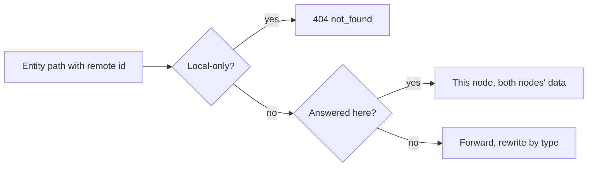
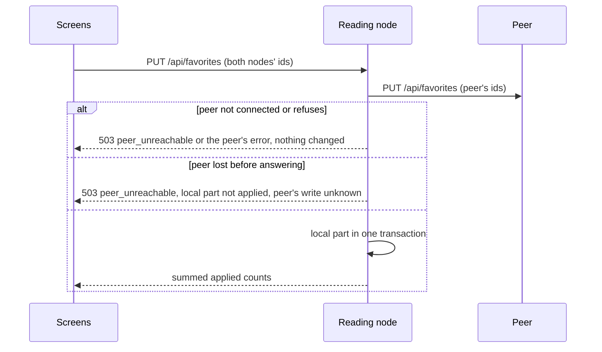
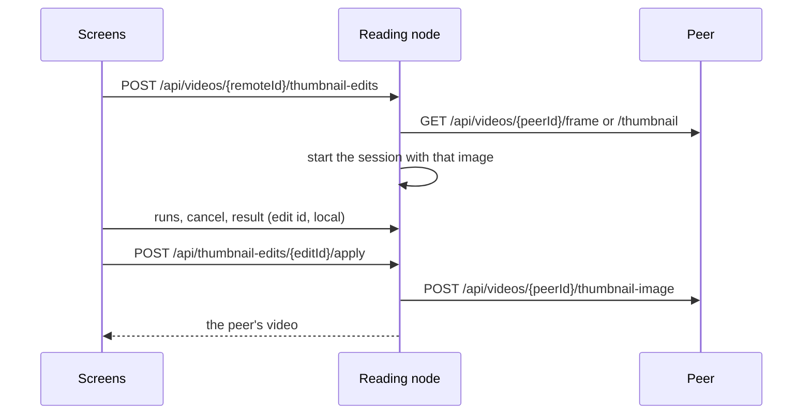

# Research: Peer parity by default

Inherited decisions: [peer-library.md](../../docs/design-docs/peer-library.md)
(remote ids, merged lists, vocabulary by name, forwarded edits),
[authentication.md](../../docs/design-docs/authentication.md#paired-vvmdm)
(the peer credential and its audience) and
[ARCHITECTURE.md](../../ARCHITECTURE.md#cross-cutting-invariants). This file
records only the decisions this feature adds.

## R-1: Entity operations are offered for remote ids unless named local-only

**Decision**: Every screen-API operation whose path starts with an entity
collection (`/api/videos/{id}`, `/api/groups/{id}`, `/api/tags/{id}`,
`/api/tag-kinds/{id}`, `/api/people/{id}`, `/api/organizations/{id}`,
`/api/face-appearances/{id}`, `/api/virtual-videos/{id}`) is forwarded for a
remote id, except the operations one Go table names as local-only with the
reason; the peer credential reaches exactly the forwarded entity operations
plus the listed non-entity operations (lists, operations over a selection,
favorites, watch history, `/api/events`, `/api/peer/*`).

The rule decides, for one request, who answers it.

| Option | New operation | Security boundary | Verdict |
| --- | --- | --- | --- |
| **Offered by default, local-only table with reasons, credential list derived from it** | Works for remote ids with no change | Still an allow-list; it is computed, not typed | Chosen |
| Allow-lists as today (`peerOperations`, `remoteVideoOperations`), plus a test that fails when an entity operation is in neither | Fails the check until a line is added | Unchanged | Rejected: every new operation still needs the individual work the parent Issue removes |
| A deny-list for the credential | Works | A forgotten route is reachable by a compromised reader | Rejected: scans, settings, the account and tokens must never depend on remembering to deny |

**Rationale**: The parent Issue's requirement 2 is met only when the default is
"offered", and acceptance 7 needs the local-only set to be explicit so a check
can tell a decision from an omission. Deriving the credential's list from the
same table keeps the two from drifting, which today's two hand-written tables
do.

Local-only operations and their reasons:

| Operation | Reason |
| --- | --- |
| `POST /api/videos/{id}/open` | Opens the file in this node's default app; out of scope |
| `POST /api/videos/{id}/probe`, `POST /api/videos/{id}/auto-tag` | Starts an analysis on the peer from here; out of scope |
| `POST /api/videos/{id}/thumbnail-edits`, `POST /api/videos/{id}/thumbnail-edits/image` | Answered here, not forwarded ([R-5](#r-5-thumbnail-edits-of-a-remote-video-run-on-the-reading-node)) |
| `GET /api/videos/{id}/related`, work-info fetches, person plugin fetches, vocabulary deletes and merges | Answered here from both nodes, as today |

Playlists and the activity log are not entity collections and stay with each
node, as the parent Issue's `対象外` says.

## R-2: The operation table is generated from openapi.yaml

**Decision**: `task generate` emits a Go table of every screen-API operation
(method, path pattern, the `$ref` of its JSON success response or that it
streams bytes, the `$ref` of its JSON request body, its path parameters other
than the entity id, and the integer `*Id`/`*Ids` fields of that body) into
`internal/httpapi/gen/`, and the remote boundary and the credential's list are
built from it at start.

| Option | Runtime cost | New dependency | Freshness | Verdict |
| --- | --- | --- | --- | --- |
| **A generated Go table under `task generate`** | None | None; the generator is Go in `scripts/generate` | `task generate-check` fails in CI when it is stale | Chosen |
| oapi-codegen's embedded spec (`GetSwagger`) read at start | Parses 400 KB of YAML at every start | `kin-openapi` in the binary | Always fresh | Rejected: a runtime dependency and start cost for a table that changes only with the schema |
| A hand-written table checked by a test against openapi.yaml | None | None | The test fails until the line is added | Rejected: that line is the individual work requirement 2 removes |

**Rationale**: The repository already regenerates clients from
`api/openapi.yaml` and refuses hand edits of the result, so a generated table
is where its contributors expect the schema to turn into code, and
`generate-check` already guards staleness.

## R-3: Answers are rewritten by response type and requests translated by declared ids

**Decision**: Rewriters are registered by response schema name
(`Video`, `VideoVersions`, `Person`, `FaceCandidateList`, …) and request
translators by request schema name or path parameter; one Go test fails when a
forwarded operation's JSON response has no rewriter, when its body has an
integer id field with no translator, or when a path parameter beyond the
entity id has none.

| Case | Translation |
| --- | --- |
| Video, group, smart folder, appearance, media-folder root, history entry ids | Offset form both ways |
| Tag, tag kind, person, organization ids | By name: a local id becomes the peer's same-named entity's id, created on the peer when the operation creates vocabulary (a face move's `targetId`), else `404` |
| A body naming this node's video with a remote path id | `400 mixed_nodes`, as a group with both nodes' videos |
| A JSON answer without ids (`Progress`) | Identity rewriter, registered under its name |

**Rationale**: Only the type says whether an `id` names a video or a tag
([peer-library.md, Remote ids](../../docs/design-docs/peer-library.md#remote-ids)),
and the generated table carries the type, so a new operation that returns
`Video` is rewritten with no new code. Ids in a request body cannot be
translated without knowing their entity, so the test names the one case where
a new operation still needs a line, instead of forwarding wrong ids.

## R-4: A remote video's progress, history and favorite live on the peer

**Decision**: `PUT /api/videos/{id}/progress` for a remote id is forwarded, a
remote `Video` keeps the peer's `progress` and `favorite`, `PUT /api/favorites`
splits its ids by node and writes the peer first, `GET /api/watch-history`
merges both nodes' pages newest first with one composite cursor, and
`PUT /api/favorites`, `GET /api/watch-history/dates`, `DELETE
/api/watch-history` and `DELETE /api/watch-history/{id}` reach the peer.

The sequence shows a favorite set from the reading node on a mixed selection.

| Option | Same from both nodes | Offline peer | Verdict |
| --- | --- | --- | --- |
| **Stored on the node holding the video; the reader forwards and merges** | Yes, by construction | The change fails visibly and nothing is saved | Chosen |
| Stored on the node that played, keyed by remote id | No; each node sees its own | Saved locally only | Rejected: requirement 5, and the edge case says a change must never stay on this node alone |
| Stored on both and reconciled | Yes, after reconciliation | Diverges until reconciled | Rejected: a replay queue needs its own conflict handling, as the vocabulary writes already rejected |

**Rationale**: Positions and favorites are keyed by the content key on the node
that owns the file ([ARCHITECTURE.md, User data survives a
rebuild](../../ARCHITECTURE.md#cross-cutting-invariants)), so the peer is the
only node that can store them without a table of remote entities. Writing the
peer first repeats the vocabulary rule: the common failure, an unreachable
peer, leaves nothing changed. The merged history page reuses the video list's
per-item cursors ([peer-library.md, Merged
lists](../../docs/design-docs/peer-library.md#merged-lists)) so the merge never
decodes the peer's cursor. Clearing the history clears both nodes, peer first,
because the screen shows one history; an entry's deletion goes to the node
holding it.

With the values on the peer, `played*` and `favorited*` sorts and
`favorite=true` filters are sent to the peer as they are, and a smart folder's
`favorite` rule is matched by the peer's own favorites instead of this node's
standing in for them; `PeerSort` and the favorites-only exceptions in the
merged lists and cards go.

## R-5: Thumbnail edits of a remote video run on the reading node

**Decision**: `POST /api/videos/{id}/thumbnail-edits` and `.../thumbnail-edits/image`
for a remote id are answered here: the session starts from the frame or
current thumbnail read from the peer (`GET /api/videos/{peerId}/frame`,
`.../thumbnail`), runs on this node's ComfyUI, and its apply uploads the result
through the forwarded `POST /api/videos/{peerId}/thumbnail-image`.

| Option | Where ComfyUI runs | Edit ids | Verdict |
| --- | --- | --- | --- |
| **On the reading node, from the peer's image, applied by the forwarded upload** | The owner's own setting | Local, as today | Chosen |
| Forward the session to the peer | The peer's ComfyUI | A second id space for `/api/thumbnail-edits/{editId}` strings | Rejected: runs an analysis on the peer from here, which the parent Issue leaves out, and `readiness` would need a video to answer for |

**Rationale**: This is the rule the work-info and person fetches already follow
(the plugin and its kept result are the reading node's; only what belongs to
the video goes to the peer), and the frame and thumbnail reads and the upload
are already forwarded, so the peer learns no new operation.

## R-6: Face edits of a remote person name people by name

**Decision**: `appearances/move`'s `targetId` and `face-candidates/{otherId}`
are translated to the peer's person by name (a remote id drops the offset; a
local id goes by its name, and a move creates the person on the peer when
missing, a candidate answers `404` when missing); `appearanceIds` and a
`similar-people` `appearanceId` drop the offset; `GET
/api/face-appearances/{id}/crop` is forwarded as media and `hasCrop` keeps the
peer's value.

| Option | Same-named person on both nodes | Verdict |
| --- | --- | --- |
| **By name, as every other vocabulary write to the peer** | The faces move to the peer's person of that name, which the screens show as the local one | Chosen |
| Refuse a local target for a remote person | The owner cannot move the peer's faces to a person they see on their screen | Rejected: acceptance 2 moves faces to another person, which on the screens is one person per name |

**Rationale**: The screens join people by name, so the only id a remote
person's page can hand back for a target is a local or offset one, and
translating it by name is what tags, people and organizations already do for
every forwarded edit.
