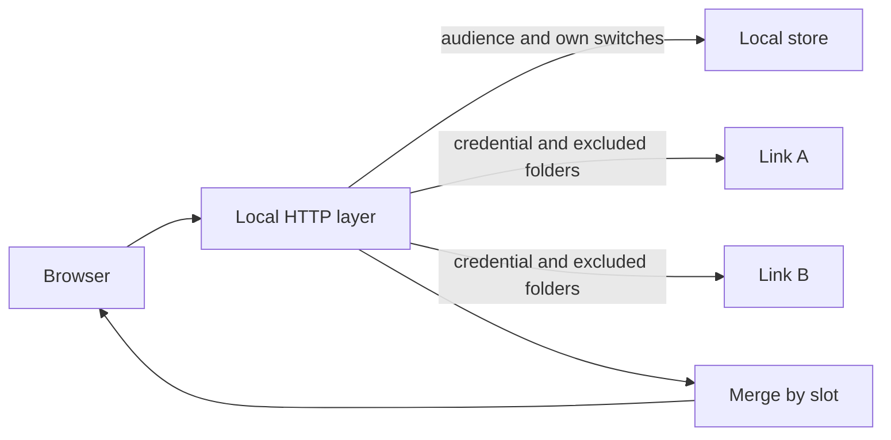
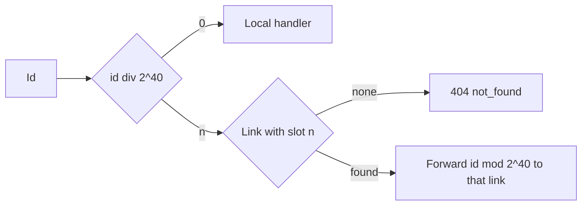
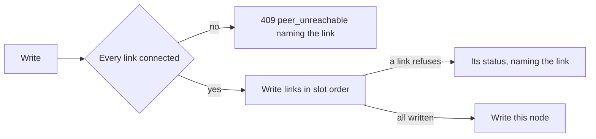
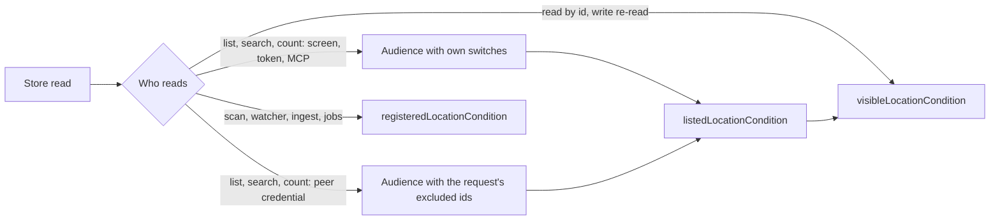
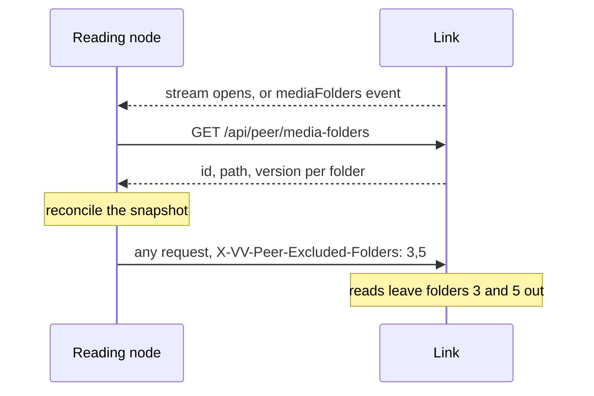
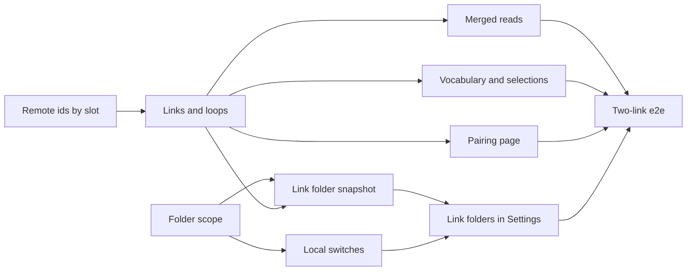

# Implementation Plan: Several read VVMDMs and media-folder switches

**Branch**: `feature/072-multi-peer-folder-switches` | **Parent Issue**: #1840

**Input**: The parent Issue. It is this feature's specification.

## Summary

A VVMDM reads up to eight other VVMDMs at once instead of one: each outgoing
**link** gets a slot, remote ids carry that slot in their offset, and every
merged read, vocabulary write and forwarded request that reaches "the peer"
today reaches each connected link. Every media folder, local or a link's,
gets an on/off **switch** that is applied by this node's reads only: a read
carries a folder scope beside its audience, the reading node sends the
switched-off folders of a link with every request to it, and the read node
never applies its own switches to a peer's request. Settings, `Media folders`
lists the local folders and one section per link with its folders, state and
switches; the Pairing page lists the links.

The diagram shows one list request answered by this node and two links.



## Technical Context

**Canonical definitions**: [ARCHITECTURE.md](../../ARCHITECTURE.md) for
layers, store roles, the viewer invariant and the remote-id invariant;
[peer-library.md](../../docs/design-docs/peer-library.md) for pairing, the
connection state, forwarding, merged lists, vocabulary by name and the peer
operation allow-list;
[authentication.md, Paired VVMDM](../../docs/design-docs/authentication.md#paired-vvmdm)
for the peer credential boundary;
[media-folder-usage.md](../../docs/design-docs/media-folder-usage.md) for the
`Media folders` rows; [catalog-organization.md](../../docs/design-docs/catalog-organization.md)
for registered locations and the folder index;
[api/openapi.yaml](../../api/openapi.yaml) for the screen API;
[testing.md](../../docs/design-docs/testing.md) and
[web-testing.md](../../docs/design-docs/web-testing.md) for test levels.

**Feature-specific context**:

| Item | Delta |
| --- | --- |
| Link count | At most 8 links per node; the grant stays at most one, as the Issue's `対象外` keeps ([Links and remote ids](#links-and-remote-ids)) |
| Id space | A remote id is the link's own id plus `slot × 2^40`; `2^53` admits slots up to 8191, far above the link limit ([Links and remote ids](#links-and-remote-ids)) |
| Reads | `domain.Audience` gains a folder scope; a new `listedLocationCondition` applies it on top of `visibleLocationCondition` for lists, searches and counts, while reads by id keep `visibleLocationCondition` and `registeredLocationCondition` stays unscoped, so scans, watching, ingest and jobs ignore the switches ([Folder switches on reads](#folder-switches-on-reads)) |
| Local tables naming remote entities | One: the snapshot of each link's media folders with their switches, which the Issue's edge cases need while a link is unreachable ([Remote folders on the reading node](#remote-folders-on-the-reading-node)) |
| Fan-out budget | A merged page sends one request per connected link, concurrently, under the existing 10 s response timeout; 8 links keep one page within that budget |
| External API and MCP | Their reads take the same scope as the screens, so a switched-off folder's videos leave `/api/v1` and `/mcp` too; no contract change |

## Constitution Check

*GATE: Must pass before Phase 0 research. Re-check after Phase 1 design.*

| Rule | Source | Verdict |
| --- | --- | --- |
| The domain decides, the store enforces | ARCHITECTURE.md | Slot allocation, the link limit, the same-node refusal, the folder scope's SQL-free rule and the snapshot reconciliation are `internal/domain` rules; `PeerStore` enforces the limit and the unique slot in its transaction |
| Store roles | ARCHITECTURE.md | `PeerStore` owns links, slots and the snapshot; `SettingsStore` owns the local switch; no role calls another's public methods |
| Events after commit | ARCHITECTURE.md | `domain.MediaFoldersChanged` is published after the switch's transaction commits; `PeerStateChanged` as today |
| Every read knows its viewer | ARCHITECTURE.md | Amended: the viewer is the audience plus a folder scope, and the zero value stays the guest with this node's switches ([Folder switches on reads](#folder-switches-on-reads)); the Go test on `security` is unchanged |
| Remote ids carry an offset | ARCHITECTURE.md | Amended: the offset is `slot × 2^40`, and the snapshot is the one local table naming remote entities, deleted with its link ([Links and remote ids](#links-and-remote-ids)) |
| Only a scan walks the media folders | ARCHITECTURE.md | A switch touches no filesystem; the snapshot is read from the link's API |
| Pages never call `fetch` | ARCHITECTURE.md, Web layer | `web/src/api/peer.ts` and `web/src/api/client.ts` are the only callers of the new operations |
| Generated files are not hand-edited | AGENTS.md | `api/openapi.yaml` changes, then `task generate` |
| Complexity 25 and no copies | AGENTS.md | The per-link loops reuse `Pairing`'s one-link functions over a slice; the merge takes a slice of sides instead of a copy per side count |
| Design system first | AGENTS.md, design-system.md | The switch rows, link sections and link list use registry components; `ui-design.md` decides the layout before the screen units |

No gate is at stake after Phase 1; `## Complexity Tracking` is left out.

## Links and remote ids

A node holds up to 8 links, each with a **slot** that fixes the offset of
that link's ids ([data-model.md, `peer_link`](data-model.md#peer_link),
[contracts/peer-links.md](contracts/peer-links.md)). The grant stays single.

The diagram shows how an id reaches its node.



| Decision | Rejected | Why |
| --- | --- | --- |
| A remote id is `own id + slot × 2^40`; `slot = id div 2^40` names the link, 0 the local node | An offset from a hash of the node id | Two links could collide, and the screens could not find the link from the id without a table |
| Same | A per-session map from ids to links | Ids live in URLs and bookmarks across restarts; `2^40 ≤ id < 2^53` keeps every id a safe integer, as today |
| Slots come from a counter in `settings` (`peer.next_slot`) and are never reused; the limit is on links, not slots | Reusing the lowest free slot | A bookmarked remote id would open another node's video of the same number after an unpair and a new pairing; 8191 slots outlast any node |
| Migration `00093` gives the existing link slot 1 | Renumbering | Its ids keep today's `2^40` offset, so open screens and bookmarks stay valid |
| At most 8 links; the ninth pairing answers `409` with reason `peer_limit`; a node already read answers `409 already_paired` | No limit | Each merged page fans out one request per link; 8 keeps a page inside one response timeout and both Settings sections readable |
| `GET /api/peer` answers `links[]`, each with its slot, node id, state, reason, version and fingerprint; unpair, address and certificate take the link's node id in the path | Keeping the single `link` and `state` with an index | The screens address a link by what identifies it, not by position |
| `app.Pairing` runs one connection loop per link, with the state, generation and stop function per link | One loop over every link | A failing link's retry delay would delay the others; requirement 11 |
| The `peer` event carries the whole `PeerState` on any link's or the grant's change | One event per link | The shell and the Pairing page render the whole state; one shape, one subscription |
| The peer's forwarded `video`, `group`, `smartFolder` and `mediaFolders` events carry that link's slot in their ids | Unchanged offset | Open screens refresh the right link's items |
| `web/src/lib/remoteId.ts` gains `remoteSlot(id)`, and `PeerProvider` maps slots to links; `RemoteItemMark` names the item's link | A `node` field on each item | No schema gains a remote field today; the id already says which link |
| Groups, `organize`, bundles and face edits refuse ids of two different nodes with `400 mixed_nodes`, two links included | Allowing two links | A group belongs to one node |

## Merged reads across links

Every read that merges "the local part and the peer's part" today merges the
local part and one part per connected link, in the request's order
([peer-library.md, Merged lists](../../docs/design-docs/peer-library.md#merged-lists)).

| Decision | Rejected | Why |
| --- | --- | --- |
| `MergedCursor` holds one cursor and done flag per slot under prefix `m2.`; an `m1.` cursor is refused as invalid, like any cursor of the wrong kind | Extending `m1.` with optional fields | A cursor from before the upgrade names a peer without saying which; refusing it restarts the list cleanly |
| `MergePages` takes a slice of sides and takes the smallest sort value, the local side first and then slot order on equal values | A pairwise merge repeated per link | A pairwise merge needs the full page of each intermediate result and loses the per-side cursors |
| The link parts of one page are requested concurrently; a link that is not `connected` is skipped without a request and stays skipped for that listing (one skipped flag per slot) | Sequential requests | A page would wait up to 10 s per link; requirement 11 |
| Vocabulary lists merge every node's entries by name with summed counts; a remote-only entry takes the offset of the first link that holds it, in slot order | An entry per link | Requirement 4: one name is one entity |
| Watch history, favorites, related videos, smart-folder items and cards, folder roots and `POST /api/work-info-fill-targets` follow the same rule: one request per connected link, merged by the existing sort | Leaving some lists single-link | Requirement 2 names every merged screen |
| `MergedRelatedCursor` holds the local side and one side per slot, written `local~slot:side~…`, and `MergeRelated` takes a slice of sides; the single-node form stays for a node without links, and the two-side `local~peer` form is refused as `ErrInvalidRelatedCursor` | Moving related videos onto `m2.` | The related order ranks by score, not by a list sort, so `MergePages` does not apply; a two-side cursor cannot say which link its peer side was |
| A selection operation splits its targets by slot, applies the local part, then one request per link, and sums `applied` with the ids no link changed in `unchanged` | A per-link result | The screens show one count and one list of leftovers today |

## Vocabulary writes across links

A rename, merge or deletion of a tag, person or organization writes every
link by name, then the local node, as today with one link
([peer-library.md, Vocabulary by name](../../docs/design-docs/peer-library.md#vocabulary-by-name)).

The diagram shows the order of one write.



| Decision | Rejected | Why |
| --- | --- | --- |
| The write first checks that every link is `connected` and answers `409 peer_unreachable` naming the first link in slot order that is not, with the link's name in `Error.peer` | Writing the connected links and skipping the rest | Requirement 12: nothing changes while a link is down, and the cause is named |
| A refusal by a link after earlier links were written answers that link's status with its name in `Error.peer`, and the earlier links stay written | Undoing the earlier links | A delete or merge has no inverse write; the common failure is caught by the check |
| `Error.peer` is a new optional field, the link's name | Only the message | The screens localize messages and need the name as data |

## Folder switches on reads

Each media folder has a switch; a switched-off folder's videos, groups and
folder tree leave every list, search, count and folder read of this node,
while scans, watching, ingest and jobs continue
([data-model.md, `media_folders`](data-model.md#media_folders),
[contracts/media-folder-switches.md](contracts/media-folder-switches.md)).

The diagram shows which condition a read takes.



| Decision | Rejected | Why |
| --- | --- | --- |
| `domain.Audience` becomes a value of a role (owner or guest) and a folder scope: this node's switches (the default, and the zero value with the guest role) or an explicit list of this node's folder ids to leave out | A new parameter on every store read | `Audience` already reaches every viewer-facing read (about 130 store sites); widening it changes signatures nowhere and keeps "the zero value is the guest" |
| Same | A context value read by the store | A read's inputs stay explicit, as `Audience` is today |
| A new `listedLocationCondition(alias, audience)` adds the scope to `visibleLocationCondition`; every list, search and folder read moves to it, and `visibleLocationCondition`, `registeredLocationCondition` and `libraryVideoCondition` stay unscoped | Adding the scope to `visibleLocationCondition` | `getVideo` and the store sites that re-read a video by id after a write go through `visibleVideoCondition`, so a scoped `visibleLocationCondition` would answer `404` for an open video and fail writes on a switched-off folder's videos; requirement 9 keeps scans, watching, ingest and analysis going |
| Every count the screens show (tags, kinds, people, organizations, folder index, group members, smart-folder cards, totals) takes the request's audience and the listed condition; the builders that take no audience and fix `domain.AudienceOwner` today (`taggedVideosSQL`, `listedCreditsCTE` and any other screen count found so) gain an audience parameter, while internal syncs such as `folderIndexLocations`, which builds the folder index, keep the unscoped owner and the index's reads apply the scope | Scoping only `visibleLocationCondition` | Those builders read `registeredVideoCondition` with a fixed owner audience, so they would keep counting a switched-off folder's videos |
| The watch history leaves out an entry whose content key has a video with a registered location and none under the listed condition; the unfiltered list joins `videos` for this, which `watchHistoryFilter` skips today | Leaving history unscoped | The history is a list the screens show; an entry of a removed video, with no registered location, stays as today |
| A read by id (`GET /api/videos/{id}`, its media and subtitles, a playlist's items) keeps `visibleLocationCondition` and answers `Video.folderOff: true` when no location of the video is under the listed condition | `404` as for a hidden video | The Issue's edge case: an open video or a playlist entry is not an error, it says the video is left out now |
| A switch may change during a scan | Refusing during a scan, as add, replace and delete do | A scan reads the registered folders, which a switch does not change |
| The `mediaFolders` event (an empty object) is sent to this node's session and token viewers after a switch commits, after a folder is added, replaced or deleted, and on a link's forwarded `mediaFolders`; open lists reload and Settings rereads | A `video` event per video | A folder holds thousands of videos; the screens reload lists on an all-folders notice already (`smartFolder`) |
| A peer-credential stream receives `mediaFolders` only when one of this node's own folders is added, replaced or deleted, never on a switch or a forwarded event | Sending it to every viewer | Two nodes that read each other would bounce a forwarded event without end, since an empty event has no ids for the `remoteIDs` check; a switch never changes what the read node answers a peer (requirement 10) |
| `VideoPage.emptyReason: all_folders_off` when the library is empty because every folder this node shows, local and of every link, is off; the library page says so and links owners to Settings | Reading `GET /api/media-folders` from the library page | That read is owner-only, and guests get the same empty library |
| The external API and MCP take the owner audience with own switches | Exempting them | Requirement 8 says every screen and search; a tool reading `/api/v1` sees what the owner sees |

## Remote folders on the reading node

The reading node keeps a snapshot of each link's media folders with the
owner's switches, sends the switched-off ids with every request to that link,
and the read node applies them instead of its own switches
([data-model.md, `peer_media_folders`](data-model.md#peer_media_folders),
[contracts/media-folder-switches.md](contracts/media-folder-switches.md)).

The diagram shows the snapshot's life.



| Decision | Rejected | Why |
| --- | --- | --- |
| `peer_media_folders` keeps each link's folders (`node_id`, `folder_id`, `path`, `version`, `enabled`) and is reconciled on each stream open and on the link's `mediaFolders` event; unpairing deletes the link's rows | No snapshot: read the link's folders when the screen opens | The Issue's first edge case shows an unreachable link's folders with their switches kept |
| Reconciling deletes a row whose id the link no longer lists and replaces a row whose `path` or `version` differs, which turns its switch on | Keying the switch by `folder_id` alone | The second edge case: a switch for a folder that was deleted or replaced must not apply to the folder now under that id |
| The switched-off ids go in `X-VV-Peer-Excluded-Folders` (comma-separated, the link's own ids), set by the Forwarder from the snapshot for that link | A query parameter on every merged list and forwarded operation | One header covers lists, counts, forwarded reads and events alike; the peer boundary already reads `X-VV-Peer-Audience` the same way |
| Same | Storing the reader's switches on the read node per grant | The read node has one grant, so one reader; a second copy of the state needs resynchronization on reconnect |
| The read node's boundary turns the header into the request's folder scope and never applies its own switches to a peer request | Applying both | Requirement 10: a switch is this node's view only |
| `GET /api/peer/media-folders` is a new peer-credential operation answering id, path and version, and `GET /api/media-folders` stays off the allow-list | Allowing `GET /api/media-folders` to the credential | The media-folder operations carry usage and edits the credential must not reach |
| Switching a link's folder answers the snapshot row and sends `mediaFolders` to this node's viewers; the link's own `mediaFolders` event refreshes the snapshot | Forwarding a switch to the link | Requirement 10 and the Issue's `対象外`: a switch never changes the link |

## Project Structure

### Documentation (this feature)

```text
specs/072-multi-peer-folder-switches/
├── plan.md
├── data-model.md                      # peer_link.slot, media_folders.enabled, peer_media_folders
├── quickstart.md                      # Three-node checks the automated tests do not cover
└── contracts/
    ├── peer-links.md                  # links[] in GET /api/peer, per-link operations, the limit
    └── media-folder-switches.md       # switches, the peer folder read, the header, the event
```

No `research.md`: every decision and its rejected alternatives fit in this
plan's tables. `ui-design.md` is written by the `design` stage.

### Source Code

**Affected boundaries**: `internal/domain` (remote ids by slot, link rules,
folder scope, snapshot reconciliation, merge over sides), `internal/store`
(`PeerStore` links and snapshot, `SettingsStore` switch, visibility and
counts, migrations `00093` to `00095`), `internal/app` (`Pairing` per link,
`MediaFolders`), `internal/peer` (forwarder per link, excluded header),
`internal/httpapi` (boundary, merges, vocabulary, folders, handlers,
events), `cmd/mdm` (wiring), `api/openapi.yaml`, `web/src/api/`,
`web/src/lib/remoteId.ts`, `web/src/shell/`, `web/src/settings/`,
`web/src/library/`, `web/src/player/`, `web/src/videoList/`, `web/e2e/`.

**New paths**: `internal/store/migrations/00093_peer_link_slots.sql`,
`internal/store/migrations/00094_media_folder_switches.sql`,
`internal/store/migrations/00095_peer_media_folders.sql`,
`docs/design-docs/media-folder-switches.md`, `web/e2e/peer-folders.e2e.ts`.

**Structure decision**: Follows the existing layout
([ARCHITECTURE.md](../../ARCHITECTURE.md#subsystem-map)). The switch
decisions go to a new `docs/design-docs/media-folder-switches.md`, linked from
the index, because [media-folder-usage.md](../../docs/design-docs/media-folder-usage.md)
is about the usage values; the link decisions amend
[peer-library.md](../../docs/design-docs/peer-library.md) in place.

## Implementation Work

The graph shows the units and what each waits for. The screen units also wait
for `ui-design.md`.



### Address a remote entity by its link's slot

**Scope**: `internal/domain/remote_id.go` turns `PeerIDOffset` into
`RemoteID(slot, id)`, `RemoteSlot(id)` and `FromRemoteID`; `peer_link.slot`
and the `peer.next_slot` counter in migration `00093`
([data-model.md, `peer_link`](data-model.md#peer_link)); `PeerStore` allocates
the slot; every caller of the old functions passes the one link's slot;
`web/src/lib/remoteId.ts` gains `remoteSlot`. Behaviour with one link is
unchanged.

**Dependencies**: None

**Acceptance**: Domain tests show `RemoteID` and `RemoteSlot` round-trip for
slots 1 and 8191 and that `IsRemoteID` is unchanged for slot 1. A migration
test on a database with one link shows slot 1 and the counter at 2. The
existing peer handler tests pass unchanged with the link in slot 1.
`web/src/lib/remoteId.test.ts` covers `remoteSlot` for local ids and slots 1
and 2.

### Read up to eight VVMDMs through independent links

**Scope**: `app.Pairing` holds a list of links with one connection loop,
state and generation each; `PeerStore` lists, adds (enforcing the limit and
the same-node refusal), updates and deletes links by node id; `GET /api/peer`
answers `links[]` and the per-link unpair, address and certificate
operations ([contracts/peer-links.md](contracts/peer-links.md)); the
Forwarder and `peerCall` take the link's slot; forwarded events carry the
slot; `PeerProvider` maps slots to links, `RemoteItemMark`, the shell notice
and the selection bar name the item's link. Amends
[peer-library.md](../../docs/design-docs/peer-library.md) and the remote-id
invariant in `ARCHITECTURE.md`.

**Dependencies**: Address a remote entity by its link's slot

**Acceptance**: `app` tests with a fake client show two links connecting
independently, one link's failure leaving the other `connected`, and the ninth
pairing refused with `peer_limit` and the same node with `already_paired`.
Handler tests show `GET /api/peer` with two links in slot order, unpairing one
by node id leaving the other, and a forwarded read with a slot-2 id reaching
the second fake peer with the id minus `2 × 2^40`. `PeerProvider` and
`RemoteItemMark` tests show the second link's name on a slot-2 id.

### Merge lists, history, related videos and smart folders across every link

**Scope**: `MergedCursor` `m2.`, `MergePages` over sides and
`MergedRelatedCursor` per slot
([Merged reads across links](#merged-reads-across-links)); the video,
library, folder, folder-root, group, smart-folder, watch-history and related
reads request every connected link concurrently and merge; smart-folder
cards sum each link's rule counts. Amends the merged-list section of
[peer-library.md](../../docs/design-docs/peer-library.md).

**Dependencies**: Read up to eight VVMDMs through independent links

**Acceptance**: Domain tests show a three-side merge in each sort with the
local item first on ties, a cursor continuing all three sides, an `m1.`
cursor refused, and a related list over three sides continuing by its
per-slot cursor with the two-side form refused. Handler tests with two fake
peers show a video page in merged
order with `total` summed, a page where one peer is not connected listing the
other without waiting, and the history list merged by `playedAt`. A
smart-folder card test shows counts summed over both peers.

### Apply vocabulary writes and selection operations to every link

**Scope**: Vocabulary lists merged by name over every link; rename, merge and
delete with the connected check, slot-order writes and `Error.peer`
([Vocabulary writes across links](#vocabulary-writes-across-links));
selection operations, favorites, `POST /api/collections/delete` and
`POST /api/work-info-fill-targets` split by slot; `mixed_nodes` across two
links.

**Dependencies**: Read up to eight VVMDMs through independent links

**Acceptance**: Handler tests with two fake peers show a tag list with one
entry for a name held by all three nodes and its count summed; a rename with
the second peer not connected answering `409 peer_unreachable` with that
peer's name in `peer` and no write reaching the first peer or the store; a
rename reaching both peers then the store; a selection tag edit applied on
both peers with `applied` summed; and a group creation over two links
answering `mixed_nodes`.

### Give every read a folder scope and each media folder a switch

**Scope**: `domain.Audience` with role and folder scope,
`media_folders.enabled` in migration `00094`, `listedLocationCondition`, the
lists, history and counts taking the scope, `Video.folderOff` on reads by id, and
`VideoPage.emptyReason` ([Folder switches on reads](#folder-switches-on-reads),
[data-model.md, `media_folders`](data-model.md#media_folders)). The switch is
written by `SettingsStore` and published as `MediaFoldersChanged`; no handler
or screen yet. Adds `docs/design-docs/media-folder-switches.md` and amends
the viewer invariant in `ARCHITECTURE.md`.

**Dependencies**: None

**Acceptance**: Store tests show that, with one folder off, the video list,
search, watch history, folder index, tag, person and organization counts and
smart-folder matches leave its videos out and count the rest, the video by id
answers with `folderOff`, an override edit of one of its videos succeeds, and
an ingest claim and a scan still see its locations; with an explicit excluded list and
the owner role, the switch is ignored and the listed ids are left out. A
migration test shows existing folders on. The openapi routing test passes
unchanged.

### Switch local media folders on and off in Settings

**Scope**: `PUT /api/media-folders/{id}/enabled`, the `mediaFolders` event,
the switch on each local row of Settings, `Media folders`, the library's
`all_folders_off` empty state, the video page's left-out notice and the
playlist item's mark ([contracts/media-folder-switches.md](contracts/media-folder-switches.md)).
Changes screens: the implementation owes a visual review against
`ui-design.md`.

**Dependencies**: Give every read a folder scope and each media folder a switch

**Acceptance**: A handler test shows the switch answering the folder with
`enabled: false` and one `mediaFolders` event, and a switch during a running
scan answering `200`. Page tests show a row's switch calling the operation,
the library empty state with the Settings link for an owner and without it for
a guest, and the video page notice on `folderOff`. The visual review is
recorded in the PR.

### Keep a snapshot of each link's media folders and send the switched-off ones

**Scope**: `GET /api/peer/media-folders` on the read node,
`peer_media_folders` in migration `00095` with its reconciliation on stream open and on the link's
`mediaFolders` event, `X-VV-Peer-Excluded-Folders` set by the Forwarder and
read by the boundary into the folder scope, and
`GET /api/peer/links/{nodeId}/media-folders` and
`PUT /api/peer/links/{nodeId}/media-folders/{folderId}/enabled` on the reading
node ([Remote folders on the reading node](#remote-folders-on-the-reading-node),
[data-model.md, `peer_media_folders`](data-model.md#peer_media_folders)).

**Dependencies**: Read up to eight VVMDMs through independent links; Give
every read a folder scope and each media folder a switch

**Acceptance**: Domain tests show reconciliation deleting a gone folder,
replacing a folder whose path changed with its switch on, and keeping an
unchanged off row. `app` tests show the snapshot refreshed when the stream
opens and on the event. Handler tests show a forwarded list carrying the
header with the off ids, the read node's boundary leaving those folders out
of its answer while its own switches stay unapplied, a peer-credential stream
receiving `mediaFolders` on an added folder but not on a switch or a forwarded
event, `GET /api/peer/media-folders`
refused to a session cookie, and the link folder list answering the snapshot
with the link's state while it is unreachable.

### Show each link's media folders with their switches in Settings

**Scope**: One section per link under the local folders in Settings,
`Media folders`: the link's name and state, its folders with their switches,
and no add, change, delete or rescan. Changes a screen: the implementation
owes a visual review against `ui-design.md`.

**Dependencies**: Keep a snapshot of each link's media folders and send the
switched-off ones; Switch local media folders on and off in Settings

**Acceptance**: Page tests show two link sections in slot order, an
unreachable link's section showing its state with its switches still usable,
a switch calling the link folder operation, and a `mediaFolders` event
rereading the sections. The visual review is recorded in the PR.

### List every link on the Pairing page

**Scope**: The Pairing page's "Read another VVMDM" section lists each link
with its state, address, certificate and removal, and keeps the pairing form
until 8 links exist, with `peer_limit` and `already_paired` shown as reasons.
Changes a screen: the implementation owes a visual review against
`ui-design.md`.

**Dependencies**: Read up to eight VVMDMs through independent links

**Acceptance**: Page tests show two links with their states, removal of one
leaving the other, the form hidden at 8 links, and the two refusal reasons
shown. The visual review is recorded in the PR.

### End-to-end checks with two read VVMDMs and folder switches

**Scope**: `web/e2e/peer-folders.e2e.ts` with a third node in
`web/e2e/nodes.ts`: pair two nodes, see both marks in the library, switch a
local and a remote folder off and on, stop one node and read the other
([quickstart.md](quickstart.md) covers the rest by hand).

**Dependencies**: Merge lists, history, related videos and smart folders
across every link; Apply vocabulary writes and selection operations to every
link; Show each link's media folders with their switches in Settings; List
every link on the Pairing page

**Acceptance**: The spec passes in the manual CI run of `Browser E2E` on the
feature branch: acceptance 1, 4, 5 and 7 of the parent Issue, each as one
test, with the stopped node's section reading as not connected. Real servers
are needed because the connection loss and the second pairing are what the
spec proves.
