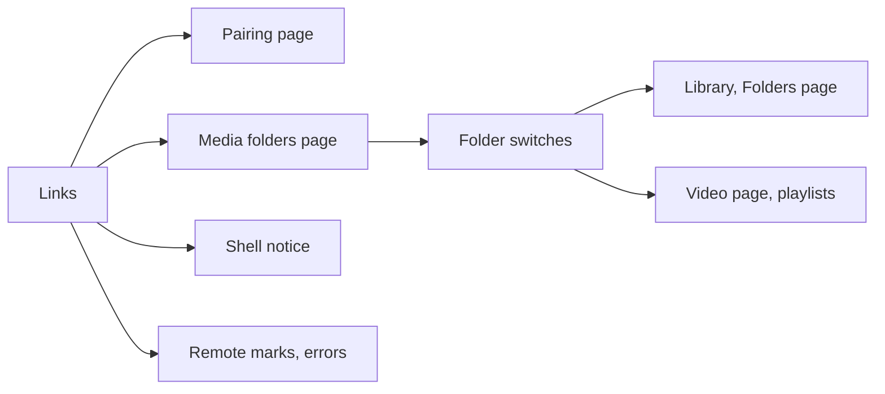
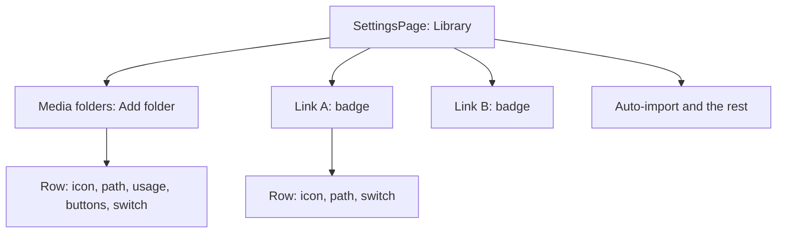
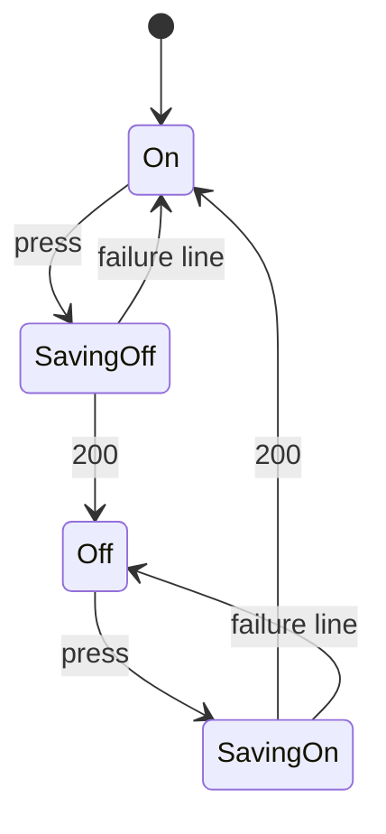
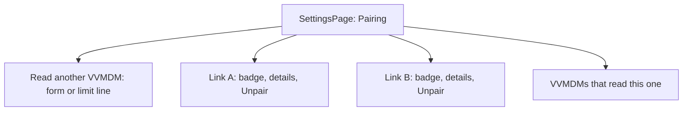
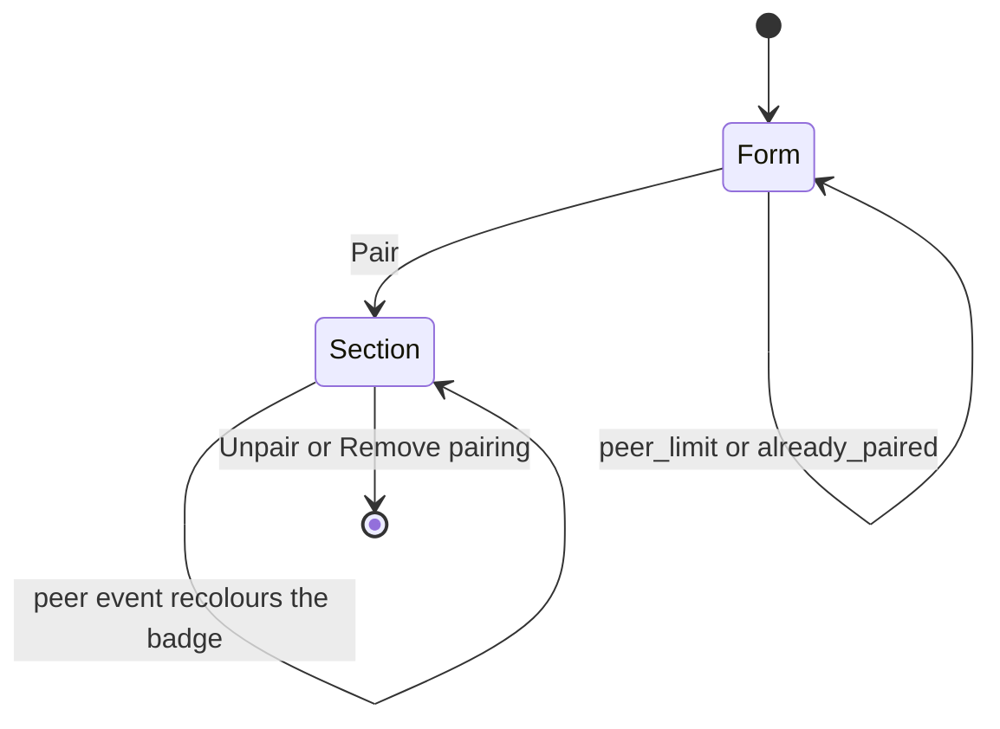

# UI design: Several read VVMDMs and media-folder switches

Sources: [plan.md](plan.md) and its contracts
([media-folder-switches.md](contracts/media-folder-switches.md),
[peer-links.md](contracts/peer-links.md));
[design-system.md](../../docs/design-docs/design-system.md) and its rules
([patterns.md](../../web/registry/rules/patterns.md),
[components.md](../../web/registry/rules/components.md),
[foundations.md](../../web/registry/rules/foundations.md));
[peer-library.md, The screens](../../docs/design-docs/peer-library.md#the-screens)
for the one-link screens this widens;
[media-folder-usage.md](../../docs/design-docs/media-folder-usage.md) for the
usage line a local row keeps; the current screens in
`web/src/settings/MediaFoldersSection.tsx`, `web/src/settings/PairingSection*.tsx`,
`web/src/shell/PeerNotice.tsx`, `web/src/videoList/RemoteItemMark.tsx` and
`web/src/player/VideoHeader.tsx`; the screen text in
[web/src/i18n/en.ts](../../web/src/i18n/en.ts) (`settings.mediaFolders`,
`settings.pairing`, `shell.peer`, `list.card.remote`, `errors`).

The diagram shows the screens this design covers and what each one reads.

A link's state reaches the Pairing page, the Media folders page and the shell
notice; a folder switch leaves its videos out of the lists and marks them where
they are opened by id.

## Why this shape

Settings, `Library`, `Media folders` becomes one page of folder sections: the
local section it has today, then one `PageSection` per link in slot order,
titled with the link's name. The owner reads where every folder is from the
section headings alone, and the switch sits at the end of every folder row,
local or a link's, in the column where every other setting of the page keeps
its control (`Auto-import` is the next row of the page). A link's state is one
`Badge` in its section header, so a state change recolours one word and moves
no row. The Pairing page takes the same shape: one section per link, the same
badge, the details a link has today, so a name and a state read the same on
both pages.

Rejected:

| Alternative | Why not |
| --- | --- |
| One section with the local folders and every link's folders as rows under group headings (`GroupedList`) | A settings page is `PageSection`s ([patterns.md, Settings page](../../web/registry/rules/patterns.md#settings-page)); headings inside a card would make the link's name smaller than the path it labels |
| The switch at the row's start, before the folder icon | It would sit in no column with the page's other switches, and an off row would start with a dim control instead of its dim path |
| A link's state as a row of the section, with the detail the Pairing page gives | The detail's length differs per state, so the folder rows below would move when a link drops; the shell notice already carries the remedy (`Open Pairing`) on this page |
| On the Pairing page, every link as a row of the `Read another VVMDM` section with an expand button | A link has an address field, a certificate alert and a removal, which are rows, not a line; `CardListItem` with members is for records read, not edited |
| A colour or a number per link in the remote mark | The palette's status colours mean status, and eight colours are not learnt; the name is what identifies a VVMDM on the Pairing page, so the mark keeps today's icon and names the link in its tooltip, screen-reader text, count line and band |

## Words

New and changed text. Unchanged text (the local rows' labels, the usage line,
the add, change, rescan and remove flows, the pairing form's fields and the
code section) stays as `en.ts` holds it.

| Place | Text | Notes |
| --- | --- | --- |
| Local row, switch label | `Show videos from {path}` | The switch's `aria-label`; `path` is the folder's path |
| Local row, state word | `On` / `Off` | Before the track, `text-xs` `muted-foreground`, in the `Label` that holds both |
| Local row, failure | `Couldn't switch the folder: {reason}` | Under the row, as `changedElsewhere` is drawn today |
| Local section, description | `Folders on the server where VVMDM looks for videos. Switch a folder off to leave its videos out of this library; scanning and auto-import go on. After adding or changing a folder, start a scan with “Scan library” on the Scan page.` | Replaces today's description |
| Link section, title | `{name}` | The link's name, as `GET /api/peer` gives it |
| Link section, description | `Its media folders, as it lists them. A switch here changes only what this VVMDM shows; {name} is unchanged.` | |
| Link section, badge | `Connected` / `Not connected` / `Access removed` | `success` with `Link`; `warning` with `Unplug`; `warning` with `Unlink` |
| Link section, loading | `Loading the folders on {name}` | The skeleton's label |
| Link section, load failed | `Couldn't load the folders on {name}: {reason}` | `ErrorState` with `Retry` |
| Link section, empty | `No media folders on {name}` / `Folders it adds show here while it is connected.` | `EmptyState` without action |
| Link row, switch label | `Show videos from {path} on {name}` | |
| Link row, failure | `Couldn't switch the folder: {reason}` | Same text as a local row |
| Library, every folder off | `Every media folder is off` / `Switch a folder on in Settings to see its videos.` / `Open Media folders` | `EmptyState`, owner; the action links to `/settings/library` |
| Folders page, no roots | `No folders to show` / `Add a media folder in Settings, or switch one on, and scan to see it here.` / `Open Settings` | Replaces `noMediaFolders`, whose title is wrong once a folder exists but is off |
| Video page, band | `Not shown in the library` | `FolderOff` icon; `title` and screen-reader text `Its media folder is switched off, so it isn't listed. Playing it is fine.` |
| Playlist row, mark | `Folder off` / `Folder off on {name}` | `FolderOff` icon, `text-xs` `muted-foreground`, under the title; the second form for a link's video |
| Pairing, limit | `This VVMDM reads 8 VVMDMs, the most it can. Unpair one to read another.` | Replaces the form at 8 links |
| Pairing, `peer_limit` | `This VVMDM already reads 8 VVMDMs, the most it can. Unpair one first.` | `FailureAlert` under the form |
| Pairing, `already_paired` | `This VVMDM already reads the VVMDM at this address, or another VVMDM already reads it. Remove that pairing on its Pairing page first.` | Replaces today's `alreadyPaired` and `errors.reason.already_paired` |
| Pairing, link section title | `{name}` | |
| Pairing, link section badge | As the Media folders badge | The same three words and tones |
| Shell notice, several links down | `{n} VVMDMs aren't connected` / `Their videos, groups and smart folders are hidden until they answer.` | `n ≥ 2`; one link keeps today's titles |
| Remote mark, guest | `On another VVMDM` / `Another VVMDM` | Replaces `On the other VVMDM` / `Other VVMDM`, since there may be several |
| Errors, `peer_unreachable` with `peer` | `Couldn't reach {name}` | Today's `Couldn't reach the other VVMDM` stays for an answer without `peer` |
| Errors, a link's refusal with `peer` | `On {name}: {message}` | `message` is the reason's own text |
| Errors, `mixed_nodes` | `Videos and groups of different VVMDMs can't be organized together. Select those of one VVMDM.` | Replaces `of both VVMDMs` |

## Media folders page

Settings, `Library`, in this order: the local `Media folders` section, one
section per link in slot order, then the page's other sections (`Auto-import`
and the rest) as today. The link sections exist while `GET /api/peer` lists
links; with none the page is unchanged.

The diagram shows the sections and what each row holds.

### Local rows

Today's row, with the switch added at its end:

| Part | Content | Type |
| --- | --- | --- |
| Icon | `Folder` | `muted-foreground`; the off row's icon stays `Folder`, dimmed with the path |
| Label and path | `Current location`, the path | `text-xs` muted, `code` `text-sm`; an off row's path is `muted-foreground` |
| Usage | The usage line as today | Unchanged |
| Buttons | `Change`, `Force rescan`, `Remove` | Unchanged, before the switch |
| Switch | `On` or `Off` and the `Switch` | The last element of the row, in a fixed-width column (`w-16`) so every switch of the page lines up |

- The switch acts at once and keeps today's optimistic form
  (`useSwitchSave`): the track moves on press, is `aria-disabled` until the
  answer, and springs back with the failure line when the save fails.
- A switch is never locked by a running scan: while `rowsLockedWhileScanning`
  shows and the three buttons are disabled, the switch stays usable
  ([plan.md, Folder switches on reads](plan.md#folder-switches-on-reads)).
- An off row dims its icon and path only; the usage line, the buttons and the
  switch keep their colour, so the row still reads as a registered folder with
  its disk values, and the `Off` word plus the dim path tell it from an on row
  at a glance.
- On a `mediaFolders` event the section rereads and replaces the rows in
  place: no skeleton, no empty state in between, the rows keep their order by
  id.

### Link sections

One `PageSection` per link, titled with the link's name, the description from
[Words](#words), and the badge in the header's `actions` slot, where a link
section has no button. Its rows:

| Part | Content | Type |
| --- | --- | --- |
| Icon | `Folder` | As a local row |
| Path | The folder's path on the link | `code` `text-sm`; one line that breaks anywhere; no `Current location` label and no usage line, since the link reports neither |
| Switch | `On` or `Off` and the `Switch` | The last element, in the same column as the local rows |

- The rows are in the link's id order, as the snapshot answers them, with no
  add, change, rescan or remove: the row has no button, and no disabled
  button stands in for one (Q-5: a control that can never act has no value
  here and would read as a locked one).
- A switch on a link's folder changes this node only; nothing is sent to the
  link, so the row never shows a "waiting for {name}" state. While the link
  is `Not connected` or `Access removed`, its switches stay usable and keep
  the optimistic form.
- The section is drawn from the snapshot, so a link that is not connected
  shows the folders it had and their switches. The badge is the only thing
  that changes with the connection; the rows, the description and the
  heading do not move.
- A link's own `mediaFolders` event reaches this node as a `mediaFolders`
  event and the section rereads in place, as the local section does: a
  folder the link removed leaves the list, a replaced one shows its new path
  with the switch on.
- The badge's icon and word follow the Pairing page's state words shortened to
  one line; the reason (`network`, `certificate`) is not told apart here. The
  remedy is on the Pairing page, which the shell notice links to from this
  page.

### States

| State | Local section | Link section |
| --- | --- | --- |
| Loading | Two `Skeleton` rows, as today | Two `Skeleton` rows under the heading and badge |
| Load failed | `ErrorState` with `Retry`, as today | `ErrorState` with `Retry` for that section only; the others stay |
| No folders | `EmptyState` `No media folders yet`, as today | `EmptyState` `No media folders on {name}` |
| Folders | Rows | Rows |
| A switch saving | That row's switch `aria-disabled`, the track at the new value | The same |
| A switch failed | The track back, the failure line under the row | The same |
| Link not connected | — | Badge `Not connected`, rows unchanged |
| Link revoked | — | Badge `Access removed`, rows unchanged |
| Link unpaired (`peer` event) | — | The section leaves the page; the sections below move up |
| `mediaFolders` event | Rows replaced in place | Rows replaced in place |

The diagram shows one row's switch.

## Library, folders page, video page and playlists

| Screen | What the viewer sees |
| --- | --- |
| Library, every folder off (`emptyReason: all_folders_off`, no search or filter) | The owner sees `Every media folder is off` with `Open Media folders`, in the body slot where `No videos yet` stands today; a guest keeps `No videos are public` with `Sign in`, since signing in is their way to the place to switch a folder on |
| Library, every folder off with a search or filter | `No matches`, as today |
| Folders page, no roots | The owner sees `No folders to show` with `Open Settings`, whether no folder exists or every one is off; a guest keeps `No videos are public` |
| Video page, `folderOff` | A band item before the breadcrumb, where `Virtual video` stands: `FolderOff` `size-4` and `Not shown in the library` in `text-sm` `muted-foreground`; for the owner it is a link to `/settings/library`, for a guest plain text. The breadcrumb keeps the folder's path as plain text, not links, since the Folders page leaves a switched-off folder out and a link would open its not-found state. The page plays, saves progress and offers every action as before; no `Alert`, no overlay |
| Playlist page row and the player's playlist panel, an item with `folderOff` | The row keeps its thumbnail, title and play; under the title, as the unplayable line is drawn (`ItemTitleExtras`), `FolderOff` `size-3` and `Folder off` in `text-xs` `muted-foreground`. A link's video reads `Folder off on {name}`, so the row still names the VVMDM that holds it. Pressing it plays as usual |
| Group and smart-folder pages | Counts and members leave the off folders' videos out; nothing marks the absence, as a hidden video is unmarked today |

## Pairing page

Settings, `Pairing`, in this order: `Read another VVMDM`, one section per
link in slot order, `VVMDMs that read this one`.

The diagram shows the sections with two links.

- `Read another VVMDM` keeps its description and holds the pairing form while
  fewer than 8 links exist. At 8 the form gives way to one row of `text-sm`
  `muted-foreground` text, the limit line from [Words](#words). The form's
  refusals (`peer_limit`, `already_paired`) are a `FailureAlert` under the
  fields, as every other refusal is today, with the field values kept.
- A link section is titled with the link's name and carries the badge in its
  header. Its rows are what `LinkDetails` draws today, in the same order:
  the state's detail line (`networkDetail`, `certificateDetail`,
  `untrustedDetail` or `revokedDetail`) only while the link is not connected,
  the `FactList` with `Version`, the `Address` row, the certificate alert
  while one waits, and `Unpair` (or `Remove pairing` when revoked) as the last
  row. The `Name` fact is dropped: the heading is the name.
- A new pairing adds its section after the last one and clears the form;
  unpairing removes the section and, when 8 were reached, brings the form back.
- The heading in `text-lg font-semibold` against the `text-sm` detail and the
  `font-mono` fingerprint is what tells the links apart down the page; the
  badge is the only coloured word in a header.

### States

| State | `Read another VVMDM` | Link sections |
| --- | --- | --- |
| Loading | The skeleton, as today | Not drawn |
| Load failed | `ErrorState` with `Retry`, as today | Not drawn |
| No link | The form | None |
| 1 to 7 links | The form | One per link |
| 8 links | The limit line | Eight |
| Pairing refused | The form with the `FailureAlert` | Unchanged |
| A link's certificate waits | Unchanged | That section shows the fingerprint alert with `Trust and reconnect` |
| A link revoked | Unchanged | Badge `Access removed`, the detail line, `Remove pairing` |

The diagram shows what moves a link section.

## Shell notice and remote marks

- The shell's notice ([patterns.md, Shared rules](../../web/registry/rules/patterns.md#shared-rules))
  reads the links. One link not connected: today's title and body for its
  reason, naming the link. Two or more: `{n} VVMDMs aren't connected` with
  the body from [Words](#words). The guest text is unchanged. The notice
  stays off the Pairing page, which shows every state in full.
- `RemoteMark` keeps today's icon and sizes. `ItemRemoteMark` names the
  item's link, found from the id's slot: the tooltip and the screen-reader
  text read `On {name}`, the collection pages' count line and the video
  page's band show that link's name. A guest sees `On another VVMDM`.
- The selection bar's `mixed_nodes` text covers two links with the changed
  wording; nothing else on the bar changes.

## Errors naming a link

A refusal that carries `Error.peer` shows the link's name in the place the
error shows today: `Couldn't reach {name}` for `peer_unreachable`, and
`On {name}: {message}` for a link's own refusal, in the tag, person and
organization dialogs' `Alert` and in the selection bar's failure toast. An
answer without `peer` keeps today's text.

## Responsive behaviour

The Settings pages keep `SettingsPage`'s layout
([patterns.md, Page list](../../web/registry/rules/patterns.md#page-list));
the rows are what this feature adds.

| Width | Media folders page | Pairing page |
| --- | --- | --- |
| 360px | The page alone under the back link. A local row stacks: path block, then the usage line, then one line of `Change`, `Force rescan`, `Remove` and the switch at its end, wrapping to a second line when the names do not fit, the switch last. A link row is one line: icon, path breaking anywhere, the switch at the end. A section heading and its badge share one line; a long name truncates before the badge | The page alone. A link section's address input spans the width; the fingerprint alert wraps its fingerprint |
| 768px | The nav column at the left, the page `max-w-4xl`. A local row is one line when the path is short: path block left, buttons and switch right; the usage line stays under the path. The switch column lines up through the local section, every link section and the `Auto-import` row below | The nav and the page; the address input `sm:max-w-sm` as today |
| 1280px | The same, centred; long paths wrap inside the path block and never push the switch off its column | The same |

## Review criteria

1. At 1280px with two links, eight local folders and twenty folders on each
   link, the eye finds a folder's origin from the section heading above it
   without reading any row, and the headings (`text-lg font-semibold`) are
   the only text heavier than the paths.
2. The switches form one column at the right edge of every section, the
   local section, each link section and the `Auto-import` row below, and the
   thumb's position reads `On` or `Off` at arm's length without the word.
3. An off row is told from an on row at a glance by its dim path and its
   `Off` word, while its usage line (local) and its switch keep full colour.
4. Dropping a link (stop it) changes one badge from `Connected` to
   `Not connected` and moves no row, heading or description on the Media
   folders page; the switches in that section still move on press.
5. A switch is reached first: it is the last element of its row, the same
   distance from the right edge in every row, and `Remove` still opens its
   confirmation while the switch never does.
6. On the Pairing page with three links, the three names read as three
   equal headings with their badges; the form stays at the top above them,
   and at 8 links the limit line takes its place at the same height.
7. At 360px a local row wraps to at most three lines of controls and the
   switch is the last control on the last line; a link row is one line with
   the path breaking before the switch.
8. The library with every folder off shows `Every media folder is off` with
   one `Open Media folders` button for the owner, in the place `No videos
   yet` takes, and the video page of one of those videos plays with the
   `Not shown in the library` band before its breadcrumb and no other
   notice; the breadcrumb shows the folder's path without links.
